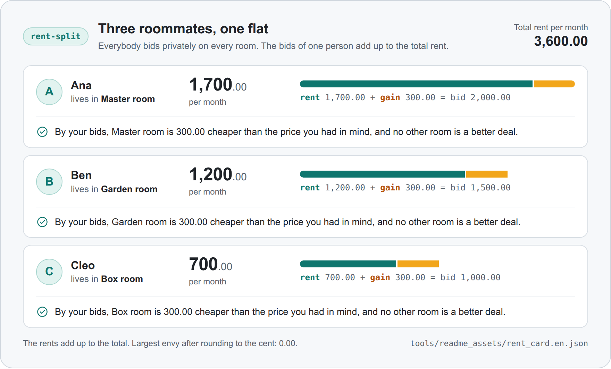
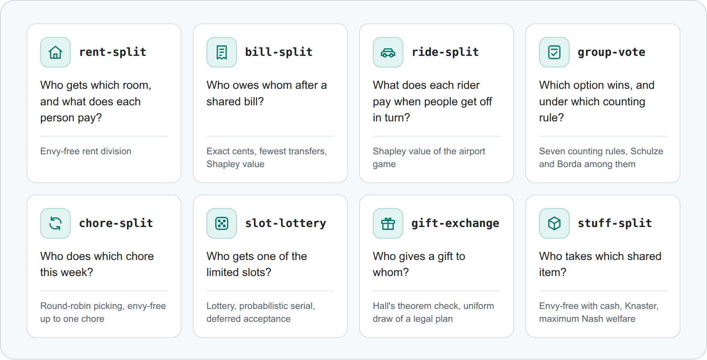
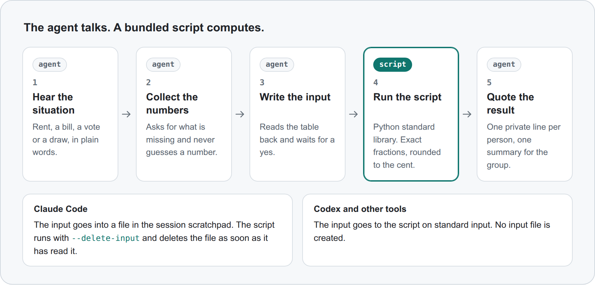

<p align="center"><b>English</b> · <a href="README_zh.md">简体中文</a></p>

<p align="center"><picture><source media="(prefers-color-scheme: dark)" srcset="docs/assets/banner-dark.png"><source media="(prefers-color-scheme: light)" srcset="docs/assets/banner-light.png"></picture></p>

<p align="center"><b>Agent skills that settle everyday splits with textbook fair-division mechanisms: rent, bills, chores, gifts. Every number comes from a tested script, and anyone can rerun the script on the same input and get the same output.</b></p>

<p align="center">
  <a href="https://github.com/YYYJH1/fair-and-square-skills/actions/workflows/ci.yml"></a>
  <a href="#install"></a>
  <a href="LICENSE"></a>
  <a href="https://agentskills.io/specification"></a>
</p>

## Install

In a Claude Code session:

```
/plugin marketplace add YYYJH1/fair-and-square-skills
/plugin install fair-and-square@fair-and-square
```

Other tools that read Agent Skills, such as Codex, only need the skill folders copied. The details are in [docs/install.md](docs/install.md).

## Try it

Ask in plain words, in English or Chinese:

> Three of us share a flat with three rooms for 3,600 a month. Help us decide who takes which room and what each person pays.

> 我们三个人合租三居室，一个月一共 3600。帮我们分一下谁住哪间、各付多少。

The agent picks `rent-split`, asks each person for private bids and runs the bundled script. The organizer sees all three lines below. Each person receives only their own.

<p align="center"><picture><source media="(prefers-color-scheme: dark)" srcset="docs/assets/result-card-en-dark.png"><source media="(prefers-color-scheme: light)" srcset="docs/assets/result-card-en-light.png"></picture></p>

<p align="center"><sub>Output of <code>rent_split.py</code> for the three roommates, drawn as a card. The input is <a href="tools/readme_assets/rent_card.en.json">tools/readme_assets/rent_card.en.json</a>.</sub></p>

## Skills

<p align="center"><picture><source media="(prefers-color-scheme: dark)" srcset="docs/assets/skills-en-dark.png"><source media="(prefers-color-scheme: light)" srcset="docs/assets/skills-en-light.png"></picture></p>

| Skill | What it settles | Shortest use |
|---|---|---|
| `rent-split` | Who gets which room and what each person pays | "Split the rent in our flat." |
| `bill-split` | Shared bills, trip expenses, group orders with coupons | "Split this dinner bill." |
| `ride-split` | Carpool or taxi fares by drop-off order | "Split our taxi fare." |
| `group-vote` | Choosing a place or an option by vote | "Help us vote on where to go." |
| `chore-split` | Who does which chore | "Make a fair chore rota." |
| `slot-lottery` | Limited slots, shifts or tickets | "Draw 3 tickets among 8 people." |
| `gift-exchange` | Who gives a gift to whom | "Draw our Secret Santa." |
| `stuff-split` | Who takes which shared item when a household breaks up | "Divide our stuff before we move out." |

`rent-split`, `bill-split` and `ride-split` can also audit a split the group already uses, and say who is losing under it.

## How it works

<p align="center"><picture><source media="(prefers-color-scheme: dark)" srcset="docs/assets/how-it-works-en-dark.png"><source media="(prefers-color-scheme: light)" srcset="docs/assets/how-it-works-en-light.png"></picture></p>

The agent does the talking: it asks the questions and quotes the result word for word. The script does the numbers: it checks the input and computes with exact fractions. Each person checks their own line against their own numbers. The details are in [docs/how-it-works.md](docs/how-it-works.md).

## Learn more

- [docs/THEORY.md](docs/THEORY.md): what each skill guarantees, the tests that check it, the references, and two figures of the mechanisms
- [docs/how-it-works.md](docs/how-it-works.md): who does what, how the private input is handled, the rules every script follows, and how to run a script without an agent
- [docs/install.md](docs/install.md): every way to install, and how to update
- [CHANGELOG.md](CHANGELOG.md): what changed in each version
- [CONTRIBUTING.md](CONTRIBUTING.md): how to set up the repository, run the checks and add a skill

## Acknowledgements

These projects inspired this one.

- [Spliddit](http://www.spliddit.org/) by Jonathan Goldman and Ariel Procaccia: fair-division algorithms for rent, rides, goods, chores and credit
- The `fair-split` skill in [pm-claude-skills](https://github.com/mohitagw15856/pm-claude-skills): each person verifies their own share, and Knaster's sealed bids
- [spliit](https://github.com/spliit-app/spliit): exact cents, remainder rotation and invariant tests
- [skills-for-humanity](https://github.com/human-avatar/skills-for-humanity): confirming the situation before computing, and "when not to use" sections
- [sperner](https://github.com/OussamaMesbah/sperner): wording by the model, every number by the tool
- [fairpyx](https://github.com/ariel-research/fairpyx): envy matrices and per-person explanations
- [secret-santa](https://github.com/jolicode/secret-santa) by JoliCode: feasibility checks for draws with exclusions
- [pref_voting](https://github.com/voting-tools/pref_voting): several voting rules side by side
- [mcd-coupon-strategist](https://github.com/Syenzzz/mcd-coupon-strategist): group-order discount traps, and amounts only from a calculator
- `skill-creator` in [anthropics/skills](https://github.com/anthropics/skills): skill descriptions that trigger, and evaluating whether they do
- [mattpocock/skills](https://github.com/mattpocock/skills): conventions for writing and packaging skills

## License

MIT. See [LICENSE](LICENSE).
