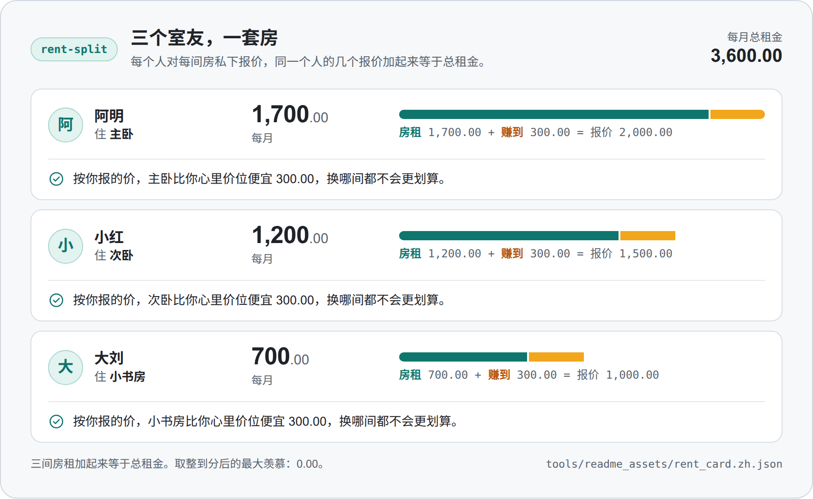
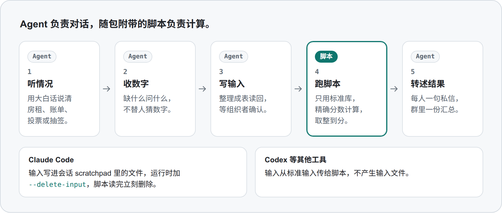

<p align="center"><a href="README.md">English</a> · <b>简体中文</b></p>

<p align="center"><picture><source media="(prefers-color-scheme: dark)" srcset="docs/assets/banner-dark.png"><source media="(prefers-color-scheme: light)" srcset="docs/assets/banner-light.png"></picture></p>

<p align="center"><b>用教科书里的公平分配机制解决日常分摊的 Agent 技能：房租、账单、家务、礼物。每个数字都来自带测试的脚本，谁拿同样的输入重跑一遍，得到的输出都一样。</b></p>

<p align="center">
  <a href="https://github.com/YYYJH1/fair-and-square-skills/actions/workflows/ci.yml"></a>
  <a href="#安装"></a>
  <a href="LICENSE"></a>
  <a href="https://agentskills.io/specification"></a>
</p>

## 安装

在 Claude Code 会话里：

```
/plugin marketplace add YYYJH1/fair-and-square-skills
/plugin install fair-and-square@fair-and-square
```

其他读取 Agent Skills 的工具（如 Codex）只需复制技能文件夹。细节见 [docs/install_zh.md](docs/install_zh.md)。

## 试一试

用大白话提需求，中文英文都行：

> 我们三个人合租三居室，一个月一共 3600。帮我们分一下谁住哪间、各付多少。

> Three of us share a flat with three rooms for 3,600 a month. Help us decide who takes which room and what each person pays.

Agent 会选用 `rent-split`，向每个人私下收报价，再运行随包附带的脚本。组织者能看到下面全部三句。每个人只收到属于自己的那一句。

<p align="center"><picture><source media="(prefers-color-scheme: dark)" srcset="docs/assets/result-card-zh-dark.png"><source media="(prefers-color-scheme: light)" srcset="docs/assets/result-card-zh-light.png"></picture></p>

<p align="center"><sub>三个室友的 <code>rent_split.py</code> 输出，画成了卡片。输入是 <a href="tools/readme_assets/rent_card.zh.json">tools/readme_assets/rent_card.zh.json</a>。</sub></p>

## 技能

<p align="center"><picture><source media="(prefers-color-scheme: dark)" srcset="docs/assets/skills-zh-dark.png"><source media="(prefers-color-scheme: light)" srcset="docs/assets/skills-zh-light.png"></picture></p>

| 技能 | 解决什么 | 最短用法 |
|---|---|---|
| `rent-split` | 谁住哪间房、各付多少 | 「帮我们分一下房租。」 |
| `bill-split` | 聚餐、旅行账单，以及带优惠券的拼单 | 「这顿饭怎么分钱。」 |
| `ride-split` | 按下车先后分拼车或打车费 | 「打车费怎么分。」 |
| `group-vote` | 用投票选去处或选项 | 「团建投票选去哪。」 |
| `chore-split` | 谁做哪件家务 | 「排一个公平的值日表。」 |
| `slot-lottery` | 名额、班次、票数有限时怎么分 | 「8 个人抢 3 张票，公平抽签。」 |
| `gift-exchange` | 交换礼物谁送给谁 | 「抽一下我们的交换礼物。」 |
| `stuff-split` | 毕业、搬家、散伙时共同的东西谁拿哪件 | 「毕业了，帮我们把共同的东西分一下。」 |

`rent-split`、`bill-split` 和 `ride-split` 还能审计一个群现在用的分法，指出按现在的分法谁在吃亏。

## 工作方式

<p align="center"><picture><source media="(prefers-color-scheme: dark)" srcset="docs/assets/how-it-works-zh-dark.png"><source media="(prefers-color-scheme: light)" srcset="docs/assets/how-it-works-zh-light.png"></picture></p>

Agent 负责说话：提问并逐字转述结果。脚本负责数字：校验输入并用精确分数计算。每个人用自己的数字核对属于自己的那一句。细节见 [docs/how-it-works_zh.md](docs/how-it-works_zh.md)。

## 了解更多

- [docs/THEORY_zh.md](docs/THEORY_zh.md)：每个技能的保证、检查保证的测试、参考文献，以及两张机制图
- [docs/how-it-works_zh.md](docs/how-it-works_zh.md)：分工、私密输入的处理、每个脚本遵守的规则，以及不用 Agent 直接运行脚本
- [docs/install_zh.md](docs/install_zh.md)：全部安装方式和更新办法
- [CHANGELOG_zh.md](CHANGELOG_zh.md)：各版本的变化
- [CONTRIBUTING_zh.md](CONTRIBUTING_zh.md)：怎样搭建仓库、运行检查和添加技能

## 致谢

下列项目给了这个项目启发。

- [Spliddit](http://www.spliddit.org/)，作者 Jonathan Goldman 和 Ariel Procaccia：分房租、分车费、分物品、分家务和分功劳的公平分配算法
- [pm-claude-skills](https://github.com/mohitagw15856/pm-claude-skills) 里的 `fair-split` 技能：每个人核对自己的那一份，以及 Knaster 暗标法
- [spliit](https://github.com/spliit-app/spliit)：金额存成分、零头轮换分配、不变量测试
- [skills-for-humanity](https://github.com/human-avatar/skills-for-humanity)：计算前先确认场景，以及“何时不用”一节
- [sperner](https://github.com/OussamaMesbah/sperner)：措辞归模型，每个数字归工具
- [fairpyx](https://github.com/ariel-research/fairpyx)：羡慕矩阵和按人生成的解释
- JoliCode 的 [secret-santa](https://github.com/jolicode/secret-santa)：带排除条件的抽签的可行性预检
- [pref_voting](https://github.com/voting-tools/pref_voting)：多种计票规则并排比较
- [mcd-coupon-strategist](https://github.com/Syenzzz/mcd-coupon-strategist)：凑单优惠陷阱，以及金额只来自计算工具
- [anthropics/skills](https://github.com/anthropics/skills) 里的 `skill-creator`：能被触发的技能描述，以及评估是否被触发
- [mattpocock/skills](https://github.com/mattpocock/skills)：技能的写法与打包约定

## 许可证

MIT，见 [LICENSE](LICENSE)。
