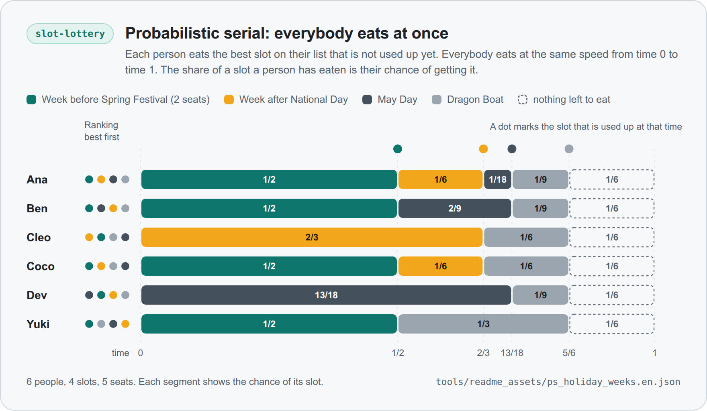
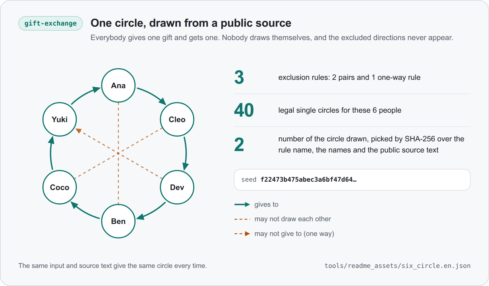

<b>English</b> · <a href="THEORY_zh.md">简体中文</a>

# Theory notes

This file records, for each skill, what its method guarantees, what it does not guarantee, and where the method comes from. It is written for readers who want to check the claims.

The file follows two rules.

- A guarantee is written down only after a test in this repository checks it. The test is named next to the guarantee as `file::function`, or as `file::Class::function` when it sits inside a test class. Every test file name is unique, and each section says which folder holds its tests.
- Every reference carries its DOI, so that anyone can look it up. The references are collected once, at the end.

Version: 0.2.1

## How to read the sections

Each skill section starts with its setting, the model and the words used, and then has three parts.

- **Guarantees.** Numbered statements, each followed by the tests that check it.
- **Not guaranteed.** What a reader might assume but should not. A statement here may still cite a test, for example one that shows a counterexample.
- **Method.** How the numbers are computed, with the derivations that the guarantees rest on.

Conventions that hold everywhere:

- Unless a statement says "after rounding", it is about exact fractions. The scripts compute with exact fractions and round to whole cents only at the end.
- Exit code 2 means invalid input, and the message names the field. Exit code 3 means that the rules the group agreed on have no solution for these numbers. Exit code 1 means that a check failed, such as a `--verify` mismatch or a failed self-test.
- The Shared mechanisms section describes what several skills use. A skill section states only what it adds.

## Shared mechanisms

These parts live in `core/fsq_core.py`, which `tools/sync_core.py` copies byte for byte into every skill folder. Their tests are in `tests/core/`.

### Exact amounts and cents

1. **Amounts are exact.** Amounts are read as exact fractions of a currency unit and never as binary floating point numbers, so 0.29 is 29 cents. An amount with more than two decimals is refused with exit code 2 and the name of the field.

   Tests: `test_core_money.py::TestMoney::test_float_is_read_as_its_shortest_decimal`, `test_core_money.py::TestMoney::test_rejects_sub_cent_precision`, `test_core_money.py::TestParseInput::test_the_binary_float_trap_is_avoided`.

2. **Shares are rounded to whole cents by the largest remainder rule.** Everybody gets the floor of their exact share in cents, and the leftover cents go to the largest fractional remainders. So the rounded shares add up to the total exactly, and each is within one cent of its exact share. Exact ties are broken by a rotation of the names, sorted by code point, that starts at the FNV-1a hash of a key such as the bill id modulo the number of names. The key changes from bill to bill, so the extra cent does not always land on the same person, and the result does not depend on the order of the input.

   Tests: `test_core_rounding.py::TestRoundShares::test_total_is_exact_and_everyone_is_within_one_cent`, `test_core_rounding.py::TestRoundShares::test_independent_of_input_order`, `test_core_rounding.py::TestRoundShares::test_leftover_cent_rotates_over_30_bills`, `test_core_rounding.py::TestFnv::test_known_vectors`.

3. **Rounding a single value.** An exact value is rounded to the nearest whole number with halves going up, so 5/2 gives 3 and -5/2 gives -2. Rent-split uses this for the whole-cent shift of bids and ride-split for the solo fares in cents.

   Tests: `test_core_rounding.py::TestRoundHalfUp::test_nearest_integer_with_halves_going_up`, `test_core_rounding.py::TestRoundHalfUp::test_the_result_is_within_half_and_ties_go_up`.

4. **Exit codes.** Invalid input stops a run with exit code 2 and the name of the field. A rule that has no answer for the numbers given stops it with exit code 3. Any other exception is a bug and is not hidden.

   Tests: `test_core_cli.py::TestRunCli::test_input_error_exits_2_and_names_the_field`, `test_core_cli.py::TestRunCli::test_no_solution_exits_3`, `test_core_cli.py::TestRunCli::test_other_exceptions_are_bugs_and_propagate`.

### Public randomness

Some skills take a random order from a public source text, such as the winning numbers of a public draw. They are the lottery of slot-lottery, the draw of a legal plan in gift-exchange, the pick order of a rota in chore-split, the order that breaks ties in group-vote and in stuff-split, and the choice among equally good assignments in rent-split. The mapping from text to order is the same everywhere. It uses only SHA-256 and integer arithmetic, never the `random` module, so it gives the same order on every Python version and platform. In words, this is `SEED_SPEC` in the core.

- The seed is the SHA-256 of the canonical JSON (sorted keys, no spaces, UTF-8) of `{"n_slots": N, "participants": names sorted by code point, "rule": RULE, "source": SOURCE TEXT}`.
- Draw number c is the first eight bytes, read big-endian, of the SHA-256 of the seed followed by c as eight big-endian bytes.
- A uniform integer below n takes x mod n when x is below the largest multiple of n that is at most 2^64, and otherwise the next draw is used.
- The order is a Fisher-Yates shuffle (the in-place form of Durstenfeld 1964) of the names sorted by code point: for i from n-1 down to 1, swap position i with a uniform integer in [0, i].

Each skill fixes its own rule name: `uniform_lottery_v1`, `rsd_v1`, `ps_bvn_v1` and `da_tiebreak_v1` for slot-lottery, `gift_exchange_any_enum_v1`, `gift_exchange_any_reject_v1`, `gift_exchange_ring_enum_v1` and `gift_exchange_ring_reject_v1` for gift-exchange, `stuff_split_priority_v1` for stuff-split, `chore_pick_order_v1` and `chore_bundle_tiebreak_v1` for chore-split, `group_vote_tie_order_v1` for group-vote and `rent_split_assignment_v1` for rent-split.

1. **The order is a function of the four inputs.** The result depends only on the rule name, the set of names, the slot count and the source text, and not on the order in which the names are listed. Changing any of the four changes the seed, and two different inputs never share a preimage, because canonical JSON quotes and escapes every string. The source text is used verbatim, with no trimming. A second implementation, written from the description above and sharing no code with the core, gives the same seeds and orders for random inputs.

   Tests: `test_core_seed.py::TestAgainstTheSpecification::test_seed_and_order_follow_the_spec`, `test_core_seed.py::TestAgainstTheSpecification::test_result_does_not_depend_on_listing_order`, `test_core_seed.py::TestMakeSeed::test_every_component_matters`, `test_core_seed.py::TestMakeSeed::test_no_two_inputs_share_a_preimage`, `test_core_seed.py::TestSeedPreimage::test_it_is_the_canonical_json_of_the_four_inputs`, `test_core_seed.py::TestSeededOrder::test_the_order_equals_draw_order_whatever_the_listing_order`.

2. **Recorded values.** For the eight people of the recorded example, three slots and the made-up source text in the slot-lottery section, the seed starts with 15b9c53a44270857eb442863 and the order is Yuki 小周 大刘 Coco 小红 阿明 Mia 老王. CI checks these values on every Python version that it runs.

   Tests: `test_core_seed.py::TestGoldenValues::test_seed_and_order_match_the_recorded_values`, `test_core_seed.py::TestGoldenValues::test_first_raw_draws`.

3. **Rejection sampling and the shuffle.** Keeping x mod n only for x below the largest multiple of n leaves every residue equally likely. The shuffle returns a permutation of its input and leaves the input alone. Fisher-Yates makes one choice per position, which gives n! choice sequences, and different sequences give different permutations.

   Tests: `test_core_seed.py::TestSeedStream::test_rejection_sampling_skips_the_biased_tail`, `test_core_seed.py::TestSeedStream::test_power_of_two_never_rejects`, `test_core_seed.py::TestShuffleAndSample::test_is_a_permutation_and_leaves_the_input_alone`.

4. **Equal chances, given an unpredictable source.** If the source text could not be predicted and SHA-256 behaves like a random function, every order has probability 1/n!, and each of k winners out of n people is drawn with probability k/n. The tests check the consequences statistically, with fixed source texts and thresholds far in the tail.

   Tests: `test_core_seed.py::TestSeedStream::test_values_are_uniform_enough`, `test_core_seed.py::TestSeedStream::test_shuffles_of_three_are_uniform_enough`, `test_core_seed.py::TestSeedStream::test_each_person_wins_about_k_over_n_of_the_time`.

**Not guaranteed.**

- The statements about chances assume that the source text could not be predicted or influenced when the rules were fixed. The scripts cannot check where the text came from or when it was fixed. If the text can be guessed in advance or chosen afterwards, whoever can do that can try variants (another day's numbers, one more name, one more slot) and keep the order that suits them. The list of names has to be frozen and shown before the source is known, because adding or dropping a name is one more way to try variants.

### Commitments

The organizer-goes-first rule of rent-split and the commit-reveal draw of slot-lottery use the same commitment. A person fixes a payload now and shows it later, and anyone can check that the two match. Committing first and revealing later is the idea of Blum (1983).

1. **Format.** The digest is the SHA-256 of the text `fsq-commit-v1`, a newline, a nonce of 128 random bits written as 32 lowercase hex characters, a newline and the canonical JSON of the payload. Canonical JSON fixes the key order and writes numbers as plain decimals, so spacing, key order and the spelling of a number (3000 or 3000.00) do not matter. Any change to the payload or the nonce gives another digest. A commitment with the right payload and nonce verifies, and one with a changed payload or nonce does not.

   Tests: `test_core_commit.py::TestFormat::test_known_answer`, `test_core_commit.py::TestRoundTrip::test_commit_then_verify`, `test_core_commit.py::TestRoundTrip::test_changed_payload_or_nonce_fails`, `test_core_commit.py::TestCanonicalPayload::test_key_order_and_spacing_do_not_matter`, `test_core_commit.py::TestCanonicalPayload::test_integers_and_whole_decimals_agree`.

2. **The nonce is fresh and comes from the system's cryptographic generator.** Two commitments to the same payload differ, and a weak or malformed nonce is refused.

   Tests: `test_core_commit.py::TestNonce::test_nonces_are_fresh_and_128_bit`, `test_core_commit.py::TestNonce::test_nonce_comes_from_secrets`, `test_core_commit.py::TestNonce::test_weak_or_malformed_nonce_is_refused`.

Under the usual assumptions about SHA-256, a digest published now hides the payload while the nonce stays private, and binds the person to it once nonce and payload are shown. These are properties of the hash function and are not tested here.

### Input files

A script reads its input from standard input or, with `--input FILE`, from a file. The option `--delete-input` deletes that file as soon as the script has read it. An agent that cannot pipe the input into the script writes it to a file instead, and this option keeps the private numbers from staying in that file.

1. **The file is deleted once it has been read, whatever happens next.** The deletion comes as soon as the file has been read, before its text is parsed as JSON. So the file is gone when the input is accepted, and also when it is not valid UTF-8, not valid JSON, too large, not a JSON object, refused by the checks of the skill, or has no solution under the agreed rule.

   Tests: `test_core_cli.py::TestDeleteInput::test_a_good_file_is_read_and_then_deleted`, `test_core_cli.py::TestDeleteInput::test_a_file_with_a_byte_order_mark_is_read_and_deleted`, `test_core_cli.py::TestDeleteInput::test_a_rejected_input_is_deleted_all_the_same`, `test_core_cli.py::TestDeleteInput::test_a_file_that_is_too_large_is_deleted_all_the_same`, `test_core_cli.py::TestDeleteInput::test_a_value_that_is_not_an_object_is_deleted_all_the_same`, `test_core_cli.py::TestDeleteInputEndToEnd::test_a_rejected_input_exits_2_naming_the_field_and_the_file_is_gone`, `test_core_cli.py::TestDeleteInputEndToEnd::test_a_rule_with_no_solution_exits_3_and_the_file_is_gone`.

2. **Nothing is deleted that was not read.** A path that cannot be read, a directory and a symbolic link stop the run with exit code 2. Standard input leaves no file, so it stops the run before anything is read. Other files in the same folder stay, and the demo reads no file and deletes none.

   Tests: `test_core_cli.py::TestDeleteInput::test_standard_input_is_refused_and_not_touched`, `test_core_cli.py::TestDeleteInput::test_leaving_out_the_input_option_means_standard_input_and_is_refused_too`, `test_core_cli.py::TestDeleteInput::test_a_missing_file_is_an_error_and_nothing_is_deleted`, `test_core_cli.py::TestDeleteInput::test_a_directory_is_refused_and_keeps_its_contents`, `test_core_cli.py::TestDeleteInput::test_a_symbolic_link_is_refused_and_it_and_its_target_both_stay`, `test_core_cli.py::TestDeleteInput::test_only_the_file_that_was_read_is_deleted`, `test_core_cli.py::TestDeleteInput::test_the_demo_reads_no_file_and_deletes_none`, `test_core_cli.py::TestDeleteInputEndToEnd::test_a_missing_path_exits_2_and_the_folder_is_left_as_it_was`.

3. **Without the option the file stays, and a failed deletion is reported.** A file that was read but cannot be deleted stops the run with exit code 2 and a message that names the file. The script does not print a result while the private input is still on disk and nobody has been told.

   Tests: `test_core_cli.py::TestDeleteInput::test_the_file_stays_when_the_option_is_off`, `test_core_cli.py::TestDeleteInput::test_a_file_that_cannot_be_deleted_is_reported_and_not_ignored`, `test_core_cli.py::TestStandardArgs::test_delete_input_is_off_unless_asked_for`.

### Limits that hold for every skill

- Deleting the input file is an ordinary deletion. It does not overwrite the contents and does not reach copies that an editor, a backup or the file system may keep. It cannot act when a run stops before the file is read, for example after a mistyped option, and the file then stays where it is. Until the script reads it, the file holds the input as plain text. Standard input creates no input file, which makes it the better route wherever an agent can use it. A shell may still keep a long heredoc in a temporary file of its own for a moment, and the scripts do not control that.
- The scripts do arithmetic on numbers that the people involved choose. They cannot see whether bids, rankings, ballots or readings are honest.

## rent-split

Tests are in `tests/skills/rent_split/`, except the shared ones in `tests/core/`.

### Guarantees

There are n people and n rooms, and the whole home costs R per month. Every person gives one private bid per room, and the bids of each person add up to R. A bid is the price the person would put on the room if they set all the prices themselves. A person who lives in room j at rent p_j has utility (own bid for j) - p_j, and an envy-free split is one in which nobody has a larger utility in some other room at that room's rent.

1. **Rents add up.** The rents add up to R exactly, and after rounding they still add up to the cent. Every room is rented once.

   Tests: `test_rent_split_properties.py::test_rents_add_up_to_the_total_and_every_room_is_rented_once`.

2. **Envy-free.** Nobody prefers another room at that room's rent, judged by their own bids. This holds in exact arithmetic, with the shift of guarantee 7 applied to a person whose bids did not add up.

   Tests: `test_rent_split_properties.py::test_nobody_envies_anybody_in_exact_arithmetic`.

3. **Fairest among the envy-free splits.** The people get the rooms that maximize the total of the winning bids, and the rents make the worst-off person as well off as possible (the maximin rule of Gal, Mash, Procaccia and Zick 2017). The answer is unique. With `spliddit` and `forbid`, rents may not be negative, and the utilities are the leximin optimum among the splits without a negative rent: the lowest utility is as high as possible, then the second lowest, and so on. The script solves both with shortest paths in exact fractions and no solver.

   Tests: `test_rent_split_lp.py::test_maximin_leximin_and_feasibility_match_the_linear_programs` and `test_rent_split_lp.py::test_a_seeded_sweep_covers_plain_negative_and_infeasible_cases` check this against `scipy.optimize.linprog`. `test_rent_split_lp.py::test_leximin_differs_from_plain_maximin_when_a_rent_would_be_negative` checks a small case by hand. `test_rent_split_properties.py::test_hungarian_method_agrees_with_brute_force` and `test_rent_split_properties.py::test_the_assignment_has_the_largest_total_bid` check the Hungarian method that picks the rooms against all assignments.

4. **No negative rent when it can be avoided.** With `spliddit` and `forbid`, no rent is negative if a split without a negative rent exists. If none exists, `forbid` stops with exit code 3 and `spliddit` gives the `allow` answer. The linear program agrees on which case holds. When the maximin split has no negative rent, all three rules give the same answer.

   Tests: `test_rent_split_properties.py::test_spliddit_and_forbid_never_pay_anyone_to_live_when_a_split_without_exists`, `test_rent_split_properties.py::test_the_three_rules_agree_when_the_standard_solution_has_no_negative_rent`, `test_rent_split_lp.py::test_the_closet_that_nobody_values_has_no_split_without_negative_rent`, `test_rent_split_cli.py::test_forbid_without_a_solution_exits_3_with_both_languages`.

5. **Nobody pays more than their own bid.** In exact arithmetic, the rent of a person is at most their (shifted) bid for their own room. Adding up the envy-free inequalities of person i over all rooms gives n u_i >= (sum of the bids of i) - R = 0, so the utility u_i is not negative.

   Tests: `test_rent_split_properties.py::test_nobody_pays_more_than_their_own_bid_for_their_room`.

6. **Rounding.** Every rent is rounded down or up to a whole cent so that the total stays exact, and among all such roundings the one with the smallest largest envy is chosen (exhaustive search for up to 8 rooms, then hill climbing). Each rounded rent is within one cent of its exact value, and the largest envy after rounding is at most one cent. When the rounded numbers show an envy of one cent, the certificate line of that person says so. The rounded rent of a person is never above their bid for the room, unless their bids were shifted by a fraction of a cent, and then it is above by at most one cent. The line "you pay no more than your bid" says so in that case.

   Tests: `test_rent_split_properties.py::test_rounded_envy_is_at_most_one_cent_and_rents_are_floor_or_ceiling`, `test_rent_split_properties.py::test_bids_that_do_not_add_up_are_shifted_so_the_given_bids_show_no_envy`, `test_rent_split_golden.py::TestRoundingEdges::test_one_cent_of_rounded_envy_is_reported_as_rounding`, `test_rent_split_golden.py::TestRoundingEdges::test_a_rent_one_cent_above_the_shifted_bid_is_reported`. The rounding itself is tested in the core by `test_core_rounding.py::TestRoundMinEnvyThreePersonExample::test_min_envy_rounding_gives_zero_where_naive_gives_one` and `test_core_rounding.py::TestRoundMinEnvyProperties::test_exact_search_matches_brute_force_and_bounds_envy_by_one_cent`.

7. **Shift, never scale.** If the bids of a person add up to S instead of R, each of them is shifted by (R - S) / n. A shift keeps every difference between two rooms, and envy only depends on those differences, so the person finds no envy when they check the result against the bids they actually gave. Scaling the bids to the right sum would change the differences. In an example with a total of 6000 and bids that added up to 7200, scaling leaves 300.00 of envy by the person's own bids and shifting leaves none. Adding a constant to all the bids of one person changes nothing, because the script takes it off again.

   Tests: `test_rent_split_properties.py::test_shifting_all_of_one_persons_bids_changes_nothing`, `test_rent_split_golden.py::TestShiftNotScale::test_a_shifted_row_gives_the_rents_of_the_shifted_bids`, `test_rent_split_golden.py::TestShiftNotScale::test_the_person_checks_the_result_against_the_original_bids`, `test_rent_split_golden.py::TestShiftNotScale::test_scaling_would_have_broken_the_guarantee`.

8. **Independence from the order of the input.** Reordering the people or the rooms changes nothing but the order of the output, and the exact rents and utilities follow a renumbering of people and rooms.

   Tests: `test_rent_split_properties.py::test_reordering_people_and_rooms_changes_nothing_but_the_order`, `test_rent_split_properties.py::test_exact_solution_follows_a_renumbering_of_people_and_rooms`.

9. **Ties never change the money.** If two assignments are exactly equally good, the rents and the exact gain of every person are the same for both, because the rents are the same for all assignments that maximize the total bid. Without a random source, people are served in the order of their names, and each takes the first suitable room by name. With a public random source, the order and the choices come from the counter stream of Public randomness, seeded by the source, the rule name and the list of people. The result is a function of those inputs alone.

   Tests: `test_rent_split_properties.py::test_a_random_source_gives_a_valid_reproducible_assignment`, `test_rent_split_properties.py::test_a_random_source_spreads_the_rooms_when_everybody_is_indifferent`, `test_rent_split_properties.py::test_without_a_random_source_ties_go_by_name`.

10. **Audit.** The audit calls the current assignment optimal exactly when its total bid is the largest over all assignments. A person's envy at the current split is what they would gain from the best other room at the current rents. When the assignment is optimal, the difference between the current rent and the rent of the rule is shown for each person. When it is not, no choice of rents can make that assignment envy-free (Svensson 1983), and the audit suggests the assignment of the rule.

    Tests: `test_rent_split_properties.py::test_the_audit_flags_an_assignment_exactly_when_it_is_not_welfare_maximising`, `test_rent_split_properties.py::test_audit_envy_is_what_the_person_would_gain_by_taking_another_room`, `test_rent_split_properties.py::test_auditing_the_rules_own_split_finds_nothing_to_change`, `test_rent_split_golden.py::TestAudit::test_equal_split_audit_a`, `test_rent_split_golden.py::TestAudit::test_audit_b_assignment_by_arrival_order`.

11. **Privacy of the output.** The group summary holds no bid, and a private message holds only the bids of its receiver and the public rents.

    Tests: `test_rent_split_golden.py::TestPrivacy::test_the_group_summary_holds_no_bid`, `test_rent_split_golden.py::TestPrivacy::test_a_private_message_holds_only_the_receivers_bids`.

12. **Commitments.** A commitment follows the format of Commitments above. Its payload is the person, the total rent and the bids by room name. It does not depend on the order of the rooms or on how the numbers are spelled. Any change to a bid, to the total or to a room name gives another code.

    Tests: `test_rent_split_cli.py::test_a_commitment_with_a_fixed_nonce_has_a_fixed_code`, `test_rent_split_cli.py::test_the_revealed_row_matches_the_code`, `test_rent_split_cli.py::test_the_order_of_rooms_and_the_spelling_of_numbers_do_not_matter`, `test_rent_split_cli.py::test_a_changed_row_does_not_match_and_exits_1`.

13. **Reproducible.** The same input gives the same bytes, in every output format.

    Tests: `test_rent_split_properties.py::test_the_output_is_deterministic`, `test_rent_split_cli.py::test_the_demo_is_byte_stable_and_matches_the_recorded_output`.

### Not guaranteed

- **Strategy-proofness.** A person who sees all the other bids before bidding can sometimes gain by misreporting. `test_rent_split_golden.py::TestOrganizerWhoGoesLast::test_a_lie_by_one_person_raises_their_true_surplus` contains such a case.
- **Uniform tie-breaking.** The tie-break is reproducible and does not depend on the order of the input. The optimal assignments do not necessarily have equal chances.
- **Anything outside the model.** Bids are treated as quasi-linear: how much a person likes a room does not depend on how much they pay in total. The script does not handle budget limits, more people than rooms, or two people who share a room but are not a couple. A couple should bid together as one person. At most 20 people are accepted.
- **Exact amounts after a shift by a fraction of a cent.** When the bids of a person are off by an amount that cannot be spread over the rooms in whole cents, the bids shown to that person are rounded to the cent. Statements about envy are not affected, because they only use differences between rooms.

### Method

1. **Assignment.** The rooms go to the people so that the total of the winning bids is as large as possible (Hungarian method). An envy-free split exists only for such an assignment (Svensson 1983).
2. **Rents.** Let w(i, k) be the bid of person k for the room k lives in, minus the bid of person i for that room, and let d(i, k) be the shortest-path distance in the complete graph with these weights (Floyd-Warshall). A vector of utilities is envy-free exactly when u_k - u_i <= d(i, k) for all i and k. The least such vector with u >= 0 is L_i = -min_k d(i, k), and the envy-free utilities that make the worst-off person as well off as possible are u_i = t + L_i with t = (W - sum of L) / n, where W is the total of the winning bids minus R. The rent of the room that person i gets is (own bid) - u_i. This is the maximin rule of Gal, Mash, Procaccia and Zick (2017), in closed form instead of a linear program. Because the rents are the same for every assignment that maximizes the total bid, the choice among such assignments only decides who lives where.
3. **No negative rent.** A rent is not negative exactly when u_i is at most the own bid of person i. The envy-free utilities below these caps have a greatest element G_k = min_i (own bid of i + d(i, k)), and a split without a negative rent exists if and only if the sum of the G_k is at least W. Among such splits the script takes the leximin one: it raises the lowest utility as far as possible, finds the people who cannot be raised any further, fixes them there, and repeats for the rest. The result is unique.
4. **Rules.** `allow` uses step 2. `forbid` uses step 3 and reports that there is no solution when step 3 has none. `spliddit`, the recommended rule, is named after the calculator (Goldman and Procaccia 2015) whose objective it follows, the largest possible smallest benefit among envy-free splits. It uses step 3 and falls back to step 2 when step 3 has no solution. The group picks one of the three rules before anybody bids.

## bill-split

Tests are in `tests/skills/bill_split/`, except the shared ones in `tests/core/`. The property tests compare the script with a separate, plainly written reference solver (`bs_testlib.py`), and the numbers in the golden tests were worked out by hand.

### Guarantees

1. **The totals are exact.** Amounts are exact, as described under Exact amounts and cents, so 0.29 is 29 cents and an amount with more than two decimals is rejected with exit code 2 and the field name. The shares owed for an expense add up to the amount paid, to the cent, and every share is the floor or the floor plus one cent of the exact amount.

   Tests: `test_bill_split_golden.py::TestDecimals::test_029_is_29_cents`, `test_bill_split_golden.py::TestDecimals::test_the_binary_float_trap_does_not_lose_a_cent`, `test_bill_split_properties.py::TestExpenseTotals::test_owed_adds_up_to_the_total_to_the_cent`, `test_bill_split_properties.py::TestExpenseTotals::test_each_expense_matches_exact_arithmetic_within_a_cent`, `test_bill_split_validation.py::TestExpenseErrors::test_exit_2_and_the_field_is_named`.

2. **The leftover cent rotates and does not depend on input order.** Shares are rounded by the largest remainder rule described under Exact amounts and cents. Exact ties are broken by a rotation of the names, sorted by code point, that starts at the FNV-1a hash of the bill id modulo the number of names. For example, thirty bills named expense-1 to expense-30, each of 100 shared three ways, give every person the extra cent exactly 10 times. Shuffling people, expenses, items, fees and every mapping in the input changes none of the numbers.

   Tests: `test_bill_split_golden.py::TestLeftoverCent::test_the_extra_cent_rotates_over_30_bills`, `test_bill_split_golden.py::TestLeftoverCent::test_the_certificate_names_who_got_the_cent`, `test_bill_split_properties.py::TestOrderIndependence::test_the_result_does_not_depend_on_the_order_of_the_input`, `test_bill_split_properties.py::TestOrderIndependence::test_the_same_input_gives_the_same_bytes`.

3. **The parts of a share add up to the share.** A breakdown (items, each fee, each discount, or dishes, packaging, each fee and each coupon) is rounded in layers: the running total after each layer is rounded to cents, and a part is the change from one layer to the next. The last layer is exactly the single rounding of the exact total, so the breakdown never moves anyone's share. A part can differ from its exact value by less than two cents.

   Tests: `test_bill_split_properties.py::TestExpenseTotals::test_the_parts_of_every_share_add_up_to_it`, `test_bill_split_properties.py::TestExpenseTotals::test_each_part_is_within_two_cents_of_its_exact_value`, `test_bill_split_properties.py::TestGroupOrder::test_the_parts_add_up_to_what_each_person_pays`.

4. **Settling up clears every balance.** The balances sum to zero. After the suggested transfers everyone is at zero and a second run suggests nothing. Every transfer goes from a person with a negative balance to a person with a positive one, so nobody both pays and receives.

   Tests: `test_bill_split_properties.py::TestSettlement::test_balances_sum_to_zero_and_the_transfers_clear_them`, `test_bill_split_properties.py::TestSettlement::test_nobody_both_pays_and_receives`, `test_bill_split_properties.py::TestSettlement::test_the_transfers_do_not_depend_on_the_order_of_the_balances`.

5. **The number of transfers is the fewest possible when at most 16 people have a balance.** See the method below. The count from the subset search equals a brute-force count over all partitions into zero-sum groups for up to 8 people, and equals a breadth-first search over all transfers for up to 5 people with small balances. After any one suggested transfer is made, the fewest number for the remaining balances is exactly one less.

   Tests: `test_bill_split_properties.py::TestSettlement::test_the_dp_count_equals_the_brute_force_minimum`, `test_bill_split_properties.py::TestSettlement::test_the_dp_count_equals_a_search_over_all_transfers`, `test_bill_split_properties.py::TestSettlement::test_after_one_transfer_the_minimum_drops_by_exactly_one`, `test_bill_split_properties.py::TestSettlement::test_the_group_split_adds_up_and_each_group_is_minimal`, `test_bill_split_validation.py::TestOddButValidInputs::test_exactly_16_balances_are_searched_exactly`.

6. **The greedy rule is bounded.** Beyond 16 people, or when the group chose it, the largest debtor pays the largest creditor. It never uses fewer transfers than the search and never more than the number of people with a balance minus one. The script says when it was used. In a recorded example it needs four transfers where three are enough.

   Tests: `test_bill_split_properties.py::TestSettlement::test_greedy_is_never_fewer_than_the_dp_and_at_most_n_minus_1`, `test_bill_split_validation.py::TestOddButValidInputs::test_more_than_16_balances_fall_back_to_greedy_and_say_so`, `test_bill_split_golden.py::TestTransfers::test_greedy_rule_can_be_chosen_and_says_so`, `test_bill_split_golden.py::TestTransfers::test_greedy_needs_four_where_three_are_enough`.

7. **A coupon shared by Shapley value is shared fairly in the sense of the value.** The shares add up to the reduction the tiers give for the whole order (efficiency). People with equal dishes get equal shares (symmetry). A person with no dishes gets nothing. No share is negative. For up to 6 people the exact value equals the average of the marginal contributions over all orders of the people. The computation is the exact Shapley value of the core, which ride-split uses as well.

   Tests: `test_bill_split_properties.py::TestShapley::test_efficiency_shares_add_up_to_the_reduction`, `test_bill_split_properties.py::TestShapley::test_symmetry_equal_dishes_get_equal_shares`, `test_bill_split_properties.py::TestShapley::test_a_person_with_no_dishes_gets_nothing`, `test_bill_split_properties.py::TestShapley::test_nobody_gets_a_negative_share_and_nobody_gets_more_than_the_reduction`, `test_bill_split_properties.py::TestShapley::test_agrees_with_averaging_over_all_orders`, `test_bill_split_properties.py::TestShapley::test_the_hand_computed_example`. In the core: `test_core_shapley.py::TestAgainstTheDefinition::test_integer_worths_equal_the_average_over_all_orders`, `test_core_shapley.py::TestAxioms::test_efficiency_the_values_add_up_to_the_worth_of_everyone`, `test_core_shapley.py::TestAxioms::test_symmetry_interchangeable_players_get_equal_values`.

8. **Group order payments follow the stated rules.** Packaging follows the dish, fees and flat coupons are shared as the rule says, and each payment is within one cent of an independent exact computation.

   Tests: `test_bill_split_properties.py::TestGroupOrder::test_payments_add_up_and_match_exact_arithmetic`, `test_bill_split_properties.py::TestGroupOrder::test_the_coupon_shares_add_up_to_the_reductions`, `test_bill_split_golden.py::TestTakeoutGroupOrder::test_payments_and_trap_check`, `test_bill_split_golden.py::TestTakeoutGroupOrder::test_coupon_shares_are_the_shapley_value`.

9. **The check against ordering alone is computed.** The script lists exactly the people whose payment in the group order is more than what the same dishes would cost on their own. The check is guaranteed to pass when no person can reach any tier alone, because a Shapley share is never negative and a fee share is never more than the whole fee. It can fail otherwise, for example when three people each order 100 and a coupon gives 20 off at 100.

   Tests: `test_bill_split_properties.py::TestGroupOrder::test_the_trap_check_is_exactly_pay_not_above_alone`, `test_bill_split_properties.py::TestGroupOrder::test_nobody_pays_more_than_alone_when_nobody_reaches_a_tier_alone`, `test_bill_split_properties.py::TestGroupOrder::test_three_full_orders_waste_a_coupon_and_the_check_says_so`.

10. **The audit is a comparison and nothing else.** The current split (equal shares, shares by dish price, or amounts the group gives) adds up to the same total as the result, and the per-person differences sum to zero.

    Tests: `test_bill_split_properties.py::TestExpenseTotals::test_audit_against_equal_shares_is_consistent`, `test_bill_split_properties.py::TestAuditWithAmounts::test_explicit_current_amounts_are_compared_person_by_person`, `test_bill_split_properties.py::TestGroupOrder::test_audit_against_equal_shares_is_consistent`, `test_bill_split_properties.py::TestGroupOrder::test_audit_against_proportional_shares_is_consistent`.

11. **Malformed input is reported with a field name.** In the mutation tests, every changed, deleted or added field gives either a result or an input error that names a field, and none of the mutated inputs crashes the script.

    Tests: `test_bill_split_fuzz.py::TestMutatedInputs::test_a_mutated_ledger_gives_a_result_or_an_input_error`, `test_bill_split_fuzz.py::TestMutatedInputs::test_a_mutated_order_gives_a_result_or_an_input_error`, `test_bill_split_validation.py::TestOrderErrors::test_exit_2_and_the_field_is_named`.

### Not guaranteed

- **Total money moved.** The total amount of money that moves is not minimized. Only the number of transfers is.
- **More than 16 people with a balance.** The number of transfers is then not guaranteed to be the fewest. The problem is NP-hard in general (see the method).
- **The Shapley value is a convention.** It is a fairness convention and not what every group will prefer. It can give a small order that lifts the group over a threshold a share larger than the order, so that person receives money. The script reports this. Whether to use it or to share the coupon in proportion to dish prices must be agreed before ordering. Test: `test_bill_split_validation.py::TestOddButValidInputs::test_a_negative_shapley_payer_is_reported`.
- **Strategy-proofness.** The methods do not resist manipulation. Receipts and dish prices are taken as facts, so a person could pad an order to cross a threshold.
- **The check against ordering alone.** It prices a stand-alone order of the same dishes with the same tiers and the full fees. A flat coupon such as a platform red packet is assumed to exist only for the group order and is not subtracted from the stand-alone price. Thresholds are tested against the dish subtotal only.
- **Scope.** One currency, whole cents, no tax or tipping rules and no exchange rates.

### Method

**Money.** JSON numbers are parsed into exact fractions. All arithmetic is done on fractions, and cents are produced only by rounding. For one expense the exact amount of person i is the sum of their shares of the items, plus their shares of the fees, minus their shares of the discounts. A fee split by consumption is shared in proportion to the exact item shares.

**Fewest transfers.** Let b be the non-zero balances of k people. They add up to zero. A settlement is a set of transfers, which can be seen as a graph on the k people. In every connected component the balances must add up to zero, and a component of m people needs at least m - 1 edges to be connected. If g is the largest number of groups into which the k people can be partitioned so that every group adds up to zero, then the graph has at most g components and so at least k - g edges. Conversely a group of m people with a zero sum is settled by m - 1 transfers: let the largest debtor pay the largest creditor, which clears at least one of the two, and the last transfer clears two. The fewest number of transfers is therefore k - g.

To find g, order the people and count the prefixes whose balances add up to zero. The largest such count over all orders is g, because the blocks between two consecutive zero prefixes are zero-sum groups, and a partition into g groups gives an order with g zero prefixes. A dynamic program over subsets computes it: best[S] is the largest over i in S of best[S without i], plus one if the balances in S add up to zero. This takes O(2^k k) time. Walking back through the table gives an order, cutting it at the zero prefixes gives the groups, and each group is settled as above. Ties are broken by sorted names, so the same input gives the same transfers.

The problem is NP-hard in general. Whether k - 2 transfers suffice is the same question as whether the balances contain a non-empty proper subset with zero sum. Given positive integers a_1, ..., a_m and a target T with 0 < T < sum of a, take the balances a_1, ..., a_m, -T and -(sum of a - T). A zero-sum proper subset either contains -T and some of the a_i that add up to T, or contains -(sum of a - T) and some a_i that add up to sum of a - T, and then the remaining a_i add up to T. A subset that holds both negative balances would need every a_i and is not proper. So a zero-sum proper subset exists exactly when some a_i add up to T. Subset sum is NP-complete (it appears as KNAPSACK in Karp 1972).

**Sharing a coupon by Shapley value.** The players are the people who ordered. The worth v(S) of a group S is the reduction that the tiers give for the dish total of S, that is the largest reduction whose threshold the total reaches, or zero. The Shapley value of person i (Shapley 1953) is the average, over all orders in which the people could be put together, of v(S + i) - v(S), where S is the set of people before i. Equivalently it is the sum over all groups S without i of |S|! (n - |S| - 1)! / n! times (v(S + i) - v(S)). The script enumerates all 2^n groups, so it is exact up to 16 people and refuses more (`test_bill_split_properties.py::TestShapley::test_the_largest_group_is_exact_and_quick`, `test_bill_split_properties.py::TestShapley::test_more_than_16_people_are_refused`). For one threshold this is the Shapley-Shubik power index (Shapley and Shubik 1954). A tiered coupon is a sum of threshold games, and the value is linear, so it is the sum of the power indices weighted by the step sizes. Because v never decreases when a person is added, no share is negative.

Example. Spend 300 and take 60 off, with orders of 150, 140 and 20. Any two people reach at most 290, so only the whole group earns the reduction. Each person is the last to arrive in a third of all orders, and the Shapley value gives each one 20.00. The person with the 20.00 order pays nothing. Sharing in proportion to the orders gives 29.03, 27.10 and 3.87, so that person pays 16.13. Tests: `test_bill_split_golden.py::TestCouponHook::test_shapley_makes_the_small_order_free`, `test_bill_split_golden.py::TestCouponHook::test_proportional_split_is_29_03_27_10_3_87`, `test_bill_split_golden.py::TestCouponHook::test_without_the_small_order_nothing_is_saved`.

**Order alone.** The stand-alone price of person i is their dishes plus their packaging plus every fee in full minus, for each tiered coupon, the reduction that their own dish total earns. If no tier is reachable alone, the stand-alone price is dishes plus packaging plus fees. The group price is the same dishes and packaging plus a share of each fee, which is never more than the whole fee, minus coupon shares, which are never negative. So the exact group price is not larger. The stand-alone price is a whole number of cents. A group price that is a whole number of cents is not rounded up, and any other group price is below the next whole cent, which is at most the stand-alone price. Rounding therefore cannot take the group price past it.

## ride-split

Tests are in `tests/skills/ride_split/`, except the shared ones in `tests/core/`.

### Guarantees

A ride is a cost game. The cost of a group of riders is the fare the same people would pay for a ride of their own. In meter and estimates mode this cost is the dearest solo fare among the members, because a car that goes as far as the farthest rider also carries the others (the airport game). In general mode it is the price typed in for the group, or the tariff applied to the shortest route that visits all their stops. The skill splits the fare by the Shapley value of this game: the average, over all orders in which the riders could join, of the extra fare each rider causes on joining. This is the rule of the taxi calculator of Spliddit (Goldman and Procaccia 2015). The cents are then rounded with the largest remainder rule, so that they add up to the fare.

1. **Efficiency.** The shares add up to the fare actually paid, exactly, and after rounding to the cent.

   Tests: `test_ride_split_properties.py::TestEfficiency::test_exact_shares_add_up_to_the_fare`, `test_ride_split_properties.py::TestEfficiency::test_meter_shares_add_up`, `test_ride_split_properties.py::TestEfficiency::test_estimates_shares_add_up`, `test_ride_split_properties.py::TestEfficiency::test_general_shares_add_up`.

2. **Closed form.** Sort the solo fares c(1) <= ... <= c(n). The rider with the k-th smallest fare pays the sum over j <= k of (c(j) - c(j-1)) / (n - j + 1). Every stretch of road is shared equally by the riders still in the car (Littlechild and Owen 1973). The formula equals the Shapley value computed over all n! orders and over all subsets.

   Tests: `test_ride_split_properties.py::TestClosedFormAgainstBruteForce::test_closed_form_equals_permutation_shapley`, `test_ride_split_properties.py::TestClosedFormAgainstBruteForce::test_the_scripts_own_helpers_agree_with_each_other`, `test_ride_split_properties.py::TestClosedFormAgainstBruteForce::test_subset_formula_equals_permutation_shapley`. In the core: `test_core_shapley.py::TestAgainstTheDefinition::test_the_airport_game_has_the_closed_form`. The route search of general mode is checked against an independent search by `test_ride_split_general.py::TestRoutes::test_route_enumeration_equals_the_independent_search` and `test_ride_split_general.py::TestRoutes::test_shapley_over_routes_equals_the_permutation_average`.

3. **Symmetry.** Riders who are interchangeable pay the same. In the airport game this means equal solo fares. After rounding, the cents of two such riders differ by at most one cent. The exact shares never fall along the drop-off order.

   Tests: `test_ride_split_properties.py::TestSymmetry::test_equal_solo_prices_give_equal_exact_shares`, `test_ride_split_properties.py::TestSymmetry::test_equal_estimates_differ_by_at_most_one_cent`, `test_ride_split_properties.py::TestSymmetry::test_relabelling_the_riders_relabels_the_shares`, `test_ride_split_properties.py::TestSymmetry::test_estimates_do_not_depend_on_the_order_of_the_list`, `test_ride_split_properties.py::TestSymmetry::test_exact_shares_never_fall_along_the_drop_off_order`.

4. **Null player.** A rider who changes the price of no group pays nothing.

   Tests: `test_ride_split_properties.py::TestNullPlayer::test_a_zero_estimate_pays_nothing`, `test_ride_split_properties.py::TestNullPlayer::test_zero_readings_at_the_start_pay_nothing`, `test_ride_split_properties.py::TestNullPlayer::test_a_rider_who_never_changes_the_price_pays_nothing`.

5. **Additivity.** The share for two fares added together is the sum of the shares for each fare.

   Tests: `test_ride_split_properties.py::TestAdditivity::test_shapley_is_additive`, `test_ride_split_properties.py::TestAdditivity::test_two_airport_games_added_together`.

6. **The airport-game split lies in the core, also after rounding.** The core of a cost game is the set of splits in which no group pays more together than its own cost. The airport game has a concave cost, and the Shapley value of such a game lies in its core (Shapley 1971). The cents printed by the script lie in the core as well, and the proof is in the Method section. The check in the script compares with the solo fare rounded to the nearest cent. An integer sum that is at most the solo fare is also at most that rounded value, so the check is never stricter than the inequality that is proved.

   Tests: `test_ride_split_properties.py::TestCore::test_every_meter_result_is_in_the_core` and `test_ride_split_properties.py::TestCore::test_every_estimates_result_is_in_the_core` compare with an independent enumeration of all groups. The same enumeration backs `test_ride_split_properties.py::TestCore::test_core_check_agrees_with_exhaustive_enumeration` and `test_ride_split_properties.py::TestCore::test_the_alternatives_core_checks_agree_with_enumeration`, which cover the equal and the proportional split shown for comparison.

7. **Scaling.** In estimates mode the solo estimates are scaled by the paid total divided by the largest estimate, and the Shapley value is homogeneous of degree one, so scaling first and splitting afterwards gives the same shares as the other way round. The unit of the estimates does not matter, a dearer estimate never pays less, and estimates equal to the meter readings give the meter result.

   Tests: `test_ride_split_properties.py::TestScaling::test_the_unit_of_the_estimates_does_not_matter`, `test_ride_split_properties.py::TestScaling::test_a_dearer_estimate_never_pays_less`, `test_ride_split_properties.py::TestScaling::test_estimates_equal_to_the_readings_reproduce_the_meter_result`.

8. **Emptiness of the core in general mode.** The script decides exactly whether any split keeps every group at or below its own cost. The method is in the Method section.

   Tests: `test_ride_split_properties.py::TestCore::test_core_emptiness_agrees_with_the_classical_inequalities` checks it against the classical inequalities for two and three riders. `test_ride_split_general.py::TestCoreOfGeneralGames::test_emptiness_agrees_with_an_independent_linear_program` and `test_ride_split_general.py::TestCoreOfGeneralGames::test_packing_value_agrees_with_an_independent_linear_program` check it against an independent linear program.

### Not guaranteed

- **General mode can fall outside the core, and the core can be empty.** Three riders going in three directions, each alone for 10 and every pair for 30, share a car for 50, so every split leaves some rider paying more than a ride of their own. The script lists the groups and says whether the core is empty. It does not offer another rule in that case.
- **The equal split and the split in proportion to solo fares are shown for comparison only.** The equal split can leave the core, as the first rider of the meter example shows. The proportional split can leave it too, for example with many cheap riders and one expensive one.
- **The Shapley value is one rule among several.** The group has to agree on it before the numbers are known. Choosing the rule after seeing the results is outside the guarantees.
- **Meter mode treats the meter reading at a drop-off as the solo fare of that rider.** A real solo ride may cost more or less than the same stretch inside the shared ride, for instance because of a second starting fee.
- **Estimates mode assumes that all riders are on the same road.** With a detour, the scaling spreads the detour cost over all riders in proportion to their estimates.
- **No incentive guarantee.** Meter readings and app estimates are reported by the riders themselves, and the method does not make misreporting unprofitable.
- **Tolls, tips, surcharges, waiting time and traffic are not modeled.** They belong in the paid total. Routes in general mode run from the start to the stops in turn, with no pick-up detours towards a common destination.
- **Size limits.** Meter and estimates mode take up to 12 riders because the core check visits all 2^n groups. General mode takes up to 6 riders because every group's price and route is enumerated. Typing the group prices by hand is practical only up to 4 riders, which needs 15 prices.

### Method

**The rounded airport split lies in the core.** Let c(1) <= ... <= c(n) = T be the solo fares in cents, with T a whole number of cents. Let phi(k) be the exact shares, which do not fall with k, and r(k) the rounded ones. A group whose dearest member is the k-th rider costs c(k) and pays at most what the first k riders pay together, because no share is negative. So it is enough to show that the sum over i <= k of r(i) is at most c(k) for every k.

- Each stretch j <= k is shared by n - j + 1 riders, of whom k - j + 1 are among the first k. Hence the sum over i <= k of phi(i) equals c(k) - (n - k) phi(k), and the sum over i > k of phi(i), the tail, equals T - c(k) + (n - k) phi(k). The claim is therefore that the tail rounds to at least the sum over i > k of (phi(i) - phi(k)).
- If phi(k) >= 1, every rounded share exceeds phi(i) - 1, which is at least phi(i) - phi(k), and the claim follows.
- If phi(k) < 1, the first k riders have the whole share as remainder, and it is at most phi(k). If every tail rider who is rounded down has a remainder of at most phi(k), the tail falls short of its exact shares by at most (n - k) phi(k), and the claim follows.
- Otherwise some tail rider is rounded down with a remainder above phi(k). The largest remainder rule rounds up only riders whose remainder is at least that one, so nobody among the first k is rounded up. Let U be the set of riders rounded up, which lies in the tail, and D the set of tail riders rounded down. The rounded shares add up to T, so the number of riders rounded up equals the sum of all remainders: |U| is the sum over i <= k of phi(i), plus the sum over D of rem(i), plus the sum over U of rem(i). Hence the shortfall of the tail, the sum over D of rem(i), equals the sum over U of (1 - rem(i)) minus the sum over i <= k of phi(i). That is at most the amount by which the rounded-up shares exceed their exact values. So the tail rounds to at least the sum over i > k of phi(i), which is more than the claim needs.

**Emptiness of the core.** Write y(i) = c(i) - x(i) for the saving of rider i against a ride alone. The core is non-empty exactly when the total saving can be handed out so that every group S receives at least the sum of its members' solo costs minus its own cost. By linear programming duality (the balanced-collection condition of Bondareva and Shapley, see Shapley 1967) this is a small packing problem, which the script solves with an exact simplex method on fractions.

## group-vote

Tests are in `tests/skills/group_vote/`. The rules are also run against plain reference implementations written for the tests (`vote_reference.py`), which work on one ballot per person and share no code with the script. All counting uses integers. Borda points can end in one half when a ballot leaves options out, so the script keeps them doubled and prints them as exact decimal text.

### Guarantees

A ballot lists some or all of the options, best first. If the agreed rules allow it (`rules.partial` is `tie_last`), the options a ballot leaves out tie for last on that ballot. A ballot prefers x to y when it ranks x and either leaves y out or ranks y lower. The pairwise count d(x, y) is the number of ballots that prefer x to y. A ballot that ranks neither x nor y counts for neither.

1. **Every ballot is counted once.** Ballots with the same ranking are merged without changing a count. The first choices, the rounds of the runoff and of instant runoff, and the Borda points all account for every ballot, and the pairwise counts of two options never add up to more than the number of ballots. With complete ballots they add up to exactly that number.

   Tests: `test_group_vote_properties.py::TestBallotCountsAreConserved::test_merged_lines_keep_every_ballot`, `test_group_vote_properties.py::TestBallotCountsAreConserved::test_first_choices_and_rounds_account_for_every_ballot`, `test_group_vote_properties.py::TestBallotCountsAreConserved::test_borda_points_add_up_to_what_the_ballots_hand_out`, `test_group_vote_properties.py::TestBallotCountsAreConserved::test_a_pair_is_never_counted_on_more_ballots_than_exist`, `test_group_vote_properties.py::TestBallotCountsAreConserved::test_complete_ballots_split_every_pair`.

2. **The order of ballots and of options does not matter.** Shuffling the ballot lines, or splitting a line with a count into single ballots, changes nothing in the result, neither in the JSON nor in the organizer's tables. Listing the options in another order changes neither the winner nor the tie-break order.

   Tests: `test_group_vote_properties.py::TestOrderOfBallotsAndOptions::test_the_whole_result_is_the_same_whatever_the_order_of_ballots`, `test_group_vote_properties.py::TestOrderOfBallotsAndOptions::test_the_winner_does_not_depend_on_how_the_options_are_listed`.

3. **Every rule agrees with a plain implementation.** For random ballots, with and without partial ballots and with and without an option removed, the winner of plurality, runoff, instant runoff, Borda, Condorcet and Schulze equals the winner of the reference. The approval count and the Kemeny ranking are checked the same way.

   Tests: `test_group_vote_properties.py::TestAgreementWithTheReference::test_every_rule_matches_the_plain_implementation`, `test_group_vote_properties.py::TestAgreementWithTheReference::test_every_rule_matches_after_an_option_is_removed`, `test_group_vote_properties.py::TestAgreementWithTheReference::test_approval_matches_the_plain_count`.

4. **A Condorcet winner always wins under condorcet, schulze and kemeny.** An option w is a Condorcet winner when d(w, x) is larger than d(x, w) for every other option x.
   - Schulze: no link into w is a winning link, because d(w, y) is larger than d(y, w) for every y. So every path into w has strength 0, while the direct link from w to any x has a positive strength. Hence w is the only potential winner.
   - Kemeny: take any ranking in which w is not first and move w to the top. Only the pairs (x, w) with x above w change, and each gains d(w, x) minus d(x, w), which is positive. So no ranking with w below the top is optimal, and every best ranking starts with w.
   - The method `condorcet` is defined as the Condorcet winner if there is one and the Schulze winner otherwise, so it always names the same winner as `schulze`.

   Tests: `test_group_vote_properties.py::TestSchulzeAndTheCondorcetWinner::test_the_condorcet_winner_wins_under_schulze_condorcet_and_kemeny`, `test_group_vote_rules.py::TestCondorcet::test_condorcet_and_schulze_always_agree`, `test_group_vote_properties.py::TestSchulzeAndTheCondorcetWinner::test_the_floyd_warshall_set_equals_the_path_enumeration`.

5. **Schulze is monotonic and independent of clones.** Both properties are proved in Schulze (2011), and independence of clones is the criterion of Tideman (1987). The tests check the monotonic part on random complete ballots: when an option is a potential winner and a voter moves it up one place, it stays a potential winner. The clone part is checked on one example in which a copy of an option changes nothing.

   Tests: `test_group_vote_properties.py::TestSchulzeAndTheCondorcetWinner::test_schulze_is_monotonic`, `test_group_vote_theory.py::TestClones::test_schulze_ignores_the_clone`.

6. **A cycle is reported exactly when there is no Condorcet winner and the pairwise graph has a cycle.** The graph has an edge from x to y when d(x, y) is larger than d(y, x). With ties between options the graph can have no Condorcet winner and also no cycle, and then no cycle is reported. The reported cycle is a shortest one, starting at the lowest-numbered option that lies on a shortest cycle. It is a closed chain of strict wins and the script prints the two counts and the margin of every link.

   Tests: `test_group_vote_properties.py::TestCycles::test_a_cycle_is_reported_exactly_when_there_is_no_condorcet_winner_and_a_cycle`, `test_group_vote_properties.py::TestCycles::test_a_reported_cycle_is_a_closed_chain_of_strict_wins`, `test_group_vote_properties.py::TestCycles::test_the_cycle_is_a_shortest_one`, `test_group_vote_golden.py::TestSchulzeLiteratureExample::test_the_cycle_is_reported_with_its_margins`.

7. **The Kemeny ranking is exact.** The script searches over subsets, which takes time proportional to 2^m times m for m options, and refuses more than 8 options. The score and the chosen ranking equal those of a search over all rankings of 4 options, and the score equals the best score of a search over up to 6 options. If several rankings reach the best score, the script fills the places from the top and takes the option that comes first in the tie-break order at each place.

   Tests: `test_group_vote_properties.py::TestKemeny::test_the_result_equals_a_search_over_all_rankings_of_four_options`, `test_group_vote_properties.py::TestKemeny::test_the_score_is_the_best_possible_for_up_to_six_options`, `test_group_vote_rules.py::TestKemeny::test_equally_good_rankings_are_settled_by_the_order`.

8. **A majority of first choices wins under every rule except possibly Borda.** If more than half of the ballots rank an option first, plurality, the runoff, instant runoff, Condorcet, Schulze and Kemeny all elect it. Borda can pass over it.

   Tests: `test_group_vote_properties.py::TestMajorityOfFirstChoices::test_a_majority_winner_wins_under_every_rule_except_possibly_borda`, `test_group_vote_theory.py::TestMajority::test_borda_can_pass_over_the_option_most_voters_rank_first`.

9. **Ties are broken by one order that is fixed in advance.** The options are put in order by the mapping of Public randomness (`fsq_core.seeded_order`), with the rule name `group_vote_tie_order_v1`, the options, one slot and the text of the public random source. The option that comes first wins a tie. In instant runoff, the tied option that comes last is eliminated. The same source gives the same order whatever the order in which the options are listed, and different sources give different orders. The result differs between sources only when a tie decides it. The `--json` output carries the seed and the order, so anyone can recompute them.

   Tests: `test_group_vote_properties.py::TestTieBreakOrder::test_the_same_source_gives_the_same_order_every_time`, `test_group_vote_properties.py::TestTieBreakOrder::test_different_sources_give_different_orders`, `test_group_vote_properties.py::TestTieBreakOrder::test_a_different_source_changes_the_result_only_through_ties`, `test_group_vote_properties.py::TestTieBreakOrder::test_a_tie_event_is_recorded_exactly_when_the_order_was_needed`, `test_group_vote_rules.py::TestEveryTieUsesTheSameOrder::test_one_order_serves_every_rule`.

10. **A tie that the rules cannot break stops the run.** If the agreed rules name no random source and a tie decides the outcome, the script exits with code 3 and asks the group to fix a source before counting. A tie that decides nothing, such as a tie for last place in plurality, needs no source. With `--all-rules`, a rule that cannot decide is listed as tied and the agreed rule is still reported.

    Tests: `test_group_vote_rules.py::TestExitCodeThreeOnAnUnbreakableTie::test_the_run_stops_with_exit_code_3`, `test_group_vote_rules.py::TestExitCodeThreeOnAnUnbreakableTie::test_a_tie_that_never_decides_anything_needs_no_source`, `test_group_vote_rules.py::TestExitCodeThreeOnAnUnbreakableTie::test_all_rules_shows_the_rules_that_cannot_decide_and_still_succeeds`.

11. **A recount is a fresh count.** The option is deleted from every ballot, ballots that ranked nothing else are dropped, and the tie-break order is the original order without the option. Removing an option other than the Condorcet winner never changes the Condorcet winner. The recount equals counting the reduced ballots from the start.

    Tests: `test_group_vote_properties.py::TestRemovingAnOption::test_removing_a_non_winner_never_changes_the_condorcet_winner`, `test_group_vote_properties.py::TestRemovingAnOption::test_a_recount_equals_a_fresh_count_of_the_reduced_ballots`, `test_group_vote_golden.py::TestRemovingAnOption::test_the_tie_break_order_is_the_original_one_without_the_removed_option`.

12. **The worked examples reproduce.** The 27 ballots of the demo give five different winners under five rules (plurality, the runoff, instant runoff, Borda and Condorcet), a runoff of 15 to 12 and a Borda count of 64 to 63. Removing either 剧本杀 or 密室逃脱 makes all seven rules of `--all-rules` elect 爬山. For 20000 random four-option profiles drawn by `random.Random(5)`, Schulze names more than one potential winner in 2248 cases. The five-candidate, 45-voter example that is often used to explain the Schulze method gives the pairwise counts worked out by hand and the winner E.

    Tests: `test_group_vote_golden.py::TestTwentySevenBallots::test_the_five_rules_name_five_different_winners`, `test_group_vote_golden.py::TestTwentySevenBallots::test_the_runoff_is_decided_15_to_12`, `test_group_vote_golden.py::TestTwentySevenBallots::test_borda_is_64_to_63`, `test_group_vote_golden.py::TestRemovingAnOption::test_every_rule_after_a_removal`, `test_group_vote_golden.py::TestSchulzeTies::test_the_random_statistic_reproduces`, `test_group_vote_golden.py::TestSchulzeLiteratureExample::test_the_pairwise_matrix_counted_by_hand`.

Properties of the rules that the script implements. A cell says "not claimed" when this repository neither proves nor tests the property and the reference does not state it.

| Rule | Elects a Condorcet winner | Majority of first choices wins | Monotonic | Independent of clones |
|---|---|---|---|---|
| plurality | no | yes | not claimed | no |
| two-round runoff | no | yes | no | not claimed |
| instant runoff | no | yes | no | not claimed |
| Borda | no | no | not claimed | no |
| condorcet and schulze | yes | yes | yes | yes |
| kemeny | yes | yes | not claimed | not claimed |

The "no" cells come from examples in `test_group_vote_theory.py` and from the 27 ballots. In those ballots plurality, the runoff, instant runoff and Borda all miss the Condorcet winner 爬山 (`test_group_vote_theory.py::TestTheTwentySevenBallots::test_four_rules_miss_the_condorcet_winner_that_the_pairwise_rules_find`). The monotonic and clone columns for condorcet and schulze are Schulze (2011). Approval voting uses approval ballots and is outside this table.

### Not guaranteed

- **No protection against strategic voting.** With three or more options, every ranking rule that can elect each option and is not a dictatorship can be manipulated by some voter in some situation (Gibbard 1973, Satterthwaite 1975). This holds for all the ranking rules here, since each is deterministic once the tie-break order is known. Approval voting has its own strategic choices, such as how many options to tick. A voter who knows the tie-break order in advance can steer a close tie.
- **Instant runoff and the runoff are not monotonic.** Take 17 voters. Five rank A, C, B. Four rank B, A, C. Two rank B, C, A. Six rank C, B, A. Both rules elect C. If the two voters who ranked B, C, A move C to the top, both rules elect A (Doron and Kronick 1977 for instant runoff). Tests: `test_group_vote_theory.py::TestMonotonicity::test_an_option_can_lose_because_more_voters_rank_it_higher`, `test_group_vote_theory.py::TestMonotonicity::test_instant_runoff_is_not_monotonic`, `test_group_vote_theory.py::TestMonotonicity::test_two_round_runoff_is_not_monotonic`.
- **Borda is sensitive to clones.** A beats B by 6 ballots to 4 and wins the Borda count. If every ballot also ranks a copy B2 of B right behind B, the Borda points are A 12, B 14 and B2 4, and B wins. Schulze, Condorcet and Kemeny still elect A. Test: `test_group_vote_theory.py::TestClones::test_borda_is_sensitive_to_clones`.
- **Plurality splits the votes of similar options.** B has 6 of 10 first choices and wins. If 3 of those voters prefer a copy B2, A has the most first choices and wins, although B still beats A in a head-to-head comparison. Test: `test_group_vote_theory.py::TestClones::test_plurality_splits_the_votes_of_similar_options`.
- **Conventions for partial ballots and ties.** Other sensible choices exist, for example giving the options a ballot leaves out no Borda points at all, or letting a ballot split its vote among them. The script uses the ones that the agreed rules name and says so in its output. Instant runoff stops as soon as one option has more than half of the ballots that still count, and options with no votes leave together without a tie-break. The Schulze method uses winning votes as the strength of a link. Margins and ratios are other versions.
- **Cycles can leave several potential winners.** Schulze names a set of potential winners, and a perfect three-way cycle puts all three in it. The tie-break order then decides. In the random test of statement 12 this happened for 11.2% of the profiles, so a random source belongs in every rules message.
- **Size limits and trust.** At most 20 options (8 for Kemeny) and 20000 ballot lines. A ballot cannot rank two options equally. The script does not check who may vote, whether anyone voted twice or whether a ballot is genuine.

### Method

**Plurality.** Each ballot counts for its first name. The option with the most first choices wins.

**Two-round runoff.** Round 1 counts first choices. If one option has more than half of them, it wins at once. Otherwise the two options with the most first choices meet in round 2, and a tie at the cut is settled by the tie-break order. In round 2 each ballot counts for the finalist it prefers, and a ballot that ranks neither finalist does not count. A tie in round 2 is settled by the order.

**Instant runoff.** Each ballot counts for the highest option on it that is still in the race, and a ballot with no such option stops counting. If one option has more than half of the ballots that still count, it wins. Otherwise the option with the fewest ballots is eliminated. If several options have no ballots at all, they all leave at once. If several options share the lowest positive count, the one that comes last in the tie-break order leaves.

**Borda.** With m options in the race, a ballot gives m - 1 points to the option in first place, m - 2 to the next one, and so on. If u options are left out, together they receive the u(u-1)/2 points that remain, shared equally. The option with the most points wins.

**Condorcet and Schulze.** Let p(x, y) be the strength of the strongest path from x to y. A link from a to b has strength d(a, b) if d(a, b) is larger than d(b, a) and 0 otherwise. The strength of a path is the weakest link on it. The script computes p with the Floyd-Warshall recurrence, and the test reference computes it by trying every simple path. An option x is a potential winner when p(x, y) is at least p(y, x) for every y. If there are several, the tie-break order picks the first.

**Kemeny.** The score of a ranking is the sum of d(x, y) over all pairs where x is above y. Let best(S) be the highest score for ranking the set S among themselves. Then best(S) is the maximum over j in S of best(S without j) plus the sum of d(j, k) for the other k in S, where j is the first option of S. This gives the best score and the number of best rankings. The ranking is then built from the top. At each place the script takes the option that comes first in the tie-break order among those that can still lead to a best ranking. This is the rule studied by Young and Levenglick (1978) and named after J. G. Kemeny.

**Approval.** The option with the most approvals wins. The totals of a chat poll are approvals without the ballots behind them.

**Questionnaire text.** A table with one column per option is read row by row. A rank column holds a whole number from 1 (best), a blank means the option was left out, and two options with the same rank are refused. For approval a cell holds 1 or is blank.

## chore-split

Tests are in `tests/skills/chore_split/`, except the shared ones in `tests/core/`.

The skill has two plans, and the group names one in `rules.plan` before anybody gives a number. Plan A, `round_robin`, is the default. It takes rankings, lets the people pick in turns and moves no money. Guarantees 1 to 11 and the first part of the Method are about it. Plan B, `bundle_pay`, takes a cost for every chore a person can do and a cap on the number of chore units, gives the chores out at the smallest total cost, and moves money between the people. Guarantees 12 to 23, the bullets of Not guaranteed that begin with Plan B, and the parts of the Method that begin with Plan B are about it. An input that names no plan is plan A and is answered as plan A.

The setting of plan B is this. There are n people and m chore units, and a chore that repeats counts once for every time. Every person gives the cost of doing one unit of each chore they can do, in money or in points and never below 0, and a cap, the most units they take. A chore that a person cannot do is named separately. A split gives every unit to one person. The cost of a bundle to a person is the sum of their costs over its units. A payment is attached to every bundle. It is a number of cents that goes to the holder of the bundle, negative when the holder pays, and the payments add up to zero. A share is a bundle together with its payment. A person can take a share when its bundle has at most as many units as their cap and holds no chore they cannot do. The net amount of a person is the payment they receive minus the cost of their own bundle. A person envies a share when, by their own costs, taking it would give them a larger net amount than keeping their own.

### Guarantees

A week has m chores. A chore that repeats during the week, such as dishes three times, is several units, and every unit is a chore of its own. Every person ranks the chores they can do, from least to most disliked, and the people take turns in a fixed order. Whoever is up takes the remaining chore they rank best, until every chore is taken. A cost for a person is a number for each chore they can do. It fits their ranking when it is not negative and does not fall along the ranking, so a chore ranked later never costs less. Ties are allowed. The cost of a bundle is the sum over its chores. A chore that a person cannot do costs them more than any number, so nobody envies a bundle that holds one. A person envies another when the other bundle costs less than their own. Envy-free up to one chore (EF1) means that after setting aside one chore of their own, the person does not envy the other. Statements below are about every cost that fits the rankings, all at once, so nobody has to give a number.

1. **Every chore unit is taken exactly once.** This holds in every week, and the picks are the ones of a plain turn-by-turn reference written separately. A person who cannot do a chore never gets it.

   Tests: `test_chore_split_properties.py::test_every_chore_unit_is_assigned_exactly_once`, `test_chore_split_properties.py::test_the_picks_equal_the_independent_reference`, `test_chore_split_properties.py::test_nobody_picks_a_chore_on_their_cannot_list`.

2. **EF1 in every week, when nobody has a chore they cannot do.** For every pair of people, the person does not envy the other once one of their own chores is set aside, for every cost that fits their ranking. The proof is in the Method section. It is checked by trying every integer cost from 0 to 2 that fits a ranking, on small random cases.

   Tests: `test_chore_split_properties.py::test_every_week_is_ef1_for_every_cost_that_fits_the_rankings`, `test_chore_split_properties.py::test_without_cannot_lists_no_pair_fails_and_nobody_runs_out`.

3. **The certificate holds round by round.** Each pick of a person is compared with the first pick the other person makes after it. A person who picks before the other in every round is compared with the same round, and a person who picks after the other is compared with the next round. Each comparison says that the chore taken is ranked no worse than the chore of the other person. Without cannot lists, at most one pick of a person has no later pick of the other to be compared with, and that is the pick the person sets aside.

   Tests: `test_chore_split_properties.py::test_the_round_by_round_comparisons_always_hold`, `test_chore_split_properties.py::test_without_cannot_at_most_one_pick_is_left_without_a_comparison`. The recorded example is checked by `test_chore_split_golden.py::TestRecordedExample::test_the_certificate_of_daliu_against_aming_is_the_recorded_sentence`.

4. **Sizes.** Without cannot lists the number of chores of two people differs by at most one, and people who pick earlier in the order hold at least as many chores as people who pick later.

   Tests: `test_chore_split_properties.py::test_without_cannot_the_number_of_chores_differs_by_at_most_one`.

5. **The exact check of the script agrees with brute force.** For a person with ranking r, the script lists the places in r of the chores of the person and of the other, heaviest first, and compares them entry by entry. It reports envy-free, EF1 only, EF1 fails, or nothing to envy because the other holds a chore the person cannot do. Brute force tries every integer cost from 0 to 2 that fits r. The two agree on every bundle that picking produces, with and without cannot lists, and on arbitrary bundles.

   Tests: `test_chore_split_properties.py::test_the_status_of_every_pair_equals_brute_force`, `test_chore_split_properties.py::test_ef1_detection_on_arbitrary_bundles_agrees_with_brute_force`, `test_chore_split_properties.py::test_dominance_means_no_larger_cost_for_every_non_decreasing_cost`.

6. **With cannot lists the script says what holds.** A person is skipped for the rest of the week once nothing they can do is left. EF1 can fail only for a pair in which the other person was skipped before the end of the week. Every pair of every week is checked and the failures are listed with the reason, and the exit code is still 0. A chore that sits on every cannot list stops the run with exit code 3.

   Tests: `test_chore_split_properties.py::test_a_person_is_skipped_only_when_nothing_they_can_do_is_left`, `test_chore_split_properties.py::test_with_cannot_lists_a_pair_can_only_fail_when_the_other_person_ran_out`, `test_chore_split_golden.py::TestExamplesFolder::test_the_cannot_example_breaks_the_guarantee_in_the_way_the_skill_describes`, `test_chore_split_inputs.py::TestCannot::test_a_chore_that_nobody_can_do_exits_3`.

7. **The order of the weeks.** The pick order of week 1 is the shuffle of the sorted names by the mapping of Public randomness, with the rule name `chore_pick_order_v1`, the names, the number of chore units per week and the public source text. With rotation, each week moves the first person of the order to the back, so every person starts once in n weeks. Without rotation the order never changes. Planning more weeks never changes the earlier ones.

   Tests: `test_chore_split_properties.py::test_the_start_order_rotates_as_declared`, `test_chore_split_properties.py::test_the_weeks_planned_do_not_change_the_earlier_weeks`, `test_chore_split_golden.py::TestSeedAndOrder::test_the_independent_reference_agrees`.

8. **Independence from the order of the input.** Listing the people, the rankings or the chores in another order changes neither the result nor any of the three text formats.

   Tests: `test_chore_split_properties.py::test_the_result_does_not_depend_on_the_order_people_are_listed`, `test_chore_split_properties.py::test_the_result_does_not_depend_on_the_order_chores_are_listed`.

9. **Only chores.** A task that somebody likes is refused with exit code 2 and the words "only chores".

   Tests: `test_chore_split_inputs.py::TestLikedTasks::test_a_liked_task_exits_2_and_says_chores_only`.

10. **Privacy of the output.** The group card holds no ranking and no place in one. A private message holds the receiver's own ranking and no other.

    Tests: `test_chore_split_output.py::TestOutputOnArbitraryInputs::test_the_group_card_never_holds_a_ranking`, `test_chore_split_output.py::TestOutputOnArbitraryInputs::test_a_private_message_holds_exactly_one_ranking_and_it_is_the_receivers`.

11. **Reproducible.** The same input gives the same bytes, in every format and both languages.

    Tests: `test_chore_split_golden.py::TestDemoIsByteStable::test_two_runs_are_identical`, `test_chore_split_golden.py::TestDemoIsByteStable::test_output_matches_the_stored_copy`, `test_chore_split_golden.py::TestStoredCopiesOfOtherExamples::test_output_matches_the_stored_copy`.

12. **Plan B: the cheapest split.** Within the caps and the cannot lists, the chores go to the people so that the total cost is as small as possible. The script finds the split with the Hungarian method on one slot for each unit of every cap. On random small cases it is checked against trying every way to give out the units, both for the smallest total cost and for whether any way exists. Units of one chore that two people swap make the same split.

    Tests: `test_chore_split_bundle_split.py::TestHungarianMethod::test_hungarian_method_equals_brute_force_on_random_matrices`, `test_chore_split_bundle_split.py::TestCheapestSplit::test_the_smallest_total_cost_equals_brute_force`, `test_chore_split_bundle_split.py::TestCheapestSplit::test_a_way_exists_exactly_when_brute_force_finds_one`, `test_chore_split_bundle_split.py::TestCheapestSplit::test_a_seeded_sweep_sees_both_kinds_of_case`, `test_chore_split_bundle_split.py::TestCheapestSplit::test_every_unit_is_given_out_once_within_the_caps_and_the_cannot_lists`, `test_chore_split_bundle_split.py::TestCheapestSplit::test_units_of_one_chore_swapped_between_people_are_one_split`.

13. **Plan B: which of several cheapest splits.** The chores are put in the order of their names, by code point, and given out one unit at a time. A unit goes to the person who comes first in the tie order and for whom a split of the smallest total cost is still possible. The tie order is the order of the sorted names, or, when the rules name a public source, the order from the mapping of Public randomness with the rule name `chore_bundle_tiebreak_v1`, the names, the number of units and the source text. That split is the first of the cheapest splits in this sense. It is the same however the input is listed, and the script says whether another split has the same total cost. In the recorded example two splits cost 135.00.

    Tests: `test_chore_split_bundle_split.py::TestCheapestSplit::test_the_split_is_the_first_cheapest_one_in_the_order_of_the_tie_rule`, `test_chore_split_bundle_split.py::TestCheapestSplit::test_with_a_public_source_the_first_cheapest_split_follows_the_drawn_order`, `test_chore_split_bundle_split.py::TestCheapestSplit::test_the_script_says_there_was_a_tie_exactly_when_brute_force_finds_two_splits`, `test_chore_split_bundle_split.py::TestCheapestSplit::test_the_recorded_example_has_exactly_two_cheapest_splits`, `test_chore_split_bundle_split.py::TestCheapestSplit::test_the_split_does_not_depend_on_the_order_the_input_is_listed_in`, `test_chore_split_bundle_split.py::TestTheTieRule::test_the_seed_and_order_equal_an_independent_computation`, `test_chore_split_bundle_split.py::TestTheTieRule::test_the_rule_name_and_the_preimage_are_the_documented_ones`, `test_chore_split_bundle_split.py::TestTheTieRule::test_with_the_source_of_the_example_the_drawn_order_gives_the_same_split`, `test_chore_split_bundle_split.py::TestTheTieRule::test_another_source_can_give_the_other_split`.

14. **Plan B: no way to share out the chores is found and explained.** When some chore is on every cannot list, or the caps and the cannot lists leave no way to give out every unit, the run stops with exit code 3. The message names chores, the people who can do any of them and their caps, and those caps add up to fewer units than the named chores have. So the message shows that no way exists.

    Tests: `test_chore_split_bundle_split.py::TestNoWayToShareOut::test_a_chore_that_nobody_can_do_exits_3_with_the_message_of_plan_a`, `test_chore_split_bundle_split.py::TestNoWayToShareOut::test_caps_that_add_up_to_less_than_the_units_exit_3_and_name_the_numbers`, `test_chore_split_bundle_split.py::TestNoWayToShareOut::test_the_message_names_the_chores_that_only_few_people_can_do`, `test_chore_split_bundle_split.py::TestNoWayToShareOut::test_the_named_chores_really_cannot_be_covered`, `test_chore_split_bundle_split.py::TestNoWayToShareOut::test_a_cap_of_zero_for_everybody_who_can_do_a_chore_has_no_way`.

15. **Plan B: the payments add up to zero.** They add up to zero in exact fractions of a cent, and after every payment is rounded to a whole cent. Each rounded payment is within one cent of the exact one. The rounding is the one that rent-split uses (guarantee 6 of that section): among the ways to round every payment down or up so that the total stays zero, the one with the smallest largest envy is taken, by exhaustive search for up to 8 people and by hill climbing beyond that.

    Tests: `test_chore_split_bundle_money.py::TestThePayments::test_the_payments_add_up_to_zero_exactly_and_after_rounding`, `test_chore_split_bundle_money.py::TestThePayments::test_each_rounded_payment_is_within_one_cent_of_the_exact_one`, `test_chore_split_bundle_money.py::TestThePayments::test_with_more_than_eight_people_the_rounding_still_adds_up_and_leaves_one_cent`. The rounding itself is tested in the core by `test_core_rounding.py::TestRoundMinEnvyProperties::test_exact_search_matches_brute_force_and_bounds_envy_by_one_cent`.

16. **Plan B: nobody envies a share they could take.** By their own costs, a person gets no more from another share they could take than from their own, in exact arithmetic and for any caps and cannot lists. After the payments are rounded to the cent, the most that anyone gains is one cent, and the certificate says so. A share that a person cannot take is left out of their comparison. The Method section proves that such payments exist for the cheapest split.

    Tests: `test_chore_split_bundle_money.py::TestThePayments::test_nobody_envies_a_bundle_they_can_take_in_exact_arithmetic`, `test_chore_split_bundle_money.py::TestThePayments::test_after_rounding_the_largest_envy_is_at_most_one_cent`, `test_chore_split_bundle_money.py::TestThePayments::test_a_net_is_the_payment_minus_the_cost_of_the_own_bundle`, `test_chore_split_bundle_money.py::TestEnvyFreePaymentsExist::test_a_cheapest_split_always_has_envy_free_payments_even_with_uneven_caps`, `test_chore_split_bundle_money.py::TestBundlesNobodyCanTake::test_a_bundle_over_the_cap_is_left_out_of_the_comparison`, `test_chore_split_bundle_money.py::TestBundlesNobodyCanTake::test_a_bundle_with_a_chore_the_person_cannot_do_is_left_out`, `test_chore_split_bundle_money.py::TestBundlesNobodyCanTake::test_the_uneven_example_leaves_the_person_with_one_unit_out_of_every_big_bundle`, `test_chore_split_bundle_output.py::TestWhatTheOutputSays::test_one_cent_of_rounded_envy_is_reported_as_rounding`, `test_chore_split_bundle_output.py::TestWhatTheOutputSays::test_a_person_who_cannot_take_a_share_is_told_why`.

17. **Plan B: the worst-off person is as well off as possible among such payments.** Among all payments that add up to zero and leave nobody envying a share they could take, the smallest net amount is as large as possible. A linear program confirms this on random cases, also with different caps and cannot lists. With the same cap for everybody and no cannot lists, the net amounts are those of rent-split with a total rent of zero, and the two functions that compute them are the same code in both scripts.

    Tests: `test_chore_split_bundle_money.py::TestTheWorstOffPerson::test_the_worst_off_person_is_as_well_off_as_a_linear_program_allows`, `test_chore_split_bundle_money.py::TestTheWorstOffPerson::test_the_money_equals_rent_split_with_a_total_rent_of_zero`, `test_chore_split_bundle_money.py::TestTheWorstOffPerson::test_the_two_functions_of_the_kernel_are_those_of_rent_split`, `test_chore_split_bundle_money.py::TestTheWorstOffPerson::test_the_kernel_works_with_a_rent_of_zero_on_a_hand_computed_case`, `test_chore_split_bundle_money.py::TestTheWorstOffPerson::test_with_the_same_cap_for_everybody_every_bundle_can_be_taken_by_everybody`.

18. **Plan B: when everybody can end up with the same amount.** Whatever the payments, the net amounts add up to minus the total cost, so the smallest of them is at most minus the total cost divided by the number of people. If the payments of the cheapest split can leave everybody exactly there, no split at all gives the worst-off person more, with any payments that add up to zero. The recorded example is such a case, and both of its cheapest splits leave everybody at -45.00 a week.

    Tests: `test_chore_split_bundle_money.py::TestWhenEveryNetIsEqual::test_when_every_net_is_equal_no_split_does_better_for_the_worst_off_person`, `test_chore_split_bundle_money.py::TestWhenEveryNetIsEqual::test_the_recorded_example_is_such_a_case`, `test_chore_split_bundle_money.py::TestRecordedExample::test_each_person_is_at_the_average_of_the_total_cost`, `test_chore_split_bundle_money.py::TestRecordedExample::test_the_other_cheapest_split_also_leaves_everybody_at_minus_45`.

19. **Plan B: the recorded example.** Three roommates share six chores, two each, at the weekly costs of the example file. The cheapest split costs 135.00. The payments are -20.00 for 阿明, -5.00 for 小红 and 25.00 for 大刘, which is the first cheapest split in the order of the names and also the one that the source of the example file selects. Every net amount is -45.00.

    Tests: `test_chore_split_bundle_money.py::TestRecordedExample::test_the_payments_of_the_recorded_example`, `test_chore_split_bundle_money.py::TestRecordedExample::test_with_the_source_of_the_example_the_same_split_is_taken`, `test_chore_split_bundle_money.py::TestRecordedExample::test_the_command_line_prints_the_same_numbers`.

20. **Plan B: privacy of the output.** The group card holds the split, the caps and the payments, and no cost and no net amount. A private message holds the costs of its receiver and the payments of everybody, and no cost of another person.

    Tests: `test_chore_split_bundle_output.py::TestPrivacy::test_the_group_card_holds_no_cost_and_no_net`, `test_chore_split_bundle_output.py::TestPrivacy::test_a_private_message_holds_only_the_costs_of_its_receiver`, `test_chore_split_bundle_output.py::TestPrivacy::test_the_group_card_does_hold_the_split_and_the_payments`.

21. **Plan B: independence from the order of the input.** Listing the people, the chores, the costs, the caps or the cannot lists in another order changes no output, in any format, in either language and in the JSON.

    Tests: `test_chore_split_bundle_output.py::TestSameInputSameBytes::test_listing_the_input_in_another_order_changes_no_output`, `test_chore_split_bundle_output.py::TestSameInputSameBytes::test_listing_a_random_input_in_another_order_changes_no_output`.

22. **Plan B: reproducible.** The same input gives the same bytes in every format and both languages, and the demo gives what its example file gives.

    Tests: `test_chore_split_bundle_output.py::TestSameInputSameBytes::test_two_runs_are_identical`, `test_chore_split_bundle_output.py::TestSameInputSameBytes::test_the_demo_prints_the_same_as_its_example`, `test_chore_split_bundle_output.py::TestStoredCopies::test_the_demo_matches_the_stored_copy`, `test_chore_split_bundle_output.py::TestStoredCopies::test_the_uneven_example_matches_the_stored_copy`, `test_chore_split_bundle_output.py::TestStoredCopies::test_the_inline_cases_match_the_stored_copies`.

23. **Plan B: the input.** The plan is named in `rules.plan`, and an input that names none is plan A. Naming `round_robin` gives exactly the output of the same input without it. The fields that only the other plan uses are refused with exit code 2 and their name. Costs are amounts of 0 or more with at most two decimals, caps are whole numbers from 0, and a cost for a chore on the cannot list is refused. Whatever is put into any field, the script answers it or refuses it with exit code 2 or 3, and never fails with a traceback.

    Tests: `test_chore_split_bundle_inputs.py::TestChoosingThePlan::test_naming_round_robin_gives_exactly_the_output_of_plan_a`, `test_chore_split_bundle_inputs.py::TestFieldsOfTheOtherPlan::test_plan_b_names_the_top_level_field_of_plan_a`, `test_chore_split_bundle_inputs.py::TestFieldsOfTheOtherPlan::test_plan_a_names_the_fields_of_plan_b_and_says_how_to_switch`, `test_chore_split_bundle_inputs.py::TestCostsAndCaps::test_bad_costs`, `test_chore_split_bundle_inputs.py::TestCostsAndCaps::test_bad_caps`, `test_chore_split_bundle_inputs.py::TestFuzzing::test_any_value_in_any_top_level_field_is_answered_or_refused`, `test_chore_split_bundle_inputs.py::TestFuzzing::test_any_value_deeper_in_the_input_is_answered_or_refused`, `test_chore_split_bundle_inputs.py::TestFuzzing::test_dropping_or_adding_a_field_is_answered_or_refused`.

### Not guaranteed

- **Envy-freeness.** Even when the chores divide evenly, a person who picks after another has to set one chore aside, because their last pick has no later pick of the other person to be compared with. Some costs that fit the ranking then make them prefer the other set. In the recorded example of three roommates, 小红 ranks 倒垃圾, 洗碗, 擦窗, 拖地, 刷厕所, 做饭. Take the cost 0 for 倒垃圾 and 1 for every other chore, which fits her ranking. Her chores 洗碗 and 擦窗 cost 2, and the chores 倒垃圾 and 做饭 of 阿明 cost 1, so she envies him. Setting aside 擦窗 removes the envy for every fitting cost, and the script says so in her message. Test: `test_chore_split_golden.py::TestRecordedExample::test_a_cost_that_fits_the_ranking_shows_why_one_chore_is_set_aside`.
- **Strategy-proofness.** A person who knows the other rankings can sometimes get a lighter set by ranking untruthfully. With two people, A picking first, A truly ranking c, a, b, d and B ranking a, b, c, d, the true ranking gives A the chores c and b. Ranking a first gives A a and c, which is no heavier for A under every cost that fits the true ranking, and lighter under some. Test: `test_chore_split_properties.py::test_round_robin_is_not_strategy_proof`.
- **Equal burden.** The script sees an order and not a size. It cannot say that two people spend the same time or effort, and it does not try to equalize totals.
- **Several weeks together.** The guarantee is for each week on its own. Rotating the start only evens out who picks first.
- **Tasks that somebody likes.** Case 2 of the proof uses that no chore has a negative cost. With liked tasks the argument fails. Handling chores and liked tasks together needs a different method, such as the round-robin based algorithms for mixed items studied by Aziz et al. (2019, 2022), which this script does not implement.
- **Chores that somebody cannot do.** A person who runs out of chores they can do is skipped, and then the others can hold many more chores than that person. Two people A and B, the order A and B, three chores x, y, z, and B able to do only x. A ranks x first. A takes x, B has nothing left to take, and A takes y and z. A holds three chores, B none. If every chore costs A something, A still holds more than B after setting aside one chore, so EF1 fails. B cannot envy A, since A holds chores B cannot do. The script reports this pair and does not repair it. Test: `test_chore_split_inputs.py::TestCannot::test_a_person_left_with_nothing_they_can_do_makes_ef1_fail`.
- **Paying somebody to take a chore, or splitting what a cleaner costs.** Plan A moves no money. Plan B moves money between the housemates, with the guarantees above. What an outside cleaner costs is not calculated by either plan.
- **Where the source text matters.** In plan A the source decides only who picks first in week 1. In plan B it only settles ties between splits of the same total cost.
- **That the entered rankings are what people meant.** Each person checks their own in their private message. The same holds for the costs and caps of plan B.
- **Plan B: the best split for the worst-off person.** The worst-off person is as well off as possible for the cheapest split, and not among all splits. Take 阿明, 小红 and 大刘, the six chores 洗碗, 倒垃圾, 拖地, 刷厕所, 做饭 and 擦窗, two chores each, and these weekly costs in that order of chores: 阿明 28, 29, 5, 20, 9, 18, 小红 13, 9, 4, 3, 26, 2 and 大刘 2, 26, 24, 27, 1, 13. The cheapest split costs 38. It gives 阿明 拖地 and 擦窗, 小红 倒垃圾 and 刷厕所, 大刘 洗碗 and 做饭. The payments leave 阿明 and 大刘 at exactly -55/3 a week, which is -18.33 to the cent, and 小红 at -4/3. After the payments are rounded to the cent the two of them have -18.33 and -18.34, because the cents must still add up to zero. Another split costs 41 and leaves everybody at exactly -41/3, which is -13.67, with payments that also add up to zero and leave nobody envious. It gives 阿明 拖地 and 做饭, 小红 倒垃圾 and 刷厕所, 大刘 洗碗 and 擦窗. Of the 90 ways to give each person two of the six chores, 15 allow payments that leave nobody envious, and this split is the best of them. The script does not look for it. Tests: `test_chore_split_bundle_money.py::TestADearerSplitCanBeBetterForTheWorstOff::test_the_cheapest_split_costs_38_and_leaves_the_worst_off_at_minus_55_over_3`, `test_chore_split_bundle_money.py::TestADearerSplitCanBeBetterForTheWorstOff::test_after_rounding_the_cents_of_the_two_worst_off_are_18_33_and_18_34`, `test_chore_split_bundle_money.py::TestADearerSplitCanBeBetterForTheWorstOff::test_another_split_with_total_cost_41_leaves_everybody_at_minus_41_over_3`, `test_chore_split_bundle_money.py::TestADearerSplitCanBeBetterForTheWorstOff::test_it_is_the_best_of_all_90_splits_into_pairs_that_have_envy_free_payments`, `test_chore_split_bundle_money.py::TestADearerSplitCanBeBetterForTheWorstOff::test_in_a_seeded_sweep_a_better_split_exists_in_some_cases_and_never_in_others`.
- **Plan B: strategy-proofness.** A person who knows the other costs can sometimes gain by entering costs that are not their own. Take two people with a cap of 1 each and two chores. 阿明 would do either chore for nothing, so the true costs are 0 for 洗碗 and 0 for 倒垃圾. 小红 has 0 for 洗碗 and 5 for 倒垃圾. With the true costs, 阿明 does 倒垃圾, 小红 does 洗碗 and no money moves. If 阿明 enters 1 for 洗碗 and 5 for 倒垃圾, the split stays the same and 小红 pays 阿明 2.50, a gain of 2.50 by the true costs of 阿明. Test: `test_chore_split_bundle_money.py::TestNotStrategyProof::test_telling_the_truth_gives_nothing_and_exaggerating_gives_2_50`.
- **Plan B: which of several cheapest splits.** The rule that picks one of several splits of the same total cost is fixed in advance and does not give each of them the same chance. Another cheapest split can leave the worst-off person better or worse off. In the recorded example both cheapest splits leave everybody at -45.00, but the payments differ. In the other one 阿明 neither pays nor receives, 小红 pays 5.00 and 大刘 receives 5.00. Tests: `test_chore_split_bundle_money.py::TestRecordedExample::test_the_other_cheapest_split_also_leaves_everybody_at_minus_45`, `test_chore_split_bundle_split.py::TestTheTieRule::test_another_source_can_give_the_other_split`.
- **Plan B: what is modeled.** A person's cost is the sum over their chores, money and cost trade one for one without a budget limit, and the week is typical and repeats. Chores that are easier or harder together, a minimum number of chores for a person and rotation between weeks are not modeled. The cheapest split is cheapest by the numbers entered and not by real effort.

### Method

**Order and rotation.** Let the pick order of a week be p_1, ..., p_n. Pick number s of the week, for s = 1, ..., m, is made by p_u with u = ((s - 1) mod n) + 1, in round ceil(s / n). A person who has no chore left that they can do is skipped from then on. The pick order of week 1 is drawn by the mapping of Public randomness, with the rule name `chore_pick_order_v1`, the sorted names, the number of chore units per week and the source text. Week w uses the order of week 1 with its first w - 1 persons moved to the back, one at a time.

**The argument for EF1, written out for chores only.** This is the standard round-robin argument for chores, with places in a ranking in place of numbers. Aziz et al. (2019, 2022) treat fair allocation of chores and of mixed items, including envy-freeness up to one item. Here it is written out for the case this script handles. Without cannot lists nobody is ever skipped, because everyone can take any chore that is left. Take two people i = p_a and j = p_b with a different from b. Let i hold the chores a_1, a_2, ..., a_k in the order they were picked, and j hold b_1, ..., b_l. The t-th pick of i is pick number (t - 1) n + a, and the t-th pick of j is pick number (t - 1) n + b.

**Availability.** If j makes a pick after i made a pick, the chore of j was still there when i picked. Since i takes the remaining chore they rank best, the chore of i is ranked at least as well as the chore of j in the ranking of i. So c_i(a_t) is at most c_i(b) for every cost c_i that fits the ranking, for each pick b of j that comes after a_t.

**Counts.** Each person picks once in every n consecutive picks, so k = floor((m - a) / n) + 1 if a is at most m, and k = 0 otherwise, and l is given by the same formula with b. If a is smaller than b then k - l is 0 or 1. If a is larger than b then l - k is 0 or 1.

**Case 1, a smaller than b (i picks before j in every round).** The t-th pick of i comes before the t-th pick of j, so c_i(a_t) is at most c_i(b_t) for t = 1, ..., l. Adding up gives c_i(a_1) + ... + c_i(a_l) at most c_i(B), where B is the bundle of j. If k = l this is c_i(A) at most c_i(B), where A is the bundle of i, and i does not envy j. If k = l + 1, the sum covers every pick of i except the last one, a_k. So c_i(A without a_k) is at most c_i(B), which is EF1 and not more.

**Case 2, a larger than b (j picks before i in every round).** The t-th pick of i lies between the t-th and the (t + 1)-th pick of j, because (t - 1) n + b is smaller than (t - 1) n + a, and (t - 1) n + a is smaller than t n + b since a - b is smaller than n. So when j has a (t + 1)-th pick, availability gives c_i(a_t) at most c_i(b_{t+1}). If l = k + 1, this holds for t = 1, ..., k, and adding up gives c_i(A) at most c_i(b_2) + ... + c_i(b_{k+1}), which is c_i(B) minus c_i(b_1), and that is at most c_i(B) because no cost is negative. So i does not envy j. If l = k, it holds for t = 1, ..., k - 1, and the same step gives c_i(A without a_k) at most c_i(B). That is EF1.

**If i holds nothing, there is nothing to compare.** The argument only uses the order of chores in the ranking of i and, in Case 2, that costs are not negative. It does not use that the chores are different, so units of one chore are covered. This is why EF1 holds for every fitting cost at once. It also gives the certificate of the script, one comparison for each pick of i, with the pick of j that comes right after it.

**The exact check of the script.** Count places in the ranking of i from 1. A cost fits the ranking exactly when c(x_r) = lambda_1 + ... + lambda_r with every lambda not negative, where x_r is the chore at place r. So every fitting cost is a sum of step costs s_q, with s_q(x) = 1 for the chores at place q or later and 0 before. A bundle S costs no more than a bundle T for all fitting costs exactly when, for every q, S has at most as many chores at place q or later as T. Equivalently, list the places of S and of T, heaviest first. S has no more entries than T, and each entry of S is at most the entry of T in the same position. The chore that is best to set aside is the heaviest one of i, since it has the largest cost for every fitting cost. So one comparison of the list of i without its first entry decides EF1 for all fitting costs. If it fails, the smallest q at which the step cost s_q separates the two bundles is the witness, shown in the output as the chores from that place on counted as heavy. With q = 1 the witness counts chores without weighing them.

**Plan B, the split.** Person i has a cap q_i, which counts as at most m, and gets q_i slots. Giving a unit of chore c to a slot of person i costs a_i(c) cents, the cost that i entered. When i cannot do c the cell costs more than any split that avoids such cells. The Hungarian method, the one that rent-split uses to give out rooms and run here with more slots than units, gives every unit its own slot at the smallest total. Before it runs, a search for augmenting paths decides whether any split respects the caps and the cannot lists. It places the units one by one, and when a unit finds every person who can do it full, it tries to move one of their units to somebody else. If that fails, the units reached by the search belong to chores whose doers are all full, and every doer holds only reached units. So the chores of these units, the people who can do any of them and their caps are a violation of Hall's condition with capacities. The caps of those people add up to one less than the number of reached units, which is less than the number of units of the named chores. This is what the message of exit code 3 states.

**Plan B, the tie rule.** Let n be the number of people, m the number of units counted from 0 in the order of the chore names, and r the place of a person in the tie order. Giving unit t to that person adds r times n^(m - 1 - t) to the cost of the cell, after the cost in cents has been multiplied by n^m. The added parts of any split sum to less than n^m, so the total cost in cents decides first. Among splits of the same total cost, the sum of the added parts reads the owners as the digits of a number in base n with unit 0 as the highest digit. The smallest sum belongs to the split whose owners, read unit by unit, come first in the tie order, and two splits in which some unit has another owner have different digits, so that split is unique. This is the split of guarantee 13. Whether another split has the same total cost is decided on the residual graph of the transportation problem. Chores supply their units, people take them within their caps, and unused room is a chore called idle that costs 0. Shortest distances from every node give potentials, and there is no negative cycle because the split is cheapest. Another split of the same cost exists exactly when the arcs of reduced cost 0 contain a cycle that is not one assignment taken back. Such a cycle can be added to the split, and the difference of two cheapest splits is a sum of cycles of cost 0.

**Plan B, why payments exist.** After the split, let C_i(k) be what the bundle of person k costs person i in cents, when i can take it. An amount t_k goes to the holder of that bundle, and the net amount of i is u_i = t_i - C_i(i). Person i does not envy the share of k exactly when u_i is at least t_k - C_i(k). Since t_k = u_k + C_k(k), this reads u_k - u_i at most w(i, k) = C_i(k) - C_k(k). These are the constraints of rent-split, with the rooms replaced by bundles, the value of a bundle by minus its cost and the total rent by zero, so that the net amounts add up to minus the total cost. Constraints of this form have a solution exactly when no cycle has a negative total weight. That is the shortest-path argument of rent-split, where Svensson (1983) shows that rent needs it. Take a cycle i_1, ..., i_r in which every i_s can take the bundle of i_(s+1), with i_(r+1) = i_1. Its weight is the sum of C_(i_s)(i_(s+1)) minus the sum of C_(i_s)(i_s). That is the total cost of the split in which every i_s holds the bundle of i_(s+1), minus the total cost of the split. The other split respects the caps and the cannot lists, because each person can take the bundle they receive, so its cost is not smaller than the smallest. The weight is therefore not negative. The argument does not need equal caps. With different caps it works because a share that a person cannot take adds no constraint.

**Plan B, the worst-off person.** Let d(i, k) be the shortest distance from i to k over the edges that exist, with d(i, i) = 0. The vectors u with u_k - u_i at most d(i, k) stay in the set when a constant is added to all of them, and among those with no negative entry there is a least one, L_i = minus the smallest d(i, k) over k. This is the closed form of rent-split, which follows the maximin rule of Gal, Mash, Procaccia and Zick (2017). A solution whose smallest entry is s is at least s + L entry by entry. The entries add up to W, minus the total cost, so s is at most (W - the sum of L) / n. The vector t + L, with t equal to that bound, reaches it, and it is the only vector that does. In the code, a share that a person cannot take is given the value minus a number larger than twice n times the sum of all the other costs, so that the unchanged function of rent-split can run. No shortest path uses such an edge, and the constraint it adds is looser than the difference of any two net amounts, so the result is the one of the system without that edge. The linear program of the tests leaves the edge out and gives the same smallest net amount.

**Plan B, rounding.** The exact payments have denominators of at most n cents. The rounding function of the core rounds each payment down or up so that the total is exactly 0, and among those roundings takes the one with the smallest largest envy. After any such rounding the envy is at most one cent. The exact envy is not positive, the payment of the other share moves up by less than a cent at most, and the own payment moves down by less than a cent at most, so the envy is a whole number of cents below 2.

**Plan B, equal amounts.** Whatever the payments, the net amounts add up to minus the total cost T, so the smallest of them is at most -T / n. Any other split has a total cost T' that is not smaller than T, so its bound -T' / n is not larger. When the payments of the cheapest split leave everybody exactly at -T / n, no split does better for the worst-off person.

**Plan B, worked example.** In the cheapest split of the example in Not guaranteed, 阿明 holds 拖地 and 擦窗 at a cost of 23, 小红 holds 倒垃圾 and 刷厕所 at 12, and 大刘 holds 洗碗 and 做饭 at 3. The total cost is 38. 小红 could do the chores of 阿明 for 4 + 2 = 6 where 阿明 does them for 23, so w(小红, 阿明) = 6 - 23 = -17, and no other distance is negative. Then L is 17 for 小红 and 0 for the other two. The net amounts add up to -38, so t = (-38 - 17) / 3 = -55/3. The net amounts are -55/3 for 阿明, -55/3 + 17 = -4/3 for 小红 and -55/3 for 大刘, and the payments are 14/3, 32/3 and -46/3, which add up to 0. In the split of cost 41, no distance is negative, L is 0 for everybody and the net amounts are all -41/3.

## slot-lottery

Tests are in `tests/skills/slot_lottery/`, except the shared ones in `tests/core/`.

### Guarantees

N people compete for limited slots. In mode `lottery` there are n identical slots and the first n names of a random order are drawn. In mode `rsd` the slots have names and every person ranks the slots they accept. The group then fixes a method in `rules.method` before any ranking is collected. The default `rsd` lets the people pick in a random order (random serial dictatorship). The method `ps` is the probabilistic serial rule followed by a draw among fixed assignments, and the method `da` is deferred acceptance. Both of them take several seats for a slot (`capacities`), and `da` takes priority tiers (`priorities`). Statements 1 to 7 are about `lottery` and `rsd`, statements 8 to 13 about `ps`, statements 14 to 19 about `da`, and statements 20 and 21 about both. In statements 1 to 7, unless a statement says otherwise, it is about the order that was drawn.

1. **Reproducibility.** The order comes from the mapping of Public randomness, with the rule name `uniform_lottery_v1` in mode `lottery` and `rsd_v1` in mode `rsd`. The result therefore depends only on the rule name, the set of names, the slot count and the source text, and not on the order in which people are listed. A second implementation, written from that description and sharing no code with the script, gives the same orders for random inputs. A different source text gives a different seed, and so does a different slot count.

   The recorded example is eight people (阿明, 小红, 大刘, Coco, 老王, Yuki, 小周, Mia), three slots and the made-up source text `（虚构示例）2026-11-08 某公开开奖号码 03 11 19 24 33 + 02 07`. The seed starts with 15b9c53a44270857eb442863, the full order is Yuki 小周 大刘 Coco 小红 阿明 Mia 老王, and the first three are drawn. The pick-in-turn example is six people and four holiday weeks.

   Tests: `test_slot_lottery_properties.py::test_the_script_agrees_with_the_independent_reference`, `test_slot_lottery_properties.py::test_rsd_script_order_equals_the_independent_reference`, `test_slot_lottery_properties.py::test_the_result_does_not_depend_on_the_order_people_are_listed`, `test_slot_lottery_properties.py::test_rsd_does_not_depend_on_how_people_prefs_and_slots_are_listed`, `test_slot_lottery_golden.py::TestRecordedLottery::test_the_printed_preimage_hashes_to_the_seed`, `test_slot_lottery_properties.py::test_the_printed_preimage_hashes_to_the_seed`, `test_slot_lottery_properties.py::test_a_different_source_text_gives_a_different_seed`, `test_slot_lottery_golden.py::TestRecordedLottery::test_changing_the_slot_count_changes_the_seed`. The recorded example is checked by `test_slot_lottery_golden.py::TestRecordedLottery::test_seed_order_winners_and_waiting_list_match_the_recorded_values` and `test_slot_lottery_golden.py::TestRecordedLottery::test_the_command_line_prints_the_same_values`, and the pick-in-turn example by `test_slot_lottery_golden.py::TestRecordedSerialDictatorship::test_queue_seed_and_allocation` and `test_slot_lottery_golden.py::TestRecordedSerialDictatorship::test_each_pick_is_explained_by_the_slots_taken_before`.

2. **Uniformity.** If the source text could not be predicted and SHA-256 behaves like a random function, every order has probability 1/n!, as explained under Public randomness. Then every person is drawn with probability n_slots/N, and every place on the waiting list is equally likely. The tests check the consequences statistically, with fixed source texts and thresholds far in the tail. They also check that every residue of the rejection sampling is equally likely and that the shuffle reaches every permutation exactly once.

   If one person leaves a uniformly random order, the others still form a uniformly random order, so moving up the waiting list gives every remaining person the chances of a new draw among the people who remain. With at least as many slots as people everybody is drawn. The order is a permutation of the people.

   Tests: `test_slot_lottery_uniformity.py::test_rejection_sampling_leaves_every_residue_equally_likely`, `test_slot_lottery_uniformity.py::test_the_shuffle_reaches_every_permutation_exactly_once`, `test_slot_lottery_uniformity.py::test_the_orders_of_four_people_are_uniform`, `test_slot_lottery_uniformity.py::test_every_person_is_equally_likely_at_every_position`, `test_slot_lottery_uniformity.py::test_each_person_is_drawn_with_probability_slots_over_people`, `test_slot_lottery_uniformity.py::test_moving_up_the_waiting_list_equals_drawing_among_those_who_remain`, `test_slot_lottery_properties.py::test_with_enough_slots_everybody_is_drawn`, `test_slot_lottery_properties.py::test_the_order_is_a_permutation_of_the_participants`.

3. **Serial dictatorship.** Fix the order of the people. Each person takes the best slot of their own list that is still free, or nothing if there is none.

   - It is a valid assignment: at most one slot per person, only slots the person accepts, each slot to at most one person. Nobody passes over a free slot they prefer to the one they get. It equals the assignment found by exhaustive search for the one that is best for the first person, then best for the second among those, and so on. Tests: `test_slot_lottery_properties.py::test_rsd_gives_everyone_at_most_one_slot_and_never_an_unacceptable_one`, `test_slot_lottery_properties.py::test_rsd_nobody_prefers_a_slot_that_was_still_free_at_their_turn`, `test_slot_lottery_properties.py::test_rsd_equals_brute_force_serial_dictatorship_for_the_drawn_order`.
   - It is strategy-proof for the drawn order: reporting the true ranking gives the best free slot at a person's turn, and any other report gives a slot that is no better (the argument is in the Method section). The statement is about reported rankings. It says nothing about the source of the order. Test, over all possible reports for small cases: `test_slot_lottery_properties.py::test_rsd_is_strategy_proof_for_the_drawn_order`.
   - It is Pareto efficient after the draw: no other assignment makes nobody worse off and somebody better off. Test, by exhaustive search over all assignments: `test_slot_lottery_properties.py::test_rsd_is_pareto_efficient_after_the_draw`.
   - Two people with the same ranking have the same probability of every slot before the draw, when all orders are equally likely. In the classic example, A and B rank a > b > c > d and C and D rank b > a > d > c. A gets a exactly when A is first (probability 1/4) or A is second and the first is C or D (probability 1/6), which is 5/12. Enumeration gives 5/12, 1/12, 5/12, 1/12 for A and for B, and the orders drawn by the script give the same frequency. Tests: `test_slot_lottery_uniformity.py::test_people_with_the_same_ranking_have_the_same_probabilities`, `test_slot_lottery_uniformity.py::test_the_classic_four_person_example_has_the_known_exact_probabilities`, `test_slot_lottery_uniformity.py::test_each_exact_probability_matches_a_uniform_sample_of_the_script_orders`.

4. **People without a ranking.** The rule is declared before the draw. With `forfeit` they are removed from the draw. With `assigned` they pick after everybody else, take the first free slot in the order of `slot_names`, and are drawn among themselves. In both cases the draw among the rest is the same procedure on a smaller set, so statements 1 to 3 apply to it. A person who lapses twice, by sending no ranking and by not revealing, is out if either declared rule says `forfeit`, and otherwise falls under `assigned`.

   Tests: `test_slot_lottery_properties.py::test_people_without_a_ranking_are_out_under_forfeit`, `test_slot_lottery_properties.py::test_people_without_a_ranking_take_what_is_left_under_assigned`.

5. **Commit-reveal.** A commitment has the format of Commitments, with the payload `{"person": name}` and the reveal code as the nonce. The reveal code is 128 random bits from the system generator and stays private until the reveal. The name inside the committed text stops a person from presenting somebody else's commitment as their own. Flipping a coin by committing first and revealing later is the idea of Blum (1983).

   A reveal that does not match its commitment, a missing reveal and a reveal without a commitment all count as no reveal. The declared rule is applied to those people before the draw. With `forfeit` they are out. With `assigned` they are placed first in a lottery, drawn among themselves when there are more of them than slots, and placed last in a pick-in-turn. The source text is the canonical JSON of the verified reveal codes, sorted by name. At least two verified reveals are needed, so that no single person decides the draw.

   Tests: `test_slot_lottery_commit_reveal.py::TestCommitments::test_a_commitment_round_trips`, `test_slot_lottery_commit_reveal.py::TestCommitments::test_the_digest_follows_the_documented_formula`, `test_slot_lottery_commit_reveal.py::TestCommitments::test_the_reveal_code_comes_from_the_system_random_generator`, `test_slot_lottery_commit_reveal.py::TestCommitments::test_a_commitment_belongs_to_one_person`, `test_slot_lottery_commit_reveal.py::TestCommitments::test_a_changed_code_does_not_verify`. A reveal that does not match, a missing reveal and a reveal without a commitment: `test_slot_lottery_commit_reveal.py::TestChecking::test_a_tampered_reveal_fails`, `test_slot_lottery_commit_reveal.py::TestChecking::test_a_reveal_cannot_be_used_by_somebody_else`, `test_slot_lottery_commit_reveal.py::TestChecking::test_a_commitment_without_a_reveal`, `test_slot_lottery_commit_reveal.py::TestChecking::test_a_reveal_without_a_commitment_does_not_count`. The declared rule: `test_slot_lottery_commit_reveal.py::TestForfeit::test_the_person_is_out_before_the_draw`, `test_slot_lottery_commit_reveal.py::TestAssigned::test_the_person_is_placed_first_in_the_lottery`, `test_slot_lottery_commit_reveal.py::TestAssigned::test_with_more_people_without_a_reveal_than_slots_they_are_drawn_among_themselves`, `test_slot_lottery_commit_reveal.py::TestAssigned::test_in_pick_in_turn_the_person_picks_last`. The source text and the minimum of two reveals: `test_slot_lottery_commit_reveal.py::TestChecking::test_the_source_text_is_the_canonical_join_of_the_sorted_verified_reveals`, `test_slot_lottery_commit_reveal.py::TestMinimumReveals::test_one_verified_reveal_is_not_enough`, `test_slot_lottery_commit_reveal.py::TestMinimumReveals::test_two_are_enough`.

6. **Checking a card.** `--verify` recomputes the draw, including the commitments, and compares it with the order, the seed and the allocation on the card. A round trip matches, and a swapped pair, a changed name, a wrong seed, a wrong allocation and a card that prints a different source text are all found.

   Tests: `test_slot_lottery_output.py::TestVerify::test_a_round_trip_matches`, `test_slot_lottery_output.py::TestVerify::test_a_swapped_pair_is_found`, `test_slot_lottery_output.py::TestVerify::test_a_different_name_is_found`, `test_slot_lottery_output.py::TestVerify::test_a_wrong_seed_alone_is_found`, `test_slot_lottery_output.py::TestVerify::test_pick_in_turn_allocation_is_verified_too`, `test_slot_lottery_output.py::TestVerify::test_a_card_that_prints_a_different_source_is_caught`.

7. **What a message shows.** A private message holds only the result and the ranking of the person it is for. The card for the group holds no ranking.

   Tests: `test_slot_lottery_output.py::TestPrivateMessages::test_no_message_names_another_person`, `test_slot_lottery_output.py::TestGroupCard::test_it_does_not_hold_any_ranking`.

8. **The table of chances is the table of the eating.** In method `ps` everybody eats at speed 1 from time 0 to time 1, always from the best slot on their list that is not used up. A slot with k seats is used up after k units have been eaten. The share of a slot that a person has eaten is their chance of getting it, and the time with nothing left to eat is their chance of no slot. Every row of the table adds up to 1, no slot is given out more often than it has seats, and a person has a chance only of the slots they list. The exact fractions equal those of a second simulation that shares no code with the script. The classic example has two people who rank a, b, c, d, two people who rank b, a, d, c, and one seat in each slot. Every person gets their first choice with chance 1/2, where random serial dictatorship gives 5/12 (guarantee 3). The eating schedule is printed, so that a person can check the table by hand.

   Tests: `test_slot_lottery_ps.py::TestClassicExample::test_everybody_gets_the_first_choice_with_chance_one_half_where_serial_dictatorship_gives_5_12`, `test_slot_lottery_ps.py::TestClassicExample::test_the_eating_schedule_has_two_stretches`, `test_slot_lottery_ps.py::TestClassicExample::test_the_independent_simulation_agrees`, `test_slot_lottery_ps.py::test_every_row_adds_up_to_one_and_no_slot_is_given_out_more_than_it_has_seats`, `test_slot_lottery_ps.py::test_the_script_agrees_with_the_independent_simulation`, `test_slot_lottery_ps.py::test_the_serial_dictatorship_chances_by_enumeration_are_what_the_docs_quote`. Seats and places without a slot: `test_slot_lottery_ps.py::TestSeatsAndNoSlot::test_a_slot_with_two_seats_can_hold_two_people_in_one_assignment`, `test_slot_lottery_ps.py::TestSeatsAndNoSlot::test_more_people_than_seats_leaves_some_without_a_slot_in_every_assignment`, `test_slot_lottery_ps.py::TestSeatsAndNoSlot::test_more_seats_than_people_leaves_seats_free`, `test_slot_lottery_ps.py::TestSeatsAndNoSlot::test_a_person_who_lists_nothing_never_gets_a_slot_and_is_reported`, `test_slot_lottery_ps.py::TestSeatsAndNoSlot::test_a_slot_that_nobody_lists_stays_free`.

9. **Before the draw nobody has a worse lottery than anybody else.** By their own ranking, a person has at every prefix of the slots they list a chance of getting a slot inside the prefix that is at least as large as the chance of every other person (stochastic dominance, Bogomolnaia and Moulin 2001). A slot that a person does not list ranks below no slot for that person. The script checks every ordered pair of people on every run and each private message says so. The proof is in the Method section, and it does not need as many slots as people. The check can fail, as the test with exchanged lotteries shows.

   Tests: `test_slot_lottery_ps.py::test_nobody_prefers_the_lottery_of_somebody_else`, `test_slot_lottery_ps.py::test_the_check_finds_a_person_who_would_prefer_the_lottery_of_another`, `test_slot_lottery_ps.py::TestOutput::test_the_message_states_the_envy_check_the_script_has_run`.

10. **The table is ordinally efficient, and every assignment that can be drawn is Pareto efficient.** No other table of chances for the same seats is at least as good for every person at every prefix of their list and better for somebody (ordinal efficiency, Bogomolnaia and Moulin 2001). Their proof is for as many slots as people. The tests check the table of the script with seats and with places without a slot by a linear program on random cases, and the same check finds that the table of random serial dictatorship in the classic example can be improved by 2/3 in total. Ordinal efficiency gives efficiency after the draw. If a fixed assignment of the decomposition could be improved without making anybody worse off, putting the better assignment in its place would give a table that is better for somebody and no worse for anybody, which contradicts ordinal efficiency. The tests check by search that none of the fixed assignments can be improved.

    Tests: `test_slot_lottery_ps.py::test_the_chances_are_ordinally_efficient`, `test_slot_lottery_ps.py::test_the_same_check_finds_that_serial_dictatorship_is_not_ordinally_efficient`, `test_slot_lottery_ps.py::test_every_fixed_assignment_of_the_decomposition_is_pareto_efficient`.

11. **Equal treatment of equals, and independence from the listing.** People with the same ranking have the same chances. Listing the people, the rankings or the slots in another order changes neither the table nor the decomposition nor any printed text. The order of `slot_names` only matters for the first free slot of people who take what is left (statement 20).

    Tests: `test_slot_lottery_ps.py::test_people_with_the_same_ranking_have_the_same_chances`, `test_slot_lottery_ps.py::test_the_chances_do_not_depend_on_how_people_prefs_and_slots_are_listed`.

12. **The table is a sum of fixed assignments.** The table is completed to a square table in which every row and every column adds up to 1 (see the Method section) and decomposed by the Birkhoff-von Neumann theorem (von Neumann 1953) into permutation tables with positive weights. Read back as assignments, the terms give every person at most one slot that they list, give no slot more people than it has seats, have positive weights that add up to 1, and add up to the table exactly. The terms are listed by falling weight and none comes twice. The number of pieces is at most the number of positive cells of the square table minus its side plus 1, because every step makes at least one cell zero and the last step makes a whole permutation zero.

    Tests: `test_slot_lottery_ps.py::test_the_terms_are_fixed_assignments_that_add_up_to_the_chances`, `test_slot_lottery_ps.py::test_the_terms_come_by_falling_weight_and_no_assignment_comes_twice`, `test_slot_lottery_ps.py::test_the_completion_table_is_square_and_doubly_stochastic_and_holds_the_chances`, `test_slot_lottery_ps.py::test_the_number_of_pieces_is_at_most_the_positive_cells_minus_the_side_plus_one`, `test_slot_lottery_ps.py::test_a_table_with_known_pieces_is_taken_apart_exactly`, `test_slot_lottery_ps.py::test_the_identity_table_has_one_piece`, `test_slot_lottery_ps.py::test_a_table_that_is_not_doubly_stochastic_is_refused_not_looped_on`, `test_slot_lottery_ps.py::TestClassicExample::test_two_fixed_assignments_of_one_half_each`.

13. **The draw gives every person every slot with the chance in the table.** One random number below D, the least common denominator of the weights, is taken from the counter stream of the seed. The seed follows Public randomness with the rule name `ps_bvn_v1`, the people with a ranking, the number of seats in all as the slot count and the source text. For D up to 2^64 the number is the one of the rejection sampling of Public randomness. A larger D takes k draws at a time, where k is the least number with D at most 2^(64k), reads them big-endian as one integer below 2^(64k) and treats that integer in the same way. A term owns as many consecutive numbers as its weight times D, in the order of the list, so it is drawn with exactly its weight when the number is uniform. Under the two assumptions of statement 2, every person therefore gets every slot with the chance in the table. A second computation in the tests, written from this description and sharing no code with the script, gives the same seed and the same number. For the classic example and the made-up source text of the recorded example the seed starts with dd99a64e48d58a49 and the number is 0 of 2.

    Tests: `test_slot_lottery_ps.py::test_the_random_number_is_the_one_computed_by_hand`, `test_slot_lottery_ps.py::test_a_random_number_below_any_modulus_follows_the_documented_rule`, `test_slot_lottery_ps.py::test_a_modulus_above_2_to_the_64_takes_two_draws_and_a_rejected_pair_takes_two_more`, `test_slot_lottery_ps.py::test_the_term_drawn_holds_the_number_and_is_the_assignment_given`, `test_slot_lottery_ps.py::test_every_term_owns_exactly_weight_times_modulus_numbers`, `test_slot_lottery_ps.py::test_a_different_source_gives_another_seed_and_the_same_table`, `test_slot_lottery_ps.py::test_the_script_draws_each_person_a_slot_with_the_chance_of_the_table`, `test_slot_lottery_ps.py::TestClassicExample::test_the_recorded_seed_number_and_term`, `test_slot_lottery_ps.py::TestSeatsAndNoSlot::test_the_assignment_drawn_respects_seats_and_lists`.

14. **An assignment of `da` is valid.** Each person gets at most one slot, a slot that they list and that accepts them, and no slot gets more people than it has seats. A person who lists nothing gets nothing.

    Tests: `test_slot_lottery_da.py::test_everybody_gets_at_most_one_slot_that_they_list_and_that_accepts_them_within_its_seats`, `test_slot_lottery_da.py::test_a_person_who_lists_nothing_never_applies`.

15. **There is no blocking pair.** A person and a slot block when the slot accepts the person, the person lists the slot above their result or has no result, and the slot has a free seat or holds somebody that it ranks lower. A slot ranks by tier first and by the place in the lottery order inside a tier. The result has no blocking pair, which is checked against this definition, and the script checks it on every run. The message of a person gives, for every slot that they listed above their result, why it did not go to them: it does not accept them, it is full of people in a better tier, or it is full of people in the same tier who come earlier in the lottery. These reasons equal those of the definition.

    Tests: `test_slot_lottery_da.py::test_there_is_no_blocking_pair`, `test_slot_lottery_da.py::TestOutput::test_the_reasons_in_a_message_are_the_reasons_of_the_definitions`, `test_slot_lottery_da.py::test_a_slot_that_does_not_list_a_person_turns_them_away_in_the_round_they_apply`, `test_slot_lottery_da.py::TestOutput::test_the_json_certificate_has_the_rounds_the_reasons_and_the_stability_check`.

16. **The result is the best one for every applicant among the assignments without a blocking pair.** Every person gets a slot that is at least as good for them as their slot in any other assignment without a blocking pair (Gale and Shapley 1962). The tests compare the result with a search over all assignments for small cases, and with a second run of the algorithm on the market in which every seat is a slot of its own.

    Tests: `test_slot_lottery_da.py::test_every_applicant_gets_the_best_slot_that_any_stable_assignment_gives_them`, `test_slot_lottery_da.py::test_the_result_equals_gale_shapley_on_the_market_with_one_college_per_seat`.

17. **Telling the truth is best for an applicant.** No applicant gets a better slot by reporting a ranking that is not their own, whatever the others report and however the ties are broken. For one seat per slot this is the theorem of Dubins and Freedman (1981) and Roth (1982) for the side that proposes. A slot with several seats gives the same result as that many slots with one seat each, the same priorities, and listed in a row where the slot stood (the second test of statement 16), so the theorem applies to it in the same way. The tests try every ranking that one person could report, for small cases with seats, tiers and slots that do not accept everybody.

    Tests: `test_slot_lottery_da.py::test_nobody_gains_by_reporting_a_ranking_that_is_not_their_own`, `test_slot_lottery_da.py::test_the_script_itself_gives_nobody_a_gain_from_another_ranking`, `test_slot_lottery_da.py::test_the_result_equals_gale_shapley_on_the_market_with_one_college_per_seat`.

18. **One lottery breaks all ties.** Ties inside a tier are broken by the order of one shuffle for all slots. It is the shuffle of Public randomness with the rule name `da_tiebreak_v1`, the people with a ranking, the number of seats in all as the slot count and the source text, and a second implementation gives the same order. A slot without a priority entry has one tier. With a strict order at every slot, no source changes the result. If every slot is tied and has one seat, the result is serial dictatorship in the lottery order. Under the two assumptions of statement 2 the order is uniform, and three people who tie for one seat win with equal chances.

    Tests: `test_slot_lottery_da.py::test_the_lottery_order_is_the_shuffle_of_the_shared_mapping_with_the_rule_da_tiebreak_v1`, `test_slot_lottery_da.py::test_the_recorded_seed_and_order_of_the_classic_example`, `test_slot_lottery_da.py::test_with_a_strict_priority_order_at_every_slot_no_source_changes_the_result`, `test_slot_lottery_da.py::test_with_strict_priorities_everywhere_no_source_matters`, `test_slot_lottery_da.py::test_with_everybody_tied_everywhere_and_one_seat_each_it_is_serial_dictatorship_in_that_order`, `test_slot_lottery_da.py::test_priority_tiers_beat_the_lottery_and_the_lottery_breaks_ties_inside_a_tier`, `test_slot_lottery_da.py::test_the_lottery_is_uniform_in_a_tier_over_many_sources`.

19. **The rounds can be replayed.** The rounds in the certificate, replayed with plain rules, give the applications, the turn-aways and the holds of every round and end in the result. A person is turned away for one of two reasons, which are printed in the round: the slot does not accept the person, or the slot is full of people that it ranks higher. The process ends when nobody applies any more.

    Tests: `test_slot_lottery_da.py::test_replaying_the_printed_rounds_with_plain_rules_gives_the_result`, `test_slot_lottery_da.py::test_a_ranking_longer_than_the_rounds_is_walked_slot_by_slot`.

20. **People without a ranking, seats and limits.** For `ps` and `da` the rule declared in advance is applied before the draw. With `forfeit` the people without a ranking are out. With `assigned` they take what is left after the method has run, each the first slot with a free seat in the order of `slot_names`, in an order drawn for them with the rule name of the method, and the output names them. At most 40 people with a ranking take part in `ps`, whose square table has at most 150 cells on a side, and at most 200 in `da`. A field that does not belong to the method is refused with the field named, and so is `commit_reveal`, which is not available with these two methods. Listing the people, the rankings or the slots in another order changes nothing in `da` either.

    Tests: `test_slot_lottery_ps.py::TestNoRanking::test_forfeit_removes_them_before_the_draw`, `test_slot_lottery_ps.py::TestNoRanking::test_assigned_gives_them_what_is_left_in_the_order_of_slot_names_after_the_draw`, `test_slot_lottery_ps.py::TestNoRanking::test_the_people_who_take_what_is_left_get_a_message_of_their_own`, `test_slot_lottery_ps.py::TestNoRanking::test_a_person_who_is_out_gets_a_message_that_says_so`, `test_slot_lottery_da.py::TestNoRanking::test_forfeit_removes_them_before_the_draw`, `test_slot_lottery_da.py::TestNoRanking::test_assigned_gives_them_what_is_left_in_slot_order_after_the_deferred_acceptance`, `test_slot_lottery_da.py::TestNoRanking::test_messages_of_the_two_groups`, `test_slot_lottery_da.py::test_the_result_does_not_depend_on_how_people_prefs_and_slots_are_listed`, `test_slot_lottery_ps.py::TestLimits::test_more_people_than_the_limit_are_refused_naming_the_people`, `test_slot_lottery_ps.py::TestLimits::test_a_table_that_is_too_large_is_refused_naming_the_method`, `test_slot_lottery_ps.py::TestLimits::test_the_largest_allowed_instance_runs_and_its_terms_add_up`, `test_slot_lottery_da.py::TestLimits::test_more_people_than_the_limit_are_refused_naming_the_people`, `test_slot_lottery_da.py::TestLimits::test_the_largest_allowed_instance_runs_and_has_no_blocking_pair`, `test_slot_lottery_inputs.py::test_bad_ps_and_da_input_is_refused_with_the_field_named`, `test_slot_lottery_inputs.py::test_command_line_exits_with_code_2_for_bad_ps_and_da_input_and_names_the_field`.

21. **What a message and the card show, and checking a card.** A private message holds only the result, the chances or the reasons, and the ranking of the person it is for. The card for the group holds the result, the source and the seed, and no ranking. For `ps` it holds neither the table of chances nor the decomposition, because they carry ranking information. For `da` it holds the tiers and the lottery order, which are public rules. `--verify` recomputes the whole result from the input and compares it with `claimed.allocation`, with the seed and, for `da`, with the lottery order. An input of `lottery` or `rsd` without `rules.method` echoes no method in the JSON, and the stored copies of the demo and of the shifts and commit-reveal examples show what it prints. Naming the default method, `rsd`, in the rules prints the same bytes.

    Tests: `test_slot_lottery_ps.py::TestOutput::test_a_private_message_holds_only_the_receivers_chances_and_ranking`, `test_slot_lottery_ps.py::TestOutput::test_the_group_card_has_the_result_and_the_draw_and_neither_chances_nor_rankings`, `test_slot_lottery_da.py::TestOutput::test_a_private_message_names_nobody_else_and_holds_only_the_own_ranking`, `test_slot_lottery_da.py::TestOutput::test_the_group_card_has_the_priorities_the_order_and_the_result_but_no_ranking`, `test_slot_lottery_output.py::TestVerify::test_a_ps_or_da_round_trip_matches_and_a_changed_allocation_does_not`, `test_slot_lottery_output.py::TestVerify::test_a_da_card_with_another_lottery_order_does_not_verify`, `test_slot_lottery_output.py::TestVerify::test_a_ps_card_is_checked_against_the_source_typed_in_again`, `test_slot_lottery_output.py::TestVerify::test_the_json_form_of_a_ps_check_has_the_recomputed_allocation`, `test_slot_lottery_golden.py::TestDemoIsByteStable::test_output_matches_the_stored_copy`, `test_slot_lottery_golden.py::TestStoredCopiesOfOtherExamples::test_output_matches_the_stored_copy`, `test_slot_lottery_golden.py::TestTheDefaultMethod::test_naming_rsd_in_the_rules_prints_the_same_bytes_as_leaving_it_out`, `test_slot_lottery_golden.py::TestTheDefaultMethod::test_the_examples_have_no_method_and_print_no_method`.

### Not guaranteed

- **Where the source text matters.** The statements about chances in guarantees 2, 13 and 18 are the ones that depend on it.
- **Commit-reveal lets a person who does not reveal influence the others.** The last person to reveal sees every other reveal first and can compare the draw with their reveal and without it. Take 3 tickets among 8 people, where not revealing means dropping out (`forfeit`). A friend of the last revealer wins in the first draw with probability 3/8 = 0.375 and in the second, among the other 7, with probability 3/7. If the last revealer picks the better of the two, the friend wins with probability 1 - (5/8)(4/7) = 9/14, which is 0.643. For a chore (`assigned`), withholding makes the last revealer take one of the 3 chores while the other 2 are drawn among the 7 others. A last revealer who is willing to take a chore can keep the friend free whenever either of the two draws leaves the friend out, so the friend is drafted only if both draws draft the friend, with probability (3/8)(2/7) = 3/28, which is 0.107, instead of 0.375. The script prints this warning with every commit-reveal result. The script cannot see the order in which the commitments and the reveals were posted. If somebody posts a commitment after seeing a reveal, they can choose their code to suit them, so the group chat has to show that every commitment came first. The declared rule only makes withholding costly for the person who does it. A public source that is published after the reveal deadline, used in addition to the reveals, would remove the advantage because the person who decides would not know the outcome yet. The script does not combine the two. Tests: `test_slot_lottery_commit_reveal.py::TestTheWarning::test_the_numbers_in_the_warning_are_exact_values` computes the values, `test_slot_lottery_commit_reveal.py::TestTheWarning::test_a_simulation_with_the_real_draw_gives_the_same_numbers` reproduces them with the script's draw, `test_slot_lottery_commit_reveal.py::TestTheWarning::test_withholding_in_the_pipeline_is_the_draw_among_the_others` shows that the pipeline withholds by drawing among the others, and `test_slot_lottery_commit_reveal.py::TestTheWarning::test_every_commit_reveal_output_carries_the_warning` checks the warning.
- **Serial dictatorship is not envy-free after the draw.** Whoever picks early takes what the others wanted. It is also not ordinally efficient before the draw. In the classic example of guarantee 3, A and B get their favorite slot with probability 5/12 each. The probabilistic serial rule of Bogomolnaia and Moulin (2001) gives them 1/2. In its eating procedure A and B eat a while C and D eat b, all at the same speed. After half of the time a and b are gone, and then A and B eat c while C and D eat d, so A and B end up with half of a and half of c. The method `ps` implements that rule.
- **The script takes the rankings as they were entered.** It cannot tell whether the organizer typed a ranking correctly.
- **Agreements among several people are not covered.** Nothing here stops several people from agreeing to rank in a way that helps one of them. The strategy-proofness of serial dictatorship and of deferred acceptance is about one person acting alone.
- **`ps` is not strategy-proof.** A person who knows the other rankings can sometimes get chances that suit them better by reporting a ranking that is not their own. Take three people with one seat in each of the slots a, b and c. The person p0 ranks b, c, a, the person p1 ranks c, a, b and the person p2 ranks c, b, a. With these rankings p0 gets b with chance 3/4 and a with chance 1/4. If p0 reports c, b, a instead, the chances become b 1/2, c 1/3 and a 1/6. The chance of the first choice falls from 3/4 to 1/2 and the chance of one of the first two slots rises from 3/4 to 5/6, so a person who cares much more about the first two slots than about the third gains. Of the 216 profiles of three complete rankings, 24 give p0 a report with a larger chance for some prefix of the true ranking. Tests: `test_slot_lottery_ps.py::TestNotStrategyProof::test_the_recorded_tables_before_and_after_the_lie`, `test_slot_lottery_ps.py::TestNotStrategyProof::test_the_lie_lowers_the_chance_of_the_first_choice_and_raises_that_of_the_first_two`, `test_slot_lottery_ps.py::TestNotStrategyProof::test_a_person_who_cares_a_lot_about_the_first_two_gains_by_lying`, `test_slot_lottery_ps.py::TestNotStrategyProof::test_such_profiles_exist_among_all_profiles_of_three_people_and_three_slots`.
- **The assignment that `ps` draws can leave envy.** The statements about envy are about the lotteries before the draw. In the classic example the two people with the same ranking end with a and c in every fixed assignment, and the one who holds c envies the other. Test: `test_slot_lottery_ps.py::test_every_assignment_of_the_classic_example_leaves_one_of_two_people_envious`.
- **The decomposition of `ps` is one of several.** Another decomposition of the same table gives every person the same chances and can pair the outcomes of different people differently. In the classic example, A holds a exactly when C holds b in one decomposition and exactly when C holds d in another. The chance that two given people both get what they want is therefore not a promise of `ps`. Test: `test_slot_lottery_ps.py::test_another_decomposition_of_the_same_table_pairs_the_outcomes_of_different_people_differently`.
- **`da` is not Pareto efficient.** Take three people x, y and z and two slots a and b with one seat each. The person x lists a and b, y lists b, and z lists b and a. Slot a ranks z, y, x and slot b ranks x, y, z. Deferred acceptance gives b to x and a to z, and y gets nothing. Giving a to x and b to z is better for x and for z and worse for nobody, but y ranks above z at b, so y would block it. A group that cares more about efficiency than about the priorities should use `rsd`, which is efficient after the draw. Tests: `test_slot_lottery_da.py::TestNotPareto::test_the_result_is_stable_and_x_and_z_would_both_prefer_to_swap`, `test_slot_lottery_da.py::TestNotPareto::test_the_swap_would_leave_y_with_a_claim_on_b_that_b_would_honour`, `test_slot_lottery_da.py::TestNotPareto::test_serial_dictatorship_has_no_such_improvement_for_the_same_lists`.
- **`da` takes the priority tiers as given.** The script cannot tell who belongs in which tier, and it cannot tell whether the tiers are fair.
- **`ps` and `da` have no waiting list and no commit-reveal.** Nobody moves up when somebody gives up a slot, so the group agrees beforehand what happens in that case. Both methods take a public random source only.
- **The seed of `ps` and `da` does not hold the rankings, the seats or the tiers.** It holds the names, the number of seats in all and the source text, as in `rsd`. A person who could change a ranking, a seat count or a tier after the source is known could try variants until the draw suits them. These are therefore frozen at the deadline together with the names, and the script cannot see that they were.

### Method

**Strategy-proofness of serial dictatorship.** At a person's turn the free slots depend only on earlier picks and not on this person's report. Reporting the true ranking therefore gives the best free slot, and any other report gives a slot that is no better.

**Pareto efficiency of serial dictatorship.** Suppose another assignment makes nobody worse off and somebody better off, and let i be the first person in the order whose outcome differs. The people before i hold the same slots in both assignments, so whatever i gets in the other assignment was free at i's turn. Person i took their best free acceptable slot, or nothing when there was none, so the other outcome cannot be better for i, and since it differs it is strictly worse. That contradicts the assumption.

**The core from random endowments.** The equivalence of random serial dictatorship with the core from random endowments is the theorem of Abdulkadiroğlu and Sönmez (1998).

**The eating of `ps`.** Time runs from 0 to 1. At every moment each person eats at speed 1 from the first slot on their list that still has supply, and a slot loses supply at the speed of the people who eat it. The schedule changes only when a slot is used up, which happens once per slot at most, so the eating has at most one stretch more than there are slots, and all times are fractions. In a stretch in which a person eats a slot for a time t, their chance of the slot grows by t. A person with nothing left on their list eats no slot until time 1. The printed schedule lists every stretch, who eats what in it and which slots run out at its end.

<picture><source media="(prefers-color-scheme: dark)" srcset="assets/ps-timeline-en-dark.png"><source media="(prefers-color-scheme: light)" srcset="assets/ps-timeline-en-light.png"></picture>

`slot-lottery` with `method: ps` ([ps_holiday_weeks.en.json](../tools/readme_assets/ps_holiday_weeks.en.json)). Before the draw, nobody prefers the lottery of anybody else by their own ranking (stochastic dominance, guarantee 9), and the table of chances is ordinally efficient (guarantee 10).

**Why nobody envies anybody in `ps`.** Take two people i and j and the set U of the first k slots on the list of i. Whenever j eats a slot of U, that slot is not used up and i lists it, so the best slot of i that is not used up lies in U as well. Hence i eats inside U whenever j does, and adding up over the time from 0 to 1 gives a chance of U for i that is at least the chance of U for j. If j eats a slot that i does not list, or nothing, that adds nothing to U. This is the argument of Bogomolnaia and Moulin (2001). It does not need as many slots as people, and the places without a slot are covered because no listed slot ranks below them.

**The square table of `ps`.** Let n be the number of people. A slot with q seats of which c people have a chance gets `min(q, c)` columns, and each of these people has their chance of the slot divided equally among the columns. Every person who has a chance of no slot gets one column of their own for it. Every column then adds up to at most 1, because the people share at most q units of the slot and each has at most 1. The table has n rows for the people and as many filler rows as there are columns minus n. The leftover of each column, which is 1 minus its sum, is poured into the filler rows in the order of the columns, one unit per row. The leftovers add up to the number of filler rows, since all columns together hold n units of the people, so every row and every column of the square table adds up to 1.

**The decomposition of `ps`.** Every such table has a perfect matching of its positive cells (the Birkhoff-von Neumann theorem, von Neumann 1953). Each step finds one by the augmenting paths of Kuhn, with the rows in order and the columns in increasing order, starting from the matching of the previous step wherever its cells are still positive. The smallest cell of the matching is its weight, and the weight is subtracted from the cells of the matching. At least one cell becomes zero in every step, so there are at most as many steps as the table has positive cells, and the weights add up to 1 when no cell is left. A piece is read as an assignment. A person whose cell lies in a seat column of a slot gets the slot, and a person whose cell lies in their own column for no slot gets none. The filler rows are dropped, and pieces with the same assignment are added up. The terms are listed by falling weight, equal weights in the order in which they first came up. The draw uses this list, and the printed list is all that is needed to find out which assignment a random number selects.

**Deferred acceptance.** In every round, each person who is not on hold applies to the next slot on their ranking. A slot looks at the people it holds and the new applicants together, turns away those it does not accept, keeps as many of the others as it has seats, best first by tier and then by place in the lottery order, and turns the rest away. A person who is turned away applies to the next slot in the next round, and a person with no slot left stops. A person applies to each slot at most once, so the process ends. A slot only ever replaces a person on hold by somebody it ranks higher.

**Why there is no blocking pair in `da`.** Suppose that a person i lists a slot s above their result. Then i applied to s and was turned away, at a moment when s did not accept i or held as many people as it has seats, all of them ranked above i. From then on s only replaces people on hold by people it ranks higher, so at the end s does not accept i or is full of people that it ranks above i. So i and s do not block.

**The two theorems behind `da`.** That the result is the best for every applicant among the assignments without a blocking pair is the theorem of Gale and Shapley (1962), and that no applicant gains by a false ranking is the theorem of Dubins and Freedman (1981) and Roth (1982). They are not proved here. The tests check both by search for small cases, with seats, tiers and slots that do not accept everybody. For slots with several seats, split each slot into as many slots as it has seats, give each of them the priorities of the slot, and let every person list them in a row where the slot stood. The script gives each person the same slot as the algorithm on this split market. A report for the original slots is a report for the split slots, and a person does not care which seat of a slot they get, so a result that is best for a strict ranking of the seats is also best for the ranking of the slots.

## gift-exchange

Tests are in `tests/skills/gift_exchange/`, except the shared ones in `tests/core/`. The property tests compare the script with a separate, plainly written reference (`gift_reference.py`), which looks at every permutation and every subset of givers and shares no code with the script. The numbers in the golden tests were worked out by that reference.

### Guarantees

There are n people, numbered 0 to n-1 in the code point order of their names. Each gives one gift to one other person and receives one gift. A direction can be excluded (A may not give to B), and a pair excludes both directions. A plan gives every giver i one receiver r(i). It is legal when r is one-to-one, r(i) is not i and no excluded direction is used. In the way `ring` a legal plan is also one single circle, so following the gifts from any person visits all n people before coming back. The way `any` has no such condition, and two people may give to each other.

1. **A plan that is drawn is legal.** Everybody gives exactly one gift and receives exactly one. Nobody draws themselves and no excluded direction is used. In the way `ring` the gifts form one single circle, and the circle printed for the organizer follows the gifts.

   Tests: `test_gift_exchange_properties.py::test_a_plan_that_is_drawn_is_legal`, `test_gift_exchange_properties.py::test_the_circle_test_agrees_with_following_the_gifts`, `test_gift_exchange_golden.py::TestRecordedExample::test_every_listed_gift_is_allowed`, `test_gift_exchange_output.py::test_the_md_output_of_a_circle_shows_the_order_of_the_circle`.

2. **The listing holds exactly the legal plans.** Up to nine people the script lists every legal plan once, in increasing order of (r(0), r(1), ...). The list equals a search over all permutations. Without exclusions the counts are the derangement numbers 1, 2, 9, 44, 265, 1854, 14833 and 133496 for 2 to 9 people, and (n-1)! circles. In the recorded example of six people, two couples and one direction from last year, there are 96 legal plans and 40 of them are single circles.

   Tests: `test_gift_exchange_properties.py::test_the_listing_equals_a_search_over_all_permutations`, `test_gift_exchange_properties.py::test_the_listing_is_increasing_and_has_no_plan_twice`, `test_gift_exchange_properties.py::test_without_exclusions_the_counts_are_the_derangement_and_circle_numbers`, `test_gift_exchange_properties.py::test_the_derangement_numbers_follow_their_recurrence`, `test_gift_exchange_golden.py::TestRecordedExample::test_there_are_96_legal_plans_and_40_of_them_are_single_circles`, `test_gift_exchange_golden.py::TestRecordedExample::test_a_search_over_all_720_permutations_finds_the_same_plans`.

3. **The check for a legal draw is exact up to nine people.** The script reports that no legal draw exists exactly when no legal plan exists, in both ways of giving. The tests compare this with a search over all permutations for up to six people, with and without exclusions. For the way `any` the same holds for any number of people, because the check is the matching argument of the Method section. For the way `ring` above nine people the script can only rule out what it can show (guarantee 4), and the random search may still find nothing.

   Tests: `test_gift_exchange_properties.py::test_the_check_says_there_is_a_draw_exactly_when_a_search_finds_one`, `test_gift_exchange_properties.py::test_the_draw_and_the_check_agree_on_the_number_of_plans`, `test_gift_exchange_properties.py::test_a_violator_exists_exactly_when_the_perfect_matching_is_missing`, `test_gift_exchange_properties.py::test_the_strategy_reaches_both_cases_with_and_without_a_legal_plan`, `test_gift_exchange_inputs.py::test_check_of_a_big_group_in_the_way_any_knows_that_a_plan_exists`, `test_gift_exchange_inputs.py::test_check_of_a_big_circle_cannot_promise_that_one_exists`.

4. **A missing legal draw is explained, and the explanation can be checked.** In the way `any` the reason is a group of givers who may give to fewer people than the group has (Hall 1935). The receivers named are exactly the people the group may give to, there are fewer of them than members, and no member can be left out without the group losing that property. The recorded case is three people of whom two are a couple: those two can only give to the third. A person who may not give to anybody is the case with zero receivers. In the way `ring` the explanation can be a group of people who can only give to each other, so that no circle can leave it. When neither reason holds and up to nine people are listed, the message says that every circle was checked. The exit code is 3 and the message comes in English and in Chinese.

   Tests: `test_gift_exchange_properties.py::test_the_reported_group_is_a_real_violator_and_cannot_be_cut_down`, `test_gift_exchange_properties.py::test_a_group_that_cannot_be_left_is_closed_and_a_proper_subset`, `test_gift_exchange_properties.py::test_a_group_that_can_still_give_outside_is_not_closed`, `test_gift_exchange_properties.py::test_a_circle_can_be_missing_although_every_other_condition_holds`, `test_gift_exchange_golden.py::TestThreePeopleWithACouple::test_there_is_no_legal_draw_and_the_reason_is_the_couple`, `test_gift_exchange_golden.py::TestThreePeopleWithACouple::test_the_message_has_both_languages_and_the_recorded_sentence`, `test_gift_exchange_golden.py::TestThreePeopleWithACouple::test_the_brute_force_search_agrees_there_is_nothing_to_draw`, `test_gift_exchange_inputs.py::test_three_people_with_a_couple_exit_3_and_name_the_couple`, `test_gift_exchange_inputs.py::test_a_person_who_may_not_give_to_anybody_is_the_reason_with_zero_receivers`, `test_gift_exchange_inputs.py::test_two_people_who_are_a_pair_have_no_draw`, `test_gift_exchange_inputs.py::test_two_groups_that_only_give_among_themselves_cannot_form_one_circle`, `test_gift_exchange_inputs.py::test_the_exit_code_of_a_missing_circle_is_3_too`, `test_gift_exchange_inputs.py::test_the_group_is_shown_in_the_order_the_people_were_listed`.

5. **The plan is a function of the inputs, and a second implementation agrees.** The seed follows Public randomness. The rule name is one of `gift_exchange_any_enum_v1`, `gift_exchange_any_reject_v1`, `gift_exchange_ring_enum_v1` and `gift_exchange_ring_reject_v1`, which fixes both the way of giving and the method. The seed takes the sorted names, the number of people as the slot count and the source text verbatim. The exclusions are not part of the seed. They only decide which plans are legal. An implementation written from the description, which shares no code with the script, gives the same seed, plan number, plan and attempt for random inputs. For the recorded example the seed starts with 1a00559810149576dff6f98c and the plan is number 13 of 96. The same people in one circle give number 10 of 40. The twelve-person example is legal at its second proposal.

   Tests: `test_gift_exchange_properties.py::test_the_listing_method_agrees_with_the_independent_reference`, `test_gift_exchange_properties.py::test_the_proposal_method_agrees_with_the_independent_reference`, `test_gift_exchange_properties.py::test_the_printed_preimage_hashes_to_the_seed_and_holds_the_four_inputs`, `test_gift_exchange_properties.py::test_the_rule_name_follows_the_way_of_giving_and_the_method`, `test_gift_exchange_properties.py::test_the_four_rule_names_are_different`, `test_gift_exchange_properties.py::test_a_different_source_text_gives_a_different_seed`, `test_gift_exchange_golden.py::TestRecordedExample::test_seed_plan_number_and_plan_match_the_recorded_values`, `test_gift_exchange_golden.py::TestRecordedExample::test_the_independent_reference_agrees`, `test_gift_exchange_golden.py::TestRecordedExample::test_the_printed_preimage_hashes_to_the_seed`, `test_gift_exchange_golden.py::TestRecordedExample::test_the_shared_core_makes_the_same_seed`, `test_gift_exchange_golden.py::TestRecordedCircle::test_seed_number_and_circle_match_the_recorded_values`, `test_gift_exchange_golden.py::TestRecordedCircle::test_the_independent_reference_agrees`, `test_gift_exchange_golden.py::TestRecordedCircle::test_the_way_of_giving_changes_the_seed`, `test_gift_exchange_golden.py::TestTwelvePeopleAreDrawnByProposals::test_seed_attempt_and_plan_match_the_recorded_values`, `test_gift_exchange_golden.py::TestTwelvePeopleAreDrawnByProposals::test_the_independent_reference_agrees`.

6. **Equal chances, given an unpredictable source.** If the source text could not be predicted and SHA-256 behaves like a random function, every legal plan has probability 1/N when the plans are listed, because plan number k+1 is chosen by one uniform integer k below N. With proposals, every proposal is a uniform permutation. In the way `any` each legal plan is reached by exactly one of the n! choice sequences of the shuffle. In the way `ring` each legal circle is reached by exactly n of them, because a circle can be written starting from any of its n people. So the first legal proposal is equally likely to be any legal plan. If the search stops after a limit of proposals, the plan it did find is still equally likely to be any legal plan. The tests check the consequences statistically with fixed source texts and with thresholds far in the tail on both sides, and they check the exact arguments exactly.

   Tests: `test_gift_exchange_uniformity.py::test_the_96_plans_of_the_recorded_example_are_equally_likely`, `test_gift_exchange_uniformity.py::test_the_40_circles_of_the_recorded_example_are_equally_likely`, `test_gift_exchange_uniformity.py::test_proposals_give_each_of_the_96_plans_the_same_chance`, `test_gift_exchange_uniformity.py::test_proposals_give_each_of_the_40_circles_the_same_chance`, `test_gift_exchange_uniformity.py::test_the_shuffle_reaches_every_permutation_by_exactly_one_choice_sequence`, `test_gift_exchange_uniformity.py::test_in_the_way_any_every_legal_plan_is_one_proposal_in_twenty_four`, `test_gift_exchange_uniformity.py::test_in_the_way_ring_every_legal_circle_is_n_proposals_in_twenty_four`, `test_gift_exchange_uniformity.py::test_the_listing_method_draws_a_number_below_the_count_and_nothing_else`.

7. **Above nine people the first legal proposal is the plan.** Proposals are made one after the other on the same stream. The number of the legal proposal is recorded, and at most 20000 proposals are made. If none is legal, the script exits with code 3 and says that it found none, which is not the same as saying that none exists. A random permutation of twelve people is a derangement with probability about 1/e, so the number of proposals up to the first one is geometric with a mean near 2.72. In the way `ring` without exclusions the first proposal is always legal. A hundred people are accepted in both ways.

   Tests: `test_gift_exchange_properties.py::test_the_proposals_use_one_stream_one_after_the_other`, `test_gift_exchange_inputs.py::test_a_search_that_finds_nothing_in_the_limit_exits_with_the_limit_message`, `test_gift_exchange_inputs.py::test_the_limit_is_a_documented_constant`, `test_gift_exchange_inputs.py::test_a_hundred_people_are_accepted_in_both_ways_of_giving`, `test_gift_exchange_uniformity.py::test_a_random_permutation_of_twelve_is_a_derangement_with_probability_one_over_e`, `test_gift_exchange_uniformity.py::test_a_random_arrangement_in_a_circle_is_always_one_circle`.

8. **Independence from the order of the input.** Listing the people or the exclusions in another order changes neither the result nor any of the text formats. A pair is the same as two one-way exclusions, and an exclusion listed twice changes nothing. Only the order in which the people of an error message are named follows the order of the input.

   Tests: `test_gift_exchange_properties.py::test_the_result_does_not_depend_on_the_order_people_and_exclusions_are_listed`, `test_gift_exchange_properties.py::test_a_pair_is_the_same_as_two_one_way_exclusions`, `test_gift_exchange_properties.py::test_listing_an_exclusion_twice_changes_nothing`, `test_gift_exchange_inputs.py::test_the_check_reads_the_people_in_any_order`.

9. **What each reader sees.** A private message names only the receiver of the person it is for. The card for the group names the people once, in one line, and names no pairing. It holds back the source text, the seed, the seed preimage and the number of the plan drawn, because with those and the exclusions anybody can run the draw again and read off every pairing. The report for the organizer holds the whole table and the material for recomputing.

   Tests: `test_gift_exchange_output.py::test_a_private_message_names_only_the_receiver_of_its_person`, `test_gift_exchange_output.py::test_the_group_card_names_everybody_in_one_line_and_nobody_elsewhere`, `test_gift_exchange_output.py::test_the_group_card_holds_back_what_would_let_a_reader_work_out_the_pairing`, `test_gift_exchange_output.py::test_the_group_card_says_the_way_of_drawing_is_public_and_can_be_recomputed`, `test_gift_exchange_output.py::test_the_group_card_gives_the_number_of_legal_plans_and_the_count_of_exclusions`, `test_gift_exchange_output.py::test_the_group_card_of_a_big_group_says_plans_are_proposed_not_listed`, `test_gift_exchange_output.py::test_the_md_output_holds_the_whole_table_and_everything_for_recomputing`, `test_gift_exchange_output.py::test_the_dm_output_has_a_note_for_the_organizer_and_one_block_per_person`, `test_gift_exchange_output.py::test_the_dm_text_of_a_circle_says_that_everybody_is_in_one_circle_without_names`, `test_gift_exchange_output.py::test_nothing_overclaims`.

10. **The certificate is enough to recompute the draw.** The JSON output holds the source text, the seed preimage that hashes to the seed, the number of legal plans and the number of the plan drawn, or the proposal and the limit. With the exclusions in the echo of the inputs, a few lines of Python reproduce the plan. The snippet in SKILL.md reproduces the recorded plan, and its variant for one circle reproduces number 10 of 40.

    Tests: `test_gift_exchange_output.py::test_json_envelope_of_the_recorded_example`, `test_gift_exchange_output.py::test_the_certificate_holds_what_is_needed_to_recompute`, `test_gift_exchange_output.py::test_anyone_can_recompute_the_plan_from_the_certificate_and_the_exclusions`, `test_gift_exchange_output.py::test_the_certificate_of_a_big_group_has_the_attempt_and_the_limit`, `test_gift_exchange_output.py::test_the_one_liner_of_each_person_is_their_private_message`, `test_gift_exchange_skill.py::test_the_python_snippet_gives_the_recorded_plan`, `test_gift_exchange_skill.py::test_the_snippet_for_a_circle_changes_only_the_rule_name_and_the_filter`.

11. **The check without a source.** The option `--check` needs neither a random source nor rules. It exits with code 0 and the number of legal plans (or, for a circle above nine people, with the statement that none can be ruled out), or with code 3 and the same message as the draw.

    Tests: `test_gift_exchange_inputs.py::test_check_needs_neither_a_source_nor_rules`, `test_gift_exchange_inputs.py::test_check_still_validates_a_source_or_rules_that_are_given`, `test_gift_exchange_inputs.py::test_check_exits_3_with_the_same_message_as_the_draw`, `test_gift_exchange_inputs.py::test_check_counts_the_circles_for_the_way_ring`, `test_gift_exchange_inputs.py::test_check_has_only_the_md_and_json_outputs`, `test_gift_exchange_output.py::test_check_prints_the_conclusion_and_the_count_in_both_languages`.

12. **Reproducible.** The same input gives the same bytes, in every format and both languages. The demo and the examples match the stored copies.

    Tests: `test_gift_exchange_properties.py::test_the_same_input_gives_the_same_bytes`, `test_gift_exchange_output.py::test_text_output_is_the_same_on_every_run`, `test_gift_exchange_golden.py::TestDemoIsByteStable::test_two_runs_are_identical`, `test_gift_exchange_golden.py::TestDemoIsByteStable::test_output_matches_the_stored_copy`, `test_gift_exchange_golden.py::TestStoredCopiesOfOtherExamples::test_output_matches_the_stored_copy`.

13. **Malformed input is reported with a field name.** In the mutation tests, every changed, deleted or added field gives a result, an input error that names a field, or the message that no legal draw exists. None of the mutated inputs crashes the script.

    Tests: `test_gift_exchange_inputs.py::test_bad_input_raises_an_input_error_that_names_the_field`, `test_gift_exchange_inputs.py::test_bad_input_exits_2_and_names_the_field_on_the_command_line`, `test_gift_exchange_fuzz.py::test_mutated_inputs_never_crash`, `test_gift_exchange_fuzz.py::test_any_json_document_is_refused_or_answered_without_a_crash`.

### Not guaranteed

- **That the pairing stays hidden from everybody.** The way of drawing is public, so anybody who has the names, the exclusions and the source text can run the draw and read off the whole table. Whoever runs the script sees the whole table, the organizer's own entry included. The card for the group holds the material back until the exchange is over, which only keeps it from being handed out by accident. Tests: `test_gift_exchange_output.py::test_the_not_modeled_list_says_who_sees_the_table_and_what_cannot_be_checked`, `test_gift_exchange_output.py::test_the_md_output_holds_the_whole_table_and_everything_for_recomputing`.
- **Names and exclusions after the source is known.** The names and the exclusions have to be frozen before the source is known, because adding a name or dropping an exclusion is one more way to try variants. The exclusions are not part of the seed, so the same names and source text give the same stream for two different sets of exclusions.
- **No mutual gifts in the way `any`.** Two people may give to each other. In the recorded example of the demo, 大刘 and 阿明 do. The way `ring` avoids this for three or more people, and so does listing the two as a pair. Test: `test_gift_exchange_output.py::test_the_md_output_warns_that_two_people_may_give_to_each_other_in_the_way_any`.
- **An explanation of every missing circle.** A circle through everybody is a Hamiltonian circuit, and deciding whether one exists is NP-complete (Karp 1972). The script names a group that cannot be left, and lists every circle up to nine people. Above nine people it can only say that the random search found none within its limit, which is not a proof. Test: `test_gift_exchange_inputs.py::test_a_search_that_finds_nothing_in_the_limit_exits_with_the_limit_message`.
- **The smallest explanation.** The group named for the way `any` has no member that can be left out, but a smaller violating group elsewhere in the input is possible. Test: `test_gift_exchange_properties.py::test_the_reported_group_is_a_real_violator_and_cannot_be_cut_down`.
- **A draw that always succeeds above nine people.** If legal plans are very rare, the limit of 20000 proposals can be reached although a legal plan exists. The probability is (1 - a) to the power 20000 for an acceptance rate a. The script then exits with code 3, and it does not give an uneven result.
- **Anything outside the model.** A person who drops out after the draw, budgets, wish lists, and games in which gifts are stolen or swapped are not handled. At most 100 people are accepted.

### Method

**Allowed gifts and legal plans.** Let allowed(i) be the set of people other than i to whom i may give. A legal plan of the way `any` picks one receiver from allowed(i) for every giver i so that every person is picked once. That is a perfect matching in the bipartite graph with the givers on one side, the receivers on the other, and an edge from i to j for every j in allowed(i).

**Hall's condition.** For a group S of givers, let N(S) be the set of people some member of S may give to. A perfect matching exists exactly when |N(S)| is at least |S| for every group S (Hall 1935). The script looks for a matching with the augmenting path method: it takes the givers in order and, for each, searches for a free receiver, moving earlier givers to other receivers along an alternating path when needed. A matching is a largest one exactly when no augmenting path exists (Berge 1957), so the search for a giver g fails only when no perfect matching exists. When it fails, let R be the receivers reached and S the givers reached, which are g and the partners of the receivers in R. Every receiver in R is matched, because otherwise the path would have succeeded, and its partner is a giver in S other than g. Hence |S| = |R| + 1. Every receiver that a member of S may give to was reached, so N(S) = R and |N(S)| = |S| - 1. The script then drops members one at a time while the rest still violates the condition. What remains is the group it names, together with N(S). In the recorded case of three people with a couple, S is the couple and N(S) is the third person.

**One circle.** A legal plan of the way `ring` is a circle through all n people along allowed gifts, which needs a perfect matching and also a graph in which everybody can reach everybody. If the people reachable from person 0 are not all of them, those reachable people can give only to each other. If some people cannot reach person 0, then these people can only give to each other, because a gift to a person who can reach person 0 would let the giver reach person 0 too. In both cases the circle cannot get out of that group. That group is the one the message names.

**Listing and choosing.** Up to nine people the script lists the legal plans by a depth-first search. For the way `any` it assigns receivers to the givers 0, 1, 2, ... in increasing order, which gives the plans in increasing order of (r(0), r(1), ...). For the way `ring` it follows paths that start at person 0, turns each into a plan and sorts. The seed and the counter stream are those of Public randomness. The first uniform integer k below the number N of legal plans, taken from the stream, chooses plan number k+1.

<picture><source media="(prefers-color-scheme: dark)" srcset="assets/gift-ring-en-dark.png"><source media="(prefers-color-scheme: light)" srcset="assets/gift-ring-en-light.png"></picture>

`gift-exchange` with `mode: ring` ([six_circle.en.json](../tools/readme_assets/six_circle.en.json)). The input is the six people of the recorded example in one circle, with English names and an English source text. Both are part of the seed, so the circle drawn is number 2 of the 40 and not number 10. Every legal circle is equally likely, provided the public source text could not be predicted (guarantee 6).

**Proposals.** Above nine people proposal t is the next Fisher-Yates shuffle (Durstenfeld 1964) of the numbers 0 to n-1 on the same stream, and the script keeps the first legal one. In the way `any` the person i gives to the number at place i of the shuffle. In the way `ring` the person at place k gives to the person at place k+1 and the last to the first. Let N be the number of legal plans and a the share of legal proposals. Proposals are independent. In the way `any` every permutation is proposed with probability 1/n!, so a = N/n! and the first legal proposal is a given legal plan x with probability (1/n!) / a = 1/N. In the way `ring` every circle is proposed with probability n/n!, so a = N n/n! and the first legal proposal is x with probability (n/n!) / a = 1/N again. The number of proposals is geometric with mean 1/a. For twelve people without exclusions a is D(12)/12!, about 0.3679, where D(12) = 176214841. Stopping after M proposals changes nothing about which plan is found, only whether one is found. The chance of finding none is (1 - a) to the power M.

## stuff-split

Tests are in `tests/skills/stuff_split/`, except the shared ones in `tests/core/`. The property tests compare the script with plain reference code written for the tests (`stuff_split_reference.py`). It works on lists of integer cents and shares no code with the script, and the numbers in the golden tests were worked out by hand.

### Guarantees

There are n people and m items that are not split. Every person gives every item a value in whole cents, and the value of a package to a person is the sum of the values of its items. A package is the set of items one person receives, and every item goes to exactly one person. Let m_j be the highest value that any person gives item j, and W the sum of the m_j. With the rules `envy_free` and `knaster`, cash is positive when received and adds up to zero, and the final worth of a person is the value of their own package plus their own cash. A person envies another when the package of the other plus the cash of the other is worth more to them than their own final worth. With `max_nash` and the turns that replace it, no money moves, and a person envies another when the package of the other is worth more to them than their own package. Envy-free up to one item (EF1) means that for every pair the envy disappears once one item is set aside from the envied package. The notion goes back to Lipton, Markakis, Mossel and Saberi (2004) and carries its name since Budish (2011).

Ties are settled by a priority order of the people, which is the names sorted by code point. If the rules name a public random source, it is the shuffle of the mapping in Public randomness, with the rule name `stuff_split_priority_v1`, the names, the number of items as the slot count and the source text.

1. **Every item goes out once, and the cash adds up to zero.** Every item goes to exactly one person. With `envy_free` and `knaster` it goes to a person who values it most, so the packages together are worth W, the most that any division can reach. The cash adds up to zero exactly, before and after rounding to cents.

   Tests: `test_stuff_split_envy_free.py::test_every_item_goes_to_a_person_who_values_it_most_and_the_cash_adds_up_to_zero`, `test_stuff_split_knaster.py::test_every_item_goes_to_a_person_who_values_it_most`, `test_stuff_split_knaster.py::test_the_surplus_is_never_negative_and_the_exact_cash_adds_up_to_zero`, `test_stuff_split_knaster.py::test_the_rounded_cash_adds_up_to_zero_and_is_within_a_cent_of_the_exact_cash`, `test_stuff_split_max_nash.py::test_the_picks_follow_the_priority_order_and_take_every_item_once`.

2. **envy_free gives everybody the same worth, and nobody envies anybody.** In exact arithmetic every person ends with W/n, the highest values added up and divided by the number of people. Nobody prefers another package plus cash to their own, and this holds for every way of settling a tie among the people who value an item most.

   Tests: `test_stuff_split_envy_free.py::test_everybody_ends_with_the_same_worth_in_exact_arithmetic`, `test_stuff_split_envy_free.py::test_nobody_envies_anybody_in_exact_arithmetic`, `test_stuff_split_envy_free.py::test_every_division_to_top_valuers_is_envy_free_so_a_tie_may_go_either_way`.

3. **envy_free is proportional, and no division with cash does better for the worst off.** Nobody ends below 1/n of the total value of all items to them, and no allocation with any zero-sum cash gives the person with the smallest worth more than W/n. This is the maximin rule of Gal, Mash, Procaccia and Zick (2017), and here it has a closed form. The proof is in the Method section.

   Tests: `test_stuff_split_envy_free.py::test_nobody_ends_below_one_nth_of_their_own_total_value`, `test_stuff_split_envy_free.py::test_the_common_worth_is_the_largest_smallest_worth_of_any_allocation_with_cash`.

4. **Rounding the cash of envy_free.** The cash is rounded to whole cents so that the total stays exactly zero. Each amount is within one cent of its exact value, the final worths differ by at most one cent, and the largest envy after rounding is at most one cent. Among all roundings that only go down or up to the next cent, the one with the smallest largest envy is taken (exhaustive search for up to 8 people, then hill climbing). When rounding leaves one cent of envy, the certificate line of that person says so.

   Tests: `test_stuff_split_envy_free.py::test_the_rounded_cash_adds_up_and_is_within_a_cent_of_the_exact_cash`, `test_stuff_split_envy_free.py::test_rounded_worths_differ_by_at_most_one_cent_and_the_largest_envy_is_at_most_one_cent`, `test_stuff_split_envy_free.py::test_the_rounding_has_the_smallest_possible_largest_envy`, `test_stuff_split_envy_free.py::test_with_more_than_eight_people_the_rounding_keeps_the_same_bounds`, `test_stuff_split_envy_free.py::test_rounding_can_leave_one_cent_of_envy_and_the_certificate_says_so`. The search itself is tested in the core by `test_core_rounding.py::TestRoundMinEnvyProperties::test_exact_search_matches_brute_force_and_bounds_envy_by_one_cent`.

5. **knaster gives a fair share plus a part of the surplus.** Let w_i be the share of person i and V_i the total value of all items to i. The shares are 1/n, or the agreed weights divided by their sum. The fair share is w_i V_i, the surplus is S = W minus the sum of the fair shares, and the final worth is the fair share plus w_i S. The surplus is never negative, so nobody ends below the fair share. After rounding to cents, nobody ends below the fair share rounded down to the cent, and the cash adds up to zero.

   Tests: `test_stuff_split_knaster.py::test_each_person_ends_with_the_fair_share_plus_a_part_of_the_surplus`, `test_stuff_split_knaster.py::test_the_surplus_is_never_negative_and_the_exact_cash_adds_up_to_zero`, `test_stuff_split_knaster.py::test_nobody_ends_below_the_fair_share_which_is_rounded_down_to_the_cent`, `test_stuff_split_knaster.py::test_the_rounded_cash_adds_up_to_zero_and_is_within_a_cent_of_the_exact_cash`, `test_stuff_split_knaster.py::test_unequal_weights_move_the_fair_shares_and_the_surplus`.

6. **Weights count only in proportion, and only under knaster.** Equal weights of any size give the same result as no weights, multiplying all weights by the same number changes nothing, and the other two rules refuse weights with exit code 2 and the field name.

   Tests: `test_stuff_split_knaster.py::test_equal_weights_of_any_size_are_the_same_as_no_weights`, `test_stuff_split_knaster.py::test_only_the_proportions_of_the_weights_count`, `test_stuff_split_knaster.py::test_weights_belong_to_knaster_alone`, `test_stuff_split_inputs.py::test_bad_weights_name_the_person`, `test_stuff_split_inputs.py::test_weights_with_another_method_are_refused_and_say_why`.

7. **Ties never change what anybody ends with under the rules with cash.** The final worth of every person is the same for every choice among the people who value an item most, and the source that settles a tie only moves an item, and the cash that goes with it, from one person to another. Items are taken in the order of their names. An item that several people value most goes to the one of them who holds the fewest items so far, and then to the first in the priority order, so a pile of equal items is spread over the people who tie for them.

   Tests: `test_stuff_split_envy_free.py::test_the_final_worth_is_the_same_whichever_source_settles_the_ties`, `test_stuff_split_knaster.py::test_the_final_worth_is_the_same_whichever_source_settles_the_ties`, `test_stuff_split_envy_free.py::test_items_that_two_people_value_equally_are_spread_over_them`, `test_stuff_split_envy_free.py::test_the_name_order_or_the_source_settles_a_tie_that_the_counts_leave_open`.

8. **max_nash looks at every allocation and takes the best.** When n to the power m is at most 2,000,000, the script tries all allocations. The best one gives a positive total to the most people, and among those it has the largest product of the totals. Among allocations that tie exactly, the script takes the one that gives people the most even numbers of items (the smallest sum of squares of the numbers), and then the first one in lexicographic order of the owner list, with the people in priority order and the items by name. The script counts the tied allocations and says when the order had to settle a tie.

   Tests: `test_stuff_split_max_nash.py::test_the_best_key_is_the_best_of_a_plain_search_over_every_allocation`, `test_stuff_split_max_nash.py::test_among_the_best_allocations_the_most_even_wins_and_then_the_first_in_order`, `test_stuff_split_max_nash.py::test_the_search_counts_the_best_allocations_and_the_most_even_of_them`, `test_stuff_split_max_nash.py::test_a_tie_that_the_counts_leave_open_is_settled_by_the_name_order_or_the_source`, `test_stuff_split_max_nash.py::test_with_fewer_items_than_people_the_people_who_get_something_are_as_many_as_possible`, `test_stuff_split_max_nash.py::test_the_limit_is_two_million_and_the_search_just_below_it_runs`, `test_stuff_split_max_nash.py::test_two_people_and_twenty_items_are_searched_and_twenty_one_take_turns`.

9. **max_nash is EF1 for all values.** This includes zero values and fewer items than people. For every envious pair, the script prints the item that the envious person values most in the other package, and the value of the package without it, which is not above their own. The envy it reports is the envy of the plain formula.

   Tests: `test_stuff_split_max_nash.py::test_the_result_is_envy_free_up_to_one_item_whatever_the_values`, `test_stuff_split_max_nash.py::test_a_person_with_nothing_of_value_never_makes_the_rule_fail`, `test_stuff_split_max_nash.py::test_in_the_roommates_example_two_people_envy_the_first_and_one_item_removes_it`, `test_stuff_split_max_nash.py::test_the_envy_reported_is_the_envy_of_the_plain_formula`.

10. **max_nash is Pareto efficient.** No other allocation is at least as good for everybody and better for somebody. The test tries every other allocation.

    Tests: `test_stuff_split_max_nash.py::test_the_result_is_pareto_efficient_whatever_the_values`.

11. **The scale of one person does not matter when everybody gets something.** If the result gives every person a positive total, multiplying all values of one person by a positive number changes nothing.

    Tests: `test_stuff_split_max_nash.py::test_when_everybody_gets_something_multiplying_one_persons_values_changes_nothing`.

12. **Above the limit the script takes turns and says so.** When n to the power m is above 2,000,000, the people take turns in the priority order and each takes the remaining item they value most, with ties between items going to the first by name. The outcome is EF1 whatever the values. Every output says that turns replaced the search and that only EF1 is promised, and the JSON names the rule asked for and the rule used.

    Tests: `test_stuff_split_max_nash.py::test_turns_replace_the_search_above_the_limit_and_give_envy_freeness_up_to_one_item`, `test_stuff_split_max_nash.py::test_the_picks_follow_the_priority_order_and_take_every_item_once`, `test_stuff_split_max_nash.py::test_the_fourteen_item_example_is_above_the_limit_and_says_so_everywhere`, `test_stuff_split_golden.py::test_the_fourteen_item_example_takes_turns_and_the_order_is_by_name`, `test_stuff_split_output.py::test_the_json_names_the_rule_asked_for_and_the_rule_used`.

13. **The worked examples reproduce.** One piano valued 0.00, 900.00 and 890.00 by three heirs. Under `knaster` the cash is +101.11, -498.89 and +397.78 and the first heir envies the third by 296.67. Under `envy_free` it is +300.00, -600.00 and +300.00, everybody ends with 300.00 and nobody envies anybody. For three roommates and six things under `max_nash`, 阿明 gets 冰箱 and 电视 (worth 45.00 to him), 小红 gets 洗衣机 and 书架 (40.00) and 大刘 gets 沙发 and 微波炉 (40.00). Two allocations tie for the largest product, and the more even one is taken. 小红 and 大刘 each find the package of 阿明 worth 45.00, so both envy him by 5.00, and setting aside 冰箱 removes it. Three siblings with the weights 2, 1 and 1 give fair shares of 335.00, 157.50 and 97.50, a surplus of 140.00 and cash of +5.00, -7.50 and +2.50.

    Tests: `test_stuff_split_golden.py::test_the_piano_under_knaster_reproduces_the_recorded_cash`, `test_stuff_split_golden.py::test_the_piano_under_envy_free_gives_everybody_300`, `test_stuff_split_golden.py::test_the_piano_comparison_in_the_demo_reproduces_both_columns`, `test_stuff_split_golden.py::test_the_roommates_reproduce_the_recorded_allocation`, `test_stuff_split_golden.py::test_the_weighted_example_reproduces_the_hand_computed_numbers`, `test_stuff_split_knaster.py::test_the_piano_example_matches_the_recorded_cash_and_the_first_heir_envies_the_third`, `test_stuff_split_envy_free.py::test_the_piano_gives_everybody_300_and_nobody_envies`, `test_stuff_split_max_nash.py::test_the_roommates_example_gives_the_recorded_allocation`, `test_stuff_split_max_nash.py::test_two_allocations_tie_in_the_roommates_example_and_the_more_even_one_is_taken`.

14. **The JSON carries a certificate that anyone can recompute.** It echoes the values and holds the highest value of each item, the exact cash, the exact fair shares and surplus, or the product and the number of allocations tried, together with the item set aside for every envious pair. The tests recompute the result from the echoed values with the plain reference code. No number in the JSON is a float.

    Tests: `test_stuff_split_output.py::test_the_json_certificate_lets_anyone_recompute_the_result`, `test_stuff_split_output.py::test_the_certificate_recomputes_on_a_case_with_ties_and_a_source`, `test_stuff_split_output.py::test_the_json_has_the_envelope_keys_and_never_a_float`.

15. **Privacy of the outputs.** The group summary holds no value. A private message holds the values of its receiver only, and the public result. The organizer's table and the JSON hold everything, so they are for the organizer.

    Tests: `test_stuff_split_output.py::test_the_group_summary_holds_no_value`, `test_stuff_split_output.py::test_a_private_message_holds_only_the_receivers_values`, `test_stuff_split_output.py::test_every_private_message_names_only_its_receiver_in_the_greeting`, `test_stuff_split_output.py::test_the_json_echoes_every_value_for_the_organizer`.

16. **Reproducible, independent of the listing order, and the same in both languages.** The same input gives the same bytes in every format and both languages. Listing the people or the items in another order changes nothing but the order of the output, and the two languages print the same amounts.

    Tests: `test_stuff_split_output.py::test_the_same_input_gives_the_same_bytes_in_every_format_and_language`, `test_stuff_split_output.py::test_both_languages_print_the_same_amounts`, `test_stuff_split_inputs.py::test_the_listing_order_of_people_and_items_does_not_change_the_numbers`, `test_stuff_split_max_nash.py::test_the_result_does_not_depend_on_the_order_of_listing`, `test_stuff_split_golden.py::test_the_output_is_byte_stable_and_matches_the_stored_copy`.

17. **The priority order is a function of the rules and the names.** The order depends only on the rule name, the set of names, the number of items and the source text, and the JSON carries the seed and its preimage, so anyone can recompute it.

    Tests: `test_stuff_split_output.py::test_the_certificate_recomputes_on_a_case_with_ties_and_a_source`, `test_stuff_split_envy_free.py::test_the_name_order_or_the_source_settles_a_tie_that_the_counts_leave_open`, `test_core_seed.py::TestAgainstTheSpecification::test_seed_and_order_follow_the_spec`.

18. **Malformed input is reported with a field name.** Every bad input in the list of cases, from a missing person to a value with three decimals, ends with exit code 2 and the name of the field. A value of 0.29 is 29 cents.

    Tests: `test_stuff_split_inputs.py::test_invalid_input_exits_2_and_names_the_field`, `test_stuff_split_inputs.py::test_values_may_be_numbers_or_decimal_strings_and_are_exact`, `test_stuff_split_inputs.py::test_the_largest_sizes_are_accepted`.

### Not guaranteed

- **Strategy-proofness.** None of the three rules stops a person from gaining by misreporting. Under `envy_free`, two people value one item at 100.00 and 60.00. Honestly, both end with 50.00. If the first reports 61.00, the common worth falls to 30.50, the first person pays 30.50, and their true worth is 69.50. Under `knaster`, the same two values give the first person a worth of 60.00 when honest, and a report of 70.00 gives them a true worth of 67.50. Under `max_nash`, a first person who values three items at 5.00, 3.00 and 4.00 gets 5.00 when honest and 8.00 when they report 1.00 for each item against a second person with 2.00, 5.00 and 6.00. Tests: `test_stuff_split_envy_free.py::test_a_person_who_shades_a_value_can_gain_so_the_rule_is_not_strategy_proof`, `test_stuff_split_knaster.py::test_the_winner_can_gain_by_understating_so_the_rule_is_not_strategy_proof`, `test_stuff_split_max_nash.py::test_a_person_can_gain_by_misreporting_so_the_rule_is_not_strategy_proof`.
- **Freedom from envy under knaster.** In the piano example the first heir envies the third. Whether anybody envies anybody depends on the values, and the script reports it. Tests: `test_stuff_split_knaster.py::test_the_piano_example_matches_the_recorded_cash_and_the_first_heir_envies_the_third`, `test_stuff_split_knaster.py::test_some_inputs_leave_envy_and_some_do_not`.
- **Freedom from all envy under max_nash.** The guarantee is EF1. In the roommates example two people envy the first by 5.00 each. Test: `test_stuff_split_max_nash.py::test_in_the_roommates_example_two_people_envy_the_first_and_one_item_removes_it`.
- **An equal share of the surplus under envy_free.** The rule equalizes the final worths, so the surplus over the fair shares is not shared equally. Both cash rules hand out the same total, so when their results differ, somebody has less under each of them. In the piano example the second and third heir have 300.00 under `envy_free` and 401.11 and 397.78 under `knaster`. Tests: `test_stuff_split_envy_free.py::test_when_the_two_rules_with_cash_differ_somebody_gets_less_under_either`, `test_stuff_split_envy_free.py::test_in_the_piano_example_two_heirs_get_less_than_under_knaster`.
- **Efficiency of the turns.** Above the limit only EF1 is promised. With values 1.00, 1.00 and 1.00 for the first person and 2.00, 1.00 and 1.00 for the second, the turns give the first person the first and third item and the second person the middle one. Giving the first item to the second person leaves the first as well off and the second better off. Test: `test_stuff_split_max_nash.py::test_turns_are_not_promised_to_be_pareto_efficient`.
- **Scale when somebody cannot get anything.** Statement 11 needs a result in which everybody gets something. With one item for two people the product is the value of whoever gets it, so the person with the larger number wins, and multiplying one number can move the item. Test: `test_stuff_split_max_nash.py::test_when_not_everybody_can_get_something_the_scale_of_a_person_can_matter`.
- **Equal chances in a tie.** The tie rules are fixed and reproducible, and tied allocations need not be equally likely. Without a random source they favor names that sort first. Test: `test_stuff_split_envy_free.py::test_the_name_order_or_the_source_settles_a_tie_that_the_counts_leave_open`.
- **Anything outside the model.** Values add up over the items of a package, so two items that are worth more together than apart have to be entered as one. A person's money is worth the same to everybody, the script does not look at budgets, and the items are never split, sold or thrown away. An item that nobody values is still given to somebody, and the notes say so. Test: `test_stuff_split_max_nash.py::test_an_item_nobody_wants_is_given_out_and_the_notes_say_so`.
- **Where the source text matters.** The source only settles ties.
- **Size limits.** At most 12 people and 60 items. Above 2,000,000 allocations `max_nash` takes turns. Tests: `test_stuff_split_inputs.py::test_invalid_input_exits_2_and_names_the_field`, `test_stuff_split_inputs.py::test_the_largest_sizes_are_accepted`.

### Method

**Items to the people who value them most.** Items are taken in the order of their names. For each item, the candidates are the people with the highest value. The item goes to the candidate who holds the fewest items so far, and if several candidates hold equally many, to the first of them in the priority order. Under `envy_free` and `knaster` this gives every item to a person who values it most, whatever the tie rule, and the values of the packages add up to W.

**envy_free.** Let A_k be the package of person k, v_ij the value of item j to person i, and V_i(S) the value of a set S to i. Put the cash of person k at t_k = W/n - V_k(A_k). The cash adds up to W minus the sum of the V_k(A_k), which is W - W = 0, because every item went to a person who values it most. The worth of k is V_k(A_k) + t_k = W/n. For a pair i and k, the package of k plus the cash of k is worth V_i(A_k) + t_k = W/n - (V_k(A_k) - V_i(A_k)) to i. The difference V_k(A_k) - V_i(A_k) is the sum over the items j of A_k of (m_j - v_ij), and every term is not negative, so i finds the package of k plus its cash worth at most W/n, which is their own worth. Nobody envies anybody.

For any allocation B and any zero-sum cash, the worths add up to the sum of the V_i(B_i), which is at most W. So the smallest worth is at most W/n, and the rule reaches W/n for every person, which gives statement 3. A smallest worth of W/n with a total of W forces every worth to be W/n, so the vector of worths is the only one that does. Nobody ends below 1/n of their total value, because W is the sum of the m_j, each m_j is at least v_ij, and so W is at least V_i. This is the maximin rule of rent-split with the packages as rooms and a total rent of zero. In the derivation in the Method of rent-split, the least vector L of envy-free utilities comes from shortest paths with the edge weights V_k(A_k) - V_i(A_k). Here every edge weight is not negative, so every distance is zero, L is zero, and the maximin utilities are all equal to W/n.

**Rounding the cash of envy_free.** The exact cash t_k has the same fractional part f, in cents, for everybody, namely the one of W/n, because the values are whole cents. Rounding each amount down or up to a cent while the total stays zero means that exactly r people are rounded up, where r is W modulo n. Let d_k be the change of the cash of k by rounding, which is -f for a person rounded down and 1 - f for a person rounded up. For a pair i and k, the gap own worth minus the package of k plus its cash is g + d_i - d_k after rounding, where g = V_k(A_k) - V_i(A_k) is a whole number of cents that is not negative. Since d_i - d_k is -1, 0 or 1, the gap is at least g - 1, so the largest envy after rounding is at most one cent. It is one cent exactly when g is zero, i is rounded down and k is rounded up. The script tries every way of choosing the r people (for up to 8 people, and otherwise it improves the largest remainder choice by swaps) and keeps the one with the smallest largest envy. Ties go to the choice closest to the largest remainder rule of Exact amounts and cents.

**knaster.** This is the procedure of sealed bids that is attributed to Knaster and described in Brams and Taylor (1996). Every item goes to a person who values it most. Person i is first owed the fair share w_i V_i. The shares add up to one and m_j is at least v_ij for every person, so m_j is at least the weighted average of the v_ij. Adding over the items shows that W is at least the sum of the fair shares, so the surplus S is not negative. The final worth is the fair share plus w_i S, and the cash is the final worth minus V_i(A_i). The cash adds up to the sum of the fair shares plus S minus W, which is zero. The exact cash is rounded by the largest remainder rule of Exact amounts and cents, with a rotation key made from the sorted names, so that each rounded amount is within one cent of the exact one and the total is zero. The rounded worth is therefore at least the exact worth rounded down, and that is at least the fair share rounded down.

**max_nash.** For every allocation, the script computes the number of people with a positive total and the product of those totals, and keeps the allocation with the largest pair, comparing the number first. This is the maximum Nash welfare rule of Caragiannis, Kurokawa, Moulin, Procaccia, Shah and Wang (2019), with the usual convention for the case in which not everybody can be given something: the number of people with a positive total comes first. The proofs below are written out for this convention. The search visits the owner lists in lexicographic order and keeps running totals, so that one allocation costs a few operations. The number of allocations is n to the power m, which is why the limit of 2,000,000 exists.

**EF1 of the result.** Let A be the result and P the set of people with a positive total. The size of P is the largest that any allocation reaches, and A has the largest product over P among those. Take two different people i and k, where the package of k is not empty, and let a be the value of the own package to i.

- Case 1, i is outside P, so that a = 0. If k is outside P as well and i values some item g of the package of k above zero, then moving g to i gives i a positive total and leaves k at zero, so P gains a member, which is impossible. So i values the whole package of k at zero. If k is in P and i values two items g and h of the package of k above zero, then moving g to i gives i a positive total. If k stayed positive, P would gain a member. So k drops to zero, which means that k values every other item of its package at zero. The same argument for h shows that k values g at zero too, so k has no value at all, which contradicts k being in P. So at most one item of the package of k is positive for i, and setting it aside leaves a package worth zero to i.
- Case 2, i is in P and k is outside P. If i values an item g of the package of k above zero, moving g to i raises the total of i and leaves k at zero, so P is the same and its product is larger, which is impossible. So i values the package of k at zero and does not envy k.
- Case 3, both are in P. Suppose that EF1 fails, so that the package of k without any single item is worth more than a to i. Call the value of the package of k to i V, and to k b. Choose, among the items g with v_i(g) above zero, one with the smallest ratio v_k(g) / v_i(g). That ratio is at most b / V, so v_k(g) is at most b v_i(g) / V, which is less than b because v_i(g) is less than V. Moving g from k to i therefore keeps k positive. Write x for v_i(g). The new product of the two totals is (a + x)(b - v_k(g)), which is at least (a + x) b (V - x) / V. Now (a + x)(V - x) = aV + x (V - x - a), and V - x - a is above zero because EF1 failed for g. So the product of the two grows, the set P is the same, and the product over P grows, which contradicts the choice of A.

This is the argument of Caragiannis et al. (2019), written out for the convention above, and the tests check the result against the definition on random values with zeros.

**Pareto efficiency of the result.** Suppose that B is at least as good as A for everybody and better for somebody. Everyone with a positive total under A has a positive total under B, so B has at least as many positive people as A. A has the largest number, so the two sets are equal, and the person who gains has a positive total under A. The product over the same set is larger under B, which contradicts the choice of A.

**Tie rule of `max_nash`.** Among allocations with the same largest pair, the one with the smallest sum of the squares of the numbers of items wins, which is the most even split of the items. Then the first one in lexicographic order of the owner list is taken, where the people are in priority order and the items are in the order of their names. In the roommates example two allocations reach the product 4500 x 4000 x 4000, in cents. One gives the numbers of items 2, 2 and 2 (sum of squares 12) and the other 1, 3 and 2 (sum 14), so the first is taken and no priority order was needed.

**Turns.** The people take turns in the priority order, one item each, until no item is left. A person takes the remaining item they value most, and the first by name if several are equally good. Take two people i and k, and let i hold a_1, a_2, and so on, and k hold b_1, b_2, and so on, in the order of the picks. Suppose that i picks before k in every round. Then b_t was still there when i took a_t, so i values a_t at least as much as b_t. Since i holds as many items as k or one more, adding these inequalities and the value of the extra item of i, which is not negative, shows that i values their own package at least as much as the package of k. So i does not envy k. Now suppose that i picks after k in every round. Then b_(t+1) was still there when i took a_t, so i values a_t at least as much as b_(t+1) for every t for which b_(t+1) exists. Since k holds as many items as i or one more, adding the inequalities for the rounds in which k picks again shows that i values their own package at least as much as the package of k without b_1. That is EF1.

**Examples.** For the piano, W = 900.00. Under `envy_free` everybody ends with 900.00 / 3 = 300.00, so the cash is +300.00, -600.00 and +300.00. Under `knaster` the fair shares are 0.00, 300.00 and 890/3, which is 296.66 rounded down to the cent. The surplus is 900 - 1790/3 = 910/3, and each heir gets 910/9 of it. The exact cash is 910/9, -4490/9 and 3580/9, which are 101.11, -498.89 and 397.78 after the largest remainder rounding that makes the total zero. The first heir values the package of the third at 397.78, which is 296.67 more than their own 101.11.

## References

The references are listed once, in alphabetical order. Each entry names the sections that cite it.

- Abdulkadiroğlu, A., Sönmez, T. Random Serial Dictatorship and the Core from Random Endowments in House Allocation Problems. Econometrica 66(3):689, 1998. doi:10.2307/2998580 (cited in slot-lottery)
- Aziz, H., Caragiannis, I., Igarashi, A., Walsh, T. Fair Allocation of Indivisible Goods and Chores. Proceedings of the Twenty-Eighth International Joint Conference on Artificial Intelligence (IJCAI 2019), pp. 53-59. doi:10.24963/ijcai.2019/8 (cited in chore-split)
- Aziz, H., Caragiannis, I., Igarashi, A., Walsh, T. Fair Allocation of Indivisible Goods and Chores. Autonomous Agents and Multi-Agent Systems 36(1):article 3, 2022. doi:10.1007/s10458-021-09532-8 (cited in chore-split)
- Berge, C. Two Theorems in Graph Theory. Proceedings of the National Academy of Sciences 43(9):842-844, 1957. doi:10.1073/pnas.43.9.842 (cited in gift-exchange)
- Blum, M. Coin Flipping by Telephone: A Protocol for Solving Impossible Problems. ACM SIGACT News 15(1):23-27, 1983. doi:10.1145/1008908.1008911 (cited in Commitments and slot-lottery)
- Bogomolnaia, A., Moulin, H. A New Solution to the Random Assignment Problem. Journal of Economic Theory 100(2):295-328, 2001. doi:10.1006/jeth.2000.2710 (cited in slot-lottery)
- Brams, S. J., Taylor, A. D. Fair Division. Cambridge University Press, 1996. doi:10.1017/cbo9780511598975 (cited in stuff-split)
- Budish, E. The Combinatorial Assignment Problem: Approximate Competitive Equilibrium from Equal Incomes. Journal of Political Economy 119(6):1061-1103, 2011. doi:10.1086/664613 (cited in stuff-split)
- Caragiannis, I., Kurokawa, D., Moulin, H., Procaccia, A. D., Shah, N., Wang, J. The Unreasonable Fairness of Maximum Nash Welfare. ACM Transactions on Economics and Computation 7(3):1-32, 2019. doi:10.1145/3355902 (cited in stuff-split)
- Doron, G., Kronick, R. Single Transferrable Vote: An Example of a Perverse Social Choice Function. American Journal of Political Science 21(2):303, 1977. doi:10.2307/2110496 (cited in group-vote)
- Dubins, L. E., Freedman, D. A. Machiavelli and the Gale-Shapley Algorithm. The American Mathematical Monthly 88(7):485-494, 1981. doi:10.1080/00029890.1981.11995301 (cited in slot-lottery)
- Durstenfeld, R. Algorithm 235: Random Permutation. Communications of the ACM 7(7):420, 1964. doi:10.1145/364520.364540 (cited in Public randomness and gift-exchange)
- Gal, Y., Mash, M., Procaccia, A. D., Zick, Y. Which Is the Fairest (Rent Division) of Them All? Journal of the ACM 64(6), 2017. doi:10.1145/3131361 (cited in rent-split, chore-split and stuff-split)
- Gale, D., Shapley, L. S. College Admissions and the Stability of Marriage. The American Mathematical Monthly 69(1):9-15, 1962. doi:10.1080/00029890.1962.11989827 (cited in slot-lottery)
- Gibbard, A. Manipulation of Voting Schemes: A General Result. Econometrica 41(4):587, 1973. doi:10.2307/1914083 (cited in group-vote)
- Goldman, J., Procaccia, A. D. Spliddit: Unleashing Fair Division Algorithms. ACM SIGecom Exchanges 13(2):41-46, 2015. doi:10.1145/2728732.2728738 (cited in rent-split and ride-split)
- Hall, P. On Representatives of Subsets. Journal of the London Mathematical Society s1-10(1):26-30, 1935. doi:10.1112/jlms/s1-10.37.26 (cited in gift-exchange)
- Karp, R. M. Reducibility among Combinatorial Problems. In Complexity of Computer Computations, Springer, 1972, pp. 85-103. doi:10.1007/978-1-4684-2001-2_9 (cited in bill-split and gift-exchange)
- Lipton, R. J., Markakis, E., Mossel, E., Saberi, A. On Approximately Fair Allocations of Indivisible Goods. Proceedings of the 5th ACM Conference on Electronic Commerce (EC 2004), pp. 125-131. doi:10.1145/988772.988792 (cited in stuff-split)
- Littlechild, S. C., Owen, G. A Simple Expression for the Shapley Value in a Special Case. Management Science 20(3):370-372, 1973. doi:10.1287/mnsc.20.3.370 (cited in ride-split)
- Roth, A. E. The Economics of Matching: Stability and Incentives. Mathematics of Operations Research 7(4):617-628, 1982. doi:10.1287/moor.7.4.617 (cited in slot-lottery)
- Satterthwaite, M. A. Strategy-proofness and Arrow's Conditions: Existence and Correspondence Theorems for Voting Procedures and Social Welfare Functions. Journal of Economic Theory 10(2):187-217, 1975. doi:10.1016/0022-0531(75)90050-2 (cited in group-vote)
- Schulze, M. A New Monotonic, Clone-Independent, Reversal Symmetric, and Condorcet-Consistent Single-Winner Election Method. Social Choice and Welfare 36(2):267-303, 2011. doi:10.1007/s00355-010-0475-4 (cited in group-vote)
- Shapley, L. S. A Value for n-Person Games. In Contributions to the Theory of Games, Volume II, Princeton University Press, 1953, pp. 307-318. doi:10.1515/9781400881970-018 (cited in bill-split)
- Shapley, L. S. On Balanced Sets and Cores. Naval Research Logistics Quarterly 14(4):453-460, 1967. doi:10.1002/nav.3800140404 (cited in ride-split)
- Shapley, L. S. Cores of Convex Games. International Journal of Game Theory 1(1):11-26, 1971. doi:10.1007/bf01753431 (cited in ride-split)
- Shapley, L. S., Shubik, M. A Method for Evaluating the Distribution of Power in a Committee System. American Political Science Review 48(3):787-792, 1954. doi:10.2307/1951053 (cited in bill-split)
- Svensson, L.-G. Large Indivisibles: An Analysis with Respect to Price Equilibrium and Fairness. Econometrica 51(4):939, 1983. doi:10.2307/1912044 (cited in rent-split and chore-split)
- Tideman, T. N. Independence of Clones as a Criterion for Voting Rules. Social Choice and Welfare 4(3):185-206, 1987. doi:10.1007/bf00433944 (cited in group-vote)
- von Neumann, J. A Certain Zero-sum Two-person Game Equivalent to the Optimal Assignment Problem. In Contributions to the Theory of Games, Volume II, Princeton University Press, 1953, pp. 5-12. doi:10.1515/9781400881970-002 (cited in slot-lottery)
- Young, H. P., Levenglick, A. A Consistent Extension of Condorcet's Election Principle. SIAM Journal on Applied Mathematics 35(2):285-300, 1978. doi:10.1137/0135023 (cited in group-vote)

Notes on the references:

- The Kemeny rule is named after J. G. Kemeny. Young and Levenglick (1978) is cited for the rule and its relation to the Condorcet principle.
- Doron and Kronick (1977) shows that single transferable vote, which is instant runoff for one seat, can fail monotonicity. Tideman (1987) defines independence of clones.
- Durstenfeld (1964) is cited for the in-place form of the shuffle, Blum (1983) for the idea of committing first and revealing later, and Bogomolnaia and Moulin (2001) for the probabilistic serial rule that the method `ps` of slot-lottery implements.
- Karp (1972) is cited for the fact that subset sum is NP-complete (bill-split) and for the fact that the Hamiltonian circuit problem is NP-complete (gift-exchange).
- Gale and Shapley (1962) is cited for the deferred acceptance algorithm and for the best result it gives every applicant, Dubins and Freedman (1981) and Roth (1982) for the fact that an applicant gains nothing by a false ranking, and von Neumann (1953) for the Birkhoff-von Neumann theorem.
- Brams and Taylor (1996) is cited for the Knaster procedure of sealed bids, Lipton et al. (2004) for the notion of envy up to one item and Budish (2011) for its name. Caragiannis et al. (2019) is cited for the maximum Nash welfare rule.
