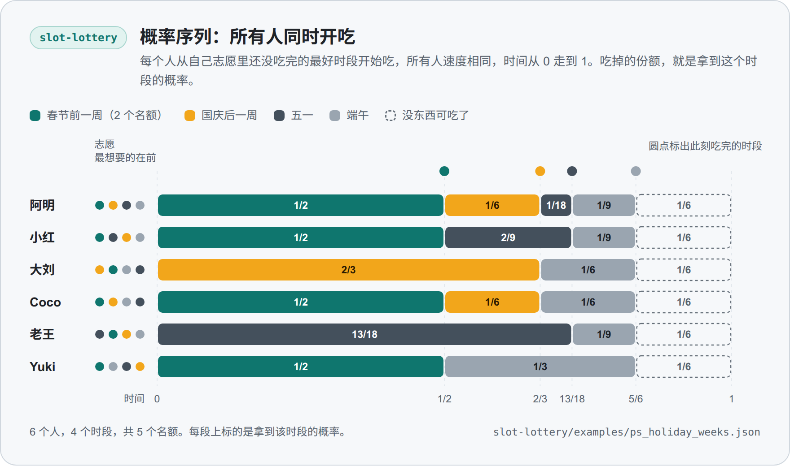

<a href="THEORY.md">English</a> · <b>简体中文</b>

# 理论说明

本文件为每个技能记录三件事：方法保证什么，不保证什么，方法出自哪里。本文件写给想核对这些说法的读者。

本文件遵循两条规则。

- 只有本仓库里的测试核对过一条保证，这条保证才会写下来。测试写在保证旁边，格式是 `file::function`，测试在测试类里时写成 `file::Class::function`。每个测试文件名都是唯一的，每一节都会说明它的测试放在哪个文件夹。
- 每条参考文献都带有 DOI，任何人都可以查到。参考文献在最后集中列出一次。

Version: 0.2.0

## 各节怎么读

每个技能的一节先写它的设定、模型和所用的词语，然后分三部分。

- **保证。** 带编号的陈述，每条后面跟着核对它的测试。
- **不保证。** 读者可能会以为成立、其实不该这样以为的内容。这里的陈述仍然可以引用测试，例如给出反例的测试。
- **方法。** 数字是怎样算出来的，以及保证所依据的推导。

处处成立的约定：

- 除非陈述里写了“取整后”，否则它说的是精确分数。脚本用精确分数计算，只在最后取整到整分。
- 退出码 2 表示输入无效，信息里会指出出问题的字段。退出码 3 表示大家约定的规则对这些数字没有解。退出码 1 表示某项核对没有通过，例如 `--verify` 不一致或自测失败。
- “共用机制”一节描述几个技能共同使用的部分。技能各自的一节只写它新增的内容。

## 共用机制

这些部分都在 `core/fsq_core.py` 里，`tools/sync_core.py` 把它逐字节复制到每个技能文件夹。它们的测试在 `tests/core/` 里。

### 精确金额与分

1. **金额是精确的。** 金额按货币单位的精确分数读入，绝不按二进制浮点数读入，所以 0.29 就是 29 分。小数位多于两位的金额会被拒绝，退出码为 2，并指出字段名。

   测试：`test_core_money.py::TestMoney::test_float_is_read_as_its_shortest_decimal`、`test_core_money.py::TestMoney::test_rejects_sub_cent_precision`、`test_core_money.py::TestParseInput::test_the_binary_float_trap_is_avoided`。

2. **份额按最大余数法取整到整分。** 每个人先得到自己精确份额（以分计）的向下取整，多出来的零头分给小数部分最大的人。所以取整后的各份加起来恰好等于总额，每一份与它的精确份额相差不超过一分。精确并列时，用名字的一次轮换来打破。名字按码位排序，轮换从某个键（例如账目编号）的 FNV-1a 哈希对名字个数取模的位置开始。键随账目而变，所以多出的那一分不会总落在同一个人身上，结果也不依赖输入的顺序。

   测试：`test_core_rounding.py::TestRoundShares::test_total_is_exact_and_everyone_is_within_one_cent`、`test_core_rounding.py::TestRoundShares::test_independent_of_input_order`、`test_core_rounding.py::TestRoundShares::test_leftover_cent_rotates_over_30_bills`、`test_core_rounding.py::TestFnv::test_known_vectors`。

3. **单个数值的取整。** 精确值取整到最近的整数，恰好一半时往上取，所以 5/2 得 3，-5/2 得 -2。rent-split 用它做报价的整分平移，ride-split 用它算以分计的单人车费。

   测试：`test_core_rounding.py::TestRoundHalfUp::test_nearest_integer_with_halves_going_up`、`test_core_rounding.py::TestRoundHalfUp::test_the_result_is_within_half_and_ties_go_up`。

4. **退出码。** 无效输入会让运行停下，退出码为 2，并指出字段名。规则对给定的数字没有解时，运行以退出码 3 停下。其他任何异常都是缺陷，不会被掩盖。

   测试：`test_core_cli.py::TestRunCli::test_input_error_exits_2_and_names_the_field`、`test_core_cli.py::TestRunCli::test_no_solution_exits_3`、`test_core_cli.py::TestRunCli::test_other_exceptions_are_bugs_and_propagate`。

### 公开随机性

有些技能从一段公开的随机源原文取得一个随机顺序，例如公开开奖的中奖号码。这些技能是：slot-lottery 的抽签、gift-exchange 里合法方案的抽取、chore-split 里值日表的挑选顺序、group-vote 和 stuff-split 里用来打破平局的顺序，以及 rent-split 里在同样好的分配之间的选择。从原文到顺序的映射处处相同。它只用 SHA-256 和整数运算，从不用 `random` 模块，所以在每个 Python 版本和每个平台上得到同样的顺序。用文字写出来，就是共用核心里的 `SEED_SPEC`。

- 种子是规范化 JSON（键排序，无空格，UTF-8）的 SHA-256，这个 JSON 是 `{"n_slots": N, "participants": names sorted by code point, "rule": RULE, "source": SOURCE TEXT}`。
- 第 c 次取数是 SHA-256（种子加上 c 的 8 字节大端）的前 8 个字节，按大端读成整数。
- 取小于 n 的均匀整数时，如果 x 小于不超过 2^64 的 n 的最大倍数，就取 x mod n，否则改用下一次取数。
- 顺序是对按码位排序的名字做一次 Fisher-Yates 洗牌（Durstenfeld 1964 的原地形式）：i 从 n-1 降到 1，把位置 i 与 [0, i] 内的一个均匀整数所指的位置交换。

每个技能固定自己的规则名。slot-lottery 用 `uniform_lottery_v1`、`rsd_v1`、`ps_bvn_v1` 和 `da_tiebreak_v1`。gift-exchange 用 `gift_exchange_any_enum_v1`、`gift_exchange_any_reject_v1`、`gift_exchange_ring_enum_v1` 和 `gift_exchange_ring_reject_v1`。stuff-split 用 `stuff_split_priority_v1`。chore-split 用 `chore_pick_order_v1` 和 `chore_bundle_tiebreak_v1`。group-vote 用 `group_vote_tie_order_v1`。rent-split 用 `rent_split_assignment_v1`。

1. **顺序是这四个输入的函数。** 结果只取决于规则名、名字集合、名额数和随机源原文，与名字列出的顺序无关。四者中任何一个改变，种子就会改变，两个不同的输入绝不会共用同一个原像，因为规范化 JSON 会给每个字符串加引号并转义。随机源原文逐字使用，不做修剪。另一个实现按上面的描述写成，与共用核心没有任何相同的代码，对随机输入给出同样的种子和顺序。

   测试：`test_core_seed.py::TestAgainstTheSpecification::test_seed_and_order_follow_the_spec`、`test_core_seed.py::TestAgainstTheSpecification::test_result_does_not_depend_on_listing_order`、`test_core_seed.py::TestMakeSeed::test_every_component_matters`、`test_core_seed.py::TestMakeSeed::test_no_two_inputs_share_a_preimage`、`test_core_seed.py::TestSeedPreimage::test_it_is_the_canonical_json_of_the_four_inputs`、`test_core_seed.py::TestSeededOrder::test_the_order_equals_draw_order_whatever_the_listing_order`。

2. **记录的值。** 对 slot-lottery 一节里记录的示例中的八个人、三个名额和那段虚构的随机源原文，种子以 15b9c53a44270857eb442863 开头，顺序是 Yuki 小周 大刘 Coco 小红 阿明 Mia 老王。这些值是在 Python 3.10、3.12 和 3.13 上记录的，CI 在 Python 3.9 到 3.13 上核对它们。

   测试：`test_core_seed.py::TestGoldenValues::test_seed_and_order_match_the_recorded_values`、`test_core_seed.py::TestGoldenValues::test_first_raw_draws`。

3. **拒绝采样与洗牌。** 只在 x 小于 n 的最大倍数时保留 x mod n，这样每个余数的可能性相等。洗牌返回输入的一个排列，并且不改动输入。Fisher-Yates 每个位置做一次选择，共有 n! 种选择序列，不同的序列给出不同的排列。

   测试：`test_core_seed.py::TestSeedStream::test_rejection_sampling_skips_the_biased_tail`、`test_core_seed.py::TestSeedStream::test_power_of_two_never_rejects`、`test_core_seed.py::TestShuffleAndSample::test_is_a_permutation_and_leaves_the_input_alone`。

4. **随机源不可预测时，机会均等。** 如果随机源原文无法预测，并且 SHA-256 的表现像随机函数，那么每个顺序的概率都是 1/n!。从 n 个人里抽出 k 个获胜者时，每个人被抽中的概率都是 k/n。这依赖这两个假设。测试用固定的随机源原文和落在尾部远处的阈值，从统计上核对它的推论。

   测试：`test_core_seed.py::TestSeedStream::test_values_are_uniform_enough`、`test_core_seed.py::TestSeedStream::test_shuffles_of_three_are_uniform_enough`、`test_core_seed.py::TestSeedStream::test_each_person_wins_about_k_over_n_of_the_time`。

**不保证。**

- 关于机会的陈述假定：定下规则的时候，随机源原文无法被预测或影响。脚本核对不了这段原文来自哪里，也核对不了它是什么时候定下的。如果原文可以事先猜到，或者可以事后挑选，能做到这一点的人就可以试各种变体（换一天的号码、多加一个名字、多加一个名额），留下对自己有利的顺序。名字名单必须在随机源公布之前冻结并展示出来，因为加上或去掉一个名字也是试变体的一种办法。

### 承诺

rent-split 里组织者先报价的规则和 slot-lottery 里承诺与揭示的抽签，用的是同一种承诺。一个人现在确定一份原文，以后再把它展示出来，任何人都可以核对前后两者是否一致。先承诺后揭示的想法来自 Blum（1983）。

1. **格式。** 承诺码是下面这段文本的 SHA-256：文本 `fsq-commit-v1`，一个换行，一个 128 位随机数的盐（写成 32 个小写十六进制字符），一个换行，再接原文的规范化 JSON。规范化 JSON 固定键的顺序，并把数字写成普通小数，所以空格、键的顺序和数字的写法（3000 或 3000.00）都无关紧要。原文或盐有任何改动，承诺码就会不同。原文和盐都正确的承诺能通过核对，原文或盐被改过的承诺通不过。

   测试：`test_core_commit.py::TestFormat::test_known_answer`、`test_core_commit.py::TestRoundTrip::test_commit_then_verify`、`test_core_commit.py::TestRoundTrip::test_changed_payload_or_nonce_fails`、`test_core_commit.py::TestCanonicalPayload::test_key_order_and_spacing_do_not_matter`、`test_core_commit.py::TestCanonicalPayload::test_integers_and_whole_decimals_agree`。

2. **盐是新生成的，来自系统的密码学随机数生成器。** 对同一份原文的两个承诺并不相同，过弱或格式错误的盐会被拒绝。

   测试：`test_core_commit.py::TestNonce::test_nonces_are_fresh_and_128_bit`、`test_core_commit.py::TestNonce::test_nonce_comes_from_secrets`、`test_core_commit.py::TestNonce::test_weak_or_malformed_nonce_is_refused`。

在关于 SHA-256 的通常假设下，现在公布的承诺码在盐保密期间隐藏原文，等盐和原文都展示之后，又把这个人约束在这份原文上。这些是哈希函数的性质，这里没有测试。

### 输入文件

脚本从标准输入读入输入，或者用 `--input FILE` 从文件读入。选项 `--delete-input` 在脚本读完那个文件后立刻把它删掉。不能把输入用管道送进脚本的 Agent 会改为把输入写进文件，这个选项让私密的数字不会留在那个文件里。

1. **文件一读完就被删除，不管之后发生什么。** 删除发生在文件读完之后立刻进行，早于把文本解析成 JSON。所以输入被接受时文件已经没了，输入不是有效的 UTF-8、不是有效的 JSON、太大、不是 JSON 对象、被技能的检查拒绝，或者在约定的规则下无解时，文件同样已经没了。

   测试：`test_core_cli.py::TestDeleteInput::test_a_good_file_is_read_and_then_deleted`、`test_core_cli.py::TestDeleteInput::test_a_file_with_a_byte_order_mark_is_read_and_deleted`、`test_core_cli.py::TestDeleteInput::test_a_rejected_input_is_deleted_all_the_same`、`test_core_cli.py::TestDeleteInput::test_a_file_that_is_too_large_is_deleted_all_the_same`、`test_core_cli.py::TestDeleteInput::test_a_value_that_is_not_an_object_is_deleted_all_the_same`、`test_core_cli.py::TestDeleteInputEndToEnd::test_a_rejected_input_exits_2_naming_the_field_and_the_file_is_gone`、`test_core_cli.py::TestDeleteInputEndToEnd::test_a_rule_with_no_solution_exits_3_and_the_file_is_gone`。

2. **没读过的东西不会被删。** 读不了的路径、目录和符号链接都会让运行以退出码 2 停下。标准输入不会留下文件，所以它会在读取任何内容之前让运行停下。同一个文件夹里的其他文件保持原样，演示不读任何文件，也不删任何文件。

   测试：`test_core_cli.py::TestDeleteInput::test_standard_input_is_refused_and_not_touched`、`test_core_cli.py::TestDeleteInput::test_leaving_out_the_input_option_means_standard_input_and_is_refused_too`、`test_core_cli.py::TestDeleteInput::test_a_missing_file_is_an_error_and_nothing_is_deleted`、`test_core_cli.py::TestDeleteInput::test_a_directory_is_refused_and_keeps_its_contents`、`test_core_cli.py::TestDeleteInput::test_a_symbolic_link_is_refused_and_it_and_its_target_both_stay`、`test_core_cli.py::TestDeleteInput::test_only_the_file_that_was_read_is_deleted`、`test_core_cli.py::TestDeleteInput::test_the_demo_reads_no_file_and_deletes_none`、`test_core_cli.py::TestDeleteInputEndToEnd::test_a_missing_path_exits_2_and_the_folder_is_left_as_it_was`。

3. **不加这个选项，文件就留着，删除失败会被报告。** 读过但删不掉的文件会让运行以退出码 2 停下，并给出指明该文件的信息。私密的输入还在磁盘上、却没有人知道的时候，脚本不会打印结果。

   测试：`test_core_cli.py::TestDeleteInput::test_the_file_stays_when_the_option_is_off`、`test_core_cli.py::TestDeleteInput::test_a_file_that_cannot_be_deleted_is_reported_and_not_ignored`、`test_core_cli.py::TestStandardArgs::test_delete_input_is_off_unless_asked_for`。

### 对每个技能都成立的局限

- 删除输入文件是普通的删除。它不会覆盖文件内容，也碰不到编辑器、备份或文件系统可能留下的副本。如果运行在读文件之前就停下，例如选项输错了，删除就不会发生，文件仍留在原处。在脚本读它之前，文件里以明文放着输入。标准输入不产生输入文件，所以凡是 Agent 能用的地方，它都是更好的途径。Shell 仍可能把很长的 heredoc 暂时放在它自己的临时文件里，脚本管不到这一点。
- 脚本对相关的人自己选的数字做运算。它们看不出报价、排序、选票或读数是否诚实。

## rent-split

测试在 `tests/skills/rent_split/` 里，共用部分的测试例外，它们在 `tests/core/` 里。

### 保证

有 n 个人和 n 间房，整套房子每月的租金是 R。每个人对每间房给出一个私下的报价，每个人的各个报价加起来等于 R。报价是这个人自己来定所有房间的价格时，会给这间房定的价。住在房间 j、房租为 p_j 的人，效用是 (自己对 j 的报价) - p_j。无嫉妒的分法是这样一种分法：没有人在另一间房、按那间房的房租住的时候，效用比现在更大。

1. **房租加起来等于总额。** 房租加起来恰好等于 R，取整后也仍然加起来恰好等于 R，精确到分。每间房租出去一次。

   测试：`test_rent_split_properties.py::test_rents_add_up_to_the_total_and_every_room_is_rented_once`。

2. **无嫉妒。** 按各人自己的报价来看，没有人更想要另一间房（按那间房的房租）。这在精确运算中成立，其中报价加起来不对的人，已按保证 7 做了平移。

   测试：`test_rent_split_properties.py::test_nobody_envies_anybody_in_exact_arithmetic`。

3. **无嫉妒的分法中最公平的一种。** 人们拿到的房间使中选报价的总和最大，房租让最差的人尽量好（Gal、Mash、Procaccia 和 Zick 2017 的 maximin 规则）。答案是唯一的。在 `spliddit` 和 `forbid` 下，房租不能为负，效用是没有负房租的分法中的 leximin 最优解：最低的效用尽量高，然后是第二低的，依此类推。脚本用精确分数上的最短路来求解这两种情形，不用求解器。

   测试：`test_rent_split_lp.py::test_maximin_leximin_and_feasibility_match_the_linear_programs` 和 `test_rent_split_lp.py::test_a_seeded_sweep_covers_plain_negative_and_infeasible_cases` 把这一点与 `scipy.optimize.linprog` 对照核对。`test_rent_split_lp.py::test_leximin_differs_from_plain_maximin_when_a_rent_would_be_negative` 手工核对一个小例子。`test_rent_split_properties.py::test_hungarian_method_agrees_with_brute_force` 和 `test_rent_split_properties.py::test_the_assignment_has_the_largest_total_bid` 把挑选房间的匈牙利算法与全部分配对照核对。

4. **能避免负房租时就没有负房租。** 在 `spliddit` 和 `forbid` 下，只要存在没有负房租的分法，就没有任何房租为负。如果不存在，`forbid` 以退出码 3 停下，`spliddit` 给出 `allow` 的答案。线性规划对究竟是哪种情形的判断与脚本一致。当 maximin 分法没有负房租时，三条规则给出同样的答案。

   测试：`test_rent_split_properties.py::test_spliddit_and_forbid_never_pay_anyone_to_live_when_a_split_without_exists`、`test_rent_split_properties.py::test_the_three_rules_agree_when_the_standard_solution_has_no_negative_rent`、`test_rent_split_lp.py::test_the_closet_that_nobody_values_has_no_split_without_negative_rent`、`test_rent_split_cli.py::test_forbid_without_a_solution_exits_3_with_both_languages`。

5. **没有人付得比自己的报价多。** 在精确运算中，一个人的房租至多等于他对自己那间房的（平移后的）报价。把人 i 对所有房间的无嫉妒不等式加起来，得到 n u_i >= (i 的各个报价之和) - R = 0，所以效用 u_i 不为负。

   测试：`test_rent_split_properties.py::test_nobody_pays_more_than_their_own_bid_for_their_room`。

6. **取整。** 每份房租向下或向上取整到整分，使总额保持精确。在所有这样的取整里，选最大羡慕最小的那一种（至多 8 间房时穷举搜索，再多则用爬山法）。每份取整后的房租与精确值相差不超过一分，取整后的最大羡慕至多一分。取整后的数字显示出一分的羡慕时，那个人的核对说明会注明这一点。一个人取整后的房租从不高于他对这间房的报价，除非他的报价被平移过不足一分的零头，此时房租至多高出一分。在这种情况下，“你付的不超过你自己给这间房的报价”那一行会注明这一点。

   测试：`test_rent_split_properties.py::test_rounded_envy_is_at_most_one_cent_and_rents_are_floor_or_ceiling`、`test_rent_split_properties.py::test_bids_that_do_not_add_up_are_shifted_so_the_given_bids_show_no_envy`、`test_rent_split_golden.py::TestRoundingEdges::test_one_cent_of_rounded_envy_is_reported_as_rounding`、`test_rent_split_golden.py::TestRoundingEdges::test_a_rent_one_cent_above_the_shifted_bid_is_reported`。取整本身由共用核心里的 `test_core_rounding.py::TestRoundMinEnvyThreePersonExample::test_min_envy_rounding_gives_zero_where_naive_gives_one` 和 `test_core_rounding.py::TestRoundMinEnvyProperties::test_exact_search_matches_brute_force_and_bounds_envy_by_one_cent` 测试。

7. **只平移，不缩放。** 如果一个人的报价加起来是 S 而不是 R，其中每个报价都平移 (R - S) / n。平移保持任意两间房之间的差，而羡慕只取决于这些差，所以这个人拿结果去对照自己实际给出的报价时，不会发现羡慕。把报价缩放到正确的和会改变这些差。在一个总额为 6000、报价加起来是 7200 的例子里，缩放后按这个人自己的报价还剩 300.00 的羡慕，平移后一点也不剩。给一个人的所有报价加同一个常数不会改变任何结果，因为脚本会把它再减掉。

   测试：`test_rent_split_properties.py::test_shifting_all_of_one_persons_bids_changes_nothing`、`test_rent_split_golden.py::TestShiftNotScale::test_a_shifted_row_gives_the_rents_of_the_shifted_bids`、`test_rent_split_golden.py::TestShiftNotScale::test_the_person_checks_the_result_against_the_original_bids`、`test_rent_split_golden.py::TestShiftNotScale::test_scaling_would_have_broken_the_guarantee`。

8. **与输入的顺序无关。** 重新排列人或房间，除了输出的顺序，什么都不会变，精确的房租和效用跟着人和房间的重新编号一起走。

   测试：`test_rent_split_properties.py::test_reordering_people_and_rooms_changes_nothing_but_the_order`、`test_rent_split_properties.py::test_exact_solution_follows_a_renumbering_of_people_and_rooms`。

9. **并列不会改变钱。** 如果两种分配恰好同样好，那么两者的房租和每个人的精确好处都相同，因为使总报价最大的所有分配，房租都是一样的。没有随机源时，按名字的顺序依次处理每个人，每个人取按名字顺序排在最前的合适房间。有公开随机源时，顺序和选择来自“公开随机性”一节的计数器流，种子由随机源、规则名和人员名单决定。结果只是这些输入的函数。

   测试：`test_rent_split_properties.py::test_a_random_source_gives_a_valid_reproducible_assignment`、`test_rent_split_properties.py::test_a_random_source_spreads_the_rooms_when_everybody_is_indifferent`、`test_rent_split_properties.py::test_without_a_random_source_ties_go_by_name`。

10. **审计。** 审计把现在的分配判为最优，当且仅当它的总报价在所有分配中最大。一个人在现在这个分法下的羡慕，是指他按现在的房租换到最好的另一间房所能多得的好处。分配最优时，会为每个人显示现在的房租与规则房租的差。分配不是最优时，无论怎样定房租，都不可能让这个分配无嫉妒（Svensson 1983），审计会建议采用规则给出的分配。

    测试：`test_rent_split_properties.py::test_the_audit_flags_an_assignment_exactly_when_it_is_not_welfare_maximising`、`test_rent_split_properties.py::test_audit_envy_is_what_the_person_would_gain_by_taking_another_room`、`test_rent_split_properties.py::test_auditing_the_rules_own_split_finds_nothing_to_change`、`test_rent_split_golden.py::TestAudit::test_equal_split_audit_a`、`test_rent_split_golden.py::TestAudit::test_audit_b_assignment_by_arrival_order`。

11. **输出的隐私。** 群汇总里没有任何报价，私信里只有收信人自己的报价和公开的房租。

    测试：`test_rent_split_golden.py::TestPrivacy::test_the_group_summary_holds_no_bid`、`test_rent_split_golden.py::TestPrivacy::test_a_private_message_holds_only_the_receivers_bids`。

12. **承诺。** 承诺遵循上面“承诺”一节的格式。它的原文是这个人、总租金和按房间名列出的报价。它不依赖房间的顺序，也不依赖数字的写法。报价、总额或房间名有任何改动，都会得到另一个码。

    测试：`test_rent_split_cli.py::test_a_commitment_with_a_fixed_nonce_has_a_fixed_code`、`test_rent_split_cli.py::test_the_revealed_row_matches_the_code`、`test_rent_split_cli.py::test_the_order_of_rooms_and_the_spelling_of_numbers_do_not_matter`、`test_rent_split_cli.py::test_a_changed_row_does_not_match_and_exits_1`。

13. **可复现。** 同样的输入在每种输出格式下都得到同样的字节。

    测试：`test_rent_split_properties.py::test_the_output_is_deterministic`、`test_rent_split_cli.py::test_the_demo_is_byte_stable_and_matches_the_recorded_output`。

### 不保证

- **防策略。** 出价之前就看到了其他所有人报价的人，有时可以靠谎报获益。`test_rent_split_golden.py::TestOrganizerWhoGoesLast::test_a_lie_by_one_person_raises_their_true_surplus` 里就有这样的例子。
- **均匀的平局处理。** 平局的处理可以复现，并且不依赖输入的顺序。各个最优分配不一定有相等的机会。
- **模型以外的一切。** 报价按拟线性处理：一个人有多喜欢一间房，与他一共付多少钱无关。脚本不处理预算上限、人数多于房间数，也不处理两个不是情侣却合住一间房的人。情侣应当作为一个人一起报价。最多接受 20 个人。
- **平移不足一分的零头之后的精确金额。** 当一个人的报价差出的数额无法按整分分摊到各间房时，显示给这个人的报价会取整到分。关于羡慕的陈述不受影响，因为它们只用到房间之间的差。

### 方法

1. **分配。** 房间分给人，使中选报价的总和尽可能大（匈牙利算法）。无嫉妒的分法只对这样的分配存在（Svensson 1983）。
2. **房租。** 设 w(i, k) 为人 k 对 k 所住房间的报价减去人 i 对该房间的报价，设 d(i, k) 为以这些权重在完全图上算出的最短路距离（Floyd-Warshall）。效用向量无嫉妒，当且仅当对所有 i 和 k 都有 u_k - u_i <= d(i, k)。满足 u >= 0 的这类向量里最小的是 L_i = -min_k d(i, k)，而让最差的人尽量好的无嫉妒效用是 u_i = t + L_i，其中 t = (W - L 之和) / n，W 是中选报价的总和减去 R。人 i 分到的那间房的房租是 (自己的报价) - u_i。这就是 Gal、Mash、Procaccia 和 Zick（2017）的 maximin 规则，写成了闭式，而不是线性规划。因为使总报价最大的每一种分配，房租都相同，所以在这些分配之间的选择只决定谁住哪间。
3. **没有负房租。** 房租不为负，当且仅当 u_i 至多等于人 i 自己的报价。落在这些上限以下的无嫉妒效用有一个最大元素 G_k = min_i (i 自己的报价 + d(i, k))，没有负房租的分法存在，当且仅当 G_k 之和至少为 W。在这样的分法里，脚本取 leximin 的那一种：把最低的效用尽量抬高，找出不能再抬高的人，把他们固定在那里，对其余的人重复这一过程。结果是唯一的。
4. **规则。** `allow` 用第 2 步。`forbid` 用第 3 步，第 3 步无解时报告没有解。默认的 `spliddit` 以计算器命名（Goldman 和 Procaccia 2015），它遵循的目标是：在无嫉妒的分法中，让最小的好处尽可能大。它用第 3 步，第 3 步无解时退回第 2 步。大家在任何人报价之前，从这三条规则里选一条。

## bill-split

测试在 `tests/skills/bill_split/` 里，共用部分的测试例外，它们在 `tests/core/` 里。性质测试把脚本与另外写的、写法朴素的参考求解器（`bs_testlib.py`）对照，golden 测试里的数字是手算出来的。

### 保证

1. **总额是精确的。** 金额是精确的，如“精确金额与分”所述。所以 0.29 就是 29 分。小数位多于两位的金额会被拒绝，退出码为 2，并指出字段名。一笔开支各人应付的份额加起来恰好等于所付的金额，精确到分，每一份都是精确金额的向下取整，或者向下取整再加一分。

   测试：`test_bill_split_golden.py::TestDecimals::test_029_is_29_cents`、`test_bill_split_golden.py::TestDecimals::test_the_binary_float_trap_does_not_lose_a_cent`、`test_bill_split_properties.py::TestExpenseTotals::test_owed_adds_up_to_the_total_to_the_cent`、`test_bill_split_properties.py::TestExpenseTotals::test_each_expense_matches_exact_arithmetic_within_a_cent`、`test_bill_split_validation.py::TestExpenseErrors::test_exit_2_and_the_field_is_named`。

2. **多出的零头轮换分配，并且不依赖输入的顺序。** 份额按“精确金额与分”里描述的最大余数法取整。精确并列时，用名字的一次轮换来打破。名字按码位排序，轮换从账目编号的 FNV-1a 哈希对名字个数取模的位置开始。例如，名为 expense-1 到 expense-30 的三十笔账，每笔 100 由三个人平摊，每个人恰好有 10 次拿到多出的那一分。打乱人、开支、项目、费用以及输入里每一个映射的顺序，都不会改变任何数字。

   测试：`test_bill_split_golden.py::TestLeftoverCent::test_the_extra_cent_rotates_over_30_bills`、`test_bill_split_golden.py::TestLeftoverCent::test_the_certificate_names_who_got_the_cent`、`test_bill_split_properties.py::TestOrderIndependence::test_the_result_does_not_depend_on_the_order_of_the_input`、`test_bill_split_properties.py::TestOrderIndependence::test_the_same_input_gives_the_same_bytes`。

3. **一份的各个部分加起来等于这一份。** 明细（项目、每项费用、每项折扣，或者菜品、打包费、每项费用和每张优惠券）按层取整：每一层之后的累计值取整到分，一个部分就是从上一层到这一层的变化量。最后一层恰好就是对精确总额的一次取整，所以明细从不会改变任何人的份额。一个部分与它的精确值可以相差不到两分。

   测试：`test_bill_split_properties.py::TestExpenseTotals::test_the_parts_of_every_share_add_up_to_it`、`test_bill_split_properties.py::TestExpenseTotals::test_each_part_is_within_two_cents_of_its_exact_value`、`test_bill_split_properties.py::TestGroupOrder::test_the_parts_add_up_to_what_each_person_pays`。

4. **结清会清掉每个差额。** 各人的差额加起来为零。按建议的转账做完之后，每个人都是零，再运行一次不会再建议任何转账。每笔转账都从差额为负的人转给差额为正的人，所以没有人既付款又收款。

   测试：`test_bill_split_properties.py::TestSettlement::test_balances_sum_to_zero_and_the_transfers_clear_them`、`test_bill_split_properties.py::TestSettlement::test_nobody_both_pays_and_receives`、`test_bill_split_properties.py::TestSettlement::test_the_transfers_do_not_depend_on_the_order_of_the_balances`。

5. **至多 16 个人有差额时，转账笔数是可能的最少。** 见下面的方法。子集搜索得出的笔数，在至多 8 个人时，等于对所有分成零和小组的划分穷举所得的笔数。在至多 5 个人、差额很小时，等于对所有转账做广度优先搜索所得的笔数。做完任意一笔建议的转账之后，剩余差额所需的最少笔数恰好少一笔。

   测试：`test_bill_split_properties.py::TestSettlement::test_the_dp_count_equals_the_brute_force_minimum`、`test_bill_split_properties.py::TestSettlement::test_the_dp_count_equals_a_search_over_all_transfers`、`test_bill_split_properties.py::TestSettlement::test_after_one_transfer_the_minimum_drops_by_exactly_one`、`test_bill_split_properties.py::TestSettlement::test_the_group_split_adds_up_and_each_group_is_minimal`、`test_bill_split_validation.py::TestOddButValidInputs::test_exactly_16_balances_are_searched_exactly`。

6. **贪心规则有界。** 超过 16 个人时，或者大家选了这条规则时，由最大欠款人付给最大债主。它用的转账笔数从不少于搜索得到的笔数，也从不多于有差额的人数减一。用过贪心规则时，脚本会说明。在一个记录的示例里，它需要四笔转账，而三笔就够了。

   测试：`test_bill_split_properties.py::TestSettlement::test_greedy_is_never_fewer_than_the_dp_and_at_most_n_minus_1`、`test_bill_split_validation.py::TestOddButValidInputs::test_more_than_16_balances_fall_back_to_greedy_and_say_so`、`test_bill_split_golden.py::TestTransfers::test_greedy_rule_can_be_chosen_and_says_so`、`test_bill_split_golden.py::TestTransfers::test_greedy_needs_four_where_three_are_enough`。

7. **按 Shapley 值分摊的优惠券，在这个值的意义上分得公平。** 各人的份额加起来等于各档位对整单给出的减额（效率性）。点了同样菜品的人得到同样的份额（对称性）。没点菜品的人什么也得不到。没有一份是负的。至多 6 个人时，精确值等于边际贡献在人的所有顺序上的平均。这个计算就是共用核心里的精确 Shapley 值，ride-split 也用它。

   测试：`test_bill_split_properties.py::TestShapley::test_efficiency_shares_add_up_to_the_reduction`、`test_bill_split_properties.py::TestShapley::test_symmetry_equal_dishes_get_equal_shares`、`test_bill_split_properties.py::TestShapley::test_a_person_with_no_dishes_gets_nothing`、`test_bill_split_properties.py::TestShapley::test_nobody_gets_a_negative_share_and_nobody_gets_more_than_the_reduction`、`test_bill_split_properties.py::TestShapley::test_agrees_with_averaging_over_all_orders`、`test_bill_split_properties.py::TestShapley::test_the_hand_computed_example`。共用核心里的测试：`test_core_shapley.py::TestAgainstTheDefinition::test_integer_worths_equal_the_average_over_all_orders`、`test_core_shapley.py::TestAxioms::test_efficiency_the_values_add_up_to_the_worth_of_everyone`、`test_core_shapley.py::TestAxioms::test_symmetry_interchangeable_players_get_equal_values`。

8. **拼单的付款遵守写明的规则。** 打包费跟着菜走，费用和定额优惠券按规则所说的方式分摊，每笔付款与一次独立的精确计算相差不超过一分。

   测试：`test_bill_split_properties.py::TestGroupOrder::test_payments_add_up_and_match_exact_arithmetic`、`test_bill_split_properties.py::TestGroupOrder::test_the_coupon_shares_add_up_to_the_reductions`、`test_bill_split_golden.py::TestTakeoutGroupOrder::test_payments_and_trap_check`、`test_bill_split_golden.py::TestTakeoutGroupOrder::test_coupon_shares_are_the_shapley_value`。

9. **与自己单点比较的核对是真算出来的。** 脚本恰好列出这样的人：他们在拼单里的付款，高于同样的菜品单点所需的价钱。当没有人能单独达到任何一档时，这项核对保证通过，因为 Shapley 份额从不为负，费用的份额也从不超过整笔费用。否则它可能不通过，例如三个人各点 100，而优惠券在达到 100 时减 20。

   测试：`test_bill_split_properties.py::TestGroupOrder::test_the_trap_check_is_exactly_pay_not_above_alone`、`test_bill_split_properties.py::TestGroupOrder::test_nobody_pays_more_than_alone_when_nobody_reaches_a_tier_alone`、`test_bill_split_properties.py::TestGroupOrder::test_three_full_orders_waste_a_coupon_and_the_check_says_so`。

10. **审计只是一次比较，没有别的。** 现在的分法（平均分、按菜价分，或者大家给出的金额）加起来与结果的总额相同，每个人的差加起来为零。

    测试：`test_bill_split_properties.py::TestExpenseTotals::test_audit_against_equal_shares_is_consistent`、`test_bill_split_properties.py::TestAuditWithAmounts::test_explicit_current_amounts_are_compared_person_by_person`、`test_bill_split_properties.py::TestGroupOrder::test_audit_against_equal_shares_is_consistent`、`test_bill_split_properties.py::TestGroupOrder::test_audit_against_proportional_shares_is_consistent`。

11. **格式不对的输入会连同字段名一起报告。** 在变异测试里，每一个被改动、删除或新增的字段，得到的要么是一个结果，要么是指明某个字段的输入错误。被变异的输入没有一个让脚本崩溃。

    测试：`test_bill_split_fuzz.py::TestMutatedInputs::test_a_mutated_ledger_gives_a_result_or_an_input_error`、`test_bill_split_fuzz.py::TestMutatedInputs::test_a_mutated_order_gives_a_result_or_an_input_error`、`test_bill_split_validation.py::TestOrderErrors::test_exit_2_and_the_field_is_named`。

### 不保证

- **转移的总金额。** 转移的钱的总数没有被最小化，被最小化的只是转账的笔数。
- **有差额的人超过 16 个。** 这时不保证转账笔数最少。这个问题一般是 NP 难的（见方法）。
- **Shapley 值是一种约定。** 它是一种公平的约定，并不是每个群都会偏好的方式。它可能给一份小订单一个比订单本身还大的份额，只因为这份小订单把全群抬过了门槛，于是这个人会收到钱。脚本会报告这种情况。用它，还是按菜价比例分摊优惠券，必须在点单之前说定。测试：`test_bill_split_validation.py::TestOddButValidInputs::test_a_negative_shapley_payer_is_reported`。
- **防策略。** 这些方法不防操纵。小票和菜价被当作事实，所以有人可能多点几样东西来越过门槛。
- **与自己单点比较的核对。** 它用同样的档位和完整的费用，给同样菜品的单点订单定价。像平台红包这样的定额优惠券，被假定只在拼单里才有，不会从单点价里扣除。门槛只拿菜品小计来比较。
- **范围。** 一种货币，整分，没有税费或小费规则，也没有汇率。

### 方法

**金额。** JSON 数字被解析成精确分数。所有运算都在分数上进行，分只通过取整产生。对一笔开支，人 i 的精确金额是他在各项目中的份额之和，加上他在各项费用中的份额，减去他在各项折扣中的份额。按消费分摊的费用，按精确的项目份额的比例分摊。

**最少转账笔数。** 设 b 为 k 个人的非零差额，它们加起来为零。一次结清是一组转账，可以看成 k 个人上的一张图。在每个连通分量里，差额必须加起来为零，而 m 个人的分量要连通，至少需要 m - 1 条边。设 g 为把 k 个人划分成若干组、并使每一组之和都为零时，所能得到的最大组数，那么这张图至多有 g 个分量，因此至少有 k - g 条边。反过来，m 个人的一组，只要和为零，就能用 m - 1 笔转账结清：让最大欠款人付给最大债主，这至少能清掉两人中的一个，而最后一笔转账同时清掉两个人。所以最少的转账笔数是 k - g。

要求 g，先给人排一个顺序，数一数哪些前缀的差额之和为零。在所有顺序上，这样的前缀数的最大值就是 g，因为两个相邻的零前缀之间的块是和为零的组，而分成 g 组的划分给出一个有 g 个零前缀的顺序。可以用对子集的动态规划来算：best[S] 是 S 中所有 i 的 best[S 去掉 i] 的最大值，如果 S 里的差额之和为零，再加一。这需要 O(2^k k) 的时间。沿着表往回走，得到一个顺序。在零前缀处把它切开，得到各个组。每个组按上面的办法结清。平局按排序后的名字打破，所以同样的输入得到同样的转账。

这个问题一般是 NP 难的。k - 2 笔转账是否够用，与差额里是否含有一个和为零的非空真子集，是同一个问题。给定正整数 a_1, ..., a_m 和目标 T，其中 0 < T < a 之和，取差额 a_1, ..., a_m，以及 -T 和 -(a 之和 - T)。一个和为零的真子集要么含有 -T 和若干加起来等于 T 的 a_i，要么含有 -(a 之和 - T) 和若干加起来等于 a 之和 - T 的 a_i，而此时剩下的 a_i 加起来等于 T。同时含有两个负差额的子集需要全部的 a_i，所以不是真子集。因此，和为零的真子集存在，当且仅当某些 a_i 加起来等于 T。子集和问题是 NP 完全的（在 Karp 1972 里以 KNAPSACK 的名字出现）。从这篇引用里取用的只有这一个事实。

**按 Shapley 值分摊优惠券。** 局中人是点了餐的人。一组人 S 的价值 v(S) 是各档位对 S 的菜品合计给出的减额，也就是门槛被合计达到的那些档位里最大的减额，达不到任何门槛时为零。人 i 的 Shapley 值（Shapley 1953）是 v(S + i) - v(S) 在人们可能被凑到一起的所有顺序上的平均，其中 S 是排在 i 之前的人的集合。等价地，它是对所有不含 i 的组 S 求和，每项是 |S|! (n - |S| - 1)! / n! 乘以 (v(S + i) - v(S))。脚本枚举全部 2^n 个组，所以在至多 16 个人时是精确的，更多的人会被拒绝（`test_bill_split_properties.py::TestShapley::test_the_largest_group_is_exact_and_quick`、`test_bill_split_properties.py::TestShapley::test_more_than_16_people_are_refused`）。对于单个门槛，这就是 Shapley-Shubik 权力指数（Shapley 和 Shubik 1954）。分档的优惠券是若干门槛博弈的和，而这个值是线性的，所以它就是各权力指数按各档增量加权后的和。因为加入一个人时 v 从不减少，所以没有一份是负的。

例子。满 300 减 60，三个人点的餐分别是 150、140 和 20。任意两个人最多凑到 290，所以只有整个群才能拿到这笔减额。每个人在三分之一的顺序里是最后到的人，Shapley 值给每个人 20.00。点 20.00 的那个人什么也不用付。按订单比例分摊得到 29.03、27.10 和 3.87，所以那个人要付 16.13。测试：`test_bill_split_golden.py::TestCouponHook::test_shapley_makes_the_small_order_free`、`test_bill_split_golden.py::TestCouponHook::test_proportional_split_is_29_03_27_10_3_87`、`test_bill_split_golden.py::TestCouponHook::test_without_the_small_order_nothing_is_saved`。

**单点。** 人 i 的单点价是：他的菜品，加上他的打包费，加上每一项费用的全额，再对每张分档的优惠券减去他自己的菜品合计所能拿到的减额。如果单独达不到任何一档，单点价就是菜品加打包费加费用。拼单价是同样的菜品和打包费，加上每项费用的一份（它从不超过整笔费用），减去优惠券的份额（它们从不为负）。所以拼单价的精确值不会更大。单点价是整数个分。整数分的拼单价不会被向上取整，其他的拼单价都低于下一个整数分，而下一个整数分至多等于单点价。因此取整不可能让拼单价超过单点价。

## ride-split

测试在 `tests/skills/ride_split/` 里，共用部分的测试例外，它们在 `tests/core/` 里。

### 保证

一次乘车是一个成本博弈。一组乘客的成本，是这些人自己单独乘一趟车所要付的车费。在 meter 和 estimates 模式下，这个成本是组员中最贵的单独车费，因为开到最远那位乘客处的车也载着其他人（机场博弈）。在 general 模式下，它是为这一组输入的价格，或者是把计价标准用在经过他们所有站点的最短路线上得到的价钱。技能用这个博弈的 Shapley 值分车费：每位乘客上车时带来的额外车费，在乘客们可能上车的所有顺序上的平均。这是 Spliddit 出租车计算器的规则（Goldman 和 Procaccia 2015）。然后用最大余数法把份额取整到分，使它们加起来等于车费。

1. **效率性。** 各人的份额加起来恰好等于实际付的车费，取整到分之后也是如此。

   测试：`test_ride_split_properties.py::TestEfficiency::test_exact_shares_add_up_to_the_fare`、`test_ride_split_properties.py::TestEfficiency::test_meter_shares_add_up`、`test_ride_split_properties.py::TestEfficiency::test_estimates_shares_add_up`、`test_ride_split_properties.py::TestEfficiency::test_general_shares_add_up`。

2. **闭式。** 把单独车费排序：c(1) <= ... <= c(n)。单独车费第 k 小的乘客付 (c(j) - c(j-1)) / (n - j + 1) 对 j <= k 的求和。每一段路由还在车上的乘客平摊（Littlechild 和 Owen 1973）。这个公式等于在全部 n! 个顺序上、以及在全部子集上算出的 Shapley 值。

   测试：`test_ride_split_properties.py::TestClosedFormAgainstBruteForce::test_closed_form_equals_permutation_shapley`、`test_ride_split_properties.py::TestClosedFormAgainstBruteForce::test_the_scripts_own_helpers_agree_with_each_other`、`test_ride_split_properties.py::TestClosedFormAgainstBruteForce::test_subset_formula_equals_permutation_shapley`。共用核心里的测试：`test_core_shapley.py::TestAgainstTheDefinition::test_the_airport_game_has_the_closed_form`。general 模式的路线搜索由 `test_ride_split_general.py::TestRoutes::test_route_enumeration_equals_the_independent_search` 和 `test_ride_split_general.py::TestRoutes::test_shapley_over_routes_equals_the_permutation_average` 与一次独立的搜索对照核对。

3. **对称性。** 可以互换的乘客付同样的钱。在机场博弈里，这意味着单独车费相等。取整后，这样的两位乘客所付的分数最多相差一分。按下车顺序看，精确份额从不下降。

   测试：`test_ride_split_properties.py::TestSymmetry::test_equal_solo_prices_give_equal_exact_shares`、`test_ride_split_properties.py::TestSymmetry::test_equal_estimates_differ_by_at_most_one_cent`、`test_ride_split_properties.py::TestSymmetry::test_relabelling_the_riders_relabels_the_shares`、`test_ride_split_properties.py::TestSymmetry::test_estimates_do_not_depend_on_the_order_of_the_list`、`test_ride_split_properties.py::TestSymmetry::test_exact_shares_never_fall_along_the_drop_off_order`。

4. **零贡献者。** 不改变任何一组价格的乘客，什么也不付。

   测试：`test_ride_split_properties.py::TestNullPlayer::test_a_zero_estimate_pays_nothing`、`test_ride_split_properties.py::TestNullPlayer::test_zero_readings_at_the_start_pay_nothing`、`test_ride_split_properties.py::TestNullPlayer::test_a_rider_who_never_changes_the_price_pays_nothing`。

5. **可加性。** 两种车费相加后得到的份额，等于各自车费的份额之和。

   测试：`test_ride_split_properties.py::TestAdditivity::test_shapley_is_additive`、`test_ride_split_properties.py::TestAdditivity::test_two_airport_games_added_together`。

6. **机场博弈的分法落在核心里，取整之后也是。** 成本博弈的核心，是这样一些分法的集合：没有哪一组人合起来付的钱比他们自己的成本更多。机场博弈的成本是凹的，这类博弈的 Shapley 值落在它的核心里（Shapley 1971）。脚本打印出的分，同样落在核心里，证明在“方法”一节。脚本里的核对，是拿它与取整到最近一分的单独车费相比。一个整数之和只要不超过单独车费，也就不超过取整后的那个值，所以这项核对从不比已被证明的不等式更严。

   测试：`test_ride_split_properties.py::TestCore::test_every_meter_result_is_in_the_core` 和 `test_ride_split_properties.py::TestCore::test_every_estimates_result_is_in_the_core` 与对全部组的一次独立枚举相比较。同一个枚举也支撑 `test_ride_split_properties.py::TestCore::test_core_check_agrees_with_exhaustive_enumeration` 和 `test_ride_split_properties.py::TestCore::test_the_alternatives_core_checks_agree_with_enumeration`，它们覆盖用来比较的平均分和按比例分。

7. **缩放。** 在 estimates 模式下，单独估价按实付总价除以最大估价来缩放。Shapley 值是一次齐次的，所以先缩放再分，与先分再缩放得到同样的份额。估价的单位无关紧要，估价更高的乘客付的钱从不更少，估价等于计价器读数时，结果与 meter 模式相同。

   测试：`test_ride_split_properties.py::TestScaling::test_the_unit_of_the_estimates_does_not_matter`、`test_ride_split_properties.py::TestScaling::test_a_dearer_estimate_never_pays_less`、`test_ride_split_properties.py::TestScaling::test_estimates_equal_to_the_readings_reproduce_the_meter_result`。

8. **general 模式下核心是否为空。** 脚本精确地判定，是否存在一种分法，使每一组付的钱都不超过它自己的成本。方法在“方法”一节。

   测试：`test_ride_split_properties.py::TestCore::test_core_emptiness_agrees_with_the_classical_inequalities` 把它与两位和三位乘客时的经典不等式对照核对。`test_ride_split_general.py::TestCoreOfGeneralGames::test_emptiness_agrees_with_an_independent_linear_program` 和 `test_ride_split_general.py::TestCoreOfGeneralGames::test_packing_value_agrees_with_an_independent_linear_program` 把它与一个独立的线性规划对照核对。

### 不保证

- **general 模式的结果可能落在核心之外，核心也可能是空的。** 三位乘客往三个方向去：每人单独乘车的价是 10，任意两人合乘的价是 30，三人共乘一辆车的价是 50。所以无论怎么分，总有乘客付得比自己单独乘车更多。脚本会列出这些组，并说明核心是否为空。这时它不提供别的规则。
- **平均分和按单独车费比例分，只作比较之用。** 平均分可能落到核心之外，meter 示例里的第一位乘客就说明了这一点。按比例分也可能落到核心之外，例如有许多便宜的乘客和一位昂贵的乘客时。
- **Shapley 值只是几条规则中的一条。** 大家必须在数字出来之前就同意用它。看了结果再选规则，不在保证的范围内。
- **meter 模式把某人下车时的计价器读数当作这位乘客的单独车费。** 真正单独乘车的价钱，可能高于或低于共乘时的同一段路，例如因为多收了一次起步价。
- **estimates 模式假定所有乘客走在同一条路上。** 有绕路时，缩放会把绕路成本按各人估价的比例摊给所有乘客。
- **没有激励保证。** 计价器读数和 App 估价由乘客自己报，方法不会让谎报变得无利可图。
- **过路费、小费、附加费、等待时间和路况都没有建模。** 它们应当算进实付总价。general 模式下的路线是从起点依次到各个站点，不含朝着共同目的地去接人的绕路。
- **规模限制。** meter 模式和 estimates 模式最多接受 12 位乘客，因为核心检查要访问全部 2^n 个组。general 模式最多接受 6 位乘客，因为要枚举每一组的价格和路线。手工输入各组价格，只有到 4 位乘客时才可行，那需要 15 个价格。

### 方法

**取整后的机场分法落在核心里。** 设 c(1) <= ... <= c(n) = T 是以分计的单独车费，T 是整数个分。设 phi(k) 为精确份额，它不随 k 下降，r(k) 为取整后的份额。最贵的成员是第 k 位乘客的那一组，成本是 c(k)，它至多付前 k 位乘客合付的数额，因为没有一份是负的。所以只需证明，对每个 k，r(i) 对 i <= k 的和至多为 c(k)。

- 每个路段 j <= k 由 n - j + 1 位乘客分摊，其中 k - j + 1 位在前 k 位之中。因此 phi(i) 对 i <= k 的和等于 c(k) - (n - k) phi(k)，phi(i) 对 i > k 的和（即尾部）等于 T - c(k) + (n - k) phi(k)。所以要证的是：尾部取整后的和至少为 (phi(i) - phi(k)) 对 i > k 的和。
- 如果 phi(k) >= 1，每个取整后的份额都大于 phi(i) - 1，而这个数至少为 phi(i) - phi(k)，于是结论成立。
- 如果 phi(k) < 1，前 k 位乘客的整个份额都是余数，而且这个余数至多为 phi(k)。如果尾部每一位被向下取整的乘客，余数都至多为 phi(k)，那么尾部比它的精确份额之和至多少 (n - k) phi(k)，于是结论成立。
- 否则，尾部有某位乘客被向下取整，而他的余数大于 phi(k)。最大余数法只会把余数不小于那个余数的乘客向上取整，所以前 k 位里没有人被向上取整。设 U 为被向上取整的乘客的集合，它落在尾部，设 D 为尾部被向下取整的乘客的集合。取整后的份额加起来是 T，所以被向上取整的乘客人数等于全部余数之和：|U| 等于 phi(i) 对 i <= k 的和，加上 rem(i) 对 D 的和，再加上 rem(i) 对 U 的和。因此尾部的缺口，即 rem(i) 对 D 的和，等于 (1 - rem(i)) 对 U 的和，减去 phi(i) 对 i <= k 的和。这至多等于向上取整的份额超出其精确值的数额。所以尾部取整后的和至少为 phi(i) 对 i > k 的和，这比结论所需的还要多。

**核心是否为空。** 记 y(i) = c(i) - x(i) 为乘客 i 相对于单独乘车所省下的钱。核心非空，当且仅当总的节省可以这样分出去：使每一组 S 得到的至少是它的成员单独车费之和减去它自己的成本。由线性规划对偶（Bondareva 和 Shapley 的平衡集族条件，见 Shapley 1967），这是一个小的装填问题，脚本在分数上用精确的单纯形法来解它。

## group-vote

测试在 `tests/skills/group_vote/` 里。各条计票规则还会与为测试写的朴素参考实现（`vote_reference.py`）对照运行，参考实现按每人一张选票来处理，与脚本不共用任何代码。所有计票都用整数。选票漏排选项时，博达分可能带有二分之一，所以脚本把它们翻倍保存，再按精确的十进制文本打印出来。

### 保证

一张选票列出部分或全部选项，最好的在前。如果约定的规则允许（`rules.partial` 是 `tie_last`），选票漏排的选项在这张选票上并列最后。当一张选票排了 x，并且要么漏排了 y、要么把 y 排在更低的位置时，这张选票偏好 x 胜过 y。两两比较的票数 d(x, y) 是偏好 x 胜过 y 的选票张数。既没排 x 也没排 y 的选票，对两者都不计。

1. **每张选票只计一次。** 排序相同的选票合并后，计数不变。第一选择、决选和即时决选的各轮，以及博达分，都把每一张选票算在内，两个选项的两两比较票数加起来从不超过选票张数。选票完整时，它们加起来恰好等于这个数。

   测试：`test_group_vote_properties.py::TestBallotCountsAreConserved::test_merged_lines_keep_every_ballot`、`test_group_vote_properties.py::TestBallotCountsAreConserved::test_first_choices_and_rounds_account_for_every_ballot`、`test_group_vote_properties.py::TestBallotCountsAreConserved::test_borda_points_add_up_to_what_the_ballots_hand_out`、`test_group_vote_properties.py::TestBallotCountsAreConserved::test_a_pair_is_never_counted_on_more_ballots_than_exist`、`test_group_vote_properties.py::TestBallotCountsAreConserved::test_complete_ballots_split_every_pair`。

2. **选票的顺序和选项的顺序都无关紧要。** 打乱选票各行的顺序，或者把带票数的一行拆成一张张单独的选票，都不会改变结果，无论是 JSON 里的结果，还是组织者的表格里的结果。把选项换个顺序列出，赢家和平票顺序都不变。

   测试：`test_group_vote_properties.py::TestOrderOfBallotsAndOptions::test_the_whole_result_is_the_same_whatever_the_order_of_ballots`、`test_group_vote_properties.py::TestOrderOfBallotsAndOptions::test_the_winner_does_not_depend_on_how_the_options_are_listed`。

3. **每条规则都与朴素实现一致。** 对随机选票，无论有没有残缺选票，也无论有没有去掉一个选项，相对多数、决选、即时决选、博达计分、孔多塞和 Schulze 的赢家都等于参考实现的赢家。认可票数和 Kemeny 排名也用同样的办法核对。

   测试：`test_group_vote_properties.py::TestAgreementWithTheReference::test_every_rule_matches_the_plain_implementation`、`test_group_vote_properties.py::TestAgreementWithTheReference::test_every_rule_matches_after_an_option_is_removed`、`test_group_vote_properties.py::TestAgreementWithTheReference::test_approval_matches_the_plain_count`。

4. **在 condorcet、schulze 和 kemeny 下，孔多塞赢家总是赢家。** 对其他每个选项 x，只要 d(w, x) 大于 d(x, w)，选项 w 就是孔多塞赢家。
   - Schulze：没有任何指向 w 的链接是获胜链接，因为对每个 y 都有 d(w, y) 大于 d(y, w)。所以每条通向 w 的路径强度都是 0，而从 w 到任一 x 的直接链接强度为正。因此 w 是唯一的候选赢家。
   - Kemeny：取任一个 w 不排第一的排名，把 w 移到最上面。只有 x 排在 w 之上的那些对 (x, w) 会变，每一对增加 d(w, x) 减去 d(x, w)，这个差为正。所以 w 不在最上面的排名都不是最优的，每个最优排名都以 w 开头。
   - 方法 `condorcet` 的定义是：有孔多塞赢家时取孔多塞赢家，否则取 Schulze 赢家，所以它选出的赢家总与 `schulze` 相同。

   测试：`test_group_vote_properties.py::TestSchulzeAndTheCondorcetWinner::test_the_condorcet_winner_wins_under_schulze_condorcet_and_kemeny`、`test_group_vote_rules.py::TestCondorcet::test_condorcet_and_schulze_always_agree`、`test_group_vote_properties.py::TestSchulzeAndTheCondorcetWinner::test_the_floyd_warshall_set_equals_the_path_enumeration`。

5. **Schulze 法单调，并且满足克隆独立性。** 两条性质都在 Schulze（2011）里证明，克隆独立性是 Tideman（1987）提出的准则。测试在随机的完整选票上核对单调的部分：当一个选项是候选赢家，而一位投票人把它往上挪一位时，它仍是候选赢家。克隆的部分用一个例子核对，在这个例子里，一个选项的复制品不改变任何结果。

   测试：`test_group_vote_properties.py::TestSchulzeAndTheCondorcetWinner::test_schulze_is_monotonic`、`test_group_vote_theory.py::TestClones::test_schulze_ignores_the_clone`。

6. **只有在没有孔多塞赢家并且两两比较图里有循环时，才会报告循环。** 当 d(x, y) 大于 d(y, x) 时，图里有一条从 x 到 y 的边。选项之间出现平局时，图可能既没有孔多塞赢家也没有循环，这时不会报告循环。报告出来的循环是最短的一个，从落在某个最短循环上的编号最小的选项开始。它是一条由严格获胜首尾相接的链，脚本会打印每条链接的两个票数和票差。

   测试：`test_group_vote_properties.py::TestCycles::test_a_cycle_is_reported_exactly_when_there_is_no_condorcet_winner_and_a_cycle`、`test_group_vote_properties.py::TestCycles::test_a_reported_cycle_is_a_closed_chain_of_strict_wins`、`test_group_vote_properties.py::TestCycles::test_the_cycle_is_a_shortest_one`、`test_group_vote_golden.py::TestSchulzeLiteratureExample::test_the_cycle_is_reported_with_its_margins`。

7. **Kemeny 排名是精确的。** 脚本对子集做搜索，m 个选项所需的时间与 2^m 乘以 m 成正比，超过 8 个选项会被拒绝。得分和选出的排名，与对 4 个选项的所有排名做搜索所得的相同，而得分与对至多 6 个选项做搜索所得的最优得分相同。如果有多个排名达到最优得分，脚本从最上面开始逐位填写，每一位取平票顺序里排得最前的那个选项。

   测试：`test_group_vote_properties.py::TestKemeny::test_the_result_equals_a_search_over_all_rankings_of_four_options`、`test_group_vote_properties.py::TestKemeny::test_the_score_is_the_best_possible_for_up_to_six_options`、`test_group_vote_rules.py::TestKemeny::test_equally_good_rankings_are_settled_by_the_order`。

8. **第一选择过半的选项在每条规则下都获胜，博达计分下可能例外。** 如果超过一半的选票把某个选项排在第一位，相对多数、决选、即时决选、孔多塞、Schulze 和 Kemeny 都会选出它。博达计分可能会漏掉它。

   测试：`test_group_vote_properties.py::TestMajorityOfFirstChoices::test_a_majority_winner_wins_under_every_rule_except_possibly_borda`、`test_group_vote_theory.py::TestMajority::test_borda_can_pass_over_the_option_most_voters_rank_first`。

9. **平票用一个事先定好的顺序来打破。** 选项按“公开随机性”里的映射（`fsq_core.seeded_order`）排成顺序，输入是规则名 `group_vote_tie_order_v1`、选项、一个名额和公开随机源的原文。顺序中排得最前的选项在平票时获胜。在即时决选里，平票的选项中排得最后的被淘汰。同一个随机源，无论选项以什么顺序列出，都给出同样的顺序，不同的随机源给出不同的顺序。只有平票决定结果时，不同随机源才会让结果不同。`--json` 输出带有种子和顺序，所以任何人都可以重新算出它们。

   测试：`test_group_vote_properties.py::TestTieBreakOrder::test_the_same_source_gives_the_same_order_every_time`、`test_group_vote_properties.py::TestTieBreakOrder::test_different_sources_give_different_orders`、`test_group_vote_properties.py::TestTieBreakOrder::test_a_different_source_changes_the_result_only_through_ties`、`test_group_vote_properties.py::TestTieBreakOrder::test_a_tie_event_is_recorded_exactly_when_the_order_was_needed`、`test_group_vote_rules.py::TestEveryTieUsesTheSameOrder::test_one_order_serves_every_rule`。

10. **规则打不破的平票会让运行停下。** 如果约定的规则没有写明随机源，而平票决定了结果，脚本以退出码 3 退出，并请大家在计票之前定下一个随机源。不决定任何结果的平票，例如相对多数里的末位平票，不需要随机源。加上 `--all-rules` 时，无法决出的规则会被列为平票，约定的规则仍然会被报告。

    测试：`test_group_vote_rules.py::TestExitCodeThreeOnAnUnbreakableTie::test_the_run_stops_with_exit_code_3`、`test_group_vote_rules.py::TestExitCodeThreeOnAnUnbreakableTie::test_a_tie_that_never_decides_anything_needs_no_source`、`test_group_vote_rules.py::TestExitCodeThreeOnAnUnbreakableTie::test_all_rules_shows_the_rules_that_cannot_decide_and_still_succeeds`。

11. **重新计票就是重新数一遍。** 这个选项从每张选票上删掉，没有排别的选项的选票被丢弃，平票顺序是去掉该选项后的原顺序。去掉孔多塞赢家以外的选项，从不改变孔多塞赢家。重新计票等于从头数一遍缩减后的选票。

    测试：`test_group_vote_properties.py::TestRemovingAnOption::test_removing_a_non_winner_never_changes_the_condorcet_winner`、`test_group_vote_properties.py::TestRemovingAnOption::test_a_recount_equals_a_fresh_count_of_the_reduced_ballots`、`test_group_vote_golden.py::TestRemovingAnOption::test_the_tie_break_order_is_the_original_one_without_the_removed_option`。

12. **算好的例子能够重现。** 演示里的 27 张选票在五条规则下给出五个不同的赢家，决选是 15 比 12，博达计分是 64 比 63。去掉剧本杀或者去掉密室逃脱，五条规则都会选出爬山。对由 `random.Random(5)` 生成的 20000 个四选项的随机选票组合，Schulze 在 2248 个里给出不止一个候选赢家。常被用来解释 Schulze 法的五个候选人、45 位投票人的例子，给出手算得出的两两比较票数，赢家是 E。

    测试：`test_group_vote_golden.py::TestTwentySevenBallots::test_the_five_rules_name_five_different_winners`、`test_group_vote_golden.py::TestTwentySevenBallots::test_the_runoff_is_decided_15_to_12`、`test_group_vote_golden.py::TestTwentySevenBallots::test_borda_is_64_to_63`、`test_group_vote_golden.py::TestRemovingAnOption::test_every_rule_after_a_removal`、`test_group_vote_golden.py::TestSchulzeTies::test_the_random_statistic_reproduces`、`test_group_vote_golden.py::TestSchulzeLiteratureExample::test_the_pairwise_matrix_counted_by_hand`。

脚本所实现的各条规则的性质。当本仓库既没有证明也没有测试某条性质，参考文献也没有陈述它时，单元格写“未声称”。

| 规则 | 选出孔多塞赢家 | 第一选择过半者获胜 | 单调 | 克隆独立 |
|---|---|---|---|---|
| 相对多数 | 否 | 是 | 未声称 | 否 |
| 两轮决选 | 否 | 是 | 否 | 未声称 |
| 即时决选 | 否 | 是 | 否 | 未声称 |
| 博达计分 | 否 | 否 | 未声称 | 否 |
| condorcet 和 schulze | 是 | 是 | 是 | 是 |
| kemeny | 是 | 是 | 未声称 | 未声称 |

“否”的单元格来自 `test_group_vote_theory.py` 里的例子和那 27 张选票。在这些选票里，相对多数、决选、即时决选和博达计分都漏掉了爬山这个孔多塞赢家（`test_group_vote_theory.py::TestTheTwentySevenBallots::test_four_rules_miss_the_condorcet_winner_that_the_pairwise_rules_find`）。condorcet 和 schulze 在单调列和克隆列里的结果来自 Schulze（2011）。认可投票使用认可票，不在这张表之内。

### 不保证

- **不防策略性投票。** 选项在三个及以上时，任何能选出每个选项、又不是独裁的排序规则，都可能在某种情形下被某个投票人操纵（Gibbard 1973，Satterthwaite 1975）。这对这里所有的排序规则都成立，因为一旦知道平票顺序，每条规则都是确定性的。认可投票有它自己的策略选择，例如勾选几个选项。事先知道平票顺序的投票人，可以左右一个很接近的平票结果。
- **即时决选和决选都不满足单调性。** 取 17 位投票人。五位的排序是 A、C、B，四位是 B、A、C，两位是 B、C、A，六位是 C、B、A。两条规则都选出 C。如果排序为 B、C、A 的两位投票人把 C 挪到最上面，两条规则都会选出 A（即时决选见 Doron 和 Kronick 1977）。测试：`test_group_vote_theory.py::TestMonotonicity::test_an_option_can_lose_because_more_voters_rank_it_higher`、`test_group_vote_theory.py::TestMonotonicity::test_instant_runoff_is_not_monotonic`、`test_group_vote_theory.py::TestMonotonicity::test_two_round_runoff_is_not_monotonic`。
- **博达计分对克隆敏感。** A 以 6 票对 4 票胜过 B，并赢得博达计分。如果每张选票还把 B 的一个复制品 B2 排在 B 的正后面，博达分就变成 A 12、B 14、B2 4，B 获胜。Schulze、孔多塞和 Kemeny 仍然选出 A。测试：`test_group_vote_theory.py::TestClones::test_borda_is_sensitive_to_clones`。
- **相对多数会分散相似选项的票。** B 拿到 10 个第一选择中的 6 个，获胜。如果其中 3 位投票人偏好复制品 B2，A 的第一选择最多，A 获胜，尽管 B 在一对一比较中仍然胜过 A。测试：`test_group_vote_theory.py::TestClones::test_plurality_splits_the_votes_of_similar_options`。
- **残缺选票和平票的约定。** 还有其他合理的选择，例如对选票漏排的选项根本不给博达分，或者让一张选票把它的一票分给这些选项。脚本使用约定的规则所指明的那些做法，并在输出里说明。即时决选在某个选项拿到仍然有效的选票的一半以上时立即结束，没有得票的选项一起出局，不用平票顺序来决定。Schulze 法用获胜票数作为链接的强度。用票差和用比率是另外的版本。
- **循环可能留下好几个候选赢家。** Schulze 法给出的是一个候选赢家的集合，一个完美的三方循环会让三个选项都在其中。这时由平票顺序决定。在第 12 条的随机测试里，这发生在 11.2% 的选票组合上，所以每条规则消息里都应当有一个随机源。
- **规模限制与信任。** 最多 20 个选项（Kemeny 最多 8 个）和 20000 行选票。一张选票不能把两个选项排在同一名次。脚本不核对谁有资格投票、有没有人投了两次，也不核对选票是否真实。

### 方法

**相对多数。** 每张选票算给排在第一位的名字。第一选择最多的选项获胜。

**两轮决选。** 第 1 轮数第一选择。如果某个选项拿到其中过半的票，它立即获胜。否则第一选择最多的两个选项在第 2 轮对决，入围分界线上出现平票时，由平票顺序决定。第 2 轮里每张选票算给它更偏好的那位决选者，两位决选者都没排的选票不计。第 2 轮的平票由这个顺序决定。

**即时决选。** 每张选票算给它上面仍在竞争的、排得最高的选项，没有这样的选项的选票不再计入。如果某个选项拿到仍然有效的选票的一半以上，它获胜。否则得票最少的选项被淘汰。如果有几个选项完全没有选票，它们一起出局。如果有几个选项并列为最低的正得票数，则其中在平票顺序里排得最后的那个出局。

**博达计分。** 有 m 个选项参选时，一张选票给排在第一位的选项 m - 1 分，给下一个 m - 2 分，依此类推。如果有 u 个选项被漏排，它们一起得到剩下的 u(u-1)/2 分，平均分摊。得分最多的选项获胜。

**孔多塞与 Schulze。** 设 p(x, y) 为从 x 到 y 的最强路径的强度。从 a 到 b 的链接，在 d(a, b) 大于 d(b, a) 时强度为 d(a, b)，否则为 0。一条路径的强度是它上面最弱的链接的强度。脚本用 Floyd-Warshall 递推算 p，测试参考实现则试遍每一条简单路径来算。如果对每个 y 都有 p(x, y) 不小于 p(y, x)，选项 x 就是候选赢家。有几个候选赢家时，由平票顺序选出排得最前的一个。

**Kemeny。** 一个排名的得分，是所有 x 排在 y 之上的选项对上 d(x, y) 的和。设 best(S) 为把集合 S 的选项在它们之间排序时的最高得分。那么 best(S) 是对 S 中的 j 取最大值，求 best(S 去掉 j) 加上对 S 中其余 k 的 d(j, k) 之和，其中 j 是 S 的第一个选项。这样就得到最优得分和最优排名的个数。然后从最上面开始构造排名。在每一位上，脚本在仍然能通向某个最优排名的选项里，取平票顺序里排得最前的那个。这就是 Young 和 Levenglick（1978）研究的、以 J. G. Kemeny 命名的规则。

**认可投票。** 得到认可最多的选项获胜。群聊投票的合计，是没有背后选票的认可数。

**问卷文本。** 每个选项一列的表格逐行读取。名次列里是从 1（最好）开始的整数，空白表示这个选项被漏排，两个选项名次相同则被拒绝。对认可投票，单元格里是 1 或空白。

## chore-split

测试在 `tests/skills/chore_split/` 里。

这个技能有两个方案，大家在任何人报数之前，在 `rules.plan` 里选定其中一个。方案 A，`round_robin`，是默认方案。它接收排序，让大家轮流挑，不转钱。保证 1 到 11 和“方法”的前半部分讲的是它。方案 B，`bundle_pay`，对每个人能做的每件家务接收一个代价，并接收家务件数的上限。它以总代价最小的方式分配家务，并在人与人之间转钱。保证 12 到 23、“不保证”里以方案 B 开头的各条，以及“方法”里以方案 B 开头的各部分讲的是它。没有指明方案的输入就是方案 A，并按方案 A 作答。

方案 B 的设定如下。有 n 个人和 m 件家务，重复的家务每重复一次算一件。每个人对自己能做的每件家务，给出做一件的代价（用钱或用点数计，永远不小于 0），再给出一个上限，即他最多接的件数。一个人做不了的家务要单独写明。一种分法把每一件交给一个人。一个家务包对一个人的代价，是这个人对其中各件家务的代价之和。每个家务包附有一笔补偿。它是一个以分计的数，交给拿着这个家务包的人，在这个人要付钱时为负，所有补偿加起来为零。一个份额就是一个家务包连同它的补偿。当一个份额的家务包的件数不超过某人的上限，并且其中没有他做不了的家务时，这个人可以接下这个份额。一个人的净额，是他收到的补偿减去他自己那个家务包的代价。如果按一个人自己的代价，接下某个份额得到的净额比保住自己的份额更大，这个人就羡慕这个份额。

### 保证

一周有 m 件家务。一周内重复的家务，例如洗碗三次，算几件，每一件都是单独的一件家务。每个人对自己能做的家务排序，从最不讨厌到最讨厌，大家按固定的顺序轮流挑。轮到谁，谁就拿走自己排得最靠前的那件剩下的家务，直到每件家务都被拿走。一个人的代价，是对他能做的每件家务给出一个数。当它不为负，并且沿着排序不下降时，就与他的排序相符。所以排得更靠后的家务，代价从不更低。允许并列。一个家务包的代价是其中各件家务的代价之和。一个人做不了的家务，对他的代价比任何数都大，所以没有人会羡慕含有这种家务的家务包。当别人的家务包的代价比自己的低时，这个人羡慕别人。去掉一件家务后无嫉妒（EF1）是指：把自己的一件家务放到一边之后，这个人不再羡慕对方。下面的陈述针对所有与排序相符的代价，一并成立，所以没有人需要给出数字。

1. **每件家务恰好被拿走一次。** 这在每一周都成立，各次挑选与另外写的、朴素的逐轮参考实现的挑选一致。做不了某件家务的人，从不会分到它。

   测试：`test_chore_split_properties.py::test_every_chore_unit_is_assigned_exactly_once`、`test_chore_split_properties.py::test_the_picks_equal_the_independent_reference`、`test_chore_split_properties.py::test_nobody_picks_a_chore_on_their_cannot_list`。

2. **没有人有做不了的家务时，每一周都满足 EF1。** 对每一对人，只要把自己的一件家务放到一边，对每个与自己排序相符的代价，这个人都不羡慕对方。证明在“方法”一节。核对的办法是：在小的随机例子上，试遍所有与某个排序相符的、取值从 0 到 2 的整数代价。

   测试：`test_chore_split_properties.py::test_every_week_is_ef1_for_every_cost_that_fits_the_rankings`、`test_chore_split_properties.py::test_without_cannot_lists_no_pair_fails_and_nobody_runs_out`。

3. **核对说明逐轮成立。** 一个人的每一次挑选，都与对方在它之后做出的第一次挑选相比较。每一轮都先于对方挑选的人，与对方的同一轮相比较。每一轮都后于对方挑选的人，与对方的下一轮相比较。每次比较都说明：所挑的家务在排序里不比对方的那件家务更讨厌。没有 cannot 清单时，一个人至多有一次挑选在对方那里没有更晚的挑选可比，那一次挑选就是这个人放到一边的那件。

   测试：`test_chore_split_properties.py::test_the_round_by_round_comparisons_always_hold`、`test_chore_split_properties.py::test_without_cannot_at_most_one_pick_is_left_without_a_comparison`。记录的示例由 `test_chore_split_golden.py::TestRecordedExample::test_the_certificate_of_daliu_against_aming_is_the_recorded_sentence` 核对。

4. **件数。** 没有 cannot 清单时，任意两人的家务件数最多相差一件，在顺序里挑得更早的人，拿到的家务不比挑得更晚的人少。

   测试：`test_chore_split_properties.py::test_without_cannot_the_number_of_chores_differs_by_at_most_one`。

5. **脚本的精确核对与穷举一致。** 对排序为 r 的人，脚本列出这个人自己的家务和对方的家务在 r 中的位次，最重的在前，并逐项比较。结果报告为：无嫉妒、仅 EF1、EF1 不成立，或者因为对方拿着这个人做不了的家务而无可羡慕。穷举试遍所有与 r 相符的、取值从 0 到 2 的整数代价。两者在挑选所产生的每个家务包上一致，无论有没有 cannot 清单，在任意的家务包上也一致。

   测试：`test_chore_split_properties.py::test_the_status_of_every_pair_equals_brute_force`、`test_chore_split_properties.py::test_ef1_detection_on_arbitrary_bundles_agrees_with_brute_force`、`test_chore_split_properties.py::test_dominance_means_no_larger_cost_for_every_non_decreasing_cost`。

6. **有 cannot 清单时，脚本会说明什么成立。** 一个人一旦没有自己能做的家务可挑，本周余下的时间里就被跳过。EF1 只可能在这样的一对人上不成立：对方在本周结束前被跳过。每一周的每一对人都会被核对，不成立的情形连同原因一起列出，退出码仍是 0。出现在每个人的 cannot 清单上的家务，会让运行以退出码 3 停下。

   测试：`test_chore_split_properties.py::test_a_person_is_skipped_only_when_nothing_they_can_do_is_left`、`test_chore_split_properties.py::test_with_cannot_lists_a_pair_can_only_fail_when_the_other_person_ran_out`、`test_chore_split_golden.py::TestExamplesFolder::test_the_cannot_example_breaks_the_guarantee_in_the_way_the_skill_describes`、`test_chore_split_inputs.py::TestCannot::test_a_chore_that_nobody_can_do_exits_3`。

7. **各周的顺序。** 第 1 周的挑选顺序，是按“公开随机性”里的映射，对排序后的名字做的洗牌，输入是规则名 `chore_pick_order_v1`、名字、每周的家务件数和公开随机源的原文。有轮换时，每过一周，顺序里的第一个人被移到最后，所以每个人在 n 周里恰好先手一次。没有轮换时，顺序从不改变。多排几周从不会改变前面各周。

   测试：`test_chore_split_properties.py::test_the_start_order_rotates_as_declared`、`test_chore_split_properties.py::test_the_weeks_planned_do_not_change_the_earlier_weeks`、`test_chore_split_golden.py::TestSeedAndOrder::test_the_independent_reference_agrees`。

8. **与输入的顺序无关。** 把人、排序或家务换个顺序列出，既不改变结果，也不改变三种文本格式中的任何一种。

   测试：`test_chore_split_properties.py::test_the_result_does_not_depend_on_the_order_people_are_listed`、`test_chore_split_properties.py::test_the_result_does_not_depend_on_the_order_chores_are_listed`。

9. **只有家务。** 有人喜欢的任务会被拒绝，退出码为 2，信息里带有“only chores”这几个词。

   测试：`test_chore_split_inputs.py::TestLikedTasks::test_a_liked_task_exits_2_and_says_chores_only`。

10. **输出的隐私。** 群卡片里没有任何排序，也没有任何排序中的位次。私信里只有收信人自己的排序，没有别人的。

    测试：`test_chore_split_output.py::TestOutputOnArbitraryInputs::test_the_group_card_never_holds_a_ranking`、`test_chore_split_output.py::TestOutputOnArbitraryInputs::test_a_private_message_holds_exactly_one_ranking_and_it_is_the_receivers`。

11. **可复现。** 同样的输入在每种格式和两种语言下都得到同样的字节。

    测试：`test_chore_split_golden.py::TestDemoIsByteStable::test_two_runs_are_identical`、`test_chore_split_golden.py::TestDemoIsByteStable::test_output_matches_the_stored_copy`、`test_chore_split_golden.py::TestStoredCopiesOfOtherExamples::test_output_matches_the_stored_copy`。

12. **方案 B：总代价最小的分法。** 在上限和 cannot 清单的限制内，家务分给人，使总代价尽可能小。脚本用匈牙利算法求这个分法，每个人的上限中的每一个单位对应一个位置。在随机的小例子上，它与试遍所有把各件家务分出去的办法的结果对照核对，既核对最小的总代价，也核对是否存在可行的办法。两个人互换同一件家务的几件，得到的是同一种分法。

    测试：`test_chore_split_bundle_split.py::TestHungarianMethod::test_hungarian_method_equals_brute_force_on_random_matrices`、`test_chore_split_bundle_split.py::TestCheapestSplit::test_the_smallest_total_cost_equals_brute_force`、`test_chore_split_bundle_split.py::TestCheapestSplit::test_a_way_exists_exactly_when_brute_force_finds_one`、`test_chore_split_bundle_split.py::TestCheapestSplit::test_a_seeded_sweep_sees_both_kinds_of_case`、`test_chore_split_bundle_split.py::TestCheapestSplit::test_every_unit_is_given_out_once_within_the_caps_and_the_cannot_lists`、`test_chore_split_bundle_split.py::TestCheapestSplit::test_units_of_one_chore_swapped_between_people_are_one_split`。

13. **方案 B：几种最便宜的分法里取哪一种。** 家务按名称的码位顺序排好，一次分一件。每一件给平局顺序里排得最前、并且分给他之后仍可能得到总代价最小的分法的人。平局顺序是排序后的名字的顺序，或者在规则指明了公开随机源时，是由“公开随机性”里的映射给出的顺序，输入是规则名 `chore_bundle_tiebreak_v1`、名字、家务件数和随机源原文。这个分法在这种意义上是最便宜的分法中的第一个。无论输入怎样列出，它都相同，而且脚本会说明是否还有别的分法总代价相同。在记录的示例里，有两种分法的代价都是 135.00。

    测试：`test_chore_split_bundle_split.py::TestCheapestSplit::test_the_split_is_the_first_cheapest_one_in_the_order_of_the_tie_rule`、`test_chore_split_bundle_split.py::TestCheapestSplit::test_with_a_public_source_the_first_cheapest_split_follows_the_drawn_order`、`test_chore_split_bundle_split.py::TestCheapestSplit::test_the_script_says_there_was_a_tie_exactly_when_brute_force_finds_two_splits`、`test_chore_split_bundle_split.py::TestCheapestSplit::test_the_recorded_example_has_exactly_two_cheapest_splits`、`test_chore_split_bundle_split.py::TestCheapestSplit::test_the_split_does_not_depend_on_the_order_the_input_is_listed_in`、`test_chore_split_bundle_split.py::TestTheTieRule::test_the_seed_and_order_equal_an_independent_computation`、`test_chore_split_bundle_split.py::TestTheTieRule::test_the_rule_name_and_the_preimage_are_the_documented_ones`、`test_chore_split_bundle_split.py::TestTheTieRule::test_with_the_source_of_the_example_the_drawn_order_gives_the_same_split`、`test_chore_split_bundle_split.py::TestTheTieRule::test_another_source_can_give_the_other_split`。

14. **方案 B：没有办法分完家务时，脚本会查出来并说明原因。** 当某件家务出现在每个人的 cannot 清单上，或者上限和 cannot 清单使得没有办法把每一件家务都分出去时，运行以退出码 3 停下。信息里写出若干家务、能做其中任何一件的人和他们的上限，这些上限加起来比所列家务的件数少。所以这条信息表明不存在可行的办法。

    测试：`test_chore_split_bundle_split.py::TestNoWayToShareOut::test_a_chore_that_nobody_can_do_exits_3_with_the_message_of_plan_a`、`test_chore_split_bundle_split.py::TestNoWayToShareOut::test_caps_that_add_up_to_less_than_the_units_exit_3_and_name_the_numbers`、`test_chore_split_bundle_split.py::TestNoWayToShareOut::test_the_message_names_the_chores_that_only_few_people_can_do`、`test_chore_split_bundle_split.py::TestNoWayToShareOut::test_the_named_chores_really_cannot_be_covered`、`test_chore_split_bundle_split.py::TestNoWayToShareOut::test_a_cap_of_zero_for_everybody_who_can_do_a_chore_has_no_way`。

15. **方案 B：补偿加起来为零。** 它们在以分为单位的精确分数下加起来为零，把每笔补偿取整到整分之后，也加起来为零。取整后的每笔补偿与精确值相差不超过一分。取整用的是 rent-split 用的那一种（那一节的保证 6）：在把每笔补偿向下或向上取整而总额保持为零的所有办法里，取最大羡慕最小的那一种，至多 8 个人时穷举搜索，更多人时用爬山法。

    测试：`test_chore_split_bundle_money.py::TestThePayments::test_the_payments_add_up_to_zero_exactly_and_after_rounding`、`test_chore_split_bundle_money.py::TestThePayments::test_each_rounded_payment_is_within_one_cent_of_the_exact_one`、`test_chore_split_bundle_money.py::TestThePayments::test_with_more_than_eight_people_the_rounding_still_adds_up_and_leaves_one_cent`。取整本身由共用核心里的 `test_core_rounding.py::TestRoundMinEnvyProperties::test_exact_search_matches_brute_force_and_bounds_envy_by_one_cent` 测试。

16. **方案 B：没有人羡慕自己能接下的份额。** 按每个人自己的代价，在精确运算中，对任意的上限和 cannot 清单，一个人从另一个自己能接下的份额得到的，都不比从自己的份额得到的多。补偿取整到分之后，任何人最多多得一分，核对说明里会写明这一点。一个人接不了的份额，不参与他的比较。“方法”一节证明了，对于总代价最小的分法，这样的补偿是存在的。

    测试：`test_chore_split_bundle_money.py::TestThePayments::test_nobody_envies_a_bundle_they_can_take_in_exact_arithmetic`、`test_chore_split_bundle_money.py::TestThePayments::test_after_rounding_the_largest_envy_is_at_most_one_cent`、`test_chore_split_bundle_money.py::TestThePayments::test_a_net_is_the_payment_minus_the_cost_of_the_own_bundle`、`test_chore_split_bundle_money.py::TestEnvyFreePaymentsExist::test_a_cheapest_split_always_has_envy_free_payments_even_with_uneven_caps`、`test_chore_split_bundle_money.py::TestBundlesNobodyCanTake::test_a_bundle_over_the_cap_is_left_out_of_the_comparison`、`test_chore_split_bundle_money.py::TestBundlesNobodyCanTake::test_a_bundle_with_a_chore_the_person_cannot_do_is_left_out`、`test_chore_split_bundle_money.py::TestBundlesNobodyCanTake::test_the_uneven_example_leaves_the_person_with_one_unit_out_of_every_big_bundle`、`test_chore_split_bundle_output.py::TestWhatTheOutputSays::test_one_cent_of_rounded_envy_is_reported_as_rounding`、`test_chore_split_bundle_output.py::TestWhatTheOutputSays::test_a_person_who_cannot_take_a_share_is_told_why`。

17. **方案 B：在这样的补偿里，最差的人尽量好。** 在所有加起来为零、并且不让任何人羡慕自己能接下的份额的补偿中，最小的净额尽可能大。线性规划在随机的例子上证实了这一点，上限和 cannot 清单不同时也是如此。每个人上限相同、且没有 cannot 清单时，净额就是总租金为零时 rent-split 的净额，算出它们的两个函数在两个脚本里是同一份代码。

    测试：`test_chore_split_bundle_money.py::TestTheWorstOffPerson::test_the_worst_off_person_is_as_well_off_as_a_linear_program_allows`、`test_chore_split_bundle_money.py::TestTheWorstOffPerson::test_the_money_equals_rent_split_with_a_total_rent_of_zero`、`test_chore_split_bundle_money.py::TestTheWorstOffPerson::test_the_two_functions_of_the_kernel_are_those_of_rent_split`、`test_chore_split_bundle_money.py::TestTheWorstOffPerson::test_the_kernel_works_with_a_rent_of_zero_on_a_hand_computed_case`、`test_chore_split_bundle_money.py::TestTheWorstOffPerson::test_with_the_same_cap_for_everybody_every_bundle_can_be_taken_by_everybody`。

18. **方案 B：当每个人最后可以得到同样的数额时。** 无论补偿怎样，净额加起来都等于总代价的相反数，所以其中最小的一个至多是总代价除以人数再取相反数。如果总代价最小的分法的补偿能让每个人恰好都落在那里，那么无论配上怎样加起来为零的补偿，任何分法都不能让最差的人得到更多。记录的示例就是这样一种情形，它的两种最便宜的分法都让每个人每周是 -45.00。

    测试：`test_chore_split_bundle_money.py::TestWhenEveryNetIsEqual::test_when_every_net_is_equal_no_split_does_better_for_the_worst_off_person`、`test_chore_split_bundle_money.py::TestWhenEveryNetIsEqual::test_the_recorded_example_is_such_a_case`、`test_chore_split_bundle_money.py::TestRecordedExample::test_each_person_is_at_the_average_of_the_total_cost`、`test_chore_split_bundle_money.py::TestRecordedExample::test_the_other_cheapest_split_also_leaves_everybody_at_minus_45`。

19. **方案 B：记录的示例。** 三位室友分六件家务，每人两件，每周的代价取自示例文件。最便宜的分法总代价是 135.00。补偿是：阿明 -20.00、小红 -5.00、大刘 25.00。这是按名字顺序排在最前的最便宜的分法，也是示例文件里的随机源所选中的那一种。每个人的净额都是 -45.00。

    测试：`test_chore_split_bundle_money.py::TestRecordedExample::test_the_payments_of_the_recorded_example`、`test_chore_split_bundle_money.py::TestRecordedExample::test_with_the_source_of_the_example_the_same_split_is_taken`、`test_chore_split_bundle_money.py::TestRecordedExample::test_the_command_line_prints_the_same_numbers`。

20. **方案 B：输出的隐私。** 群卡片里有分法、上限和补偿，没有任何代价，也没有任何净额。私信里有收信人自己的代价和所有人的补偿，没有别人的代价。

    测试：`test_chore_split_bundle_output.py::TestPrivacy::test_the_group_card_holds_no_cost_and_no_net`、`test_chore_split_bundle_output.py::TestPrivacy::test_a_private_message_holds_only_the_costs_of_its_receiver`、`test_chore_split_bundle_output.py::TestPrivacy::test_the_group_card_does_hold_the_split_and_the_payments`。

21. **方案 B：与输入的顺序无关。** 把人、家务、代价、上限或 cannot 清单换个顺序列出，任何输出都不变，无论是哪种格式、哪种语言，还是 JSON。

    测试：`test_chore_split_bundle_output.py::TestSameInputSameBytes::test_listing_the_input_in_another_order_changes_no_output`、`test_chore_split_bundle_output.py::TestSameInputSameBytes::test_listing_a_random_input_in_another_order_changes_no_output`。

22. **方案 B：可复现。** 同样的输入在每种格式和两种语言下都得到同样的字节，演示的结果与它的示例文件的结果相同。

    测试：`test_chore_split_bundle_output.py::TestSameInputSameBytes::test_two_runs_are_identical`、`test_chore_split_bundle_output.py::TestSameInputSameBytes::test_the_demo_prints_the_same_as_its_example`、`test_chore_split_bundle_output.py::TestStoredCopies::test_the_demo_matches_the_stored_copy`、`test_chore_split_bundle_output.py::TestStoredCopies::test_the_uneven_example_matches_the_stored_copy`、`test_chore_split_bundle_output.py::TestStoredCopies::test_the_inline_cases_match_the_stored_copies`。

23. **方案 B：输入。** 方案写在 `rules.plan` 里，没有指明方案的输入就是方案 A。写上 `round_robin`，输出与没写它的同一份输入的输出完全相同。只有另一个方案才用的字段，会被拒绝，退出码为 2，并指出字段名。代价是 0 或更大、至多两位小数的金额，上限是从 0 起的整数，给 cannot 清单上的家务填写代价会被拒绝。无论往哪个字段里填什么，脚本都会作答，或者以退出码 2 或 3 拒绝，从不带着 traceback 失败。

    测试：`test_chore_split_bundle_inputs.py::TestChoosingThePlan::test_naming_round_robin_gives_exactly_the_output_of_plan_a`、`test_chore_split_bundle_inputs.py::TestFieldsOfTheOtherPlan::test_plan_b_names_the_top_level_field_of_plan_a`、`test_chore_split_bundle_inputs.py::TestFieldsOfTheOtherPlan::test_plan_a_names_the_fields_of_plan_b_and_says_how_to_switch`、`test_chore_split_bundle_inputs.py::TestCostsAndCaps::test_bad_costs`、`test_chore_split_bundle_inputs.py::TestCostsAndCaps::test_bad_caps`、`test_chore_split_bundle_inputs.py::TestFuzzing::test_any_value_in_any_top_level_field_is_answered_or_refused`、`test_chore_split_bundle_inputs.py::TestFuzzing::test_any_value_deeper_in_the_input_is_answered_or_refused`、`test_chore_split_bundle_inputs.py::TestFuzzing::test_dropping_or_adding_a_field_is_answered_or_refused`。

### 不保证

- **无嫉妒。** 即使家务能平均分开，挑得比别人晚的人也必须放下一件家务，因为他的最后一次挑选，在另一个人那里没有更晚的挑选可比。这时有些与排序相符的代价，会让他更想要另一份。在三位室友的记录示例里，小红把家务排成：倒垃圾、洗碗、擦窗、拖地、刷厕所、做饭。取倒垃圾的代价为 0，其他每件家务的代价为 1，它与她的排序相符。她的家务洗碗和擦窗的代价是 2，而阿明的家务倒垃圾和做饭的代价是 1，所以她羡慕他。放下擦窗，对每个相符的代价都能消除这份羡慕，脚本在她的私信里会这样说明。测试：`test_chore_split_golden.py::TestRecordedExample::test_a_cost_that_fits_the_ranking_shows_why_one_chore_is_set_aside`。
- **防策略。** 知道别人排序的人，有时可以靠不如实地排序拿到更轻的一组家务。设有两个人，A 先挑。A 真实的排序是 c、a、b、d，B 的排序是 a、b、c、d。按真实排序，A 拿到家务 c 和 b。把 a 排在第一位，A 拿到 a 和 c。在每个与真实排序相符的代价下，这对 A 都不更重，在某些代价下更轻。测试：`test_chore_split_properties.py::test_round_robin_is_not_strategy_proof`。
- **负担相等。** 脚本看到的是次序，不是大小。它无法判断两个人花的时间或力气是否相同，也不会设法把总量拉平。
- **几周合起来。** 保证针对的是每一周单独的情形。轮换先手只是让先挑的机会匀开。
- **有人喜欢的任务。** 证明的情形 2 用到了没有一件家务的代价为负。有人喜欢的任务出现时，这个论证就不成立。要同时处理家务和有人喜欢的任务，需要另一种方法，例如 Aziz 等人（2019，2022）研究的、针对混合物品的、基于轮流挑选的算法。本脚本没有实现它们。
- **有人做不了的家务。** 能做的家务已经挑完的人会被跳过，这样一来，其他人拿到的家务可以比这个人多得多。设有两个人 A 和 B，顺序是 A、B，有三件家务 x、y、z，B 只能做 x。A 把 x 排在第一位。A 拿走 x，B 没有可挑的了，于是 A 拿走 y 和 z。A 有三件家务，B 一件也没有。如果每件家务对 A 都有代价，那么放下一件家务之后，A 手里的仍然比 B 多，所以 EF1 不成立。B 不会羡慕 A，因为 A 手里有 B 做不了的家务。脚本会报告这一对人，并且不做修补。测试：`test_chore_split_inputs.py::TestCannot::test_a_person_left_with_nothing_they_can_do_makes_ef1_fail`。
- **付钱请人接下一件家务，或者分摊保洁的费用。** 方案 A 不转钱。方案 B 在室友之间转钱，保证见上文。请外面的保洁员要花多少钱，两个方案都不计算。
- **随机源原文事先已定、无法预测。** 脚本看不出这一点，这正是“公开随机性”的假设。在方案 A 里，随机源只决定第 1 周谁先挑。在方案 B 里，它只用来在总代价相同的分法之间打破平局。
- **输入的排序就是大家的本意。** 每个人在自己的私信里核对自己的排序。方案 B 的代价和上限也是如此。
- **方案 B：对最差的人最好的分法。** 在总代价最小的分法里，最差的人已经尽量好，但在所有分法里不一定。取阿明、小红和大刘，六件家务按这个顺序是洗碗、倒垃圾、拖地、刷厕所、做饭和擦窗，每人两件，每周的代价按这个家务顺序依次是：阿明 28、29、5、20、9、18，小红 13、9、4、3、26、2，大刘 2、26、24、27、1、13。总代价最小的分法是 38。它把拖地和擦窗给阿明，把倒垃圾和刷厕所给小红，把洗碗和做饭给大刘。补偿让阿明和大刘恰好每周 -55/3，精确到分是 -18.33，小红是 -4/3。补偿取整到分之后，这两个人是 -18.33 和 -18.34，因为各个分加起来仍然必须为零。另一种分法的总代价是 41，让每个人恰好是 -41/3，即 -13.67。它的补偿也加起来为零，并且不让任何人羡慕。它把拖地和做饭给阿明，把倒垃圾和刷厕所给小红，把洗碗和擦窗给大刘。把六件家务中的两件给每个人，共有 90 种分法，其中 15 种允许有让没有人羡慕的补偿，这一种是其中最好的。脚本不去找它。测试：`test_chore_split_bundle_money.py::TestADearerSplitCanBeBetterForTheWorstOff::test_the_cheapest_split_costs_38_and_leaves_the_worst_off_at_minus_55_over_3`、`test_chore_split_bundle_money.py::TestADearerSplitCanBeBetterForTheWorstOff::test_after_rounding_the_cents_of_the_two_worst_off_are_18_33_and_18_34`、`test_chore_split_bundle_money.py::TestADearerSplitCanBeBetterForTheWorstOff::test_another_split_with_total_cost_41_leaves_everybody_at_minus_41_over_3`、`test_chore_split_bundle_money.py::TestADearerSplitCanBeBetterForTheWorstOff::test_it_is_the_best_of_all_90_splits_into_pairs_that_have_envy_free_payments`、`test_chore_split_bundle_money.py::TestADearerSplitCanBeBetterForTheWorstOff::test_in_a_seeded_sweep_a_better_split_exists_in_some_cases_and_never_in_others`。
- **方案 B：防策略。** 知道别人代价的人，有时可以靠填上不是自己真实的代价而获益。取两个人，上限各为 1，有两件家务。阿明做哪件家务都没有代价，所以他的真实代价是洗碗 0、倒垃圾 0。小红的代价是洗碗 0、倒垃圾 5。按真实代价，阿明做倒垃圾，小红做洗碗，不转钱。如果阿明填洗碗 1、倒垃圾 5，分法不变，而小红付给阿明 2.50。按阿明的真实代价，他获益 2.50。测试：`test_chore_split_bundle_money.py::TestNotStrategyProof::test_telling_the_truth_gives_nothing_and_exaggerating_gives_2_50`。
- **方案 B：几种最便宜的分法里取哪一种。** 在几种总代价相同的分法里选出一种的规则，是事先定好的，它不会给每一种同样的机会。另一种最便宜的分法，可能让最差的人更好，也可能更差。在记录的示例里，两种最便宜的分法都让每个人是 -45.00，但补偿不同。在另一种里，阿明既不付也不收，小红付 5.00，大刘收 5.00。测试：`test_chore_split_bundle_money.py::TestRecordedExample::test_the_other_cheapest_split_also_leaves_everybody_at_minus_45`、`test_chore_split_bundle_split.py::TestTheTieRule::test_another_source_can_give_the_other_split`。
- **方案 B：模型里有什么。** 一个人的代价是其各件家务的代价之和。钱和代价按 1 比 1 折算，没有预算上限。这一周是一个典型的周，会重复下去。一起做更轻松或更费力的家务、一个人至少要做的件数，以及几周之间的轮换，都没有建模。最便宜的分法是按输入的数字来说最便宜，而不是按真实的力气。

### 方法

**顺序与轮换。** 设一周的挑选顺序为 p_1, ..., p_n。本周第 s 次挑选（s = 1, ..., m）由 p_u 做出，其中 u = ((s - 1) mod n) + 1，处于第 ceil(s / n) 轮。没有自己能做的家务可挑的人，从那以后被跳过。第 1 周的挑选顺序由“公开随机性”里的映射抽出，输入是规则名 `chore_pick_order_v1`、排序后的名字、每周的家务件数和随机源原文。第 w 周用第 1 周的顺序，把它最前面的 w - 1 个人逐个移到最后。

**EF1 的论证，只针对家务写出。** 这是针对家务的标准轮流挑选论证，用排序中的位次代替数字。Aziz 等人（2019，2022）处理了家务和混合物品的公平分配，包括去掉一件物品后无嫉妒。这里只就本脚本处理的情形写出论证。没有 cannot 清单时，没有人会被跳过，因为每个人都可以拿走任何剩下的家务。取两个人 i = p_a 和 j = p_b，其中 a 不等于 b。设 i 按挑选顺序拿到家务 a_1, a_2, ..., a_k，j 拿到 b_1, ..., b_l。i 的第 t 次挑选是第 (t - 1) n + a 次挑选，j 的第 t 次挑选是第 (t - 1) n + b 次挑选。

**可得性。** 如果 j 在 i 做出一次挑选之后才做出一次挑选，那么 i 挑选的时候，j 的那件家务还在。因为 i 拿走的是自己排得最靠前的剩余家务，所以在 i 的排序里，i 的那件家务排得至少与 j 的那件一样靠前。于是对每个与排序相符的代价 c_i，以及 j 的每次排在 a_t 之后的挑选 b，都有 c_i(a_t) 至多为 c_i(b)。

**件数。** 每个人在连续的 n 次挑选里恰好挑一次，所以当 a 至多为 m 时 k = floor((m - a) / n) + 1，否则 k = 0，而 l 由同样的公式用 b 给出。如果 a 小于 b，那么 k - l 是 0 或 1。如果 a 大于 b，那么 l - k 是 0 或 1。

**情形 1，a 小于 b（每一轮 i 都先于 j 挑选）。** i 的第 t 次挑选先于 j 的第 t 次挑选，所以对 t = 1, ..., l 都有 c_i(a_t) 至多为 c_i(b_t)。加起来得到 c_i(a_1) + ... + c_i(a_l) 至多为 c_i(B)，其中 B 是 j 的家务包。如果 k = l，这就是 c_i(A) 至多为 c_i(B)，其中 A 是 i 的家务包，i 不羡慕 j。如果 k = l + 1，这个和涵盖了 i 除最后一次 a_k 之外的每一次挑选。所以 c_i(A 去掉 a_k) 至多为 c_i(B)，这就是 EF1，仅此而已。

**情形 2，a 大于 b（每一轮 j 都先于 i 挑选）。** i 的第 t 次挑选落在 j 的第 t 次与第 (t + 1) 次挑选之间，因为 (t - 1) n + b 小于 (t - 1) n + a，而 (t - 1) n + a 小于 t n + b，这是由于 a - b 小于 n。所以当 j 有第 (t + 1) 次挑选时，由可得性得 c_i(a_t) 至多为 c_i(b_{t+1})。如果 l = k + 1，这对 t = 1, ..., k 成立。加起来得到 c_i(A) 至多为 c_i(b_2) + ... + c_i(b_{k+1})，也就是 c_i(B) 减去 c_i(b_1)。它至多为 c_i(B)，因为没有代价为负。所以 i 不羡慕 j。如果 l = k，它对 t = 1, ..., k - 1 成立，同样的步骤得到 c_i(A 去掉 a_k) 至多为 c_i(B)。这就是 EF1。

**如果 i 什么也没拿，就没有可比的东西。** 这个论证只用到 i 的排序里各件家务的次序，以及在情形 2 里用到代价不为负。它没有用到各件家务互不相同，所以同一件家务的各件也在涵盖之内。这就是 EF1 对每个相符的代价同时成立的原因。它也给出脚本的核对说明：对 i 的每一次挑选做一次比较，比较的对象是 j 紧接在它之后的那次挑选。

**脚本的精确核对。** 在 i 的排序里，位次从 1 开始数。一个代价与排序相符，当且仅当 c(x_r) = lambda_1 + ... + lambda_r 且每个 lambda 都不为负，其中 x_r 是位次为 r 的家务。所以每个相符的代价都是阶梯代价 s_q 的和，其中 s_q(x) 对位次为 q 或更靠后的家务取 1，对更靠前的取 0。一个家务包 S 对所有相符的代价都不比家务包 T 代价更高，当且仅当对每个 q，S 中位次为 q 或更靠后的家务不多于 T。等价地，把 S 和 T 的各件家务的位次列出来，最重的在前。S 的项数不多于 T，并且 S 的每一项在相同位置上都至多等于 T 的那一项。最适合放到一边的家务是 i 最重的那一件，因为对每个相符的代价，它的代价都最大。所以，只需对 i 的列表去掉第一项之后做一次比较，就能对所有相符的代价判定 EF1。如果不成立，阶梯代价 s_q 能区分两个家务包的最小的 q 就是见证，输出里把从该位次起的家务都算作重活来展示。当 q = 1 时，见证只数家务的件数，不区分轻重。

**方案 B，分法。** 人 i 有上限 q_i（它至多按 m 计），并得到 q_i 个位置。把一件家务 c 交给 i 的一个位置，代价是 a_i(c) 分，即 i 填的代价。当 i 做不了 c 时，这个格子的代价比任何避开这类格子的分法的总代价都高。匈牙利算法，也就是 rent-split 用来分房间的那一个，在这里以位置多于件数的方式运行。它给每一件家务各自一个位置，使总代价最小。运行之前，先用增广路搜索判定是否有分法遵守上限和 cannot 清单。它把各件家务逐件安放，当某一件发现能做它的人全都满了，就试着把其中一个人的一件家务挪给别人。如果挪不动，搜索到过的各件家务属于这样一些家务：能做它们的人都已满员，并且每个能做的人手里只有搜索到过的各件。于是这些家务、能做其中任何一件的人和他们的上限，就违反了带容量的 Hall 条件。这些人的上限加起来，比搜索到过的件数少一，而搜索到过的件数又少于所列各家务的件数。这正是退出码 3 的信息所陈述的内容。

**方案 B，平局规则。** 设 n 为人数，m 为按家务名称顺序从 0 起数的件数，r 为一个人在平局顺序里的位次。把第 t 件交给这个人，会在以分计的代价乘以 n^m 之后，给这个格子的代价加上 r 乘以 n^(m - 1 - t)。任何分法加上的部分之和都小于 n^m，所以先由以分计的总代价决定。在总代价相同的分法里，加上的部分之和把各件的拥有者读成一个 n 进制数的各位，第 0 件是最高位。最小的和属于这样的分法：逐件读出的拥有者，在平局顺序里排得最前。如果有某一件的拥有者不同，两种分法的各位就不同，所以这个分法是唯一的。这就是保证 13 的分法。是否还有别的分法总代价相同，在运输问题的残量图上判定。家务提供它们的件数，人们在上限内接下它们，没用到的余量是一件叫 idle 的家务，代价为 0。从每个节点出发的最短距离给出势，因为这个分法是最便宜的，所以没有负环。还有别的代价相同的分法，当且仅当约化代价为 0 的弧里含有一个环，而这个环不只是把某一次分配收回。这样的环可以加到分法上，而两种最便宜的分法之差是若干代价为 0 的环之和。

**方案 B，补偿为什么存在。** 分法定下之后，设 C_i(k) 为人 k 的家务包在 i 能接下它时，对 i 的代价（以分计）。一笔数额 t_k 交给这个家务包的持有者，i 的净额是 u_i = t_i - C_i(i)。人 i 不羡慕 k 的份额，当且仅当 u_i 至少为 t_k - C_i(k)。因为 t_k = u_k + C_k(k)，这可以写成 u_k - u_i 至多为 w(i, k) = C_i(k) - C_k(k)。这些就是 rent-split 的约束，其中房间换成了家务包，家务包的价值换成了它的代价的相反数，总租金换成了零。这样一来，净额加起来就等于总代价的相反数。这种形式的约束有解，当且仅当没有任何环的总权重为负。这就是 rent-split 的最短路论证，其中 Svensson（1983）说明了房租需要它。取一个环 i_1, ..., i_r，其中每个 i_s 都能接下 i_(s+1) 的家务包，并且 i_(r+1) = i_1。它的权重是 C_(i_s)(i_(s+1)) 之和减去 C_(i_s)(i_s) 之和。这等于每个 i_s 都拿着 i_(s+1) 的家务包的那种分法的总代价，减去这个分法的总代价。另一种分法遵守上限和 cannot 清单，因为每个人都能接下自己拿到的家务包，所以它的代价不小于最小的代价。于是权重不为负。这个论证不需要上限相等。上限不同时它也成立，因为一个人接不了的份额不增加约束。

**方案 B，最差的人。** 设 d(i, k) 为从 i 到 k 沿现有的边的最短距离，d(i, i) = 0。满足 u_k - u_i 至多为 d(i, k) 的向量 u，在给它们全体加上同一个常数后仍在这个集合里，而在没有负分量的那些向量里有一个最小的，L_i = 对 k 取 d(i, k) 的最小值再取相反数。这就是 rent-split 的闭式，它遵循 Gal、Mash、Procaccia 和 Zick（2017）的 maximin 规则。最小分量为 s 的解，逐个分量都至少为 s + L。各分量加起来是 W，即总代价的相反数，所以 s 至多为 (W - L 之和) / n。取 t 等于这个上界的向量 t + L 能达到它，并且它是唯一能达到的向量。在代码里，一个人接不了的份额被赋予的值，是一个大于 2n 乘以其余所有代价之和的数的相反数，这样 rent-split 里原封不动的函数就能运行。没有最短路会用到这样的边，它增加的约束比任意两个净额之差都松，所以结果就是没有这条边的系统的结果。测试里的线性规划把这条边略去，得到同样的最小净额。

**方案 B，取整。** 以分计，精确的补偿是分母至多为 n 的分数。共用核心里的取整函数把每笔补偿向下或向上取整，使总额恰好为 0，并在这些取整里取最大羡慕最小的那一种。经过任何这样的取整，羡慕都至多一分。精确的羡慕不为正，另一份的补偿至多上移不到一分，自己的补偿至多下移不到一分，所以羡慕是小于 2 的整数个分。

**方案 B，数额相等。** 无论补偿怎样，净额加起来都等于总代价 T 的相反数，所以其中最小的一个至多为 -T / n。任何其他分法的总代价 T' 都不小于 T，所以它的上界 -T' / n 不会更大。当最便宜的分法的补偿让每个人恰好都落在 -T / n 时，没有任何分法能让最差的人更好。

**方案 B，算例。** 在“不保证”里那个例子的最便宜分法中，阿明拿着拖地和擦窗，代价是 23。小红拿着倒垃圾和刷厕所，代价是 12。大刘拿着洗碗和做饭，代价是 3。总代价是 38。小红做阿明的那几件家务，代价是 4 + 2 = 6，而阿明做它们的代价是 23。所以 w(小红, 阿明) = 6 - 23 = -17，其他距离都不为负。于是 L 对小红是 17，对另外两人是 0。净额加起来是 -38，所以 t = (-38 - 17) / 3 = -55/3。净额是：阿明 -55/3、小红 -55/3 + 17 = -4/3、大刘 -55/3。补偿是 14/3、32/3 和 -46/3，它们加起来为 0。在总代价为 41 的分法里，没有负的距离，L 对每个人都是 0，净额都是 -41/3。

## slot-lottery

测试在 `tests/skills/slot_lottery/` 里，共用部分的测试例外，它们在 `tests/core/` 里。

### 保证

N 个人争夺有限的名额。在 `lottery` 模式下有 n 个相同的名额，抽取随机顺序里的前 n 个名字。在 `rsd` 模式下，时段有名字，每个人对自己接受的时段排出志愿。然后大家在收集任何志愿之前，在 `rules.method` 里定下方法。默认的 `rsd` 让大家按随机顺序轮流挑（随机序列独裁）。方法 `ps` 是概率序列规则，再从若干确定的分配里抽一个，方法 `da` 是延迟接受。这两种方法都允许一个时段有多个名额（`capacities`），`da` 还允许优先级档次（`priorities`）。第 1 到 7 条讲 `lottery` 和 `rsd`，第 8 到 13 条讲 `ps`，第 14 到 19 条讲 `da`，第 20 条和第 21 条讲这两者。第 1 到 7 条里，除非某条另有说明，它说的是已经抽出的那个顺序。

1. **可复现。** 顺序来自“公开随机性”里的映射，规则名是 `uniform_lottery_v1`（`lottery` 模式）和 `rsd_v1`（`rsd` 模式）。所以结果只取决于规则名、名字集合、名额数和随机源原文，与人们列出的顺序无关。另一个实现按这段描述写成，与脚本不共用任何代码，对随机输入给出同样的顺序。不同的随机源原文给出不同的种子，不同的名额数也是如此。

   记录的示例是八个人（阿明、小红、大刘、Coco、老王、Yuki、小周、Mia）、三个名额，以及那段虚构的随机源原文 `（虚构示例）2026-11-08 某公开开奖号码 03 11 19 24 33 + 02 07`。种子以 15b9c53a44270857eb442863 开头，完整的顺序是 Yuki 小周 大刘 Coco 小红 阿明 Mia 老王，前三位中签。轮流挑的示例是六个人和四个假期周。

   测试：`test_slot_lottery_properties.py::test_the_script_agrees_with_the_independent_reference`、`test_slot_lottery_properties.py::test_rsd_script_order_equals_the_independent_reference`、`test_slot_lottery_properties.py::test_the_result_does_not_depend_on_the_order_people_are_listed`、`test_slot_lottery_properties.py::test_rsd_does_not_depend_on_how_people_prefs_and_slots_are_listed`、`test_slot_lottery_golden.py::TestRecordedLottery::test_the_printed_preimage_hashes_to_the_seed`、`test_slot_lottery_properties.py::test_the_printed_preimage_hashes_to_the_seed`、`test_slot_lottery_properties.py::test_a_different_source_text_gives_a_different_seed`、`test_slot_lottery_golden.py::TestRecordedLottery::test_changing_the_slot_count_changes_the_seed`。记录的示例由 `test_slot_lottery_golden.py::TestRecordedLottery::test_seed_order_winners_and_waiting_list_match_the_recorded_values` 和 `test_slot_lottery_golden.py::TestRecordedLottery::test_the_command_line_prints_the_same_values` 核对，轮流挑的示例由 `test_slot_lottery_golden.py::TestRecordedSerialDictatorship::test_queue_seed_and_allocation` 和 `test_slot_lottery_golden.py::TestRecordedSerialDictatorship::test_each_pick_is_explained_by_the_slots_taken_before` 核对。

2. **均匀性。** 如果随机源原文无法预测，并且 SHA-256 的表现像随机函数，那么每个顺序的概率都是 1/n!，如“公开随机性”所述。于是每个人被抽中的概率都是 n_slots/N，候补名单上的每个位置也同样可能。这依赖这两个假设。测试用固定的随机源原文和落在尾部远处的阈值，从统计上核对它的推论。测试还核对拒绝采样的每个余数是否同样可能，以及洗牌是否恰好一次地达到每一个排列。

   从一个均匀随机的顺序里去掉一个人，其余的人仍然构成一个均匀随机的顺序，所以候补名单上顺位前移，使留下的每个人都得到在剩余的人当中重新抽一次的概率。名额不少于人数时，每个人都中签。这个顺序是这些人的一个排列。

   测试：`test_slot_lottery_uniformity.py::test_rejection_sampling_leaves_every_residue_equally_likely`、`test_slot_lottery_uniformity.py::test_the_shuffle_reaches_every_permutation_exactly_once`、`test_slot_lottery_uniformity.py::test_the_orders_of_four_people_are_uniform`、`test_slot_lottery_uniformity.py::test_every_person_is_equally_likely_at_every_position`、`test_slot_lottery_uniformity.py::test_each_person_is_drawn_with_probability_slots_over_people`、`test_slot_lottery_uniformity.py::test_moving_up_the_waiting_list_equals_drawing_among_those_who_remain`、`test_slot_lottery_properties.py::test_with_enough_slots_everybody_is_drawn`、`test_slot_lottery_properties.py::test_the_order_is_a_permutation_of_the_participants`。

3. **序列独裁。** 固定人的顺序。每个人从自己的清单里拿走仍然空着的最好的时段，没有就什么也拿不到。

   - 它是一个合法的分配：每个人至多一个时段，只能是此人接受的时段，每个时段至多给一个人。没有人会放过比自己所得更偏好的空闲时段。它等于这样穷举搜索出的分配：先让第一个人最好，再在这些分配里让第二个人最好，依此类推。测试：`test_slot_lottery_properties.py::test_rsd_gives_everyone_at_most_one_slot_and_never_an_unacceptable_one`、`test_slot_lottery_properties.py::test_rsd_nobody_prefers_a_slot_that_was_still_free_at_their_turn`、`test_slot_lottery_properties.py::test_rsd_equals_brute_force_serial_dictatorship_for_the_drawn_order`。
   - 对于已抽出的顺序，它是防策略的：如实报告志愿，在轮到此人时得到最好的空闲时段，任何其他报告得到的时段都不会更好（论证在“方法”一节）。这条陈述针对的是报告出来的志愿，对顺序的来源什么也没说。测试，对小例子穷举所有可能的报告：`test_slot_lottery_properties.py::test_rsd_is_strategy_proof_for_the_drawn_order`。
   - 抽签之后它是帕累托有效的：没有别的分配能使没有人更差、有人更好。测试，对所有分配穷举搜索：`test_slot_lottery_properties.py::test_rsd_is_pareto_efficient_after_the_draw`。
   - 所有顺序等可能时，志愿相同的两个人在抽签之前，对每个时段的概率相同。在经典例子里，A 和 B 的志愿是 a > b > c > d，C 和 D 的志愿是 b > a > d > c。A 拿到 a，当且仅当 A 排第一（概率 1/4），或者 A 排第二而第一是 C 或 D（概率 1/6），合起来是 5/12。枚举得出 A 和 B 各自的概率是 5/12、1/12、5/12、1/12，脚本抽出的顺序给出同样的频率。测试：`test_slot_lottery_uniformity.py::test_people_with_the_same_ranking_have_the_same_probabilities`、`test_slot_lottery_uniformity.py::test_the_classic_four_person_example_has_the_known_exact_probabilities`、`test_slot_lottery_uniformity.py::test_each_exact_probability_matches_a_uniform_sample_of_the_script_orders`。

4. **没交志愿的人。** 规则在抽签之前声明。用 `forfeit` 时，他们被排除出抽签。用 `assigned` 时，他们在其他所有人之后挑，按 `slot_names` 的顺序取第一个空闲的时段，他们之间的先后由抽签决定。两种情形下，对其余的人的抽签都是同一个程序，只是集合更小，所以第 1 到 3 条适用于它。一个人两次失约，即没有交志愿，也没有揭示。只要任何一条声明的规则是 `forfeit`，他就退出，否则按 `assigned` 处理。

   测试：`test_slot_lottery_properties.py::test_people_without_a_ranking_are_out_under_forfeit`、`test_slot_lottery_properties.py::test_people_without_a_ranking_take_what_is_left_under_assigned`。

5. **承诺与揭示。** 承诺采用“承诺”一节的格式，原文是 `{"person": name}`，揭示码就是盐。揭示码是系统生成器给出的 128 个随机位，在揭示之前一直保密。被承诺的文本里的名字，使人不能把别人的承诺当作自己的来出示。先承诺、后揭示，以此抛硬币，这是 Blum（1983）的想法。

   与自己的承诺不符的揭示、缺失的揭示和没有承诺的揭示，都算作没有揭示。抽签之前，声明的规则施用于这些人。用 `forfeit` 时，他们退出。用 `assigned` 时，在抽签里他们被排在最前面，人数多于名额时在他们之间抽，在轮流挑里他们被排在最后。随机源原文是核对通过的揭示码按名字排序后的规范化 JSON。至少需要两个核对通过的揭示，这样就没有哪一个人单独决定抽签。

   测试：`test_slot_lottery_commit_reveal.py::TestCommitments::test_a_commitment_round_trips`、`test_slot_lottery_commit_reveal.py::TestCommitments::test_the_digest_follows_the_documented_formula`、`test_slot_lottery_commit_reveal.py::TestCommitments::test_the_reveal_code_comes_from_the_system_random_generator`、`test_slot_lottery_commit_reveal.py::TestCommitments::test_a_commitment_belongs_to_one_person`、`test_slot_lottery_commit_reveal.py::TestCommitments::test_a_changed_code_does_not_verify`。不符的揭示、缺失的揭示和没有承诺的揭示：`test_slot_lottery_commit_reveal.py::TestChecking::test_a_tampered_reveal_fails`、`test_slot_lottery_commit_reveal.py::TestChecking::test_a_reveal_cannot_be_used_by_somebody_else`、`test_slot_lottery_commit_reveal.py::TestChecking::test_a_commitment_without_a_reveal`、`test_slot_lottery_commit_reveal.py::TestChecking::test_a_reveal_without_a_commitment_does_not_count`。声明的规则：`test_slot_lottery_commit_reveal.py::TestForfeit::test_the_person_is_out_before_the_draw`、`test_slot_lottery_commit_reveal.py::TestAssigned::test_the_person_is_placed_first_in_the_lottery`、`test_slot_lottery_commit_reveal.py::TestAssigned::test_with_more_people_without_a_reveal_than_slots_they_are_drawn_among_themselves`、`test_slot_lottery_commit_reveal.py::TestAssigned::test_in_pick_in_turn_the_person_picks_last`。随机源原文和至少两个揭示：`test_slot_lottery_commit_reveal.py::TestChecking::test_the_source_text_is_the_canonical_join_of_the_sorted_verified_reveals`、`test_slot_lottery_commit_reveal.py::TestMinimumReveals::test_one_verified_reveal_is_not_enough`、`test_slot_lottery_commit_reveal.py::TestMinimumReveals::test_two_are_enough`。

6. **核对卡片。** `--verify` 重新算一遍抽签，包括承诺，并把结果与卡片上的顺序、种子和分配相比较。先生成再核对，两者一致。对调的一对、改过的名字、错误的种子、错误的分配和印着另一段随机源原文的卡片，都能被发现。

   测试：`test_slot_lottery_output.py::TestVerify::test_a_round_trip_matches`、`test_slot_lottery_output.py::TestVerify::test_a_swapped_pair_is_found`、`test_slot_lottery_output.py::TestVerify::test_a_different_name_is_found`、`test_slot_lottery_output.py::TestVerify::test_a_wrong_seed_alone_is_found`、`test_slot_lottery_output.py::TestVerify::test_pick_in_turn_allocation_is_verified_too`、`test_slot_lottery_output.py::TestVerify::test_a_card_that_prints_a_different_source_is_caught`。

7. **消息里显示什么。** 私信里只有结果和收信人自己的志愿。群卡片里没有任何志愿。

   测试：`test_slot_lottery_output.py::TestPrivateMessages::test_no_message_names_another_person`、`test_slot_lottery_output.py::TestGroupCard::test_it_does_not_hold_any_ranking`。

8. **概率表就是“吃”出来的表。** 在方法 `ps` 里，每个人从时间 0 到时间 1 都以速度 1 吃，永远从自己清单上还没吃完的最好的时段吃起。一个有 k 个名额的时段，被吃掉 k 个单位之后就吃完了。一个人吃掉的那部分时段，就是他拿到这个时段的概率，没有东西可吃的那段时间，就是他一个时段也拿不到的概率。表的每一行加起来为 1，没有哪个时段被给出的次数超过它的名额数，一个人只对自己列出的时段才有概率。精确的分数等于另一个与脚本不共用代码的模拟所得的分数。经典例子里，有两个人的志愿是 a、b、c、d，两个人的志愿是 b、a、d、c，每个时段一个名额。每个人拿到第一志愿的概率都是 1/2，而随机序列独裁给出 5/12（保证 3）。吃的日程会被打印出来，这样每个人都可以手工核对这张表。

   测试：`test_slot_lottery_ps.py::TestClassicExample::test_everybody_gets_the_first_choice_with_chance_one_half_where_serial_dictatorship_gives_5_12`、`test_slot_lottery_ps.py::TestClassicExample::test_the_eating_schedule_has_two_stretches`、`test_slot_lottery_ps.py::TestClassicExample::test_the_independent_simulation_agrees`、`test_slot_lottery_ps.py::test_every_row_adds_up_to_one_and_no_slot_is_given_out_more_than_it_has_seats`、`test_slot_lottery_ps.py::test_the_script_agrees_with_the_independent_simulation`、`test_slot_lottery_ps.py::test_the_serial_dictatorship_chances_by_enumeration_are_what_the_docs_quote`。名额和没分到时段的情形：`test_slot_lottery_ps.py::TestSeatsAndNoSlot::test_a_slot_with_two_seats_can_hold_two_people_in_one_assignment`、`test_slot_lottery_ps.py::TestSeatsAndNoSlot::test_more_people_than_seats_leaves_some_without_a_slot_in_every_assignment`、`test_slot_lottery_ps.py::TestSeatsAndNoSlot::test_more_seats_than_people_leaves_seats_free`、`test_slot_lottery_ps.py::TestSeatsAndNoSlot::test_a_person_who_lists_nothing_never_gets_a_slot_and_is_reported`、`test_slot_lottery_ps.py::TestSeatsAndNoSlot::test_a_slot_that_nobody_lists_stays_free`。

9. **抽签之前，没有人的概率分布比别人的差。** 按每个人自己的志愿，在他列出的时段的每一个前缀上，他拿到前缀内某个时段的概率，都至少与其他每个人的这一概率一样大（随机占优，Bogomolnaia 和 Moulin 2001）。一个人没有列出的时段，对这个人来说不排在任何时段之下。脚本每次运行都核对每一个有序的人对，每条私信里都会说明这一点。证明在“方法”一节，并且不需要时段数与人数一样多。这项核对是可能不通过的，交换了概率分布的那个测试就说明了这一点。

   测试：`test_slot_lottery_ps.py::test_nobody_prefers_the_lottery_of_somebody_else`、`test_slot_lottery_ps.py::test_the_check_finds_a_person_who_would_prefer_the_lottery_of_another`、`test_slot_lottery_ps.py::TestOutput::test_the_message_states_the_envy_check_the_script_has_run`。

10. **这张表是序数有效的，每一个可能被抽出的分配都是帕累托有效的。** 对同样的名额，没有别的概率表能做到：在每个人的清单的每个前缀上，对每个人都至少一样好，并且对某个人更好（序数有效，Bogomolnaia 和 Moulin 2001）。他们的证明针对时段数与人数一样多的情形。测试在随机的例子上，用线性规划核对脚本里带名额、也带没有时段的位置的表，同一项核对还发现，经典例子里随机序列独裁的表总共可以改进 2/3。序数有效推出抽签之后的有效。如果分解中的某个确定的分配可以在不让任何人更差的情况下得到改进，那么用更好的分配取代它，就会得到一张对某人更好、对谁都不更差的表，这与序数有效矛盾。测试用搜索核对，没有哪个确定的分配可以被改进。

    测试：`test_slot_lottery_ps.py::test_the_chances_are_ordinally_efficient`、`test_slot_lottery_ps.py::test_the_same_check_finds_that_serial_dictatorship_is_not_ordinally_efficient`、`test_slot_lottery_ps.py::test_every_fixed_assignment_of_the_decomposition_is_pareto_efficient`。

11. **相同者同等对待，并且与列出的顺序无关。** 志愿相同的人有相同的概率。把人、志愿或时段换个顺序列出，表、分解和任何打印出来的文字都不变。`slot_names` 的顺序只对那些拿剩下的时段的人的第一个空闲时段有影响（第 20 条）。

    测试：`test_slot_lottery_ps.py::test_people_with_the_same_ranking_have_the_same_chances`、`test_slot_lottery_ps.py::test_the_chances_do_not_depend_on_how_people_prefs_and_slots_are_listed`。

12. **这张表是若干确定的分配之和。** 这张表被补全成一张每行每列之和都为 1 的方形表（见“方法”一节），再由 Birkhoff-von Neumann 定理（von Neumann 1953）分解成带正权重的置换表。读回成分配之后，各项让每个人至多得到一个他列出的时段。各项让每个时段所得的人数不超过它的名额数。各项的权重为正，加起来为 1。各项加起来恰好等于这张表。各项按权重从大到小列出，没有重复的项。项数至多是方形表中正格的个数减去它的边长再加 1。原因是每一步至少让一个格变为零，而最后一步让一整个置换变为零。

    测试：`test_slot_lottery_ps.py::test_the_terms_are_fixed_assignments_that_add_up_to_the_chances`、`test_slot_lottery_ps.py::test_the_terms_come_by_falling_weight_and_no_assignment_comes_twice`、`test_slot_lottery_ps.py::test_the_completion_table_is_square_and_doubly_stochastic_and_holds_the_chances`、`test_slot_lottery_ps.py::test_the_number_of_pieces_is_at_most_the_positive_cells_minus_the_side_plus_one`、`test_slot_lottery_ps.py::test_a_table_with_known_pieces_is_taken_apart_exactly`、`test_slot_lottery_ps.py::test_the_identity_table_has_one_piece`、`test_slot_lottery_ps.py::test_a_table_that_is_not_doubly_stochastic_is_refused_not_looped_on`、`test_slot_lottery_ps.py::TestClassicExample::test_two_fixed_assignments_of_one_half_each`。

13. **抽签给每个人每个时段的概率，就是表里的概率。** 从种子的计数器流里取一个小于 D 的随机数，D 是各权重的最小公分母。种子遵循“公开随机性”，输入是规则名 `ps_bvn_v1`、交了志愿的人、作为名额数的名额总数，以及随机源原文。D 不超过 2^64 时，这个数就是“公开随机性”的拒绝采样所得的那个数。D 更大时，一次取 k 次取数，其中 k 是使 D 至多为 2^(64k) 的最小整数。把它们按大端读成一个小于 2^(64k) 的整数，并用同样的办法处理这个整数。一项占有的连续数的个数等于它的权重乘以 D，按列表的顺序排列，所以当这个数是均匀的时，它恰好以它的权重被抽中。在第 2 条的两个假设下，每个人因此以表里的概率得到每个时段。另一个手工计算给出同样的种子和同样的数。对经典例子和记录的示例里那段虚构的随机源原文，种子以 dd99a64e48d58a49 开头，取到的数是 0，D 为 2。

    测试：`test_slot_lottery_ps.py::test_the_random_number_is_the_one_computed_by_hand`、`test_slot_lottery_ps.py::test_a_random_number_below_any_modulus_follows_the_documented_rule`、`test_slot_lottery_ps.py::test_a_modulus_above_2_to_the_64_takes_two_draws_and_a_rejected_pair_takes_two_more`、`test_slot_lottery_ps.py::test_the_term_drawn_holds_the_number_and_is_the_assignment_given`、`test_slot_lottery_ps.py::test_every_term_owns_exactly_weight_times_modulus_numbers`、`test_slot_lottery_ps.py::test_a_different_source_gives_another_seed_and_the_same_table`、`test_slot_lottery_ps.py::test_the_script_draws_each_person_a_slot_with_the_chance_of_the_table`、`test_slot_lottery_ps.py::TestClassicExample::test_the_recorded_seed_number_and_term`、`test_slot_lottery_ps.py::TestSeatsAndNoSlot::test_the_assignment_drawn_respects_seats_and_lists`。

14. **`da` 的分配是合法的。** 每个人至多得到一个时段，这个时段是他列出的、并且接受他的，每个时段得到的人数不超过它的名额数。什么也没列出的人什么也得不到。

    测试：`test_slot_lottery_da.py::test_everybody_gets_at_most_one_slot_that_they_list_and_that_accepts_them_within_its_seats`、`test_slot_lottery_da.py::test_a_person_who_lists_nothing_never_applies`。

15. **没有阻塞对。** 当一个时段接受某人，此人把这个时段排在自己的结果前面或者没有结果，并且这个时段有空余名额或者保留着一个它排得更低的人，这个人和这个时段就构成阻塞。时段先按档次排序，同一档里按抽签顺序里的位次排序。结果里没有阻塞对，这对照上面的定义核对过，脚本每次运行也核对。每个人的私信里，对每个他列在自己的结果之前的时段，都写明了它为什么没有给他：它不接受他，它已被更高档的人占满，或者它已被同一档里抽签靠前的人占满。这些原因与定义所给出的相同。

    测试：`test_slot_lottery_da.py::test_there_is_no_blocking_pair`、`test_slot_lottery_da.py::TestOutput::test_the_reasons_in_a_message_are_the_reasons_of_the_definitions`、`test_slot_lottery_da.py::test_a_slot_that_does_not_list_a_person_turns_them_away_in_the_round_they_apply`、`test_slot_lottery_da.py::TestOutput::test_the_json_certificate_has_the_rounds_the_reasons_and_the_stability_check`。

16. **在没有阻塞对的分配中，这个结果对每个申请人都是最好的。** 每个人得到的时段，对他来说都至少与他在任何其他没有阻塞对的分配里的时段一样好（Gale 和 Shapley 1962）。测试在小例子上把结果与对所有分配的搜索相比较，也与在每个名额都是一个独立时段的市场上第二次运行算法所得的结果相比较。

    测试：`test_slot_lottery_da.py::test_every_applicant_gets_the_best_slot_that_any_stable_assignment_gives_them`、`test_slot_lottery_da.py::test_the_result_equals_gale_shapley_on_the_market_with_one_college_per_seat`。

17. **说真话对申请人最好。** 没有申请人能靠报告一个不是自己的志愿得到更好的时段，不管其他人报告什么，也不管平局怎样打破。每个时段一个名额时，这就是 Dubins 和 Freedman（1981）以及 Roth（1982）关于提出申请的一方的定理。一个有多个名额的时段，给出的结果与这样一些时段相同：同样多个，各有一个名额，优先级相同，并且在原来那个时段所在的位置连排列出（第 16 条的第二个测试）。所以这个定理以同样的方式适用于它。测试对带名额、档次和不接受所有人的时段的小例子，试遍一个人可能报告的每一种志愿。

    测试：`test_slot_lottery_da.py::test_nobody_gains_by_reporting_a_ranking_that_is_not_their_own`、`test_slot_lottery_da.py::test_the_script_itself_gives_nobody_a_gain_from_another_ranking`、`test_slot_lottery_da.py::test_the_result_equals_gale_shapley_on_the_market_with_one_college_per_seat`。

18. **一次抽签打破所有平局。** 同一档内的平局，由对所有时段共用的一次洗牌的顺序来打破。这次洗牌是“公开随机性”里的洗牌，输入是规则名 `da_tiebreak_v1`、交了志愿的人、作为名额数的名额总数和随机源原文，另一个实现给出同样的顺序。没有优先级条目的时段只有一档。每个时段都是严格的顺序时，任何随机源都不会改变结果。如果每个时段里所有人都并列并且只有一个名额，结果就是按抽签顺序的序列独裁。在第 2 条的两个假设下，这个顺序是均匀的，三个人争一个名额时，各自以相等的概率获胜。

    测试：`test_slot_lottery_da.py::test_the_lottery_order_is_the_shuffle_of_the_shared_mapping_with_the_rule_da_tiebreak_v1`、`test_slot_lottery_da.py::test_the_recorded_seed_and_order_of_the_classic_example`、`test_slot_lottery_da.py::test_with_a_strict_priority_order_at_every_slot_no_source_changes_the_result`、`test_slot_lottery_da.py::test_with_strict_priorities_everywhere_no_source_matters`、`test_slot_lottery_da.py::test_with_everybody_tied_everywhere_and_one_seat_each_it_is_serial_dictatorship_in_that_order`、`test_slot_lottery_da.py::test_priority_tiers_beat_the_lottery_and_the_lottery_breaks_ties_inside_a_tier`、`test_slot_lottery_da.py::test_the_lottery_is_uniform_in_a_tier_over_many_sources`。

19. **各轮可以重放。** 核对说明里的各轮，用朴素的规则重放，给出每一轮的申请、拒绝和保留，并以结果结束。一个人被拒绝只有两种原因，它们都会印在这一轮里：时段不接受此人，或者时段已被它排得更高的人占满。没有人再提出申请时，过程结束。

    测试：`test_slot_lottery_da.py::test_replaying_the_printed_rounds_with_plain_rules_gives_the_result`、`test_slot_lottery_da.py::test_a_ranking_longer_than_the_rounds_is_walked_slot_by_slot`。

20. **没交志愿的人、名额和限制。** 对 `ps` 和 `da`，事先声明的规则在抽签之前施用。用 `forfeit` 时，没交志愿的人退出。用 `assigned` 时，他们在方法运行之后拿剩下的，每人取按 `slot_names` 顺序的第一个有空余名额的时段。他们的先后顺序是用该方法的规则名为他们抽出来的，输出里会写出他们的名字。`ps` 里至多有 40 个交了志愿的人参加，它的方形表每边至多 150 格，`da` 里至多有 200 个。不属于该方法的字段会被拒绝，并指出字段名，`commit_reveal` 也是如此，这两种方法不能用它。把人、志愿或时段换个顺序列出，在 `da` 里也不改变任何结果。

    测试：`test_slot_lottery_ps.py::TestNoRanking::test_forfeit_removes_them_before_the_draw`、`test_slot_lottery_ps.py::TestNoRanking::test_assigned_gives_them_what_is_left_in_the_order_of_slot_names_after_the_draw`、`test_slot_lottery_ps.py::TestNoRanking::test_the_people_who_take_what_is_left_get_a_message_of_their_own`、`test_slot_lottery_ps.py::TestNoRanking::test_a_person_who_is_out_gets_a_message_that_says_so`、`test_slot_lottery_da.py::TestNoRanking::test_forfeit_removes_them_before_the_draw`、`test_slot_lottery_da.py::TestNoRanking::test_assigned_gives_them_what_is_left_in_slot_order_after_the_deferred_acceptance`、`test_slot_lottery_da.py::TestNoRanking::test_messages_of_the_two_groups`、`test_slot_lottery_da.py::test_the_result_does_not_depend_on_how_people_prefs_and_slots_are_listed`、`test_slot_lottery_ps.py::TestLimits::test_more_people_than_the_limit_are_refused_naming_the_people`、`test_slot_lottery_ps.py::TestLimits::test_a_table_that_is_too_large_is_refused_naming_the_method`、`test_slot_lottery_ps.py::TestLimits::test_the_largest_allowed_instance_runs_and_its_terms_add_up`、`test_slot_lottery_da.py::TestLimits::test_more_people_than_the_limit_are_refused_naming_the_people`、`test_slot_lottery_da.py::TestLimits::test_the_largest_allowed_instance_runs_and_has_no_blocking_pair`、`test_slot_lottery_inputs.py::test_bad_ps_and_da_input_is_refused_with_the_field_named`、`test_slot_lottery_inputs.py::test_command_line_exits_with_code_2_for_bad_ps_and_da_input_and_names_the_field`。

21. **消息和卡片里显示什么，以及核对卡片。** 私信里只有结果、概率或原因，以及收信人自己的志愿。群卡片里有结果、随机源和种子，没有任何志愿。对 `ps`，卡片里既没有概率表也没有分解，因为它们带有志愿的信息。对 `da`，卡片里有档次和抽签顺序，它们是公开的规则。`--verify` 根据输入重新算出整个结果，并把它与 `claimed.allocation`、种子比较，对 `da` 还与抽签顺序比较。`lottery` 和 `rsd` 的输入，只要没有 `rules.method`，打印的字节就与加入这些方法之前相同，演示以及班次示例和承诺与揭示示例的存档副本就说明了这一点。在规则里写出默认方法 `rsd`，不改变任何结果。

    测试：`test_slot_lottery_ps.py::TestOutput::test_a_private_message_holds_only_the_receivers_chances_and_ranking`、`test_slot_lottery_ps.py::TestOutput::test_the_group_card_has_the_result_and_the_draw_and_neither_chances_nor_rankings`、`test_slot_lottery_da.py::TestOutput::test_a_private_message_names_nobody_else_and_holds_only_the_own_ranking`、`test_slot_lottery_da.py::TestOutput::test_the_group_card_has_the_priorities_the_order_and_the_result_but_no_ranking`、`test_slot_lottery_output.py::TestVerify::test_a_ps_or_da_round_trip_matches_and_a_changed_allocation_does_not`、`test_slot_lottery_output.py::TestVerify::test_a_da_card_with_another_lottery_order_does_not_verify`、`test_slot_lottery_output.py::TestVerify::test_a_ps_card_is_checked_against_the_source_typed_in_again`、`test_slot_lottery_output.py::TestVerify::test_the_json_form_of_a_ps_check_has_the_recomputed_allocation`、`test_slot_lottery_golden.py::TestDemoIsByteStable::test_output_matches_the_stored_copy`、`test_slot_lottery_golden.py::TestStoredCopiesOfOtherExamples::test_output_matches_the_stored_copy`、`test_slot_lottery_golden.py::TestTheDefaultMethodIsUnchanged::test_naming_rsd_in_the_rules_prints_the_same_bytes_as_leaving_it_out`、`test_slot_lottery_golden.py::TestTheDefaultMethodIsUnchanged::test_the_old_examples_have_no_method_and_print_no_method`。

### 不保证

- **概率取决于随机源原文。** 保证 2、13 和 18 里关于概率的陈述，假定定下规则时随机源原文无法被预测或影响，如“公开随机性”所述。
- **承诺与揭示让不揭示的人可以影响其他人。** 最后一个揭示的人先看到所有其他人的揭示，可以比较有他的揭示和没有他的揭示时的抽签结果。设 8 个人里抽 3 张票，不揭示就意味着退出（`forfeit`）。最后揭示者的一个朋友，在第一次抽签里以 3/8 = 0.375 的概率中签。在第二次抽签（在其余 7 个人里抽）里，他以 3/7 的概率中签。如果最后揭示者在这两者里挑好的那个，朋友中签的概率是 1 - (5/8)(4/7) = 9/14，即 0.643。对于一件家务（`assigned`），不揭示使最后揭示者承担 3 件家务中的一件，其余 2 件在另外 7 个人里抽。愿意承担一件家务的最后揭示者，只要两次抽签中有一次把朋友抽在外面，就能让朋友保持自由。所以只有两次抽签都抽中朋友，朋友才被派到。概率是 (3/8)(2/7) = 3/28，即 0.107，而不是 0.375。脚本在每个承诺与揭示的结果里都会打印这条警告。脚本看不到承诺和揭示是按什么顺序贴出来的。如果有人看了某个揭示之后才贴出承诺，他就可以挑选对自己有利的码，所以群聊里必须能看出每一个承诺都在先。声明的规则只是让不揭示的人付出代价。在揭示截止之后才公布的公开随机源，如果与揭示一起使用，就会消除这种优势，因为做决定的人那时还不知道结果。脚本没有把这两者结合起来。测试：`test_slot_lottery_commit_reveal.py::TestTheWarning::test_the_numbers_in_the_warning_are_exact_values` 计算这些值，`test_slot_lottery_commit_reveal.py::TestTheWarning::test_a_simulation_with_the_real_draw_gives_the_same_numbers` 用脚本的抽签重现它们，`test_slot_lottery_commit_reveal.py::TestTheWarning::test_withholding_in_the_pipeline_is_the_draw_among_the_others` 表明流程里的不揭示是通过在其余的人里抽签来实现的，`test_slot_lottery_commit_reveal.py::TestTheWarning::test_every_commit_reveal_output_carries_the_warning` 核对这条警告。
- **序列独裁在抽签之后不是无嫉妒的。** 挑得早的人拿走别人想要的。它在抽签之前也不是序数有效的。在保证 3 的经典例子里，A 和 B 拿到自己最想要的时段的概率各是 5/12。Bogomolnaia 和 Moulin（2001）的概率序列规则给他们 1/2。在它的吃法里，A 和 B 吃 a，同时 C 和 D 吃 b，速度都一样。过了一半的时间，a 和 b 都吃完了。然后 A 和 B 吃 c，C 和 D 吃 d，所以 A 和 B 最后各得到一半的 a 和一半的 c。方法 `ps` 实现的就是这条规则。
- **脚本按输入的原样接受志愿。** 它看不出组织者有没有把某个志愿输对。
- **几个人之间的约定不在保证之内。** 这里没有任何东西能阻止几个人约好用一种对其中一人有利的方式填志愿。序列独裁和延迟接受的防策略性，说的是一个人单独行动的情形。
- **`ps` 不是防策略的。** 知道其他人志愿的人，有时可以靠报告一个不是自己的志愿，得到更合自己心意的概率。取三个人，时段 a、b、c 各有一个名额。p0 的志愿是 b、c、a，p1 的志愿是 c、a、b，p2 的志愿是 c、b、a。按这些志愿，p0 以 3/4 的概率得到 b，以 1/4 的概率得到 a。如果 p0 改报 c、b、a，概率就变成 b 1/2、c 1/3、a 1/6。第一志愿的概率从 3/4 降到 1/2，前两个时段之一的概率从 3/4 升到 5/6，所以对前两个时段比对第三个时段在乎得多的人会获益。在三个完整志愿的 216 种组合里，有 24 种让 p0 有一种报告，使真实志愿的某个前缀上的概率更大。测试：`test_slot_lottery_ps.py::TestNotStrategyProof::test_the_recorded_tables_before_and_after_the_lie`、`test_slot_lottery_ps.py::TestNotStrategyProof::test_the_lie_lowers_the_chance_of_the_first_choice_and_raises_that_of_the_first_two`、`test_slot_lottery_ps.py::TestNotStrategyProof::test_a_person_who_cares_a_lot_about_the_first_two_gains_by_lying`、`test_slot_lottery_ps.py::TestNotStrategyProof::test_such_profiles_exist_among_all_profiles_of_three_people_and_three_slots`。
- **`ps` 抽出的分配可能留下羡慕。** 关于羡慕的陈述针对的是抽签之前每个人拿到的概率分布。在经典例子里，志愿相同的两个人，在每一个确定的分配里最后拿到的是 a 和 c，拿着 c 的那个人羡慕另一个人。测试：`test_slot_lottery_ps.py::test_every_assignment_of_the_classic_example_leaves_one_of_two_people_envious`。
- **`ps` 的分解只是若干种分解之一。** 同一张表的另一种分解，给每个人同样的概率，却可能把不同人的结果配成不同的对。在经典例子里，在一种分解中，A 拿到 a 当且仅当 C 拿到 b。在另一种分解中，A 拿到 a 当且仅当 C 拿到 d。所以两个给定的人同时拿到各自想要的东西的概率，不是 `ps` 所承诺的。测试：`test_slot_lottery_ps.py::test_another_decomposition_of_the_same_table_pairs_the_outcomes_of_different_people_differently`。
- **`da` 不是帕累托有效的。** 取三个人 x、y、z 和两个各有一个名额的时段 a、b。x 的志愿是 a、b，y 的志愿是 b，z 的志愿是 b、a。时段 a 的排序是 z、y、x，时段 b 的排序是 x、y、z。延迟接受把 b 给 x，把 a 给 z，y 什么也得不到。把 a 给 x、把 b 给 z，对 x 和 z 都更好，对谁都不更差。但在 b 那里 y 排在 z 之上，所以 y 会阻塞它。比起优先级更看重效率的群，应当使用 `rsd`，它在抽签之后是有效的。测试：`test_slot_lottery_da.py::TestNotPareto::test_the_result_is_stable_and_x_and_z_would_both_prefer_to_swap`、`test_slot_lottery_da.py::TestNotPareto::test_the_swap_would_leave_y_with_a_claim_on_b_that_b_would_honour`、`test_slot_lottery_da.py::TestNotPareto::test_serial_dictatorship_has_no_such_improvement_for_the_same_lists`。
- **`da` 把优先级档次当作既定的。** 脚本看不出谁该属于哪一档，也看不出这些档次是否公平。
- **`ps` 和 `da` 没有候补名单，也没有承诺与揭示。** 有人放弃时段时没有人递补，所以大家要事先约定这种情况怎么处理。这两种方法只接受公开随机源。
- **`ps` 和 `da` 的种子里不含志愿、名额和档次。** 它含有名字、名额总数和随机源原文，与 `rsd` 一样。如果有人在随机源已知之后还能改志愿、名额数或档次，他就可以试各种变体，直到抽签对他有利。所以这些东西要在截止时间与名字一起冻结，而脚本看不出它们有没有被冻结。

### 方法

**序列独裁的防策略性。** 轮到某人时，空闲的时段只取决于更早的挑选，而不取决于此人的报告。所以如实报告志愿得到最好的空闲时段，任何其他报告得到的时段都不会更好。

**序列独裁的帕累托有效性。** 假设另一个分配使没有人更差、有人更好，设 i 是顺序里第一个结果不同的人。i 之前的人在两个分配里拿着相同的时段，所以 i 在另一个分配里得到的无论是什么，在轮到 i 时都是空闲的。人 i 拿走的是自己可接受的最好的空闲时段，没有时则什么也没拿。所以另一个结果对 i 不可能更好，而既然不同，就是严格更差。这与假设矛盾。

**随机初始禀赋的核心。** 随机序列独裁与随机初始禀赋的核心等价，这是 Abdulkadiroğlu 和 Sönmez（1998）的定理。这里没有核对它，上文也没有任何内容依赖它。

**`ps` 的吃法。** 时间从 0 走到 1。每个时刻，每个人都以速度 1，从自己清单上第一个仍有余量的时段吃起，而一个时段的余量以吃它的人的速度减少。日程只在某个时段被吃完时改变，每个时段至多发生一次，所以吃的过程比时段数至多多一段，所有时间点都是分数。在某一段里，一个人吃某个时段吃了时间 t，他得到这个时段的概率就增加 t。清单上什么也不剩的人，到时间 1 之前不吃任何时段。打印出来的日程列出每一段，其中谁吃什么，以及在这一段结束时哪些时段被吃完。

<picture><source media="(prefers-color-scheme: dark)" srcset="assets/ps-timeline-zh-dark.png"><source media="(prefers-color-scheme: light)" srcset="assets/ps-timeline-zh-light.png"></picture>

`slot-lottery` 的 `method: ps`（[ps_holiday_weeks.json](../plugin/skills/slot-lottery/examples/ps_holiday_weeks.json)）。抽签之前，按各自的志愿顺序，没有人更想要别人的抽签结果（随机占优意义下无嫉妒，保证 9）。概率表也满足序数有效（保证 10）。

**为什么 `ps` 里没有人羡慕别人。** 取两个人 i 和 j，以及 i 的清单上前 k 个时段构成的集合 U。每当 j 吃 U 里的一个时段，这个时段就还没有吃完，而且 i 也列了它，所以 i 还没吃完的最好的时段也在 U 里。因此，只要 j 在 U 里吃，i 就也在 U 里吃。把从时间 0 到 1 的时间加起来，i 得到 U 的概率至少等于 j 得到 U 的概率。如果 j 吃的是 i 没有列出的时段，或者什么也不吃，那么这对 U 什么也没有增加。这是 Bogomolnaia 和 Moulin（2001）的论证。它不需要时段数与人数一样多，而“没有时段”的位置也被涵盖，因为没有任何列出的时段排在它们之下。

**`ps` 的方形表。** 设 n 为人数。一个有 q 个名额的时段，如果有 c 个人对它有概率，就得到 `min(q, c)` 列。这些人各自拿到这个时段的概率，在这些列之间平均分开。每个有拿不到任何时段的概率的人，为此得到自己的一列。这样每一列加起来至多为 1，因为这些人共同分享这个时段至多 q 个单位，而每个人至多有 1。这张表有 n 行给人，另有数量等于列数减 n 的填充行。每一列的剩余部分，即 1 减去它的和，按列的顺序倒进填充行，每行一个单位。剩余部分加起来等于填充行的行数，因为所有列合起来恰好容纳这些人的 n 个单位，所以方形表的每一行和每一列加起来都为 1。

**`ps` 的分解。** 每张这样的表，其正格都有一个完美匹配（Birkhoff-von Neumann 定理，von Neumann 1953）。每一步用 Kuhn 的增广路找出一个，行按顺序、列按递增的顺序，凡是上一步匹配的格仍为正，就从上一步的匹配出发。匹配中最小的格就是它的权重，把这个权重从匹配的各格里减去。每一步至少有一个格变为零，所以步数至多等于表的正格个数，格全部用完时，权重加起来为 1。一块被读成一个分配。格落在某个时段的名额列里的人得到这个时段，格落在自己的“没有时段”那一列里的人什么也得不到。填充行被丢弃，分配相同的块被加起来。各项按权重从大到小列出，权重相等的按它们最先出现的顺序。抽签使用这张列表，而要弄清一个随机数选中哪个分配，只需要打印出来的这张列表。

**延迟接受。** 每一轮，每个没有被保留的人向自己志愿里的下一个时段提出申请。时段把它已经保留的人和新来的申请人放在一起看。它先拒绝不接受的人。在其余的人里，它按档次从好到坏、同档再按抽签顺序里的位次，留下它的名额数那么多的人，并拒绝其余的人。被拒绝的人在下一轮向下一个时段申请，没有时段可申请的人就停下。一个人向每个时段至多申请一次，所以过程会结束。一个时段只会用它排得更高的人去替换被它保留的人。

**为什么 `da` 里没有阻塞对。** 假设某人 i 把时段 s 列在自己的结果之前。那么 i 向 s 申请过并被拒绝。被拒绝的那一刻，s 不接受 i，或者保留着和它的名额数一样多的人，他们全都排在 i 之上。从那以后，s 只会用它排得更高的人去替换被保留的人。所以到最后，s 不接受 i，或者被它排在 i 之上的人占满。因此 i 和 s 不构成阻塞。

**`da` 背后的两个定理。** 结果在没有阻塞对的分配中对每个申请人都是最好的，这是 Gale 和 Shapley（1962）的定理，而没有申请人能靠假志愿获益，这是 Dubins 和 Freedman（1981）以及 Roth（1982）的定理。这里不证明它们。测试在带名额、档次和不接受所有人的时段的小例子上，用搜索核对这两个定理。对有多个名额的时段，把每个时段拆成与它的名额数一样多的时段，给每个新时段该时段的优先级，并让每个人在原来那个时段所在的位置连排列出它们。脚本给每个人的时段，与算法在这个拆开的市场上给出的相同。对原来时段的报告就是对拆开后时段的报告，而且一个人并不在乎自己拿到一个时段的哪一个名额，所以对名额的严格志愿而言最好的结果，对时段的志愿而言也是最好的。

## gift-exchange

测试在 `tests/skills/gift_exchange/` 里，共用部分的测试例外，它们在 `tests/core/` 里。性质测试把脚本与另外写的、写法朴素的参考实现（`gift_reference.py`）对照，参考实现会看每一个排列和送礼人的每一个子集，与脚本不共用任何代码。golden 测试里的数字是用这个参考实现算出来的。

### 保证

有 n 个人，按名字的码位顺序编号为 0 到 n-1。每个人给另一个人送一份礼物，也收到一份礼物。一个方向可以被排除（A 不能送给 B），一对人则同时排除两个方向。一个方案给每个送礼人 i 定一个收礼人 r(i)。当 r 是一一对应的，r(i) 不等于 i，并且没有用到被排除的方向时，这个方案是合法的。在 `ring` 方式下，合法方案还必须是一个单圈，所以从任何一个人出发顺着礼物走，回到起点之前会经过全部 n 个人。`any` 方式没有这个条件，两个人可以互相送礼。

1. **抽出的方案是合法的。** 每个人恰好送出一份礼物，也恰好收到一份。没有人抽到自己，也没有用到被排除的方向。在 `ring` 方式下，礼物连成一个单圈，给组织者打印的圈与礼物的走向一致。

   测试：`test_gift_exchange_properties.py::test_a_plan_that_is_drawn_is_legal`、`test_gift_exchange_properties.py::test_the_circle_test_agrees_with_following_the_gifts`、`test_gift_exchange_golden.py::TestRecordedExample::test_every_listed_gift_is_allowed`、`test_gift_exchange_output.py::test_the_md_output_of_a_circle_shows_the_order_of_the_circle`。

2. **列表恰好包含全部合法方案。** 至多九个人时，脚本把每个合法方案列出一次，按 (r(0), r(1), ...) 从小到大排列。这张列表等于对所有排列做搜索的结果。没有排除时，2 到 9 个人的方案数是错排数 1、2、9、44、265、1854、14833 和 133496，圈的个数是 (n-1)!。在记录的六个人、两对情侣和去年的一个方向的示例里，有 96 个合法方案，其中 40 个是单圈。

   测试：`test_gift_exchange_properties.py::test_the_listing_equals_a_search_over_all_permutations`、`test_gift_exchange_properties.py::test_the_listing_is_increasing_and_has_no_plan_twice`、`test_gift_exchange_properties.py::test_without_exclusions_the_counts_are_the_derangement_and_circle_numbers`、`test_gift_exchange_properties.py::test_the_derangement_numbers_follow_their_recurrence`、`test_gift_exchange_golden.py::TestRecordedExample::test_there_are_96_legal_plans_and_40_of_them_are_single_circles`、`test_gift_exchange_golden.py::TestRecordedExample::test_a_search_over_all_720_permutations_finds_the_same_plans`。

3. **对合法抽法的检查，至多九个人时是精确的。** 脚本报告不存在合法抽法，当且仅当不存在合法方案，两种送法都是如此。测试在至多六个人时，有排除和没有排除两种情形下，把这一点与对所有排列的搜索相比较。对 `any` 方式，人数再多也同样成立，因为这项检查就是“方法”一节里的匹配论证。对超过九个人的 `ring` 方式，脚本只能排除它能证明的情形（保证 4），随机搜索仍然可能什么也找不到。

   测试：`test_gift_exchange_properties.py::test_the_check_says_there_is_a_draw_exactly_when_a_search_finds_one`、`test_gift_exchange_properties.py::test_the_draw_and_the_check_agree_on_the_number_of_plans`、`test_gift_exchange_properties.py::test_a_violator_exists_exactly_when_the_perfect_matching_is_missing`、`test_gift_exchange_properties.py::test_the_strategy_reaches_both_cases_with_and_without_a_legal_plan`、`test_gift_exchange_inputs.py::test_check_of_a_big_group_in_the_way_any_knows_that_a_plan_exists`、`test_gift_exchange_inputs.py::test_check_of_a_big_circle_cannot_promise_that_one_exists`。

4. **不存在合法抽法时，会给出解释，并且这个解释可以核对。** 在 `any` 方式下，原因是有一组送礼人，他们能送的人数比这一组的人数还少（Hall 1935）。所指出的收礼人恰好是这一组能送的那些人，他们比组员少，而且组里不能去掉任何一个成员，否则这一组就不再有这个性质。记录的情形是三个人，其中两人是一对情侣：这两个人只能送给第三个人。一个人不能送给任何人，是收礼人为零的情形。在 `ring` 方式下，解释可以是一组只能互相送礼的人，所以没有圈能走出这一组。当这两种原因都不成立，并且列出的人至多九个时，信息会说每个圈都检查过了。退出码是 3，信息有英文和中文两种。

   测试：`test_gift_exchange_properties.py::test_the_reported_group_is_a_real_violator_and_cannot_be_cut_down`、`test_gift_exchange_properties.py::test_a_group_that_cannot_be_left_is_closed_and_a_proper_subset`、`test_gift_exchange_properties.py::test_a_group_that_can_still_give_outside_is_not_closed`、`test_gift_exchange_properties.py::test_a_circle_can_be_missing_although_every_other_condition_holds`、`test_gift_exchange_golden.py::TestThreePeopleWithACouple::test_there_is_no_legal_draw_and_the_reason_is_the_couple`、`test_gift_exchange_golden.py::TestThreePeopleWithACouple::test_the_message_has_both_languages_and_the_recorded_sentence`、`test_gift_exchange_golden.py::TestThreePeopleWithACouple::test_the_brute_force_search_agrees_there_is_nothing_to_draw`、`test_gift_exchange_inputs.py::test_three_people_with_a_couple_exit_3_and_name_the_couple`、`test_gift_exchange_inputs.py::test_a_person_who_may_not_give_to_anybody_is_the_reason_with_zero_receivers`、`test_gift_exchange_inputs.py::test_two_people_who_are_a_pair_have_no_draw`、`test_gift_exchange_inputs.py::test_two_groups_that_only_give_among_themselves_cannot_form_one_circle`、`test_gift_exchange_inputs.py::test_the_exit_code_of_a_missing_circle_is_3_too`、`test_gift_exchange_inputs.py::test_the_group_is_shown_in_the_order_the_people_were_listed`。

5. **方案是输入的函数，另一个实现与之一致。** 种子遵循“公开随机性”。规则名是 `gift_exchange_any_enum_v1`、`gift_exchange_any_reject_v1`、`gift_exchange_ring_enum_v1` 和 `gift_exchange_ring_reject_v1` 之一，它同时固定了送法和选法。种子取排序后的名字、作为名额数的人数，以及逐字的随机源原文。排除不是种子的一部分，它们只决定哪些方案是合法的。另一个按这段描述写成、与脚本不共用任何代码的实现，对随机输入给出同样的种子、方案序号、方案和试排次数。对记录的示例，种子以 1a00559810149576dff6f98c 开头，方案是 96 个中的第 13 号。同样的人排成一个圈时，得到 40 个中的第 10 号。十二个人的示例在第二次试排时合法。

   测试：`test_gift_exchange_properties.py::test_the_listing_method_agrees_with_the_independent_reference`、`test_gift_exchange_properties.py::test_the_proposal_method_agrees_with_the_independent_reference`、`test_gift_exchange_properties.py::test_the_printed_preimage_hashes_to_the_seed_and_holds_the_four_inputs`、`test_gift_exchange_properties.py::test_the_rule_name_follows_the_way_of_giving_and_the_method`、`test_gift_exchange_properties.py::test_the_four_rule_names_are_different`、`test_gift_exchange_properties.py::test_a_different_source_text_gives_a_different_seed`、`test_gift_exchange_golden.py::TestRecordedExample::test_seed_plan_number_and_plan_match_the_recorded_values`、`test_gift_exchange_golden.py::TestRecordedExample::test_the_independent_reference_agrees`、`test_gift_exchange_golden.py::TestRecordedExample::test_the_printed_preimage_hashes_to_the_seed`、`test_gift_exchange_golden.py::TestRecordedExample::test_the_shared_core_makes_the_same_seed`、`test_gift_exchange_golden.py::TestRecordedCircle::test_seed_number_and_circle_match_the_recorded_values`、`test_gift_exchange_golden.py::TestRecordedCircle::test_the_independent_reference_agrees`、`test_gift_exchange_golden.py::TestRecordedCircle::test_the_way_of_giving_changes_the_seed`、`test_gift_exchange_golden.py::TestTwelvePeopleAreDrawnByProposals::test_seed_attempt_and_plan_match_the_recorded_values`、`test_gift_exchange_golden.py::TestTwelvePeopleAreDrawnByProposals::test_the_independent_reference_agrees`。

6. **随机源不可预测时，机会均等。** 如果随机源原文无法预测，并且 SHA-256 的表现像随机函数，那么列出方案时，每个合法方案的概率都是 1/N。原因是第 k+1 号方案由一个小于 N 的均匀整数 k 选出。采用试排时，每一次试排都是一个均匀的排列。在 `any` 方式下，洗牌的 n! 种选择序列中，恰好有一个到达每个合法方案。在 `ring` 方式下，每个合法的圈恰好被其中 n 个到达，因为一个圈可以从它的 n 个人中的任何一个开始写。所以第一个合法的试排，等可能地是任何一个合法方案。如果搜索在试排达到上限后停止，它找到的那个方案，仍然等可能地是任何一个合法方案。这些陈述依赖那两个假设。测试用固定的随机源原文和两侧都落在尾部远处的阈值，从统计上核对推论，并对精确的论证做精确的核对。

   测试：`test_gift_exchange_uniformity.py::test_the_96_plans_of_the_recorded_example_are_equally_likely`、`test_gift_exchange_uniformity.py::test_the_40_circles_of_the_recorded_example_are_equally_likely`、`test_gift_exchange_uniformity.py::test_proposals_give_each_of_the_96_plans_the_same_chance`、`test_gift_exchange_uniformity.py::test_proposals_give_each_of_the_40_circles_the_same_chance`、`test_gift_exchange_uniformity.py::test_the_shuffle_reaches_every_permutation_by_exactly_one_choice_sequence`、`test_gift_exchange_uniformity.py::test_in_the_way_any_every_legal_plan_is_one_proposal_in_twenty_four`、`test_gift_exchange_uniformity.py::test_in_the_way_ring_every_legal_circle_is_n_proposals_in_twenty_four`、`test_gift_exchange_uniformity.py::test_the_listing_method_draws_a_number_below_the_count_and_nothing_else`。

7. **超过九个人时，第一个合法的试排就是方案。** 试排在同一条流上一次接一次地做出。合法试排的序号会被记录下来，最多做 20000 次试排。如果没有一次合法，脚本以退出码 3 退出，并说明它没有找到，这与说不存在并不是一回事。十二个人的随机排列是错排的概率约为 1/e，所以到第一个合法试排为止的试排次数服从几何分布，均值接近 2.72。在没有排除的 `ring` 方式下，第一次试排总是合法的。两种方式都接受一百个人。

   测试：`test_gift_exchange_properties.py::test_the_proposals_use_one_stream_one_after_the_other`、`test_gift_exchange_inputs.py::test_a_search_that_finds_nothing_in_the_limit_exits_with_the_limit_message`、`test_gift_exchange_inputs.py::test_the_limit_is_a_documented_constant`、`test_gift_exchange_inputs.py::test_a_hundred_people_are_accepted_in_both_ways_of_giving`、`test_gift_exchange_uniformity.py::test_a_random_permutation_of_twelve_is_a_derangement_with_probability_one_over_e`、`test_gift_exchange_uniformity.py::test_a_random_arrangement_in_a_circle_is_always_one_circle`。

8. **与输入的顺序无关。** 把人或排除换个顺序列出，既不改变结果，也不改变任何文本格式。一对人等同于两个单向的排除，把一条排除列出两次也不改变任何东西。只有错误信息里点名的人的先后，跟随输入的顺序。

   测试：`test_gift_exchange_properties.py::test_the_result_does_not_depend_on_the_order_people_and_exclusions_are_listed`、`test_gift_exchange_properties.py::test_a_pair_is_the_same_as_two_one_way_exclusions`、`test_gift_exchange_properties.py::test_listing_an_exclusion_twice_changes_nothing`、`test_gift_exchange_inputs.py::test_the_check_reads_the_people_in_any_order`。

9. **每个读者看到什么。** 每条私信只写出收信人所要送给的那个人。群卡片把这些人在一行里点名一次，不点出任何配对。它不放随机源原文、种子、种子原像和抽出的方案序号，因为有了这些再加上排除，任何人都可以重新抽一遍，并读出每一个配对。给组织者的报告里有完整的表和复算用的材料。

   测试：`test_gift_exchange_output.py::test_a_private_message_names_only_the_receiver_of_its_person`、`test_gift_exchange_output.py::test_the_group_card_names_everybody_in_one_line_and_nobody_elsewhere`、`test_gift_exchange_output.py::test_the_group_card_holds_back_what_would_let_a_reader_work_out_the_pairing`、`test_gift_exchange_output.py::test_the_group_card_says_the_way_of_drawing_is_public_and_can_be_recomputed`、`test_gift_exchange_output.py::test_the_group_card_gives_the_number_of_legal_plans_and_the_count_of_exclusions`、`test_gift_exchange_output.py::test_the_group_card_of_a_big_group_says_plans_are_proposed_not_listed`、`test_gift_exchange_output.py::test_the_md_output_holds_the_whole_table_and_everything_for_recomputing`、`test_gift_exchange_output.py::test_the_dm_output_has_a_note_for_the_organizer_and_one_block_per_person`、`test_gift_exchange_output.py::test_the_dm_text_of_a_circle_says_that_everybody_is_in_one_circle_without_names`、`test_gift_exchange_output.py::test_nothing_overclaims`。

10. **核对说明足以重新算出这次抽签。** JSON 输出里有随机源原文、哈希出种子的种子原像、合法方案的个数和抽出的方案序号，或者是试排次数和上限。有了输入回显里的排除，几行 Python 就能重现这个方案。SKILL.md 里的代码片段能重现记录的方案，它针对单圈的变体能重现 40 个中的第 10 号。

    测试：`test_gift_exchange_output.py::test_json_envelope_of_the_recorded_example`、`test_gift_exchange_output.py::test_the_certificate_holds_what_is_needed_to_recompute`、`test_gift_exchange_output.py::test_anyone_can_recompute_the_plan_from_the_certificate_and_the_exclusions`、`test_gift_exchange_output.py::test_the_certificate_of_a_big_group_has_the_attempt_and_the_limit`、`test_gift_exchange_output.py::test_the_one_liner_of_each_person_is_their_private_message`、`test_gift_exchange_skill.py::test_the_python_snippet_gives_the_recorded_plan`、`test_gift_exchange_skill.py::test_the_snippet_for_a_circle_changes_only_the_rule_name_and_the_filter`。

11. **不要随机源的检查。** 选项 `--check` 既不需要随机源，也不需要规则。它以退出码 0 退出并给出合法方案的个数（对超过九个人的圈，则是“没有发现无解的迹象”这样的说明），或者以退出码 3 退出并给出与抽签相同的信息。

    测试：`test_gift_exchange_inputs.py::test_check_needs_neither_a_source_nor_rules`、`test_gift_exchange_inputs.py::test_check_still_validates_a_source_or_rules_that_are_given`、`test_gift_exchange_inputs.py::test_check_exits_3_with_the_same_message_as_the_draw`、`test_gift_exchange_inputs.py::test_check_counts_the_circles_for_the_way_ring`、`test_gift_exchange_inputs.py::test_check_has_only_the_md_and_json_outputs`、`test_gift_exchange_output.py::test_check_prints_the_conclusion_and_the_count_in_both_languages`。

12. **可复现。** 同样的输入在每种格式和两种语言下都得到同样的字节。演示和示例与存档的副本一致。

    测试：`test_gift_exchange_properties.py::test_the_same_input_gives_the_same_bytes`、`test_gift_exchange_output.py::test_text_output_is_the_same_on_every_run`、`test_gift_exchange_golden.py::TestDemoIsByteStable::test_two_runs_are_identical`、`test_gift_exchange_golden.py::TestDemoIsByteStable::test_output_matches_the_stored_copy`、`test_gift_exchange_golden.py::TestStoredCopiesOfOtherExamples::test_output_matches_the_stored_copy`。

13. **格式不对的输入会连同字段名一起报告。** 在变异测试里，每一个被改动、删除或新增的字段，得到的是一个结果、一个指明某个字段的输入错误，或者不存在合法抽法的信息。被变异的输入没有一个让脚本崩溃。

    测试：`test_gift_exchange_inputs.py::test_bad_input_raises_an_input_error_that_names_the_field`、`test_gift_exchange_inputs.py::test_bad_input_exits_2_and_names_the_field_on_the_command_line`、`test_gift_exchange_fuzz.py::test_mutated_inputs_never_crash`、`test_gift_exchange_fuzz.py::test_any_json_document_is_refused_or_answered_without_a_crash`。

### 不保证

- **配对对所有人都保持隐藏。** 抽法是公开的，所以任何有名字、排除和随机源原文的人，都可以重新抽一遍，读出整张表。运行脚本的人会看到整张表，包括组织者自己的那一条。群卡片把这些材料留到交换结束之后再给，这只是防止它被无意中发出去。测试：`test_gift_exchange_output.py::test_the_not_modeled_list_says_who_sees_the_table_and_what_cannot_be_checked`、`test_gift_exchange_output.py::test_the_md_output_holds_the_whole_table_and_everything_for_recomputing`。
- **机会均等。** 它依赖随机源原文不可预测、并且事先已定，如“公开随机性”所述。名字和排除必须在随机源已知之前冻结，因为加上一个名字或去掉一条排除，也是试变体的一种办法。排除不是种子的一部分，所以同样的名字和随机源原文，对两组不同的排除给出同一条流。
- **`any` 方式下没有互送。** 两个人可以互相送礼。在演示的记录示例里，大刘和阿明就是这样。`ring` 方式在三个及以上的人时避免了这种情况，把这两个人列为一对也能避免。测试：`test_gift_exchange_output.py::test_the_md_output_warns_that_two_people_may_give_to_each_other_in_the_way_any`。
- **对每个不存在的圈都给出解释。** 经过所有人的圈就是哈密顿回路，判定它是否存在是 NP 完全的（Karp 1972）。脚本指出一组走不出去的人，并且在至多九个人时列出每一个圈。超过九个人时，它只能说随机搜索在上限之内没有找到，这不是证明。测试：`test_gift_exchange_inputs.py::test_a_search_that_finds_nothing_in_the_limit_exits_with_the_limit_message`。
- **最小的解释。** 为 `any` 方式指出的那一组，不能再去掉任何成员，但输入里别处可能还有更小的违反条件的组。测试：`test_gift_exchange_properties.py::test_the_reported_group_is_a_real_violator_and_cannot_be_cut_down`。
- **超过九个人时抽签总能成功。** 如果合法方案非常稀少，即使存在合法方案，也可能达到 20000 次试排的上限。接受率为 a 时，这个概率是 (1 - a) 的 20000 次方。这时脚本以退出码 3 退出，不会给出不均匀的结果。
- **模型以外的一切。** 抽签之后退出的人、预算、心愿单，以及礼物会被抢走或被交换的游戏，都没有处理。最多接受 100 个人。

### 方法

**允许的礼物与合法方案。** 设 allowed(i) 为 i 可以送给的、除 i 以外的人的集合。`any` 方式的一个合法方案，为每个送礼人 i 从 allowed(i) 里挑一个收礼人，使每个人恰好被挑中一次。这就是一个二部图上的完美匹配，二部图的一侧是送礼人，另一侧是收礼人，对 allowed(i) 里的每个 j 有一条从 i 到 j 的边。

**Hall 条件。** 对一组送礼人 S，设 N(S) 为 S 中某个成员可以送给的人的集合。完美匹配存在，当且仅当对每个组 S 都有 |N(S)| 至少为 |S|（Hall 1935）。脚本用增广路方法找匹配：按顺序取送礼人，对每一个，搜索一个空闲的收礼人，必要时沿一条交替路径把更早的送礼人挪给别的收礼人。一个匹配是最大匹配，当且仅当不存在增广路（Berge 1957），所以为送礼人 g 做的搜索只有在不存在完美匹配时才会失败。失败时，设 R 为到达过的收礼人，S 为到达过的送礼人，即 g 和 R 中各收礼人在匹配中的对应者。R 中的每个收礼人都已被匹配，否则这条路径就已成功，而它的对应者是 S 中不同于 g 的一个送礼人。因此 |S| = |R| + 1。S 的成员可以送给的每个收礼人都被到达过，所以 N(S) = R，|N(S)| = |S| - 1。然后脚本一次去掉一个成员，只要剩下的仍然违反这个条件。剩下的就是它指出的那一组，连同 N(S)。在记录的三个人（其中有一对情侣）的情形里，S 是这对情侣，N(S) 是第三个人。

**单圈。** `ring` 方式的合法方案，是沿着允许的礼物经过全部 n 个人的一个圈，这既需要一个完美匹配，也需要一张人人都能到达所有人的图。如果从 0 号出发能到达的人不是全部，那么这些能到达的人只能互相送礼。如果有些人到不了 0 号，那么这些人也只能互相送礼，因为送给一个能到达 0 号的人，会让送礼的人也能到达 0 号。两种情形下，圈都走不出那一组人。那一组就是信息里指出的那一组。

**列出与选取。** 至多九个人时，脚本用深度优先搜索列出合法方案。对 `any` 方式，它按送礼人 0、1、2、... 的递增顺序为他们分配收礼人，这样得到的方案就按 (r(0), r(1), ...) 递增排列。对 `ring` 方式，它沿着从 0 号出发的路径走，把每条路径变成一个方案，再排序。种子和计数器流是“公开随机性”里的那一套。从这条流里取出的第一个小于合法方案个数 N 的均匀整数 k，选出的是第 k+1 号方案。

<picture><source media="(prefers-color-scheme: dark)" srcset="assets/gift-ring-zh-dark.png"><source media="(prefers-color-scheme: light)" srcset="assets/gift-ring-zh-light.png"></picture>

`gift-exchange` 的 `mode: ring`（[six_circle.json](../plugin/skills/gift-exchange/examples/six_circle.json)）。只要公开随机源的文本事先无法预测，每个合法的圈被抽中的概率就相同（保证 6）。

**试排。** 超过九个人时，第 t 次试排是同一条流上对数字 0 到 n-1 做的下一次 Fisher-Yates 洗牌（Durstenfeld 1964），脚本保留第一个合法的试排。在 `any` 方式下，人 i 送给洗牌结果第 i 位上的那个数。在 `ring` 方式下，第 k 位的人送给第 k+1 位的人，最后一位送给第一位。设 N 为合法方案的个数，a 为合法试排所占的比例。各次试排相互独立。在 `any` 方式下，每个排列被试到的概率都是 1/n!，所以 a = N/n!。第一个合法的试排恰好是某个给定的合法方案 x 的概率是 (1/n!) / a = 1/N。在 `ring` 方式下，每个圈被试到的概率是 n/n!，所以 a = N n/n!。第一个合法的试排是 x 的概率是 (n/n!) / a，又等于 1/N。试排次数服从均值为 1/a 的几何分布。十二个人且没有排除时，a 是 D(12)/12!，约为 0.3679，其中 D(12) = 176214841。在 M 次试排后停止，不改变找到的是哪个方案，只改变是否找得到。一个也找不到的概率是 (1 - a) 的 M 次方。

## stuff-split

测试在 `tests/skills/stuff_split/` 里，共用部分的测试例外，它们在 `tests/core/` 里。性质测试把脚本与为测试写的朴素参考代码（`stuff_split_reference.py`）对照。参考代码处理的是整数分的列表，与脚本不共用任何代码，golden 测试里的数字是手算出来的。

### 保证

有 n 个人和 m 件不拆开的东西。每个人给每件东西一个以整分计的估值，一份东西对一个人的估值，是其中各件东西的估值之和。一份东西是一个人拿到的那一组东西，每件东西恰好给一个人。设 m_j 为任何人给东西 j 的最高估值，W 为各个 m_j 之和。在规则 `envy_free` 和 `knaster` 下，现金收到为正，所有现金加起来为零，一个人的最后合计是他自己那份东西的估值加上他自己的现金。当别人那份东西加上别人的现金，对一个人来说价值超过他自己的最后合计时，这个人羡慕别人。在 `max_nash` 和代替它的轮流挑下，不转钱，当别人那份东西对一个人来说价值超过他自己那份东西时，这个人羡慕别人。去掉一件东西后无嫉妒（EF1）是指：对每一对人，只要把被羡慕的那份东西里的一件放到一边，羡慕就消失。这个概念可以追溯到 Lipton、Markakis、Mossel 和 Saberi（2004），这个名称自 Budish（2011）起使用。

平局由人的一个优先顺序来决定，这个顺序就是按码位排序的名字。如果规则指明了公开随机源，优先顺序就是“公开随机性”里的映射所做的洗牌，输入是规则名 `stuff_split_priority_v1`、名字、作为名额数的东西件数和随机源原文。

1. **每件东西给出一次，现金加起来为零。** 每件东西恰好给一个人。在 `envy_free` 和 `knaster` 下，它给的是最看重它的人，所以各份东西合起来价值 W，这是任何分法所能达到的最大值。现金加起来恰好为零，取整到分之前和之后都是如此。

   测试：`test_stuff_split_envy_free.py::test_every_item_goes_to_a_person_who_values_it_most_and_the_cash_adds_up_to_zero`、`test_stuff_split_knaster.py::test_every_item_goes_to_a_person_who_values_it_most`、`test_stuff_split_knaster.py::test_the_surplus_is_never_negative_and_the_exact_cash_adds_up_to_zero`、`test_stuff_split_knaster.py::test_the_rounded_cash_adds_up_to_zero_and_is_within_a_cent_of_the_exact_cash`、`test_stuff_split_max_nash.py::test_the_picks_follow_the_priority_order_and_take_every_item_once`。

2. **envy_free 给每个人同样的最后合计，没有人羡慕别人。** 在精确运算中，每个人最后得到 W/n，即最高估值之和除以人数。没有人更想要别人的那份东西加现金。在最看重某件东西的几个人之间，无论怎样打破平局，这一点都成立。

   测试：`test_stuff_split_envy_free.py::test_everybody_ends_with_the_same_worth_in_exact_arithmetic`、`test_stuff_split_envy_free.py::test_nobody_envies_anybody_in_exact_arithmetic`、`test_stuff_split_envy_free.py::test_every_division_to_top_valuers_is_envy_free_so_a_tie_may_go_either_way`。

3. **envy_free 是成比例的，并且带现金的分法没有一种能让最差的人更好。** 没有人最后合计低于全部东西对自己总估值的 1/n，并且无论配上怎样加起来为零的现金，没有任何分配能让最后合计最小的人得到多于 W/n。这就是 Gal、Mash、Procaccia 和 Zick（2017）的 maximin 规则，在这里它有闭式。证明在“方法”一节。

   测试：`test_stuff_split_envy_free.py::test_nobody_ends_below_one_nth_of_their_own_total_value`、`test_stuff_split_envy_free.py::test_the_common_worth_is_the_largest_smallest_worth_of_any_allocation_with_cash`。

4. **envy_free 的现金取整。** 现金取整到整分，使总额保持恰好为零。每笔金额与精确值相差不超过一分，各人的最后合计最多相差一分，取整后的最大羡慕至多一分。在所有只向下或向上取整到相邻一分的取整里，取最大羡慕最小的那一种（至多 8 个人时穷举搜索，更多时用爬山法）。取整留下了一分羡慕时，那个人的核对说明会注明这一点。

   测试：`test_stuff_split_envy_free.py::test_the_rounded_cash_adds_up_and_is_within_a_cent_of_the_exact_cash`、`test_stuff_split_envy_free.py::test_rounded_worths_differ_by_at_most_one_cent_and_the_largest_envy_is_at_most_one_cent`、`test_stuff_split_envy_free.py::test_the_rounding_has_the_smallest_possible_largest_envy`、`test_stuff_split_envy_free.py::test_with_more_than_eight_people_the_rounding_keeps_the_same_bounds`、`test_stuff_split_envy_free.py::test_rounding_can_leave_one_cent_of_envy_and_the_certificate_says_so`。搜索本身由共用核心里的 `test_core_rounding.py::TestRoundMinEnvyProperties::test_exact_search_matches_brute_force_and_bounds_envy_by_one_cent` 测试。

5. **knaster 给每个人公平份额，再加一部分盈余。** 设 w_i 为人 i 的份额，V_i 为全部东西对 i 的总估值。份额是 1/n，或者约定的权重除以权重之和。公平份额是 w_i V_i，盈余是 S = W 减去各公平份额之和，最后合计是公平份额加 w_i S。盈余从不为负，所以没有人最后低于公平份额。取整到分之后，没有人最后低于向下取整到分的公平份额，现金加起来为零。

   测试：`test_stuff_split_knaster.py::test_each_person_ends_with_the_fair_share_plus_a_part_of_the_surplus`、`test_stuff_split_knaster.py::test_the_surplus_is_never_negative_and_the_exact_cash_adds_up_to_zero`、`test_stuff_split_knaster.py::test_nobody_ends_below_the_fair_share_which_is_rounded_down_to_the_cent`、`test_stuff_split_knaster.py::test_the_rounded_cash_adds_up_to_zero_and_is_within_a_cent_of_the_exact_cash`、`test_stuff_split_knaster.py::test_unequal_weights_move_the_fair_shares_and_the_surplus`。

6. **权重只按比例起作用，并且只在 knaster 下起作用。** 无论大小，相等的权重给出的结果都与没有权重相同。把所有权重乘以同一个数，不改变任何东西。另外两条规则拒绝权重，退出码为 2，并指出字段名。

   测试：`test_stuff_split_knaster.py::test_equal_weights_of_any_size_are_the_same_as_no_weights`、`test_stuff_split_knaster.py::test_only_the_proportions_of_the_weights_count`、`test_stuff_split_knaster.py::test_weights_belong_to_knaster_alone`、`test_stuff_split_inputs.py::test_bad_weights_name_the_person`、`test_stuff_split_inputs.py::test_weights_with_another_method_are_refused_and_say_why`。

7. **在带现金的规则下，平局从不改变任何人最后得到的东西。** 在最看重某件东西的几个人之间，无论怎么选，每个人的最后合计都相同。用来打破平局的随机源，只是把一件东西以及随它而来的现金，从一个人那里挪到另一个人那里。东西按名称的顺序依次处理。几个人同样最看重的东西，给其中到目前为止拿到东西最少的人，仍然并列时再给优先顺序里排第一的人。所以一堆同样的东西会被分给为它们并列的那几个人。

   测试：`test_stuff_split_envy_free.py::test_the_final_worth_is_the_same_whichever_source_settles_the_ties`、`test_stuff_split_knaster.py::test_the_final_worth_is_the_same_whichever_source_settles_the_ties`、`test_stuff_split_envy_free.py::test_items_that_two_people_value_equally_are_spread_over_them`、`test_stuff_split_envy_free.py::test_the_name_order_or_the_source_settles_a_tie_that_the_counts_leave_open`。

8. **max_nash 看遍每一种分配，取最好的。** 当 n 的 m 次方不超过 2,000,000 时，脚本试遍所有分配。最好的一种让最多的人得到为正的合计，在这些分配里，各人合计的乘积最大。在恰好并列的分配里，脚本取让各人拿到的件数最均匀的那一种（件数的平方和最小）。然后取拥有者列表按字典序排第一的那一种，其中人按优先顺序排，东西按名称排。脚本会数出并列的分配有几种，并在不得不靠顺序来打破平局时说明。

   测试：`test_stuff_split_max_nash.py::test_the_best_key_is_the_best_of_a_plain_search_over_every_allocation`、`test_stuff_split_max_nash.py::test_among_the_best_allocations_the_most_even_wins_and_then_the_first_in_order`、`test_stuff_split_max_nash.py::test_the_search_counts_the_best_allocations_and_the_most_even_of_them`、`test_stuff_split_max_nash.py::test_a_tie_that_the_counts_leave_open_is_settled_by_the_name_order_or_the_source`、`test_stuff_split_max_nash.py::test_with_fewer_items_than_people_the_people_who_get_something_are_as_many_as_possible`、`test_stuff_split_max_nash.py::test_the_limit_is_two_million_and_the_search_just_below_it_runs`、`test_stuff_split_max_nash.py::test_two_people_and_twenty_items_are_searched_and_twenty_one_take_turns`。

9. **对所有估值，max_nash 都满足 EF1。** 这包括估值为零的情形，以及东西比人少的情形。对每一对有羡慕的人，脚本都会打印：羡慕者在对方那份东西里最看重的那一件，以及去掉它之后那份东西的估值，这个估值不高于羡慕者自己那份。它报告的羡慕，是按朴素公式算出的羡慕。

   测试：`test_stuff_split_max_nash.py::test_the_result_is_envy_free_up_to_one_item_whatever_the_values`、`test_stuff_split_max_nash.py::test_a_person_with_nothing_of_value_never_makes_the_rule_fail`、`test_stuff_split_max_nash.py::test_in_the_roommates_example_two_people_envy_the_first_and_one_item_removes_it`、`test_stuff_split_max_nash.py::test_the_envy_reported_is_the_envy_of_the_plain_formula`。

10. **max_nash 是帕累托有效的。** 没有别的分配能对每个人都至少一样好并且对某个人更好。测试试遍每一种别的分配。

    测试：`test_stuff_split_max_nash.py::test_the_result_is_pareto_efficient_whatever_the_values`。

11. **每个人都有所得时，一个人估值的尺度无关紧要。** 如果结果让每个人的合计都为正，把一个人的全部估值乘以一个正数，不改变任何东西。

    测试：`test_stuff_split_max_nash.py::test_when_everybody_gets_something_multiplying_one_persons_values_changes_nothing`。

12. **超过上限时，脚本改为轮流挑，并且会说明。** 当 n 的 m 次方超过 2,000,000 时，大家按优先顺序轮流挑，每个人拿走自己最看重的剩余东西，几件东西不分高下时取按名称排第一的。无论估值如何，结果都满足 EF1。每份输出都会说明，轮流挑取代了搜索，并且只承诺 EF1，JSON 里写出要求的规则和实际用的规则。

    测试：`test_stuff_split_max_nash.py::test_turns_replace_the_search_above_the_limit_and_give_envy_freeness_up_to_one_item`、`test_stuff_split_max_nash.py::test_the_picks_follow_the_priority_order_and_take_every_item_once`、`test_stuff_split_max_nash.py::test_the_fourteen_item_example_is_above_the_limit_and_says_so_everywhere`、`test_stuff_split_golden.py::test_the_fourteen_item_example_takes_turns_and_the_order_is_by_name`、`test_stuff_split_output.py::test_the_json_names_the_rule_asked_for_and_the_rule_used`。

13. **算好的例子能够重现。** 一架钢琴，三位继承人的估值分别是 0.00、900.00 和 890.00。在 `knaster` 下，现金是 +101.11、-498.89 和 +397.78，第一位继承人羡慕第三位，羡慕 296.67。在 `envy_free` 下，现金是 +300.00、-600.00 和 +300.00，每个人最后都是 300.00，没有人羡慕别人。对三位室友和六件东西，在 `max_nash` 下，阿明拿到冰箱和电视（他的估值是 45.00）。小红拿到洗衣机和书架（40.00）。大刘拿到沙发和微波炉（40.00）。有两种分配的乘积并列最大，取其中更均匀的那一种。小红和大刘都认为阿明那份东西值 45.00，所以两人都羡慕他 5.00，放下冰箱就消除了这份羡慕。三位兄弟姐妹的权重是 2、1 和 1，公平份额是 335.00、157.50 和 97.50，盈余是 140.00，现金是 +5.00、-7.50 和 +2.50。

    测试：`test_stuff_split_golden.py::test_the_piano_under_knaster_reproduces_the_recorded_cash`、`test_stuff_split_golden.py::test_the_piano_under_envy_free_gives_everybody_300`、`test_stuff_split_golden.py::test_the_piano_comparison_in_the_demo_reproduces_both_columns`、`test_stuff_split_golden.py::test_the_roommates_reproduce_the_recorded_allocation`、`test_stuff_split_golden.py::test_the_weighted_example_reproduces_the_hand_computed_numbers`、`test_stuff_split_knaster.py::test_the_piano_example_matches_the_recorded_cash_and_the_first_heir_envies_the_third`、`test_stuff_split_envy_free.py::test_the_piano_gives_everybody_300_and_nobody_envies`、`test_stuff_split_max_nash.py::test_the_roommates_example_gives_the_recorded_allocation`、`test_stuff_split_max_nash.py::test_two_allocations_tie_in_the_roommates_example_and_the_more_even_one_is_taken`。

14. **JSON 里带有任何人都能复算的核对说明。** 它回显各项估值，并给出每件东西的最高估值、精确的现金、精确的公平份额和盈余，或者乘积和试过的分配个数，以及每一对有羡慕的人所放到一边的那件东西。测试用朴素的参考代码，根据回显的估值复算结果。JSON 里没有一个数是浮点数。

    测试：`test_stuff_split_output.py::test_the_json_certificate_lets_anyone_recompute_the_result`、`test_stuff_split_output.py::test_the_certificate_recomputes_on_a_case_with_ties_and_a_source`、`test_stuff_split_output.py::test_the_json_has_the_envelope_keys_and_never_a_float`。

15. **输出的隐私。** 群汇总里没有任何估值。私信里只有收信人自己的估值和公开的结果。组织者的表和 JSON 里有全部内容，所以它们是给组织者看的。

    测试：`test_stuff_split_output.py::test_the_group_summary_holds_no_value`、`test_stuff_split_output.py::test_a_private_message_holds_only_the_receivers_values`、`test_stuff_split_output.py::test_every_private_message_names_only_its_receiver_in_the_greeting`、`test_stuff_split_output.py::test_the_json_echoes_every_value_for_the_organizer`。

16. **可复现，与列出的顺序无关，两种语言下也相同。** 同样的输入在每种格式和两种语言下都得到同样的字节。把人或东西换个顺序列出，除了输出的顺序，什么都不会变，两种语言打印出的金额相同。

    测试：`test_stuff_split_output.py::test_the_same_input_gives_the_same_bytes_in_every_format_and_language`、`test_stuff_split_output.py::test_both_languages_print_the_same_amounts`、`test_stuff_split_inputs.py::test_the_listing_order_of_people_and_items_does_not_change_the_numbers`、`test_stuff_split_max_nash.py::test_the_result_does_not_depend_on_the_order_of_listing`、`test_stuff_split_golden.py::test_the_output_is_byte_stable_and_matches_the_stored_copy`。

17. **优先顺序是规则和名字的函数。** 这个顺序只取决于规则名、名字集合、东西件数和随机源原文，JSON 里带有种子和它的原像，所以任何人都可以复算。

    测试：`test_stuff_split_output.py::test_the_certificate_recomputes_on_a_case_with_ties_and_a_source`、`test_stuff_split_envy_free.py::test_the_name_order_or_the_source_settles_a_tie_that_the_counts_leave_open`、`test_core_seed.py::TestAgainstTheSpecification::test_seed_and_order_follow_the_spec`。

18. **格式不对的输入会连同字段名一起报告。** 用例清单里的每一个坏输入，从缺了一个人到一个有三位小数的估值，都以退出码 2 结束，并指出字段名。0.29 的估值就是 29 分。

    测试：`test_stuff_split_inputs.py::test_invalid_input_exits_2_and_names_the_field`、`test_stuff_split_inputs.py::test_values_may_be_numbers_or_decimal_strings_and_are_exact`、`test_stuff_split_inputs.py::test_the_largest_sizes_are_accepted`。

### 不保证

- **防策略。** 三条规则都不能阻止一个人靠谎报获益。在 `envy_free` 下，两个人对一件东西的估值是 100.00 和 60.00。如实报告时，两人最后都得到 50.00。如果第一个人报 61.00，共同的合计降到 30.50，第一个人付出 30.50，他的真实合计是 69.50。在 `knaster` 下，同样的两个估值，如实报告时给第一个人的合计是 60.00。报 70.00 时，他的真实合计是 67.50。在 `max_nash` 下，第一个人对三件东西的估值是 5.00、3.00 和 4.00，第二个人的估值是 2.00、5.00 和 6.00。第一个人如实报告时得到 5.00，而对每件东西都报 1.00 时得到 8.00。测试：`test_stuff_split_envy_free.py::test_a_person_who_shades_a_value_can_gain_so_the_rule_is_not_strategy_proof`、`test_stuff_split_knaster.py::test_the_winner_can_gain_by_understating_so_the_rule_is_not_strategy_proof`、`test_stuff_split_max_nash.py::test_a_person_can_gain_by_misreporting_so_the_rule_is_not_strategy_proof`。
- **knaster 下的无嫉妒。** 在钢琴的例子里，第一位继承人羡慕第三位。是否有人羡慕别人，取决于估值，脚本会如实报告。测试：`test_stuff_split_knaster.py::test_the_piano_example_matches_the_recorded_cash_and_the_first_heir_envies_the_third`、`test_stuff_split_knaster.py::test_some_inputs_leave_envy_and_some_do_not`。
- **max_nash 下的完全无嫉妒。** 保证的是 EF1。在室友的例子里，有两个人各羡慕第一个人 5.00。测试：`test_stuff_split_max_nash.py::test_in_the_roommates_example_two_people_envy_the_first_and_one_item_removes_it`。
- **envy_free 下盈余的平均分配。** 这条规则把最后合计拉平，所以超出公平份额的盈余并不是平均分的。两条带现金的规则分出去的总额相同，所以当两条规则的结果不同时，在每一条下都有人拿得更少。在钢琴的例子里，第二位和第三位继承人在 `envy_free` 下是 300.00，在 `knaster` 下是 401.11 和 397.78。测试：`test_stuff_split_envy_free.py::test_when_the_two_rules_with_cash_differ_somebody_gets_less_under_either`、`test_stuff_split_envy_free.py::test_in_the_piano_example_two_heirs_get_less_than_under_knaster`。
- **轮流挑的效率。** 超过上限时只承诺 EF1。第一个人的估值是 1.00、1.00 和 1.00，第二个人的是 2.00、1.00 和 1.00，轮流挑把第一件和第三件给第一个人，把中间那件给第二个人。把第一件给第二个人，第一个人不变差，第二个人更好。测试：`test_stuff_split_max_nash.py::test_turns_are_not_promised_to_be_pareto_efficient`。
- **有人什么也拿不到时的尺度。** 第 11 条需要一个每个人都有所得的结果。两个人争一件东西时，乘积就是拿到它的那个人的估值，所以数更大的人获胜，把其中一个数乘一下就可能让东西换人。测试：`test_stuff_split_max_nash.py::test_when_not_everybody_can_get_something_the_scale_of_a_person_can_matter`。
- **平局时机会均等。** 平局规则是固定的、可复现的，并列的分配不必同样可能。没有随机源时，它们偏向排序靠前的名字。测试：`test_stuff_split_envy_free.py::test_the_name_order_or_the_source_settles_a_tie_that_the_counts_leave_open`。
- **模型以外的一切。** 估值在一份东西的各件东西上相加，所以合在一起比分开更值钱的两件东西，必须当作一件来输入。一个人的钱对每个人都值同样多，脚本不看预算，东西也从不被拆开、卖掉或丢掉。没有人估值的东西仍然会给某个人，备注里会这样说明。测试：`test_stuff_split_max_nash.py::test_an_item_nobody_wants_is_given_out_and_the_notes_say_so`。
- **随机源事先已定、无法预测。** 脚本看不出这一点，这正是“公开随机性”的假设。随机源只用来打破平局。
- **规模限制。** 最多 12 个人和 60 件东西。超过 2,000,000 种分配时，`max_nash` 改为轮流挑。测试：`test_stuff_split_inputs.py::test_invalid_input_exits_2_and_names_the_field`、`test_stuff_split_inputs.py::test_the_largest_sizes_are_accepted`。

### 方法

**把东西给最看重它的人。** 东西按名称的顺序依次处理。对每件东西，候选人是估值最高的那些人。这件东西给到目前为止拿到东西最少的候选人，如果有几个候选人拿到的一样多，就给其中优先顺序里排第一的。在 `envy_free` 和 `knaster` 下，无论平局规则如何，这样都把每件东西给了最看重它的人，各份东西的估值加起来是 W。

**envy_free。** 设 A_k 为人 k 的那份东西，v_ij 为人 i 对东西 j 的估值，V_i(S) 为集合 S 对 i 的估值。把人 k 的现金定为 t_k = W/n - V_k(A_k)。现金加起来是 W 减去 V_k(A_k) 之和，即 W - W = 0，因为每件东西都给了最看重它的人。k 的最后合计是 V_k(A_k) + t_k = W/n。对一对人 i 和 k，k 那份东西加上 k 的现金，对 i 的价值是 V_i(A_k) + t_k = W/n - (V_k(A_k) - V_i(A_k))。差 V_k(A_k) - V_i(A_k) 是 A_k 中各件东西 j 的 (m_j - v_ij) 之和，每一项都不为负。所以 i 认为 k 那份东西加上它的现金，价值至多为 W/n，也就是他自己的最后合计。没有人羡慕别人。

对任意分配 B 和任意加起来为零的现金，各人的最后合计加起来等于 V_i(B_i) 之和，它至多为 W。所以最小的最后合计至多为 W/n，而这条规则让每个人都达到 W/n，这就得到第 3 条。总和为 W 时，最小的最后合计为 W/n，就迫使每个最后合计都是 W/n，所以最后合计的向量是唯一能做到这一点的向量。没有人最后低于自己总估值的 1/n，因为 W 是各个 m_j 之和，每个 m_j 至少为 v_ij，所以 W 至少为 V_i。这就是 rent-split 的 maximin 规则，把各份东西当作房间，总租金取零。在 rent-split 的“方法”一节的推导里，效用无嫉妒的最小向量 L 来自以 V_k(A_k) - V_i(A_k) 为边权的最短路。这里每条边的权重都不为负，所以每个距离都是零，L 为零，maximin 的效用全都等于 W/n。

**envy_free 的现金取整。** 以分计，精确的现金 t_k 对每个人都有相同的小数部分 f，也就是 W/n 的小数部分，因为各个估值都是整分。把每笔金额向下或向上取整到分而总额保持为零，意味着恰好有 r 个人被向上取整，其中 r 是 W 对 n 取模。设 d_k 为取整给 k 的现金带来的改变，被向下取整的人是 -f，被向上取整的人是 1 - f。对一对人 i 和 k，取整之后，差额“自己的最后合计减去 k 那份东西加上它的现金”是 g + d_i - d_k，其中 g = V_k(A_k) - V_i(A_k) 是不为负的整数个分。因为 d_i - d_k 是 -1、0 或 1，所以这个差额至少为 g - 1，于是取整后的最大羡慕至多一分。它恰好为一分，当且仅当 g 为零、i 被向下取整而 k 被向上取整。脚本试遍选出这 r 个人的每一种办法（至多 8 个人时如此，否则从最大余数法的选择出发，用交换来改进），并保留最大羡慕最小的那一种。平局取最接近“精确金额与分”里的最大余数法的那个选择。

**knaster。** 这是归于 Knaster 的暗标程序，Brams 和 Taylor（1996）对它有描述。每件东西都给最看重它的人。人 i 先应得公平份额 w_i V_i。各份额加起来为一，而对每个人都有 m_j 至少为 v_ij，所以 m_j 至少为 v_ij 的加权平均。对各件东西相加可知，W 至少为各公平份额之和，所以盈余 S 不为负。最后合计是公平份额加 w_i S，现金是最后合计减去 V_i(A_i)。现金加起来等于各公平份额之和加 S 再减 W，也就是零。精确的现金按“精确金额与分”里的最大余数法取整，轮换的键由排序后的名字构成，使每笔取整后的金额与精确值相差不超过一分，并且总额为零。所以取整后的合计至少为精确合计向下取整的值，而这个值至少为公平份额向下取整的值。

**max_nash。** 对每一种分配，脚本计算合计为正的人数以及这些合计的乘积，并保留这一对最大的分配，先比较人数。这就是 Caragiannis、Kurokawa、Moulin、Procaccia、Shah 和 Wang（2019）的最大纳什福利规则，对不是每个人都能分到东西的情形，采用通常的约定：合计为正的人数优先。下面的证明是针对这个约定写出的。搜索按字典序访问拥有者列表，并保持累计的合计，所以一种分配只需要几次运算。分配的个数是 n 的 m 次方，这就是存在 2,000,000 这个上限的原因。

**结果的 EF1。** 设 A 为结果，P 为合计为正的人的集合。P 的大小是任何分配所能达到的最大值，而在这样的分配中，A 在 P 上的乘积最大。取两个不同的人 i 和 k，其中 k 那份东西不为空，设 a 为自己那份东西对 i 的估值。

- 情形 1，i 在 P 之外，所以 a = 0。如果 k 也在 P 之外，并且 i 对 k 那份东西里的某件东西 g 的估值大于零，那么把 g 挪给 i 会让 i 的合计为正，而 k 仍为零。于是 P 增加一个成员，这是不可能的。所以 i 对 k 那份东西的估值全为零。如果 k 在 P 之内，并且 i 对 k 那份东西里的两件东西 g 和 h 的估值都大于零，那么把 g 挪给 i，会让 i 的合计为正。如果 k 仍然为正，P 就会增加一个成员。所以 k 降到零，这意味着 k 对它那份东西里的其他每件东西估值都为零。对 h 做同样的论证可知，k 对 g 的估值也为零。所以 k 完全没有任何估值，这与 k 在 P 之内矛盾。所以 k 那份东西里至多有一件东西对 i 为正，把它放到一边，剩下的东西对 i 的价值为零。
- 情形 2，i 在 P 之内，k 在 P 之外。如果 i 对 k 那份东西里的某件东西 g 的估值大于零，把 g 挪给 i，会提高 i 的合计，而 k 仍为零。于是 P 不变而它的乘积更大，这是不可能的。所以 i 对 k 那份东西的估值为零，i 不羡慕 k。
- 情形 3，两人都在 P 之内。假设 EF1 不成立，也就是说，k 那份东西去掉任何单独一件之后，对 i 的价值仍然大于 a。把 k 那份东西对 i 的估值记为 V，对 k 的估值记为 b。在 v_i(g) 大于零的东西 g 里，选一件使比值 v_k(g) / v_i(g) 最小的。这个比值至多为 b / V，所以 v_k(g) 至多为 b v_i(g) / V，而它小于 b，因为 v_i(g) 小于 V。所以把 g 从 k 挪给 i，k 仍然为正。记 x 为 v_i(g)。两人合计的新乘积是 (a + x)(b - v_k(g))，它至少为 (a + x) b (V - x) / V。现在 (a + x)(V - x) = aV + x (V - x - a)，而 V - x - a 大于零，因为对 g 来说 EF1 不成立。所以这两人的乘积变大，集合 P 不变，P 上的乘积变大，这与 A 的选取矛盾。

这就是 Caragiannis 等人（2019）的论证，针对上面的约定写出，测试在带零的随机估值上，对照定义核对结果。

**结果的帕累托有效性。** 假设 B 对每个人都至少与 A 一样好，对某个人更好。在 A 下合计为正的每个人，在 B 下合计也为正，所以 B 里合计为正的人至少与 A 一样多。A 的人数是最大的，所以两个集合相等，而得益的那个人在 A 下的合计为正。在同一个集合上，B 的乘积更大，这与 A 的选取矛盾。

**`max_nash` 的平局规则。** 在最大的那一对相同的分配里，件数平方和最小的那一种获胜，也就是东西分得最均匀的那种。然后取拥有者列表按字典序排第一的那一种，其中人按优先顺序排，东西按名称的顺序排。在室友的例子里，有两种分配达到乘积 4500 x 4000 x 4000（以分计）。一种的件数是 2、2 和 2（平方和 12），另一种是 1、3 和 2（平方和 14），所以取第一种，不需要用到优先顺序。

**轮流挑。** 大家按优先顺序轮流挑，每人一件，直到没有东西剩下。一个人拿走自己最看重的剩余东西，几件同样好时拿按名称排第一的。取两个人 i 和 k，设 i 按挑选顺序拿到 a_1, a_2 等等，k 拿到 b_1, b_2 等等。假设每一轮 i 都先于 k 挑选。那么 i 拿 a_t 的时候，b_t 还在，所以 i 对 a_t 的估值至少与对 b_t 的一样高。因为 i 拿到的件数与 k 一样多，或者多一件，把这些不等式与 i 多出的那件东西的估值（它不为负）加起来，就得出 i 对自己那份东西的估值至少与对 k 那份的一样高。所以 i 不羡慕 k。现在假设每一轮 i 都后于 k 挑选。那么 i 拿 a_t 的时候，b_(t+1) 还在，所以对每个使 b_(t+1) 存在的 t，i 对 a_t 的估值至少与对 b_(t+1) 的一样高。因为 k 拿到的件数与 i 一样多，或者多一件，把 k 再挑一次的那些轮的不等式加起来，就得出 i 对自己那份东西的估值至少与对 k 那份东西去掉 b_1 之后的一样高。这就是 EF1。

**例子。** 对钢琴，W = 900.00。在 `envy_free` 下，每个人最后都是 900.00 / 3 = 300.00，所以现金是 +300.00、-600.00 和 +300.00。在 `knaster` 下，公平份额是 0.00、300.00 和 890/3，后者向下取整到分是 296.66。盈余是 900 - 1790/3 = 910/3，每位继承人分到其中的 910/9。精确的现金是 910/9、-4490/9 和 3580/9，经过使总额为零的最大余数取整之后，是 101.11、-498.89 和 397.78。第一位继承人认为第三位那份东西值 397.78，比他自己的 101.11 多 296.67。

## 参考文献

参考文献只列出一次，按字母顺序排列。每一条都注明引用它的各节。

- Abdulkadiroğlu, A., Sönmez, T. Random Serial Dictatorship and the Core from Random Endowments in House Allocation Problems. Econometrica 66(3):689, 1998. doi:10.2307/2998580 (cited in slot-lottery)
- Aziz, H., Caragiannis, I., Igarashi, A., Walsh, T. Fair Allocation of Indivisible Goods and Chores. Proceedings of the Twenty-Eighth International Joint Conference on Artificial Intelligence (IJCAI 2019), pp. 53-59. doi:10.24963/ijcai.2019/8 (cited in chore-split)
- Aziz, H., Caragiannis, I., Igarashi, A., Walsh, T. Fair Allocation of Indivisible Goods and Chores. Autonomous Agents and Multi-Agent Systems 36(1):article 3, 2022. doi:10.1007/s10458-021-09532-8 (cited in chore-split)
- Berge, C. Two Theorems in Graph Theory. Proceedings of the National Academy of Sciences 43(9):842-844, 1957. doi:10.1073/pnas.43.9.842 (cited in gift-exchange)
- Blum, M. Coin Flipping by Telephone: A Protocol for Solving Impossible Problems. ACM SIGACT News 15(1):23-27, 1983. doi:10.1145/1008908.1008911 (cited in slot-lottery)
- Bogomolnaia, A., Moulin, H. A New Solution to the Random Assignment Problem. Journal of Economic Theory 100(2):295-328, 2001. doi:10.1006/jeth.2000.2710 (cited in slot-lottery)
- Brams, S. J., Taylor, A. D. Fair Division. Cambridge University Press, 1996. doi:10.1017/cbo9780511598975 (cited in stuff-split)
- Budish, E. The Combinatorial Assignment Problem: Approximate Competitive Equilibrium from Equal Incomes. Journal of Political Economy 119(6):1061-1103, 2011. doi:10.1086/664613 (cited in stuff-split)
- Caragiannis, I., Kurokawa, D., Moulin, H., Procaccia, A. D., Shah, N., Wang, J. The Unreasonable Fairness of Maximum Nash Welfare. ACM Transactions on Economics and Computation 7(3):1-32, 2019. doi:10.1145/3355902 (cited in stuff-split)
- Doron, G., Kronick, R. Single Transferrable Vote: An Example of a Perverse Social Choice Function. American Journal of Political Science 21(2):303, 1977. doi:10.2307/2110496 (cited in group-vote)
- Dubins, L. E., Freedman, D. A. Machiavelli and the Gale-Shapley Algorithm. The American Mathematical Monthly 88(7):485-494, 1981. doi:10.1080/00029890.1981.11995301 (cited in slot-lottery)
- Durstenfeld, R. Algorithm 235: Random Permutation. Communications of the ACM 7(7):420, 1964. doi:10.1145/364520.364540 (cited in Public randomness and gift-exchange)
- Gal, Y., Mash, M., Procaccia, A. D., Zick, Y. Which Is the Fairest (Rent Division) of Them All? Journal of the ACM 64(6), 2017. doi:10.1145/3131361 (cited in rent-split, chore-split and stuff-split)
- Gale, D., Shapley, L. S. College Admissions and the Stability of Marriage. The American Mathematical Monthly 69(1):9-15, 1962. doi:10.1080/00029890.1962.11989827 (cited in slot-lottery)
- Gibbard, A. Manipulation of Voting Schemes: A General Result. Econometrica 41(4):587, 1973. doi:10.2307/1914083 (cited in group-vote)
- Goldman, J., Procaccia, A. D. Spliddit: Unleashing Fair Division Algorithms. ACM SIGecom Exchanges 13(2):41-46, 2015. doi:10.1145/2728732.2728738 (cited in rent-split and ride-split)
- Hall, P. On Representatives of Subsets. Journal of the London Mathematical Society s1-10(1):26-30, 1935. doi:10.1112/jlms/s1-10.37.26 (cited in gift-exchange)
- Karp, R. M. Reducibility among Combinatorial Problems. In Complexity of Computer Computations, Springer, 1972, pp. 85-103. doi:10.1007/978-1-4684-2001-2_9 (cited in bill-split and gift-exchange)
- Lipton, R. J., Markakis, E., Mossel, E., Saberi, A. On Approximately Fair Allocations of Indivisible Goods. Proceedings of the 5th ACM Conference on Electronic Commerce (EC 2004), pp. 125-131. doi:10.1145/988772.988792 (cited in stuff-split)
- Littlechild, S. C., Owen, G. A Simple Expression for the Shapley Value in a Special Case. Management Science 20(3):370-372, 1973. doi:10.1287/mnsc.20.3.370 (cited in ride-split)
- Roth, A. E. The Economics of Matching: Stability and Incentives. Mathematics of Operations Research 7(4):617-628, 1982. doi:10.1287/moor.7.4.617 (cited in slot-lottery)
- Satterthwaite, M. A. Strategy-proofness and Arrow's Conditions: Existence and Correspondence Theorems for Voting Procedures and Social Welfare Functions. Journal of Economic Theory 10(2):187-217, 1975. doi:10.1016/0022-0531(75)90050-2 (cited in group-vote)
- Schulze, M. A New Monotonic, Clone-Independent, Reversal Symmetric, and Condorcet-Consistent Single-Winner Election Method. Social Choice and Welfare 36(2):267-303, 2011. doi:10.1007/s00355-010-0475-4 (cited in group-vote)
- Shapley, L. S. A Value for n-Person Games. In Contributions to the Theory of Games, Volume II, Princeton University Press, 1953, pp. 307-318. doi:10.1515/9781400881970-018 (cited in bill-split)
- Shapley, L. S. On Balanced Sets and Cores. Naval Research Logistics Quarterly 14(4):453-460, 1967. doi:10.1002/nav.3800140404 (cited in ride-split)
- Shapley, L. S. Cores of Convex Games. International Journal of Game Theory 1(1):11-26, 1971. doi:10.1007/bf01753431 (cited in ride-split)
- Shapley, L. S., Shubik, M. A Method for Evaluating the Distribution of Power in a Committee System. American Political Science Review 48(3):787-792, 1954. doi:10.2307/1951053 (cited in bill-split)
- Svensson, L.-G. Large Indivisibles: An Analysis with Respect to Price Equilibrium and Fairness. Econometrica 51(4):939, 1983. doi:10.2307/1912044 (cited in rent-split and chore-split)
- Tideman, T. N. Independence of Clones as a Criterion for Voting Rules. Social Choice and Welfare 4(3):185-206, 1987. doi:10.1007/bf00433944 (cited in group-vote)
- von Neumann, J. A Certain Zero-sum Two-person Game Equivalent to the Optimal Assignment Problem. In Contributions to the Theory of Games, Volume II, Princeton University Press, 1953, pp. 5-12. doi:10.1515/9781400881970-002 (cited in slot-lottery)
- Young, H. P., Levenglick, A. A Consistent Extension of Condorcet's Election Principle. SIAM Journal on Applied Mathematics 35(2):285-300, 1978. doi:10.1137/0135023 (cited in group-vote)

关于参考文献的说明：

- Abdulkadiroğlu 和 Sönmez（1998）、Gibbard（1973）、Doron 和 Kronick（1977）以及 Svensson（1983）只给出首页。CrossRef 对 Gibbard 以及对 Doron 和 Kronick 只列出首页。Gal 等人（2017）没有给出页码范围或文章编号。
- Kemeny 规则以 J. G. Kemeny 命名。原始文章（Daedalus，1959）在 CrossRef 里没有 DOI，这里没有引用。引用 Young 和 Levenglick（1978）是为了这条规则及其与孔多塞原则的关系。
- Doron 和 Kronick（1977）表明，单一可转移投票，即只选一个席位时的即时决选，可能不满足单调性。Tideman（1987）定义了克隆独立性。
- 引用 Durstenfeld（1964）是为了洗牌的原地形式。引用 Blum（1983）是为了先承诺后揭示的想法。引用 Bogomolnaia 和 Moulin（2001）是为了 slot-lottery 的方法 `ps` 所实现的概率序列规则。
- 引用 Karp（1972）是为了子集和问题是 NP 完全的这一事实（bill-split），以及哈密顿回路问题是 NP 完全的这一事实（gift-exchange）。
- 引用 Gale 和 Shapley（1962）是为了延迟接受算法，以及它给每个申请人的最好结果。引用 Dubins 和 Freedman（1981）以及 Roth（1982）是为了申请人不能靠假志愿获益这一事实。引用 von Neumann（1953）是为了 Birkhoff-von Neumann 定理。Birkhoff（1946）没有 DOI，正文里只通过这条定理提到它。
- CrossRef 把 Hall（1935）的期号记为 1，在该刊自己的编号里是第 37 期，DOI 也表明了这一点。
- CrossRef 把 Brams 和 Taylor（1996）这本书列在 Fair Division 这个标题下，并把它的 DOI 写成小写。
- 引用 Brams 和 Taylor（1996）是为了 Knaster 的暗标程序。引用 Lipton 等人（2004）是为了去掉一件东西后的羡慕这一概念。引用 Budish（2011）是为了它的名称。引用 Caragiannis 等人（2019）是为了最大纳什福利规则。
